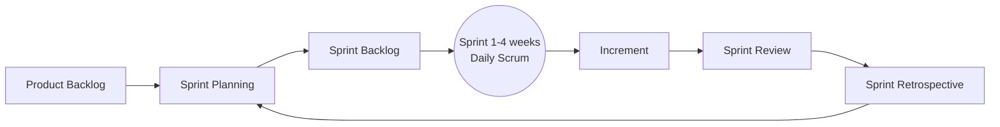
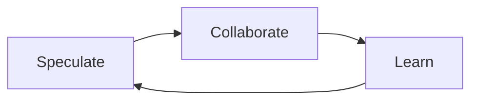

# Session 09: Scrum and Agile Process Models I: ASD, DSDM and Crystal

> Module: Agile and DevOps · Term 5 (ADSE) · ⏱ ~2 hours

Scrum is the most widely used Agile framework. We also meet three other Agile models — ASD, DSDM and Crystal — to see that Agile comes in many flavours.

## 🎯 Learning Objectives

By the end of this session you will be able to:

- Explain Scrum's values, principles and rules
- Describe the Scrum life cycle and its five events
- Describe the three Scrum accountabilities and three artifacts
- Explain the ASD model and its Speculate–Collaborate–Learn cycle
- Explain DSDM principles, MoSCoW prioritisation and roles
- Describe the Crystal family and its core properties

## 📖 Concepts Explained

### 1. Scrum in one picture



### 2. Scrum values

**Commitment, Focus, Openness, Respect, Courage.** Scrum is built on **empiricism** — three pillars: *transparency*, *inspection*, *adaptation*.

### 3. Scrum accountabilities (roles)

| Role | Responsible for |
|------|-----------------|
| Product Owner | Maximising product value; owns and orders the Product Backlog |
| Scrum Master | Team effectiveness; coaches Scrum, removes impediments |
| Developers | Building a usable increment each sprint (includes testers, designers) |

A Scrum team is usually **10 or fewer** people.

### 4. Scrum events (all time-boxed)

| Event | Time-box (1-month sprint) | Purpose |
|-------|---------------------------|---------|
| Sprint | ≤ 1 month | Container for all other events |
| Sprint Planning | ≤ 8 hours | Why (sprint goal), what (items), how (plan) |
| Daily Scrum | 15 minutes | Inspect progress toward the sprint goal; adapt the plan |
| Sprint Review | ≤ 4 hours | Show the increment to stakeholders; update backlog |
| Sprint Retrospective | ≤ 3 hours | Improve how the team works |

### 5. Scrum artifacts and commitments

| Artifact | Commitment |
|----------|------------|
| Product Backlog | Product Goal |
| Sprint Backlog | Sprint Goal |
| Increment | Definition of Done |

### 6. Advantages of Scrum

Clear roles and rhythm · fast feedback · high visibility · easy to start · continuous improvement through retrospectives.

---

### 7. Adaptive Software Development (ASD)

Created by Jim Highsmith; designed for **complex, fast-changing** projects. It replaces "plan–build–review" with:



| Phase | Meaning |
|-------|---------|
| Speculate | Plan loosely, accept that the plan may be wrong; define mission and release cycles |
| Collaborate | Teams and customers work closely; diverse skills combine |
| Learn | Focus groups, technical reviews and post-mortems turn mistakes into knowledge |

### 8. Dynamic Systems Development Method (DSDM)

A business-focused Agile framework that **fixes time and cost, and flexes features**.

**Eight principles:** focus on the business need · deliver on time · collaborate · never compromise quality · build incrementally from firm foundations · develop iteratively · communicate continuously and clearly · demonstrate control.

**Key techniques:** time-boxing, **MoSCoW** prioritisation, facilitated workshops, prototyping, modelling.

| MoSCoW | Meaning | Typical share |
|--------|---------|---------------|
| **M**ust have | Without it the release fails | ≈ 60% of effort |
| **S**hould have | Important but there is a workaround | ≈ 20% |
| **C**ould have | Nice to have | ≈ 20% (contingency) |
| **W**on't have (this time) | Agreed to leave out | 0% |

**Roles:** Business Sponsor, Business Visionary, Project Manager, Technical Coordinator, Team Leader, Business Ambassador, Solution Developer, Solution Tester, Business Analyst, DSDM Coach, Workshop Facilitator.

### 9. Crystal methods

Developed by Alistair Cockburn. Crystal is a **family** of methods coloured by team size and criticality: *Clear* (1–8 people), *Yellow* (10–20), *Orange* (20–50), *Red* (50–100)…

**Core properties:** frequent delivery · reflective improvement · osmotic communication (team in one room) · personal safety · focus · easy access to expert users · technical environment with automated tests, configuration management and frequent integration.

Crystal believes **people and communication** matter more than process.

## 💻 Code Examples

### Example 1: Sprint planning template

📄 File: [`sprint-planning-template.md`](./sprint-planning-template.md)

```markdown
# Sprint Planning – Sprint __

**Sprint dates:** ____ to ____      **Capacity:** __ developer-days      **Last velocity:** __ pts

## Sprint Goal
> One sentence describing the value this sprint delivers.

## Selected Product Backlog Items
| ID | Story | Points | Owner |
|----|-------|--------|-------|
| | | | |

## Tasks (how)
| Story ID | Task | Est. hours |
|----------|------|-----------|

## Risks / dependencies
-

## Daily Scrum questions
1. What did I do yesterday toward the Sprint Goal?
2. What will I do today?
3. Is anything blocking me?
```

**How it works**

- Starts with the **Sprint Goal** (the *why*), then items (*what*), then tasks (*how*) — mirroring Scrum's three planning topics.
- Capacity and last velocity prevent over-commitment.

### Example 2: MoSCoW planner for a time-box

📄 File: [`moscow.py`](./moscow.py)

```python
"""MoSCoW prioritisation helper for a fixed time-box (DSDM style).
Run: python moscow.py
"""
CAPACITY_DAYS = 20                     # what the team can deliver in this time-box

features = [
    ("Student login", "M", 3),
    ("View results", "M", 4),
    ("Download transcript PDF", "S", 3),
    ("Fee payment online", "M", 5),
    ("Dark mode", "C", 2),
    ("Chat with advisor", "W", 6),
    ("Push notifications", "S", 3),
    ("Profile photo upload", "C", 1),
]

order = {"M": 0, "S": 1, "C": 2, "W": 3}
plan, used = [], 0
for name, prio, days in sorted(features, key=lambda f: order[f[1]]):
    if prio == "W":
        continue                                   # agreed: not this time
    if used + days <= CAPACITY_DAYS:
        plan.append((name, prio, days))
        used += days

must = sum(d for _, p, d in features if p == "M")
print(f"Must-have effort: {must} of {CAPACITY_DAYS} days ({must / CAPACITY_DAYS:.0%})")
for name, prio, days in plan:
    print(f"  [{prio}] {name:<25} {days} d")
print(f"Planned {used}/{CAPACITY_DAYS} days")
if must / CAPACITY_DAYS > 0.6:
    print("Warning: Musts exceed 60% of capacity - little contingency left.")
```

**Run it:**

```bash
python moscow.py
```

**How it works**

- Features are sorted Must → Should → Could; *Won't* items are skipped by agreement.
- Items are added while capacity remains — time is fixed, scope flexes (DSDM's core idea).
- The 60% warning reflects DSDM guidance that Musts should leave contingency.

## 🧪 Lab Practice

### Task 1: Scrum role-play

1. Form teams of 5: one Product Owner, one Scrum Master, three Developers.
2. PO writes 8 stories for a *Campus Events app* and orders them.
3. Run a 20-minute Sprint Planning using the template, then a 5-minute Daily Scrum.

### Task 2: MoSCoW your project

1. Edit `moscow.py` with features of your own app idea.
2. Set capacity to 15 days and see which Shoulds and Coulds survive.

### Task 3: ASD reflection

1. Pick a group project you completed. Write what you *speculated*, how you *collaborated* and what you *learned*.

### Task 4: Crystal fit

1. For team sizes 6, 18 and 45, state which Crystal colour applies and one practice you would emphasise.

## 📝 Assignment

Produce a **Scrum playbook** (2–3 pages) for a 6-person team building a *Food Donation app*: roles and who holds them, sprint length, schedule of all events for one sprint (with times),
Product Backlog of 10 items with MoSCoW tags, a Sprint Goal for Sprint 1, and the team's Definition of Done.

## ❓ Quick Quiz

**Q1. Which Scrum role orders the Product Backlog?**

- a) Scrum Master
- b) Developers
- c) Product Owner
- d) Stakeholders

<details><summary>Show answer</summary>

c) Product Owner

</details>

**Q2. The Daily Scrum is time-boxed to…**

- a) 5 minutes
- b) 15 minutes
- c) 1 hour
- d) No limit

<details><summary>Show answer</summary>

b) 15 minutes

</details>

**Q3. In DSDM, which is fixed?**

- a) Features
- b) Time and cost
- c) Team size only
- d) Nothing

<details><summary>Show answer</summary>

b) Time and cost

</details>

**Q4. What are ASD's three phases?**

<details><summary>Show answer</summary>

Speculate, Collaborate, Learn.

</details>

**Q5. What commitment belongs to the Increment?**

<details><summary>Show answer</summary>

The Definition of Done.

</details>

## 💼 Interview Questions

**1. Describe the Scrum events.**

<details><summary>Model answer</summary>

The Sprint contains Sprint Planning (goal and plan), Daily Scrum (15-minute inspection), Sprint Review (inspect the increment with stakeholders) and Sprint Retrospective (improve the process). All are time-boxed.

</details>

**2. What does a Scrum Master actually do?**

<details><summary>Model answer</summary>

Coaches the team and organisation in Scrum, facilitates events when needed, removes impediments, protects the team from interruptions and helps the Product Owner manage the backlog effectively. It is a servant-leadership role, not a project manager.

</details>

**3. Explain MoSCoW with an example.**

<details><summary>Model answer</summary>

For an exam-results portal: Must — login and view results; Should — download PDF; Could — dark mode; Won't (this release) — chat with advisor. Time is fixed, so lower priorities are dropped first if needed.

</details>

## ✅ Summary

- Scrum: 3 accountabilities, 5 events, 3 artifacts with commitments, built on empiricism.
- ASD replaces fixed plans with Speculate–Collaborate–Learn cycles.
- DSDM fixes time and cost and flexes scope using MoSCoW and time-boxing.
- Crystal is a people-centric family scaled by team size and criticality.

---

[⬅ Previous](../Session-08-Extreme-Programming/README.md) · [🏠 Module Home](../README.md) · [Next ➡](../Session-10-Agile-Process-Models-2-and-Comparison/README.md)

Prepared by Zeeshan Abbas · Aptech Learning North Nazimabad
