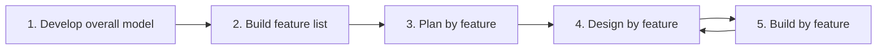

# Session 10: Agile Process Models II (FDD, Lean, AUP) and Comparing Agile with Traditional Models

> Module: Agile and DevOps · Term 5 (ADSE) · ⏱ ~2 hours

We complete our tour of Agile methods and then step back to compare all the models we have learned, so you can choose wisely in real projects.

## 🎯 Learning Objectives

By the end of this session you will be able to:

- Describe Feature-Driven Development (FDD), its practices and five processes
- Explain Lean Software Development principles and tools for removing waste
- Describe the philosophy, phases and principles of the Agile Unified Process (AUP)
- List parameters for selecting the right SDLC model
- Compare Agile with Waterfall and other models using a case study

## 📖 Concepts Explained

### 1. Feature-Driven Development (FDD)

FDD (Jeff De Luca, 1997) organises work around small, **client-valued features** written as `<action> the <result> <by|for|of|to> a(n) <object>` — e.g., *"Calculate the total of a sale"*.

**Five processes:**



**Practices:** domain object modelling · developing by feature · individual class ownership · feature teams · inspections · regular builds · configuration management · progress reporting.

### 2. Lean Software Development (LSD)

Adapted from Toyota's production system by Mary and Tom Poppendieck.

| Principle | Meaning |
|-----------|---------|
| Eliminate waste | Remove anything that doesn't add customer value |
| Amplify learning | Short cycles, experiments, feedback |
| Decide as late as possible | Keep options open until facts arrive |
| Deliver as fast as possible | Small batches, quick flow |
| Empower the team | People closest to the work decide |
| Build integrity in | Quality from the start (tests, refactoring) |
| Optimise the whole | Improve the entire value stream, not one step |

**The seven wastes of software:** partially done work · extra features · relearning · hand-offs · task switching · delays · defects.

**Lean tools:** value stream mapping, Kanban, pull systems, queuing theory (limit WIP), set-based development, root-cause analysis (5 Whys).

### 3. Agile Unified Process (AUP)

AUP (Scott Ambler) is a simplified, Agile version of the Rational Unified Process (RUP).

**Philosophies:** your staff know what they are doing · simplicity · agility · focus on high-value activities · tool independence · tailor it to your needs.

| Phase | Goal |
|-------|------|
| Inception | Agree scope, initial architecture, funding |
| Elaboration | Prove the architecture works |
| Construction | Build working software incrementally |
| Transition | Validate and deploy to production |

**Disciplines** run across phases: Model, Implementation, Test, Deployment, Configuration Management, Project Management, Environment.

**Strengths:** familiar to RUP shops, balanced structure, fits regulated environments. **Weaknesses:** heavier than Scrum, needs tailoring skills, less popular today.

### 4. Choosing the right SDLC model – parameters

| Parameter | Questions to ask |
|-----------|------------------|
| Requirements | Clear? Stable? |
| Project size & complexity | Small/large? Many integrations? |
| Risk | Technical/business uncertainty? |
| Customer involvement | Available weekly? |
| Team | Experienced? Co-located? |
| Time-to-market | Must something ship quickly? |
| Regulation | Audit trail needed? |
| Budget model | Fixed price or time & materials? |

### 5. Agile vs. Waterfall – head to head

| Criteria | Waterfall | Agile |
|----------|-----------|-------|
| Requirements | Fixed early | Evolving |
| Delivery | One big release | Frequent increments |
| Risk discovery | Late | Early |
| Customer feedback | Start & end | Every iteration |
| Cost of change | High | Low |
| Documentation | Heavy | Just enough |
| Best for | Stable, regulated work | Uncertain, competitive markets |

### 6. Case study: two teams, one project

Two teams build a *hospital appointment system*.
- **Team W (Waterfall)** spends 2 months on an SRS, 4 months coding, 2 months testing. At go-live, doctors ask for WhatsApp reminders — a change request costs 6 more weeks.
- **Team A (Agile)** ships booking in sprint 3, gets doctor feedback, adds WhatsApp reminders in sprint 5 and goes live in 5 months with fewer features but higher satisfaction.

**Lesson:** when needs are uncertain, short feedback loops win; when everything is truly fixed and audited, Waterfall's predictability can still be valuable.

### 7. Feature comparison of all models

| Model | Flexibility | Risk handling | Customer involvement | Documentation | Speed |
|-------|------------|---------------|----------------------|---------------|-------|
| Waterfall | Low | Low | Low | High | Slow |
| V-Model | Low | Medium | Low | High | Slow |
| Prototype | High | Medium | High | Low | Medium |
| Incremental | Medium | Medium | Medium | Medium | Medium |
| Spiral | High | High | High | High | Slow |
| RAD | High | Low | High | Low | Fast |
| Scrum/XP | High | High | High | Low–Med | Fast |

## 💻 Code Examples

### Example 1: Value stream map (Lean)

📄 File: [`value-stream-map.md`](./value-stream-map.md)

```markdown
# Value Stream Map – "Bug fix reaches users"

| Step | Work time | Wait time after step |
|------|-----------|----------------------|
| Bug reported in email | 5 min | 2 days (unread inbox) |
| Bug triaged | 15 min | 3 days (waiting for sprint) |
| Developer fixes | 2 h | 1 day (waiting for review) |
| Code review | 20 min | 2 days (waiting for QA) |
| QA test | 1 h | 4 days (waiting for release window) |
| Release | 30 min | — |

**Total work time:** ≈ 4.2 hours  **Total lead time:** ≈ 12 days
**Flow efficiency** = work / lead ≈ 1.5% → most time is *waiting* (waste!).

Improvement ideas: bug-tracker form instead of email, daily triage, WIP limits, automated tests, continuous delivery.
```

**How it works**

- Lists each step with its **work time** and the **waiting time** after it.
- Flow efficiency of ~1.5% shows that waiting, not working, is the main waste — the typical Lean insight.

### Example 2: Model recommender

📄 File: [`model_selector.py`](./model_selector.py)

```python
"""Score-based SDLC model recommender.
Run: python model_selector.py
"""
QUESTIONS = {
    "clear_requirements": "Requirements are clear and stable (0-5): ",
    "regulated": "Heavy regulation / audit needed (0-5): ",
    "risk": "Technical or business risk (0-5): ",
    "customer_time": "Customer available every week (0-5): ",
    "speed": "Need to release something fast (0-5): ",
}


def recommend(a: dict) -> str:
    scores = {
        "Waterfall / V-Model": a["clear_requirements"] + a["regulated"] - a["risk"],
        "Spiral": a["risk"] * 2 + a["regulated"] - a["speed"],
        "Scrum / XP": a["customer_time"] + a["speed"] + a["risk"] - a["clear_requirements"],
        "RAD": a["speed"] * 2 + a["customer_time"] - a["regulated"] - a["risk"],
    }
    for model, s in sorted(scores.items(), key=lambda kv: -kv[1]):
        print(f"{model:<22} score {s:>3}")
    return max(scores, key=scores.get)


if __name__ == "__main__":
    demo = {"clear_requirements": 1, "regulated": 1, "risk": 4, "customer_time": 4, "speed": 5}
    print("Demo project (startup app):")
    print("Recommended ->", recommend(demo))
```

**Run it:**

```bash
python model_selector.py
```

**How it works**

- Each model gets a score from weighted answers; for example high risk pushes Spiral and Scrum up.
- The weights are a teaching simplification — real decisions also consider team skills and contracts.
- Change the `demo` dictionary to test your own projects.

## 🧪 Lab Practice

### Task 1: Feature list

1. Write 10 FDD-style features for an *Online Pharmacy* ("Calculate the total of an order", …).
2. Group them into 3 feature sets.

### Task 2: Find the waste

1. Draw a value stream map for how your class submits and receives assignment marks.
2. Calculate flow efficiency and identify two of the seven wastes.

### Task 3: AUP phase plan

1. For a *School ERP*, write one goal and one deliverable for each AUP phase.

### Task 4: Pick the model

1. Run `model_selector.py` for three different projects by editing `demo`.
2. Do you agree with the result? Write one line for each.

## 📝 Assignment

Write a **comparative report** (2 pages) choosing an SDLC model for *two* projects: (1) a tax-filing system for a government department and (2) a social learning app for students.
Use the selection parameters table, compare at least four models, and justify your final choice for each.

## ❓ Quick Quiz

**Q1. Which method organises work around client-valued features and class ownership?**

- a) Lean
- b) FDD
- c) AUP
- d) Crystal

<details><summary>Show answer</summary>

b) FDD

</details>

**Q2. Which is NOT one of the seven wastes of software?**

- a) Hand-offs
- b) Task switching
- c) Refactoring
- d) Partially done work

<details><summary>Show answer</summary>

c) Refactoring

</details>

**Q3. The four AUP phases are…**

<details><summary>Show answer</summary>

Inception, Elaboration, Construction, Transition.

</details>

**Q4. Lean says decisions should be made…**

- a) As early as possible
- b) As late as responsibly possible
- c) Only by managers
- d) At project start

<details><summary>Show answer</summary>

b) As late as responsibly possible

</details>

**Q5. Give two parameters for choosing an SDLC model.**

<details><summary>Show answer</summary>

Any two: requirement clarity, size/complexity, risk, customer involvement, team experience, time-to-market, regulation, budget model.

</details>

## 💼 Interview Questions

**1. What is the main idea of Lean software development?**

<details><summary>Model answer</summary>

Deliver customer value quickly by eliminating waste (waiting, hand-offs, defects, unused features), keeping work small, limiting WIP and continuously improving the whole value stream.

</details>

**2. How is AUP different from Scrum?**

<details><summary>Model answer</summary>

AUP keeps RUP's four phases and named disciplines, giving more structure and documentation; Scrum has no phases, just repeated sprints with minimal prescribed artifacts.

</details>

**3. Can a project mix models?**

<details><summary>Model answer</summary>

Yes. Many organisations run hybrid approaches — e.g., a Waterfall-style contract and phase gates with Scrum sprints inside the construction phase, or Kanban for maintenance and Scrum for new features.

</details>

## ✅ Summary

- FDD builds software feature by feature through five processes.
- Lean removes waste and optimises flow across the whole value stream.
- AUP is a lightweight RUP with four phases and seven disciplines.
- Choose models using requirement clarity, risk, size, customer availability, regulation and speed.
- Agile wins under uncertainty; linear models suit stable, regulated work; hybrids are common.

---

[⬅ Previous](../Session-09-Scrum-and-Agile-Process-Models-1/README.md) · [🏠 Module Home](../README.md) · [Next ➡](../Session-11-DevOps-Configuration-Management-and-CI-CD/README.md)

Prepared by Zeeshan Abbas · Aptech Learning North Nazimabad
