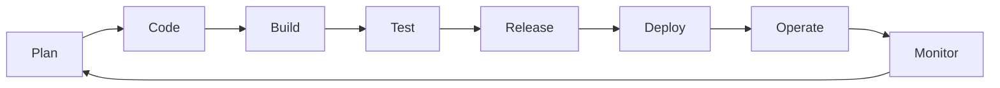

# Session 11: Introduction to DevOps, Configuration Management and CI/CD

> Module: Agile and DevOps · Term 5 (ADSE) · ⏱ ~2 hours

Agile made development fast. But if operations can only deploy once a quarter, users still wait. **DevOps** closes that gap.

## 🎯 Learning Objectives

By the end of this session you will be able to:

- Define DevOps and explain its values (CALMS) and why organisations adopt it
- Describe DevOps challenges and common patterns, and relate DevOps to Agile and Lean
- Explain configuration management, source version control, release and artifact management
- Explain continuous integration: developer duties, CI systems and benefits
- Explain continuous delivery, its golden rules and the role of continuous testing

## 📖 Concepts Explained

### 1. What is DevOps?

**DevOps** is a culture and set of practices that brings **Dev**elopment and **Op**eration**s** together to deliver software **faster, more reliably and more often**.



### 2. DevOps values – CALMS

| Letter | Value | Example |
|--------|-------|---------|
| C | Culture | Shared responsibility; "you build it, you run it" |
| A | Automation | Builds, tests and deployments run automatically |
| L | Lean | Small batches, remove waste |
| M | Measurement | Track deployment frequency, lead time, failure rate, recovery time |
| S | Sharing | Shared tools, knowledge and blameless post-mortems |

### 3. Why DevOps?

- Faster time to market (deploy daily instead of quarterly).
- Fewer failed releases thanks to small, automated changes.
- Faster recovery when things break.
- Happier teams — less "throw it over the wall".

**DORA metrics** measure DevOps performance: deployment frequency · lead time for changes · change failure rate · time to restore service.

### 4. Challenges and patterns

| Challenge | Pattern that helps |
|-----------|-------------------|
| Silos between dev and ops | Cross-functional teams, shared on-call |
| Manual, error-prone deployments | Pipelines, Infrastructure as Code |
| "Works on my machine" | Containers (Docker), identical environments |
| Fear of release | Feature flags, blue-green and canary releases |
| Legacy systems | Strangler pattern — replace piece by piece |

### 5. Agile, Lean and DevOps

Agile shortens the **development** loop; Lean removes **waste** in the flow; DevOps extends both to **delivery and operations**, so the whole loop from idea to user is short.

### 6. Configuration management (CM)

**Configuration management** keeps track of every item that makes up the system — code, configs, libraries, infrastructure — and controls how they change.

| Area | Purpose | Tools |
|------|---------|-------|
| Source code version control | History, branching, collaboration | Git, GitHub, GitLab, Subversion |
| Release management | Plan, schedule and control releases; semantic versioning `MAJOR.MINOR.PATCH` | GitHub Releases, Jira |
| Artifact management | Store built outputs (jars, APKs, Docker images) with versions | Nexus, JFrog Artifactory, GitHub Packages, Docker Hub |
| Infrastructure/config | Servers configured from code | Ansible, Puppet, Chef, Terraform |

**Why version control matters:** every change is traceable (who, what, why), you can roll back, and many developers can work in parallel through branches and pull requests.

### 7. Continuous Integration (CI)

**CI** = every developer merges small changes into the shared main branch **at least daily**; each merge triggers an **automatic build and test**.

**What developers must do:**
1. Pull latest main often; keep branches short-lived.
2. Write automated tests with every change.
3. Run tests locally before pushing.
4. Never leave the build broken — fixing a red build is priority #1.

**A CI system** (GitHub Actions, Jenkins, GitLab CI, Azure Pipelines) watches the repository, runs the build/test steps and reports results.

**Benefits:** integration problems found within minutes · always-releasable main branch · fewer merge conflicts · confidence to refactor.

### 8. Continuous Delivery (CD) and continuous testing

**Continuous Delivery** means every change that passes the pipeline is **ready to release at the push of a button**.

**Golden rules (our summary):**
1. Build once, deploy the same artifact everywhere.
2. Automate everything that is repeated.
3. Keep everything in version control (code, config, scripts).
4. If it hurts, do it more often (and automate it).
5. Done means *released*, not just coded.
6. Everyone is responsible for the delivery process.

**Continuous testing** runs unit, integration, security and performance tests automatically at each pipeline stage, giving fast feedback on business risk.

**Why CD is not enough:** a release button still needs a human; monitoring and fast feedback from production are still required. That leads to **Continuous Deployment** and **Continuous Monitoring** (next session).

## 💻 Code Examples

### Example 1: Code under test

📄 File: [`app.py`](./app.py)

```python
"""Tiny module used to demonstrate a CI pipeline."""


def grade(marks: int) -> str:
    if not 0 <= marks <= 100:
        raise ValueError("marks must be 0-100")
    if marks >= 80:
        return "A"
    if marks >= 70:
        return "B"
    if marks >= 60:
        return "C"
    if marks >= 50:
        return "D"
    return "F"
```

**How it works**

- A small pure function — easy to test and perfect for demonstrating CI.

### Example 2: Automated tests

📄 File: [`test_app.py`](./test_app.py)

```python
"""Run: python -m unittest -v"""
import unittest
from app import grade


class GradeTests(unittest.TestCase):
    def test_boundaries(self):
        self.assertEqual(grade(80), "A")
        self.assertEqual(grade(79), "B")
        self.assertEqual(grade(50), "D")
        self.assertEqual(grade(49), "F")

    def test_invalid(self):
        with self.assertRaises(ValueError):
            grade(101)


if __name__ == "__main__":
    unittest.main()
```

**Run it:**

```bash
python -m unittest -v
```

**How it works**

- Boundary tests (80/79, 50/49) catch the most common off-by-one mistakes.
- These are the tests the CI server runs on every push.

### Example 3: GitHub Actions CI workflow

📄 File: [`ci.yml`](./ci.yml)

```yaml
# Save in your repository as .github/workflows/ci.yml
name: CI

on:
  push:
    branches: [ main ]
  pull_request:
    branches: [ main ]

jobs:
  test:
    runs-on: ubuntu-latest
    strategy:
      matrix:
        python-version: ["3.11", "3.12"]
    steps:
      - name: Check out code
        uses: actions/checkout@v4

      - name: Set up Python ${{ matrix.python-version }}
        uses: actions/setup-python@v5
        with:
          python-version: ${{ matrix.python-version }}

      - name: Run unit tests
        run: python -m unittest -v
```

**How it works**

- **`on`** triggers the workflow on pushes and pull requests to `main`.
- **`matrix`** runs the same job on two Python versions in parallel.
- Steps check out code, install Python and run the tests; a failing test makes the pull request show a red ❌, blocking a bad merge.
- To use it, place the file at `.github/workflows/ci.yml` in a GitHub repository together with `app.py` and `test_app.py`.

### Example 4: Release checklist

📄 File: [`release-checklist.md`](./release-checklist.md)

```markdown
# Release Checklist (Semantic Versioning)

Version: v__.__.__  (MAJOR = breaking change, MINOR = new feature, PATCH = bug fix)

- [ ] All CI checks green on `main`
- [ ] CHANGELOG updated (Added / Changed / Fixed)
- [ ] Version number bumped in code / pubspec / package files
- [ ] Git tag created: `git tag -a v1.4.0 -m "Release 1.4.0"` and pushed
- [ ] Artifact built once and uploaded to the artifact repository
- [ ] Same artifact deployed to staging and smoke-tested
- [ ] Rollback plan written
- [ ] Release notes shared with users/support
```

**How it works**

- Encodes release management and the golden rule *build once, deploy everywhere*.
- Semantic versioning tells users at a glance whether an update may break them.

## 🧪 Lab Practice

### Task 1: Version control basics

1. Create a new GitHub repository `ci-demo` and clone it.
2. Add `app.py` and `test_app.py`, commit with a meaningful message and push.
3. Create a branch `feature/grade-a-plus`, add an `A+` grade for ≥ 90 and open a pull request.

### Task 2: Your first CI pipeline

1. Add `ci.yml` at `.github/workflows/ci.yml` and push.
2. Open the **Actions** tab and watch the run succeed.
3. Deliberately break a test, push, and observe the red build; then fix it.

### Task 3: Release it

1. Follow `release-checklist.md` to create tag `v1.0.0` and a GitHub Release with notes.

### Task 4: CALMS self-assessment

1. Rate your class project on each CALMS value (1–5) and propose one improvement per value.

## 📝 Assignment

Create a public GitHub repository containing a small Python or Dart project with **at least 6 unit tests** and a **working GitHub Actions CI workflow**. Protect the `main` branch so pull requests need a passing check.
Submit the repo link, a screenshot of a failed and a passed run, and a short README explaining your branching strategy and versioning plan.

## ❓ Quick Quiz

**Q1. What does the 'A' in CALMS stand for?**

- a) Agility
- b) Automation
- c) Architecture
- d) Availability

<details><summary>Show answer</summary>

b) Automation

</details>

**Q2. In CI, developers should integrate into main…**

- a) Once per release
- b) At least daily
- c) Only after testing manually
- d) Monthly

<details><summary>Show answer</summary>

b) At least daily

</details>

**Q3. Storing built APKs and Docker images with versions is called…**

- a) Release management
- b) Artifact management
- c) Source control
- d) Monitoring

<details><summary>Show answer</summary>

b) Artifact management

</details>

**Q4. What is the difference between continuous delivery and continuous deployment?**

<details><summary>Show answer</summary>

Continuous delivery keeps every change *ready* to release with a manual approval step; continuous deployment releases every passing change to production automatically.

</details>

**Q5. Name the four DORA metrics.**

<details><summary>Show answer</summary>

Deployment frequency, lead time for changes, change failure rate, time to restore service.

</details>

## 💼 Interview Questions

**1. What is DevOps in your own words?**

<details><summary>Model answer</summary>

A culture plus automation that makes development and operations share responsibility for delivering software, using small changes, automated pipelines, measurement and feedback to release quickly and safely.

</details>

**2. What happens in a CI pipeline when a developer pushes code?**

<details><summary>Model answer</summary>

The CI server detects the push, checks out the code, installs dependencies, builds it, runs automated tests (and often linters/security scans), and reports pass/fail on the commit or pull request. A failure blocks merging until fixed.

</details>

**3. Why 'build once, deploy everywhere'?**

<details><summary>Model answer</summary>

Rebuilding for each environment can produce different binaries. Promoting the same tested artifact through test, staging and production guarantees that what you tested is what users get.

</details>

## ✅ Summary

- DevOps unites development and operations through culture, automation, lean flow, measurement and sharing (CALMS).
- Configuration management covers version control, release management and artifact management.
- CI merges small changes often and verifies each with an automatic build and test.
- Continuous delivery keeps software always releasable; continuous testing provides fast feedback.
- GitHub Actions lets you build a real CI pipeline with a single YAML file.

---

[⬅ Previous](../Session-10-Agile-Process-Models-2-and-Comparison/README.md) · [🏠 Module Home](../README.md) · [Next ➡](../Session-12-Continuous-Deployment-Monitoring-and-DevOps-Tools/README.md)

Prepared by Zeeshan Abbas · Aptech Learning North Nazimabad
