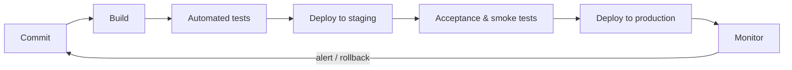

# Session 12: Continuous Deployment, Monitoring and DevOps Tools

> Module: Agile and DevOps · Term 5 (ADSE) · ⏱ ~2 hours

In the final session we complete the DevOps loop: deploying automatically, watching production, and building a full pipeline with industry tools.

## 🎯 Learning Objectives

By the end of this session you will be able to:

- Explain continuous deployment and its benefits
- Explain how virtualization, containers and cloud enable automation
- Compare traditional monitoring with continuous monitoring and name monitoring tools
- Classify DevOps tools by category and describe a DevOps pipeline
- Read and write a basic Jenkins pipeline and Dockerfile; recognise Subversion, Ant, Puppet and Chef

## 📖 Concepts Explained

### 1. Continuous deployment

Every change that passes all automated stages is **released to production automatically** — no manual approval.



**Benefits:** fastest feedback from real users · tiny, low-risk releases · no "release day" stress · developers see impact quickly.
**Pre-requisites:** strong automated tests, feature flags, monitoring and automatic rollback.

**Safe release strategies**

| Strategy | Idea |
|----------|------|
| Blue-green | Two identical environments; switch traffic from blue to green instantly |
| Canary | Release to 5% of users first, watch metrics, then expand |
| Rolling | Update servers one by one |
| Feature flags | Code is deployed but the feature is switched on later |

### 2. Automation with virtualization and cloud

| Technology | What it gives DevOps |
|------------|---------------------|
| Virtual machines | Create full servers on demand from templates |
| Containers (Docker) | Package app + dependencies; runs the same everywhere |
| Orchestration (Kubernetes) | Run, scale and heal many containers |
| Cloud (AWS, Azure, GCP) | Pay-as-you-go infrastructure through APIs |
| Infrastructure as Code (Terraform) | Servers and networks defined in version-controlled files |

### 3. Continuous monitoring

| Traditional monitoring | Continuous monitoring |
|------------------------|----------------------|
| Periodic manual checks | Automated, real-time collection |
| Mainly infrastructure (CPU, disk) | Infrastructure + application + user experience + security |
| Reacts after users complain | Alerts before users notice |
| Separate ops team | Shared dashboards for dev and ops |

**What to monitor — the "golden signals":** latency · traffic · errors · saturation.

**Tools:** Prometheus + Grafana (metrics & dashboards), ELK/Elastic Stack (logs), Nagios/Zabbix (infrastructure), Datadog/New Relic (APM), Sentry/Firebase Crashlytics (app errors).

### 4. DevOps tool categories

| Category | Examples |
|----------|----------|
| Plan | Jira, Azure Boards, GitHub Projects |
| Source control | Git/GitHub, GitLab, Subversion (SVN) |
| Build | Maven, Gradle, Apache Ant, npm, `flutter build` |
| CI/CD | Jenkins, GitHub Actions, GitLab CI, Azure Pipelines |
| Test | JUnit, pytest, Selenium, `flutter test` |
| Artifact repo | Nexus, Artifactory, Docker Hub |
| Configuration / IaC | Puppet, Chef, Ansible, Terraform |
| Containers | Docker, Kubernetes |
| Monitor | Prometheus, Grafana, ELK, Nagios |

### 5. A DevOps pipeline with classic tools

| Stage | Classic tool | Role |
|-------|-------------|------|
| Version control | **Subversion** (centralised) or Git | Stores code; commit triggers pipeline |
| Build | **Apache Ant** (XML build scripts for Java) | Compiles and packages |
| Orchestration | **Jenkins** | Runs stages, shows results |
| Configuration | **Puppet** (declarative manifests) / **Chef** (Ruby "recipes" in "cookbooks") | Brings servers to the desired state |

Modern equivalents follow the same flow: Git → Gradle/npm → GitHub Actions/Jenkins → Docker → Ansible/Kubernetes.

### 6. Why tools and automation matter

Humans are slow and inconsistent at repetitive tasks; scripts are fast and identical every time. Automation creates an **audit trail**, reduces errors and frees people for creative work.

## 💻 Code Examples

### Example 1: A small service with a health endpoint

📄 File: [`server.py`](./server.py)

```python
"""Minimal HTTP service with a /health endpoint for monitoring.
Uses only the standard library. Run: python server.py  then open http://localhost:8000/grade?marks=72
"""
import json
from http.server import BaseHTTPRequestHandler, HTTPServer
from urllib.parse import urlparse, parse_qs

from app import grade


class Handler(BaseHTTPRequestHandler):
    def _send(self, status: int, body: dict) -> None:
        data = json.dumps(body).encode()
        self.send_response(status)
        self.send_header("Content-Type", "application/json")
        self.send_header("Content-Length", str(len(data)))
        self.end_headers()
        self.wfile.write(data)

    def do_GET(self):
        url = urlparse(self.path)
        if url.path == "/health":
            self._send(200, {"status": "ok"})
        elif url.path == "/grade":
            try:
                marks = int(parse_qs(url.query).get("marks", ["-1"])[0])
                self._send(200, {"marks": marks, "grade": grade(marks)})
            except ValueError as err:
                self._send(400, {"error": str(err)})
        else:
            self._send(404, {"error": "not found"})


if __name__ == "__main__":
    print("Serving on http://localhost:8000")
    HTTPServer(("0.0.0.0", 8000), Handler).serve_forever()
```

**Run it:**

```bash
python server.py
```

**How it works**

- `/health` returns `{"status": "ok"}` — monitoring tools and the pipeline's smoke test call it to check the service is alive.
- `/grade?marks=72` uses the tested `grade()` function from `app.py`; invalid input returns HTTP 400.
- Only the standard library is used, so the container stays small.

### Example 2: Dockerfile

📄 File: [`Dockerfile`](./Dockerfile)

```dockerfile
# Small, reproducible image for the grade service
FROM python:3.12-slim
WORKDIR /app
COPY server.py app.py ./
EXPOSE 8000
CMD ["python", "server.py"]
```

**Run it:**

```bash
docker build -t grade-service .
docker run -p 8000:8000 grade-service
```

**How it works**

- Starts from a slim official Python image, copies the two source files and starts the server.
- The resulting image runs identically on a laptop, a CI server or the cloud — ending "works on my machine".

### Example 3: Jenkins declarative pipeline

📄 File: [`Jenkinsfile`](./Jenkinsfile)

```groovy
// Declarative Jenkins pipeline for a Python web service
pipeline {
    agent any

    environment {
        IMAGE = "zeeshan/grade-service:${env.BUILD_NUMBER}"
    }

    stages {
        stage('Checkout') {
            steps { checkout scm }
        }
        stage('Test') {
            steps { sh 'python3 -m unittest -v' }
        }
        stage('Build image') {
            steps { sh "docker build -t ${IMAGE} ." }
        }
        stage('Deploy to staging') {
            steps { sh "docker rm -f grade-staging || true && docker run -d --name grade-staging -p 8081:8000 ${IMAGE}" }
        }
        stage('Smoke test') {
            steps { sh 'sleep 3 && curl -fsS http://localhost:8081/health' }
        }
        stage('Deploy to production') {
            when { branch 'main' }
            steps { sh "docker rm -f grade-prod || true && docker run -d --name grade-prod -p 8000:8000 ${IMAGE}" }
        }
    }

    post {
        failure { echo 'Pipeline failed - check the stage logs above.' }
        success { echo "Deployed ${IMAGE}" }
    }
}
```

**How it works**

- Stages run in order: test → build image → deploy to staging → smoke test → deploy to production.
- `when { branch 'main' }` means only the main branch reaches production — feature branches stop at staging.
- `post` blocks report success or failure; Jenkins shows each stage as a green/red box.

### Example 4: Puppet manifest (configuration management)

📄 File: [`puppet-example.pp`](./puppet-example.pp)

```puppet
# Puppet manifest: make sure a web server is installed and running (declarative)
package { 'nginx':
  ensure => installed,
}

service { 'nginx':
  ensure  => running,
  enable  => true,
  require => Package['nginx'],
}

file { '/var/www/html/index.html':
  ensure  => file,
  content => "<h1>Deployed by Puppet</h1>",
  require => Package['nginx'],
}
```

**How it works**

- Declarative: you describe the **desired state** (nginx installed, running, page present) and Puppet makes it so on every run.
- `require` defines ordering; running it twice changes nothing (idempotent). Chef expresses the same idea in Ruby recipes.

## 🧪 Lab Practice

### Task 1: Run the service locally

1. In this folder run `python -m unittest -v` then `python server.py`.
2. Open `http://localhost:8000/health` and `http://localhost:8000/grade?marks=88` in your browser.
3. Try `marks=150` and observe the 400 error.

### Task 2: Containerise it

1. Install Docker Desktop, then run `docker build -t grade-service .`.
2. Run `docker run -p 8000:8000 grade-service` and test the URLs again.

### Task 3: Pipeline on paper (or in Jenkins)

1. Draw the pipeline stages from the `Jenkinsfile` as a flowchart.
2. Optional: run Jenkins with `docker run -p 8080:8080 jenkins/jenkins:lts`, create a Pipeline job pointing at your repo.

### Task 4: Monitoring plan

1. For the grade service, write one metric for each golden signal (latency, traffic, errors, saturation) and an alert threshold.

## 📝 Assignment

Extend your Session 11 repository into a **mini DevOps project**: add `server.py` with a `/health` endpoint, a `Dockerfile`, and a GitHub Actions workflow that runs tests and then builds the Docker image.
Write a README section "Release & Monitoring" describing your deployment strategy (blue-green, canary or rolling), which metrics you would monitor and how you would roll back.

## ❓ Quick Quiz

**Q1. Which release strategy sends a new version to a small % of users first?**

- a) Blue-green
- b) Canary
- c) Rolling
- d) Big bang

<details><summary>Show answer</summary>

b) Canary

</details>

**Q2. Puppet is mainly a ___ tool.**

- a) Monitoring
- b) Configuration management
- c) Build
- d) Planning

<details><summary>Show answer</summary>

b) Configuration management

</details>

**Q3. Apache Ant is used for…**

- a) Building Java projects
- b) Monitoring logs
- c) Container orchestration
- d) Issue tracking

<details><summary>Show answer</summary>

a) Building Java projects

</details>

**Q4. Name the four golden signals of monitoring.**

<details><summary>Show answer</summary>

Latency, traffic, errors, saturation.

</details>

**Q5. Why does a pipeline include a smoke test after deployment?**

<details><summary>Show answer</summary>

To quickly confirm the deployed service is up and basic functions work before continuing (or to trigger a rollback).

</details>

## 💼 Interview Questions

**1. What do you need in place before adopting continuous deployment?**

<details><summary>Model answer</summary>

Reliable automated tests at multiple levels, fast pipelines, feature flags, production monitoring with alerts, and automatic or one-click rollback — plus a team culture that fixes broken builds immediately.

</details>

**2. Explain containers vs. virtual machines.**

<details><summary>Model answer</summary>

A VM virtualises hardware and runs a full guest OS; a container shares the host OS kernel and packages only the app and its dependencies, so it starts in seconds and uses far fewer resources.

</details>

**3. Describe a DevOps pipeline you would build for a Flutter app.**

<details><summary>Model answer</summary>

Git push → GitHub Actions runs `flutter analyze` and `flutter test` → builds APK/IPA and web bundle → uploads artifacts → deploys the web build to hosting and the APK to an internal testing track → Crashlytics and analytics monitor real usage.

</details>

## ✅ Summary

- Continuous deployment releases every passing change automatically, using safe strategies like canary and blue-green.
- Virtualization, containers, cloud and IaC make environments reproducible and automatable.
- Continuous monitoring watches latency, traffic, errors and saturation in real time.
- DevOps tools span plan, code, build, CI/CD, test, artifacts, configuration, containers and monitoring.
- A pipeline (e.g., SVN/Git → Ant/Gradle → Jenkins → Puppet/Chef/Docker) automates the path from commit to production.

---

[⬅ Previous](../Session-11-DevOps-Configuration-Management-and-CI-CD/README.md) · [🏠 Module Home](../README.md) · [Next Module ➡](../../02-Dart-Programming/README.md)

Prepared by Zeeshan Abbas · Aptech Learning North Nazimabad
