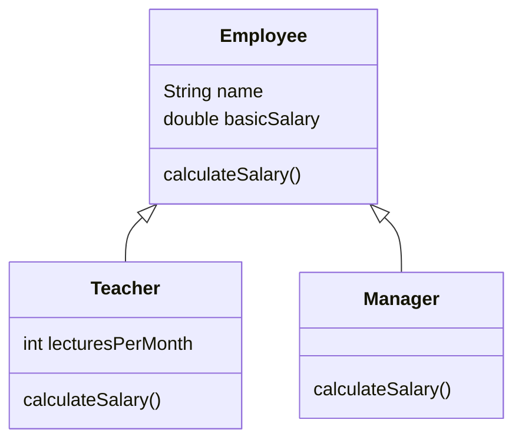

# Session 02: Object-Oriented Programming in Dart

> Module: Dart Programming · Term 5 (ADSE) · ⏱ ~2 hours

Everything in Dart is an object — even numbers and functions. Flutter apps are built from classes (every screen and button is a widget class), so a solid grip on OOP is essential before you start Flutter.

## 🎯 Learning Objectives

By the end of this session you will be able to:

- Explain classes and objects and create your own classes
- Write normal and named constructors, getters and setters
- Use inheritance, `super` and `@override` to reuse and change behaviour
- Apply polymorphism through a common parent type
- Use abstract classes, interfaces, mixins and static members

## 📖 Concepts Explained

### 1. Classes and objects

A **class** is a blueprint; an **object** is something built from it.

> **Analogy:** a house map drawn by an architect is the class. Each actual house built from that map in DHA or Gulshan is an object. All houses share the same design but have their own owner and paint colour.

| Term | Meaning | Example |
|------|---------|---------|
| Field / property | Data an object holds | `name`, `marks` |
| Method | Function inside a class | `introduce()` |
| Constructor | Special method that creates the object | `Student(this.name, ...)` |
| Instance | One object made from a class | `Student('Ayesha', ...)` |

### 2. Constructors

- **Generative constructor:** `Student(this.name, this.marks);` — `this.name` copies the argument straight into the field.
- **Named constructor:** `BankAccount.student(...)` — another clearly named way to create an object.
- **Initializer list:** the part after `:` that sets fields before the body runs, e.g. `: _balance = 500`.

### 3. Encapsulation with getters and setters

A name starting with `_` is **private to its file (library)**. We hide data and give controlled access:

- **Getter** `double get balance => _balance;` — read only.
- **Setter** `set dailyLimit(double value) { ... }` — can validate before saving.

### 4. Inheritance and polymorphism



- `extends` creates an **is-a** relationship: a Teacher *is an* Employee.
- `super` calls the parent's constructor or methods; `@override` marks a replaced method.
- **Polymorphism** = "many forms": a `List<Employee>` can hold Teachers and Managers, and each one runs its *own* version of `calculateSalary()`.

### 5. Abstract classes, interfaces and mixins

| Tool | Keyword | Use it when |
|------|---------|-------------|
| Abstract class | `abstract class` | You want a common base that must not be created directly and forces children to write certain methods |
| Interface | `implements` | A class promises to provide a set of members, writing all of them itself |
| Mixin | `mixin` / `with` | You want to share a *skill* (methods) across unrelated classes without inheritance |
| Static member | `static` | Data or a method belongs to the class as a whole, not each object |

Dart allows only **one** parent class (`extends`), but many interfaces and many mixins.

## 💻 Code Examples

### Example 1: Classes and objects

📄 File: [`classes_and_objects.dart`](./classes_and_objects.dart)

```dart
// classes_and_objects.dart
// A class is a blueprint. An object is a real thing made from that blueprint.

// The blueprint: every Student has a name, a roll number and marks.
class Student {
  // Fields (also called properties or instance variables).
  String name;
  String rollNumber;
  int marks;

  // A constructor that fills the fields. "this.name" is a shortcut.
  Student(this.name, this.rollNumber, this.marks);

  // A method: a function that belongs to the class.
  void introduce() {
    print('I am $name, roll number $rollNumber.');
  }

  // A method that returns a value.
  bool hasPassed() {
    return marks >= 50;
  }
}

void main() {
  // Create two objects (instances) from the same class.
  Student first = Student('Ayesha', 'STU-01', 82);
  Student second = Student('Usman', 'STU-02', 45);

  // Call methods using the dot (.) operator.
  first.introduce();
  print('Passed? ${first.hasPassed()}');

  second.introduce();
  print('Passed? ${second.hasPassed()}');

  // We can read and change fields of an object.
  second.marks = 55; // after re-sit exam
  print('${second.name} marks after re-sit: ${second.marks}');
  print('Passed now? ${second.hasPassed()}');
}
```

**How it works**

- Two objects share one blueprint but keep their own data.
- `second.marks = 55;` changes only that object.

### Example 2: Constructors, getters and setters

📄 File: [`constructors_getters_setters.dart`](./constructors_getters_setters.dart)

```dart
// constructors_getters_setters.dart
// Different constructors, plus getters and setters for safe data access.

class BankAccount {
  // final: the owner never changes after the account is created.
  final String owner;

  // The underscore (_) makes the field private to this file.
  double _balance;

  // 1. Normal constructor with a named, optional parameter.
  BankAccount(this.owner, {double openingBalance = 0}) : _balance = openingBalance;

  // 2. Named constructor: another way to create an object.
  BankAccount.student(this.owner) : _balance = 500; // bonus for students

  // Getter: read-only access to the private balance.
  double get balance => _balance;

  // A computed getter: calculated every time it is read.
  bool get isEmpty => _balance == 0;

  // Setter with a check, so nobody can set a negative limit.
  double _dailyLimit = 20000;
  double get dailyLimit => _dailyLimit;
  set dailyLimit(double value) {
    if (value < 0) {
      print('Limit cannot be negative. Keeping $_dailyLimit');
      return;
    }
    _dailyLimit = value;
  }

  void deposit(double amount) {
    _balance = _balance + amount;
    print('$owner deposited Rs. $amount');
  }
}

void main() {
  BankAccount account = BankAccount('Zainab', openingBalance: 1000);
  BankAccount studentAccount = BankAccount.student('Ali');

  account.deposit(250);
  print('${account.owner} balance: Rs. ${account.balance}');
  print('${studentAccount.owner} balance: Rs. ${studentAccount.balance}');

  // account.balance = 99999;  // ERROR: there is no setter for balance.

  account.dailyLimit = -5;      // rejected by the setter
  account.dailyLimit = 50000;   // accepted
  print('Daily limit: Rs. ${account.dailyLimit}');
  print('Is empty? ${account.isEmpty}');
}
```

**How it works**

- `_balance` is private; outside code reads it through the `balance` getter but cannot assign it.
- The `dailyLimit` setter rejects negative values, protecting the object from bad data.

### Example 3: Inheritance and polymorphism

📄 File: [`inheritance_polymorphism.dart`](./inheritance_polymorphism.dart)

```dart
// inheritance_polymorphism.dart
// A child class "extends" a parent class and can override its methods.

// Parent (base) class.
class Employee {
  String name;
  double basicSalary;

  Employee(this.name, this.basicSalary);

  // Child classes may change (override) this method.
  double calculateSalary() {
    return basicSalary;
  }

  void showSalary() {
    print('$name earns Rs. ${calculateSalary()}');
  }
}

// Child class: a Teacher IS an Employee.
class Teacher extends Employee {
  int lecturesPerMonth;

  // super(...) sends values to the parent constructor.
  Teacher(String name, double basicSalary, this.lecturesPerMonth)
      : super(name, basicSalary);

  @override
  double calculateSalary() {
    // Teachers get 500 extra for every lecture.
    return basicSalary + lecturesPerMonth * 500;
  }
}

// Another child class.
class Manager extends Employee {
  Manager(super.name, super.basicSalary); // short form of super(...)

  @override
  double calculateSalary() {
    // Managers get a 20% allowance on top of basic salary.
    return basicSalary * 1.2;
  }
}

void main() {
  // Polymorphism: one list of type Employee holds different kinds of objects.
  List<Employee> staff = [
    Employee('Kamran', 40000),
    Teacher('Sana', 50000, 20),
    Manager('Faisal', 90000),
  ];

  // The same call showSalary() behaves differently for each object.
  for (Employee person in staff) {
    person.showSalary();
  }

  // "is" checks the real type of an object.
  for (Employee person in staff) {
    if (person is Teacher) {
      print('${person.name} gives ${person.lecturesPerMonth} lectures.');
    }
  }
}
```

**How it works**

- `showSalary()` is written once in `Employee`, but calls the overridden `calculateSalary()` of the real object.
- `Manager(super.name, super.basicSalary)` is the Dart 3 short form for passing values to the parent.

### Example 4: Abstract classes and interfaces

📄 File: [`abstract_and_interfaces.dart`](./abstract_and_interfaces.dart)

```dart
// abstract_and_interfaces.dart
// Abstract classes describe WHAT must be done; child classes decide HOW.

// An abstract class cannot be turned into an object directly.
abstract class Shape {
  // Abstract method: no body. Every child must write one.
  double area();

  // A normal method that all shapes share.
  void describe() {
    print('${runtimeType} with area ${area().toStringAsFixed(2)}');
  }
}

class Circle extends Shape {
  double radius;
  Circle(this.radius);

  @override
  double area() => 3.14159 * radius * radius;
}

class Rectangle extends Shape {
  double width, height;
  Rectangle(this.width, this.height);

  @override
  double area() => width * height;
}

// Interfaces: in Dart every class can be used as an interface.
// "implements" means: I promise to provide ALL these members myself.
abstract interface class Printable {
  void printDetails();
}

class Invoice implements Printable {
  String customer;
  double amount;
  Invoice(this.customer, this.amount);

  @override
  void printDetails() {
    print('Invoice for $customer: Rs. $amount');
  }
}

void main() {
  // Shape s = Shape();   // ERROR: abstract classes can't be created.

  List<Shape> shapes = [Circle(2), Rectangle(3, 4)];
  for (Shape shape in shapes) {
    shape.describe();
  }

  Printable bill = Invoice('Ahmed Traders', 15000);
  bill.printDetails();
}
```

**How it works**

- `Shape` forces each child to provide `area()`, and shares `describe()` with all of them.
- `Invoice implements Printable` must write `printDetails()` itself.

### Example 5: Mixins and static members

📄 File: [`mixins_and_static.dart`](./mixins_and_static.dart)

```dart
// mixins_and_static.dart
// Mixins share abilities between classes. Static members belong to the class.

// A mixin is a bundle of methods you can "mix in" to many classes.
mixin CanSwim {
  void swim() => print('$runtimeType is swimming.');
}

mixin CanFly {
  void fly() => print('$runtimeType is flying.');
}

class Animal {
  void breathe() => print('$runtimeType is breathing.');
}

// "with" adds the mixins to the class.
class Duck extends Animal with CanSwim, CanFly {}

class Fish extends Animal with CanSwim {}

// Static members: shared by the class, not by each object.
class Student {
  // One counter for the whole class.
  static int totalStudents = 0;

  // A constant that belongs to the class.
  static const String instituteName = 'Aptech North Nazimabad';

  String name;

  Student(this.name) {
    totalStudents++; // every new student increases the shared counter
  }

  // A static method is called on the class name, not on an object.
  static void showTotal() {
    print('Total students at $instituteName: $totalStudents');
  }
}

void main() {
  Duck duck = Duck();
  duck.breathe();
  duck.swim();
  duck.fly();

  Fish fish = Fish();
  fish.swim();
  // fish.fly();   // ERROR: Fish does not have the CanFly mixin.

  Student('Hira');
  Student('Owais');
  Student('Maham');
  Student.showTotal(); // called on the class itself
}
```

**How it works**

- `Duck` gets both swimming and flying abilities through `with`; `Fish` only gets swimming.
- `totalStudents` is shared by all `Student` objects and read through the class name.

## 🧪 Lab Practice

1. Create a `Mobile` class with `brand`, `model` and `price`, a method `showSpecs()`, and create three objects.
2. Add a named constructor `Mobile.basic(String brand)` that sets a default model and price.
3. Make `price` private and add a getter plus a setter that rejects prices below Rs. 5,000.
4. Create an abstract class `Vehicle` with `int wheels()` and two children `Bike` and `Car`. Put both in a `List<Vehicle>` and loop through it.
5. Write a mixin `CanCharge` with `charge()` and add it to `Mobile` only.

## 📝 Assignment

Model a small **school fee system**: an abstract `Person` (name, abstract `describe()`), `Student` and `Teacher` that extend it, a mixin `HasId` that generates IDs using a static counter, and a getter `monthlyFee` on `Student` that applies a 10% sibling discount when `hasSibling` is true. Print all people from one list.

## ❓ Quick Quiz

1. What does an underscore `_` at the start of a field name do?
2. Can you create an object of an abstract class?
3. What is the difference between `extends` and `implements`?
4. How many classes can a Dart class extend?
5. How do you call a static method `showTotal` of class `Student`?

<details>
<summary>Show answers</summary>

1. Makes it private to the file (library).
2. No — only of its concrete child classes.
3. `extends` inherits the parent's code; `implements` only promises the same members and you write them all yourself.
4. Exactly one (but it can use many mixins and implement many interfaces).
5. `Student.showTotal();`

</details>

## 💼 Interview Questions

1. **What is polymorphism? Give a Dart example.** — One interface, many behaviours: a `List<Shape>` of circles and rectangles where `area()` gives a different result for each.
2. **When would you use a mixin instead of inheritance?** — When unrelated classes need the same ability (e.g. logging or swimming) and they already have different parents.
3. **Why use getters and setters instead of public fields?** — To hide internal data, validate new values and change the inner design later without breaking other code.

## ✅ Summary

- Classes are blueprints; objects are instances with their own data.
- Constructors (normal, named, initializer lists) build objects cleanly.
- `_` + getters/setters give encapsulation.
- `extends`, `super` and `@override` give reuse; a parent-typed list gives polymorphism.
- Abstract classes, interfaces, mixins and static members help design clean, reusable code.

---

[⬅ Previous](../Session-01-Dart-Fundamentals-and-Null-Safety/README.md) · [🏠 Module Home](../README.md) · [Next ➡](../Session-03-Async-Futures-Streams-and-Exceptions/README.md)

Prepared by Zeeshan Abbas · Aptech Learning North Nazimabad
