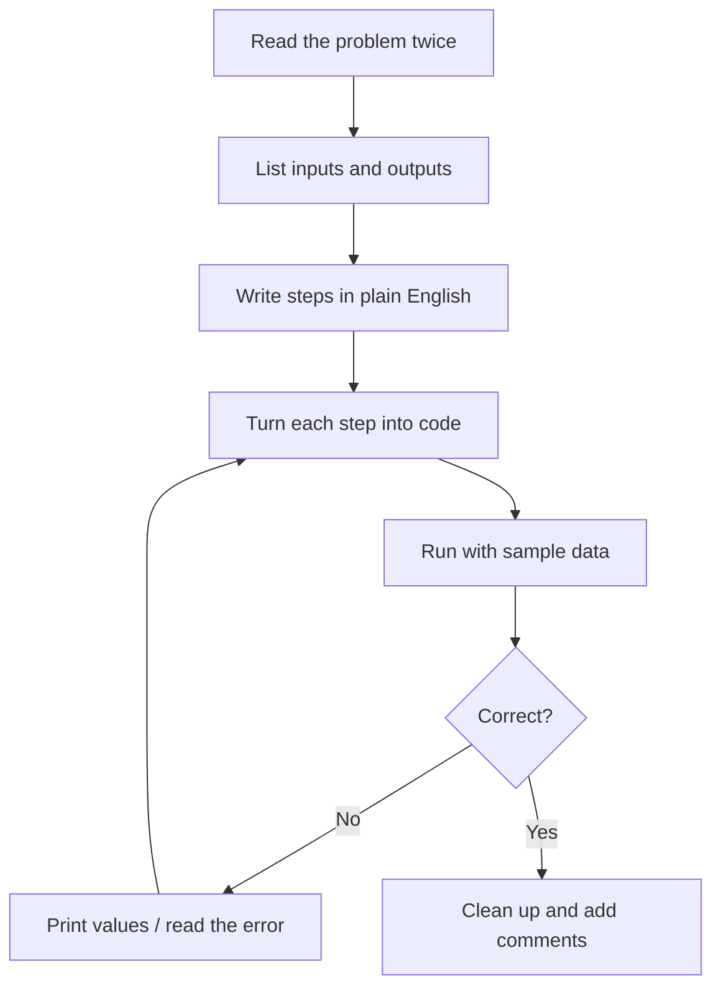

# Session 05: Practice Lab — Dart Foundations (Sessions 1–4)

> Module: Dart Programming · Term 5 (ADSE) · ⏱ ~2 hours

This is a hands-on lab. You will revise everything from Sessions 01–04 by solving small, realistic problems. Try each task **yourself first**, then compare with the solution files in this folder.

## 🎯 Learning Objectives

By the end of this lab you will be able to:

- Break a word problem into small steps before coding
- Combine variables, conditions, loops and functions in one program
- Model real things with classes, inheritance and abstract methods
- Use Maps, async functions and exception handling together
- Read and fix compile errors and run-time errors confidently

## 📖 Concepts Explained

### 1. Quick revision map

| Session | Key ideas | You use them in |
|---------|-----------|-----------------|
| 01 | Types, `if`, loops, functions, null safety | Lab 1, Lab 4 |
| 02 | Classes, constructors, inheritance, abstract classes | Lab 2 |
| 03 | Collections, Futures, async/await, exceptions | Lab 3, Lab 4 |
| 04 | Packages, tests | Bonus task |

### 2. How to attack a programming problem



### 3. Reading errors like a pro

| Message (shortened) | Usually means | Fix |
|---------------------|---------------|-----|
| `A value of type 'String' can't be assigned to 'int'` | Wrong type | Convert with `int.parse()` or change the type |
| `The property 'length' can't be unconditionally accessed because the receiver can be 'null'` | Using a nullable value directly | Use `?.`, `??` or check for null first |
| `Missing concrete implementation of 'area'` | Child of an abstract class forgot a method | Add the `@override` method |
| `FormatException` at run time | Text could not be converted | Use `int.tryParse()` and handle null |
| `RangeError (index)` | List index too big or negative | Check `index < list.length` |

### 4. Lab rules

1. Create a folder `session05_lab` and one file per task.
2. Comment every step in your own words.
3. Run `dart analyze` before you call a task "done" — aim for *No issues found*.
4. Only open a solution file after you have a working attempt or have been stuck for 15 minutes.

## 💻 Code Examples

### Lab 1: Electricity bill calculator

**Task:** Read a meter (which might be missing), calculate the bill using three slabs, and test some readings in a loop.

📄 File: [`lab1_electricity_bill.dart`](./lab1_electricity_bill.dart)

```dart
// lab1_electricity_bill.dart
// Practice: variables, if/else, functions and null safety.
// Slab rates below are made-up practice numbers, not real tariffs.

// Calculates the bill for a number of units using simple slabs.
double calculateBill(int units) {
  double bill;
  if (units <= 100) {
    bill = units * 10; // first slab: Rs. 10 per unit
  } else if (units <= 300) {
    bill = 100 * 10 + (units - 100) * 15; // next units cost Rs. 15
  } else {
    bill = 100 * 10 + 200 * 15 + (units - 300) * 20; // above 300: Rs. 20
  }
  return bill;
}

void main() {
  // The meter reading might be missing, so the type is int?.
  int? unitsUsed = readMeter('KE-5521');

  // If the reading is missing, use 0 instead of crashing.
  int units = unitsUsed ?? 0;

  double bill = calculateBill(units);
  print('Units used: $units');
  print('Total bill: Rs. ${bill.toStringAsFixed(0)}');

  // Try a few more readings with a loop.
  for (int testUnits in [80, 250, 420]) {
    print('$testUnits units -> Rs. ${calculateBill(testUnits)}');
  }
}

// Pretend meter reader. Returns null for unknown meters.
int? readMeter(String meterId) {
  if (meterId == 'KE-5521') return 275;
  return null;
}
```

**How it works**

- `readMeter` returns `int?`; `??` supplies 0 if the meter is unknown.
- Each slab only charges the units *inside* that slab.

### Lab 2: Library items with OOP

**Task:** Books and magazines can be issued once and have different late fines.

📄 File: [`lab2_library_books.dart`](./lab2_library_books.dart)

```dart
// lab2_library_books.dart
// Practice: classes, inheritance, abstract classes and collections.

abstract class LibraryItem {
  final String title;
  bool isIssued = false;

  LibraryItem(this.title);

  // Each type of item has its own late-return fine per day.
  int finePerDay();

  void issue() {
    if (isIssued) {
      print('Sorry, "$title" is already issued.');
      return;
    }
    isIssued = true;
    print('"$title" issued.');
  }
}

class Book extends LibraryItem {
  final String author;
  Book(super.title, this.author);

  @override
  int finePerDay() => 20;
}

class Magazine extends LibraryItem {
  Magazine(super.title);

  @override
  int finePerDay() => 10;
}

void main() {
  List<LibraryItem> shelf = [
    Book('Clean Code', 'Robert C. Martin'),
    Book('Dart Apprentice', 'Jonathan Sande'),
    Magazine('Tech Monthly'),
  ];

  shelf[0].issue();
  shelf[0].issue(); // second try should be refused
  shelf[2].issue();

  // Show which items are still available using where().
  List<LibraryItem> available = shelf.where((item) => !item.isIssued).toList();
  print('Available now:');
  for (LibraryItem item in available) {
    print('  - ${item.title}');
  }

  // Fine for returning each item 3 days late.
  int daysLate = 3;
  for (LibraryItem item in shelf) {
    print('${item.title}: fine for $daysLate days = Rs. ${item.finePerDay() * daysLate}');
  }
}
```

**How it works**

- `LibraryItem` is abstract, so each child must define `finePerDay()`.
- `issue()` lives in the parent and protects against double issuing.

### Lab 3: Async weather check

**Task:** Load temperatures for several cities from a slow, unreliable "server".

📄 File: [`lab3_async_weather.dart`](./lab3_async_weather.dart)

```dart
// lab3_async_weather.dart
// Practice: Future, async/await, Map and exception handling.

// Fake "server" data: city -> temperature in Celsius.
Map<String, int> fakeServer = {
  'Karachi': 33,
  'Lahore': 28,
  'Islamabad': 22,
};

// Simulates a slow network call that can fail.
Future<int> getTemperature(String city) async {
  await Future.delayed(Duration(milliseconds: 400));

  int? temperature = fakeServer[city]; // null if the city is unknown
  if (temperature == null) {
    throw Exception('No weather data for $city');
  }
  return temperature;
}

Future<void> main() async {
  List<String> cities = ['Karachi', 'Lahore', 'Gilgit', 'Islamabad'];

  for (String city in cities) {
    try {
      int temperature = await getTemperature(city);
      String feeling = temperature >= 30 ? 'hot' : 'pleasant';
      print('$city: $temperature°C ($feeling)');
    } catch (e) {
      print('$city: could not load -> $e');
    }
  }
  print('Weather check complete.');
}
```

**How it works**

- A Map lookup returns `null` for unknown keys, which we turn into an exception.
- `try/catch` inside the loop means one failed city does not stop the others.

### Lab 4: Word frequency counter

**Task:** Find the three most common words in a paragraph.

📄 File: [`lab4_word_counter.dart`](./lab4_word_counter.dart)

```dart
// lab4_word_counter.dart
// Practice: Strings, Map counting and sorting.

void main() {
  String paragraph =
      'Dart is fun. Dart is fast. Flutter uses Dart and Flutter is popular.';

  // Step 1: make lowercase and remove full stops.
  String cleanText = paragraph.toLowerCase().replaceAll('.', '');

  // Step 2: split the text into words wherever there is a space.
  List<String> words = cleanText.split(' ');

  // Step 3: count each word in a Map<String, int>.
  Map<String, int> counts = {};
  for (String word in words) {
    // If the word is new, start at 0, then add 1.
    counts[word] = (counts[word] ?? 0) + 1;
  }

  // Step 4: sort the words by count, biggest first.
  List<MapEntry<String, int>> sorted = counts.entries.toList();
  sorted.sort((a, b) => b.value.compareTo(a.value));

  print('Total words: ${words.length}');
  print('Top 3 words:');
  for (MapEntry<String, int> entry in sorted.take(3)) {
    print('  ${entry.key}: ${entry.value}');
  }
}
```

**How it works**

- `(counts[word] ?? 0) + 1` is the classic "count with a Map" pattern.
- `sort` with `compareTo` reversed (`b` vs `a`) gives biggest first.

## 🧪 Lab Practice

1. **Lab 1 extension:** add a fixed tax of 5% and a Rs. 35 meter rent, and print a neat bill with `padRight`.
2. **Lab 2 extension:** add a `returnItem()` method and a `DVD` class with a Rs. 50 daily fine.
3. **Lab 3 extension:** fetch all cities at the same time with `Future.wait` (hint: make each call catch its own error and return a message).
4. **Lab 4 extension:** ignore small words like *is*, *and*, *the* using a `Set<String>` of stop words.
5. **Bonus (Session 04):** move `calculateBill` into a tiny package `bill_tools` and write three tests for it.

## 📝 Assignment

Write `marks_manager.dart`: store at least six students in a `List<Student>` (class with name and `Map<String, int>` subject marks). Print each student's average and grade (use a function), the class topper, and the list of students who failed any subject. Simulate loading the data with a `Future` that takes one second, and handle an exception if any mark is outside 0–100.

## ❓ Quick Quiz

1. Which method converts text to an int **without** throwing an error?
2. In Lab 2, why can't we write `LibraryItem('Atlas')`?
3. What does `counts[word] ?? 0` protect against?
4. Why is the `try/catch` placed *inside* the loop in Lab 3?
5. Which command checks your code for problems without running it?

<details>
<summary>Show answers</summary>

1. `int.tryParse()` — it returns `null` for bad input.
2. `LibraryItem` is abstract; only its children can be created.
3. A word that is not in the Map yet (the lookup would return null).
4. So one failure is handled and the loop continues with the next city.
5. `dart analyze`.

</details>

## 💼 Interview Questions

1. **How do you debug a program that gives the wrong answer but no error?** — Reproduce with small input, print intermediate values (or use breakpoints in VS Code), compare with the expected value step by step, then write a test for the bug.
2. **`int.parse` vs `int.tryParse`?** — `parse` throws a `FormatException` on bad input; `tryParse` returns `null`, which suits user input.
3. **How would you count occurrences of items in a list in Dart?** — Loop and use a `Map<T, int>` with `map[item] = (map[item] ?? 0) + 1`.

## ✅ Summary

- Plan first: inputs, outputs, steps — then code.
- Labs combined null safety, OOP, collections, async and exceptions in small programs.
- Read error messages carefully; most have a standard fix.
- `dart analyze` and tests help you finish with clean, working code.

---

[⬅ Previous](../Session-04-Packages-and-Pub/README.md) · [🏠 Module Home](../README.md) · [Next ➡](../Session-06-Dart-for-the-Web/README.md)

Prepared by Zeeshan Abbas · Aptech Learning North Nazimabad
