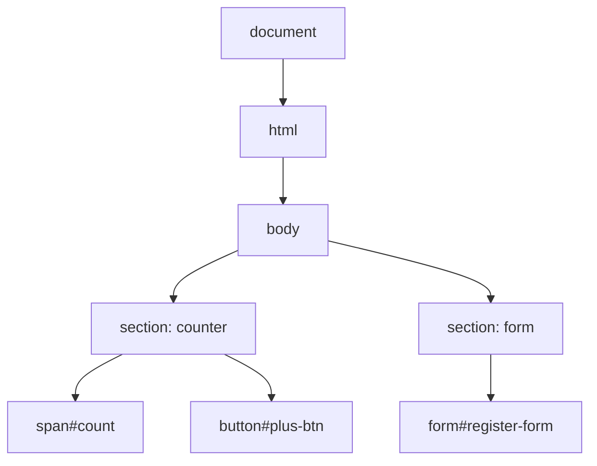

# Session 06: Dart for the Web (and Its Role in Flutter)

> Module: Dart Programming · Term 5 (ADSE) · ⏱ ~2 hours

Dart was born for the browser. Today the same language compiles to JavaScript or WebAssembly for the web and to native code for mobile through Flutter. In this session you connect Dart to HTML and CSS using the official **`package:web`**, handle clicks and forms, and see how this knowledge carries over to Flutter.

## 🎯 Learning Objectives

By the end of this session you will be able to:

- Describe how Dart runs on the web and how Flutter uses Dart for mobile apps
- Set up a small Dart web project with `package:web`
- Select HTML elements and change their text, classes and children from Dart
- Handle button clicks and form submissions as event streams
- Validate user input and show helpful feedback messages

## 📖 Concepts Explained

### 1. Where Dart runs

| Target | How | Used for |
|--------|-----|----------|
| Terminal / server | Dart VM (`dart run`) or AOT executable | Scripts, CLIs, back-end services |
| Web browser | Compiled to **JavaScript** (`dart compile js`) or **WebAssembly** | Web apps, Flutter Web |
| Android / iOS / desktop | Compiled to native machine code by **Flutter** | Mobile and desktop apps |

### 2. Dart in Flutter (preview of the next module)

In Flutter, **everything on screen is a widget**, and widgets are Dart classes. The skills you have learned map directly:

| Dart skill | Where it shows up in Flutter |
|------------|------------------------------|
| Classes and constructors (Session 02) | Every widget, e.g. `Text('Hello')` |
| Named parameters | `ElevatedButton(onPressed: ..., child: ...)` |
| Null safety | Optional widget properties like `String? title` |
| Futures / Streams (Session 03) | Loading data with `FutureBuilder` / `StreamBuilder` |
| Packages (Session 04) | Adding `http`, `provider` and others to `pubspec.yaml` |

### 3. The DOM and `package:web`

The browser turns HTML into a tree of objects called the **DOM** (Document Object Model). Dart can read and change that tree.



`package:web` is the modern, official way to access browser APIs from Dart (it replaces the old `dart:html`).

| Task | Dart code |
|------|-----------|
| Find an element | `document.querySelector('#count')` |
| Tell Dart the exact type | `... as HTMLButtonElement` |
| Change text | `element.textContent = 'Hello';` |
| Change CSS class | `element.className = 'error';` |
| Read input value | `inputElement.value` |
| Create and add an element | `document.createElement('li')`, `list.appendChild(item)` |
| Listen to an event | `button.onClick.listen((event) { ... });` |

### 4. Events are streams

A button's `onClick` is a **Stream** of click events — the same idea from Session 03. `listen()` runs your function every time the user clicks. For forms, `onSubmit` fires when the user presses the submit button; call `event.preventDefault()` to stop the page from reloading.

### 5. Validating forms

Never trust user input. Check each field in order and stop at the first problem:

1. Trim spaces and check required fields are not empty.
2. Convert numbers with `int.tryParse` (returns `null` for bad input).
3. Check ranges (e.g. age ≥ 15).
4. Show a clear message near the form, coloured with a CSS class.

## 💻 Code Examples

All files are in [`dart_web_demo/`](./dart_web_demo/).

### Example 1: Project file

📄 File: [`dart_web_demo/pubspec.yaml`](./dart_web_demo/pubspec.yaml)

```yaml
# A tiny Dart web app. package:web gives Dart access to the browser (DOM).
name: dart_web_demo
description: Counter and form examples written in Dart for the browser.
version: 1.0.0
publish_to: none

environment:
  sdk: ^3.5.0

dependencies:
  web: ^1.1.0
```

### Example 2: The HTML page

📄 File: [`dart_web_demo/web/index.html`](./dart_web_demo/web/index.html)

```html
<!DOCTYPE html>
<html lang="en">
<head>
  <meta charset="UTF-8">
  <meta name="viewport" content="width=device-width, initial-scale=1.0">
  <title>Dart Web Demo</title>
  <link rel="stylesheet" href="styles.css">
  <!-- main.dart.js is created by: dart compile js web/main.dart -o web/main.dart.js -->
  <script defer src="main.dart.js"></script>
</head>
<body>
  <h1>Dart in the Browser</h1>

  <!-- Example 1: a counter -->
  <section class="card">
    <h2>1. Click Counter</h2>
    <p>Clicks: <span id="count">0</span></p>
    <button id="plus-btn">+1</button>
    <button id="reset-btn" class="secondary">Reset</button>
  </section>

  <!-- Example 2: a form with validation -->
  <section class="card">
    <h2>2. Course Registration</h2>
    <form id="register-form">
      <label for="name-input">Full name</label>
      <input id="name-input" type="text" placeholder="e.g. Ayesha Khan">

      <label for="age-input">Age</label>
      <input id="age-input" type="number" placeholder="e.g. 19">

      <label for="course-select">Course</label>
      <select id="course-select">
        <option value="Dart">Dart Programming</option>
        <option value="Flutter">Flutter Apps</option>
        <option value="AI">AI Basics</option>
      </select>

      <button type="submit">Register</button>
    </form>
    <p id="form-message"></p>
  </section>

  <!-- Example 3: a list built from Dart data -->
  <section class="card">
    <h2>3. Topics This Term</h2>
    <ul id="topic-list"></ul>
  </section>
</body>
</html>
```

**How it works**

- Every element Dart needs has an `id`.
- The page loads `main.dart.js`, the JavaScript produced from our Dart code.

### Example 3: The styles

📄 File: [`dart_web_demo/web/styles.css`](./dart_web_demo/web/styles.css)

```css
/* Simple, clean styles for the demo page. */
body {
  font-family: system-ui, Arial, sans-serif;
  background: #f4f6fb;
  color: #222;
  max-width: 640px;
  margin: 2rem auto;
  padding: 0 1rem;
}

h1 { color: #0175c2; } /* Dart blue */

.card {
  background: #fff;
  border-radius: 10px;
  padding: 1rem 1.5rem;
  margin-bottom: 1.5rem;
  box-shadow: 0 2px 6px rgba(0, 0, 0, 0.08);
}

label { display: block; margin-top: 0.75rem; font-weight: 600; }

input, select {
  width: 100%;
  padding: 0.5rem;
  margin-top: 0.25rem;
  border: 1px solid #ccc;
  border-radius: 6px;
  box-sizing: border-box;
}

button {
  margin-top: 1rem;
  padding: 0.5rem 1.2rem;
  border: none;
  border-radius: 6px;
  background: #0175c2;
  color: #fff;
  cursor: pointer;
}

button.secondary { background: #888; }

.success { color: #1b7f3b; font-weight: 600; }
.error   { color: #c62828; font-weight: 600; }
```

### Example 4: The Dart code

📄 File: [`dart_web_demo/web/main.dart`](./dart_web_demo/web/main.dart)

```dart
// web/main.dart
// Dart code that runs in the browser using package:web.
//
// Build it:  dart compile js web/main.dart -o web/main.dart.js
// Then open web/index.html with a local server (see the session notes).

import 'package:web/web.dart';

void main() {
  setupCounter();
  setupForm();
  showTopics();
}

// ---------- Example 1: Click counter ----------
void setupCounter() {
  // Find the elements by their id. "as" tells Dart the exact element type.
  final countSpan = document.querySelector('#count') as HTMLSpanElement;
  final plusButton = document.querySelector('#plus-btn') as HTMLButtonElement;
  final resetButton = document.querySelector('#reset-btn') as HTMLButtonElement;

  int count = 0;

  // onClick is a Stream of click events. listen() runs our code on each click.
  plusButton.onClick.listen((event) {
    count++;
    countSpan.textContent = '$count';
  });

  resetButton.onClick.listen((event) {
    count = 0;
    countSpan.textContent = '0';
  });
}

// ---------- Example 2: Form handling ----------
void setupForm() {
  final form = document.querySelector('#register-form') as HTMLFormElement;
  final nameInput = document.querySelector('#name-input') as HTMLInputElement;
  final ageInput = document.querySelector('#age-input') as HTMLInputElement;
  final courseSelect = document.querySelector('#course-select') as HTMLSelectElement;
  final message = document.querySelector('#form-message') as HTMLParagraphElement;

  form.onSubmit.listen((event) {
    // Stop the browser from reloading the page.
    event.preventDefault();

    // Read the values the user typed.
    String name = nameInput.value.trim();
    int? age = int.tryParse(ageInput.value); // null if not a number
    String course = courseSelect.value;

    // Validate step by step and show a helpful message.
    if (name.isEmpty) {
      showMessage(message, 'Please enter your name.', isError: true);
      return;
    }
    if (age == null || age < 15) {
      showMessage(message, 'Please enter a valid age (15 or above).', isError: true);
      return;
    }

    showMessage(message, 'Thank you $name! You are registered for $course.');
    form.reset(); // clear the form
  });
}

// Writes a message and switches its CSS class for colour.
void showMessage(HTMLParagraphElement element, String text, {bool isError = false}) {
  element.textContent = text;
  element.className = isError ? 'error' : 'success';
}

// ---------- Example 3: Build HTML from Dart data ----------
void showTopics() {
  final list = document.querySelector('#topic-list') as HTMLUListElement;
  List<String> topics = ['Null safety', 'Classes', 'Async', 'Packages', 'AI'];

  for (String topic in topics) {
    // Create a new <li> element and add it to the list.
    final item = document.createElement('li') as HTMLLIElement;
    item.textContent = topic;
    list.appendChild(item);
  }
}
```

**Run it:**

```bash
cd dart_web_demo
dart pub get
dart compile js web/main.dart -o web/main.dart.js
cd web
python -m http.server 8080      # then open http://localhost:8080
```

Alternative with live rebuilds: `dart pub global activate webdev` and then `webdev serve` from the project folder.

**How it works**

- `main()` sets up three independent examples, each in its own function.
- `onClick.listen` and `onSubmit.listen` react to user events.
- `showMessage` swaps the CSS class so success is green and errors are red.
- `showTopics` builds `<li>` elements from a Dart `List` — the same idea Flutter uses to build lists of widgets from data.

## 🧪 Lab Practice

1. Run the demo and test the form with an empty name, the age "abc", the age 12 and valid data.
2. Add a **−1** button to the counter that never lets the count go below 0.
3. Add an email field and check that it contains `@` and `.`; show an error otherwise.
4. Add a text box and an **Add Topic** button that appends a new `<li>` to the topic list.
5. Show the number of characters typed in the name field live, using `nameInput.onInput.listen(...)`.

## 📝 Assignment

Build a **Tip Calculator** web page in Dart: inputs for bill amount and number of people, a `<select>` for tip (10%, 15%, 20%), and a Calculate button. Validate the inputs, show tip, total and per-person share formatted to two decimals, and style errors in red. Submit your `web/` folder (without the generated `.js`).

## ❓ Quick Quiz

1. Which package is the modern way to use browser APIs from Dart?
2. What does `as HTMLInputElement` do?
3. Why do we call `event.preventDefault()` in a form submit handler?
4. Which command turns `main.dart` into JavaScript?
5. In Flutter, what are screens and buttons made of?

<details>
<summary>Show answers</summary>

1. `package:web`.
2. Tells Dart the exact element type so properties like `.value` are available.
3. To stop the browser from reloading the page and losing the data.
4. `dart compile js web/main.dart -o web/main.dart.js`.
5. Widgets, which are Dart classes.

</details>

## 💼 Interview Questions

1. **How does Dart run in a browser?** — The compiler translates Dart to optimised JavaScript (or WebAssembly), which the browser executes; `package:web` provides typed access to browser APIs.
2. **What is the DOM?** — The browser's tree representation of an HTML page that code can read and change to update what the user sees.
3. **Why is Dart a good fit for Flutter?** — Fast JIT compilation enables hot reload during development, AOT gives fast native release apps, and its object-oriented, null-safe design suits building UIs from widget classes.

## ✅ Summary

- Dart runs on the VM, in the browser (JS/Wasm) and natively on devices through Flutter.
- `package:web` lets Dart find, change and create HTML elements.
- Clicks and form submissions are event streams you `listen` to.
- Always validate input and give clear feedback.
- Classes, named parameters, null safety and async from earlier sessions are exactly what Flutter uses.

---

[⬅ Previous](../Session-05-Practice-Lab-Dart-Foundations/README.md) · [🏠 Module Home](../README.md) · [Next ➡](../Session-07-AI-in-Dart/README.md)

Prepared by Zeeshan Abbas · Aptech Learning North Nazimabad
