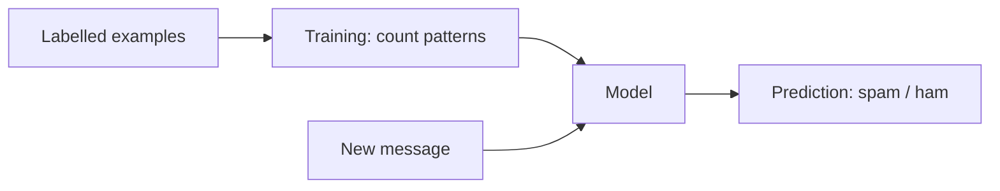

# Session 07: AI in Dart — A Tiny Classifier and Calling an AI API

> Module: Dart Programming · Term 5 (ADSE) · ⏱ ~2 hours

As an ACCP **AI** student you will add intelligence to apps again and again. There are two main ways: **build a small model yourself** (good for learning and simple offline tasks) or **call a powerful AI service over the internet** (good for chat, summaries, translation). In this session you do both in plain Dart.

## 🎯 Learning Objectives

By the end of this session you will be able to:

- Explain how AI features are added to modern apps and where Dart fits in
- Describe the main options for AI and ML in Dart (on-device vs cloud APIs)
- Build and explain a Naive Bayes text classifier in plain Dart
- Call a REST AI API with `package:http`, sending and reading JSON
- Keep API keys safe and handle network errors properly

## 📖 Concepts Explained

### 1. AI in everyday apps

Spam filters, voice typing, product recommendations, chat assistants and photo search are all AI features. Most apps do **not** train giant models themselves — they either run a small model or call an AI service.

| Approach | How | Pros | Cons |
|----------|-----|------|------|
| Small model in your code | Write the algorithm in Dart (today's classifier) | Offline, free, private | Limited power |
| On-device ML in Flutter | Run a TensorFlow Lite / ML Kit model through a plugin | Fast, offline, works with camera | Needs a trained model file |
| Cloud AI API | Send a request with `http` to a service such as Gemini | Very powerful, no training | Needs internet, API key, may cost money |
| Official SDK packages | E.g. the Firebase AI Logic SDK for Flutter | Less code, managed security | Tied to a provider |

### 2. Machine learning in one picture



- **Training data:** examples with correct answers (labels).
- **Model:** what the algorithm learned (here, word counts).
- **Prediction (inference):** using the model on new data.

### 3. Naive Bayes — the idea in simple words

Imagine you have read 100 messages. Words like *free*, *win* and *prize* appeared mostly in spam; *assignment* and *class* appeared in normal messages. For a new message, you ask: *"Given these words, is it more likely spam or ham?"*

1. **Prior:** how common each label is (4 spam out of 8 = 50%).
2. **Likelihood:** for each word, how often it appears in that label's messages.
3. Multiply prior × likelihoods for each label; the **bigger score wins**.
4. It is called *naive* because it assumes words are independent of each other — not true, but works surprisingly well.

Two practical tricks used in the code:

- **Laplace smoothing (+1):** a word never seen in spam would make the whole product 0. Adding 1 to every count avoids this.
- **Logarithms:** multiplying many tiny probabilities becomes too small for the computer, so we *add* their logs instead (`log(a × b) = log a + log b`).

### 4. Calling a REST AI API

A REST API is a web address you send an HTTP request to; it replies with JSON.

| Step | Code idea |
|------|-----------|
| 1. Build the URL | `Uri.parse('https://...:generateContent')` |
| 2. Prepare JSON body | a `Map` → `jsonEncode(body)` |
| 3. Send POST with headers | `http.post(url, headers: {...}, body: ...)` |
| 4. Check status | `200` = OK; `400` bad request; `401/403` key problem; `429` too many requests |
| 5. Decode JSON | `jsonDecode(response.body)` then read the fields |

### 5. Keeping keys safe

- Never write an API key in your code or push it to GitHub.
- Read it from an **environment variable** (`Platform.environment`).
- In a real mobile app, keep keys on a server or use a managed SDK (e.g. Firebase), because anything inside an app can be extracted.

## 💻 Code Examples

### Example 1: Naive Bayes spam classifier (plain Dart)

📄 File: [`naive_bayes.dart`](./naive_bayes.dart)

```dart
// naive_bayes.dart
// A tiny "spam or not spam" classifier written in plain Dart (no packages).
// Run with:  dart run naive_bayes.dart
//
// Idea: count how often each word appears in spam and in normal (ham)
// messages, then use those counts to guess the label of a new message.

import 'dart:math';

class NaiveBayesClassifier {
  // How many training messages each label has, e.g. {'spam': 4, 'ham': 4}
  final Map<String, int> messagesPerLabel = {};

  // Word counts per label, e.g. {'spam': {'free': 3, 'win': 2}, ...}
  final Map<String, Map<String, int>> wordCounts = {};

  // Every different word we have seen (the vocabulary).
  final Set<String> vocabulary = {};

  // Turn a sentence into a list of clean lowercase words.
  List<String> tokenize(String text) {
    String clean = text.toLowerCase().replaceAll(RegExp(r'[^a-z0-9 ]'), '');
    return clean.split(' ').where((word) => word.isNotEmpty).toList();
  }

  // TRAINING: learn from one example message and its correct label.
  void train(String text, String label) {
    messagesPerLabel[label] = (messagesPerLabel[label] ?? 0) + 1;
    wordCounts.putIfAbsent(label, () => {});

    for (String word in tokenize(text)) {
      Map<String, int> counts = wordCounts[label]!;
      counts[word] = (counts[word] ?? 0) + 1;
      vocabulary.add(word);
    }
  }

  // PREDICTION: return the most likely label for a new message.
  String predict(String text) {
    int totalMessages = messagesPerLabel.values.reduce((a, b) => a + b);
    String bestLabel = '';
    double bestScore = double.negativeInfinity;

    for (String label in messagesPerLabel.keys) {
      // Step 1: prior = how common this label is overall.
      // We add logarithms instead of multiplying tiny numbers (safer).
      double score = log(messagesPerLabel[label]! / totalMessages);

      // Step 2: total words seen in this label.
      Map<String, int> counts = wordCounts[label]!;
      int wordsInLabel = counts.values.reduce((a, b) => a + b);

      // Step 3: add the likelihood of every word in the message.
      for (String word in tokenize(text)) {
        int wordCount = counts[word] ?? 0;
        // "+1" is Laplace smoothing: unseen words do not give zero.
        double probability = (wordCount + 1) / (wordsInLabel + vocabulary.length);
        score += log(probability);
      }

      // Step 4: keep the label with the highest score.
      if (score > bestScore) {
        bestScore = score;
        bestLabel = label;
      }
    }
    return bestLabel;
  }
}

void main() {
  NaiveBayesClassifier model = NaiveBayesClassifier();

  // Small training data set (made-up examples).
  model.train('Win a FREE phone now', 'spam');
  model.train('Claim your free prize money today', 'spam');
  model.train('Congratulations you won a lucky draw', 'spam');
  model.train('Free recharge offer click now', 'spam');
  model.train('Class is shifted to room 4 today', 'ham');
  model.train('Please submit your Dart assignment', 'ham');
  model.train('Can we meet after the lab session', 'ham');
  model.train('The exam schedule is on the notice board', 'ham');

  // Test with messages the model has never seen.
  List<String> newMessages = [
    'You won a free prize, click now',
    'Is the Dart lab session today',
    'Lucky draw offer for you',
    'Submit the assignment before the exam',
  ];

  for (String message in newMessages) {
    print('${model.predict(message).toUpperCase().padRight(5)} <- "$message"');
  }
}
```

**Run it:** `dart run naive_bayes.dart`

**How it works**

- `train` counts messages per label and words per label, and builds the vocabulary.
- `predict` scores each label with log-prior + log-likelihoods and returns the highest.
- With only 8 examples the model is tiny, yet it already separates the test messages correctly.

### Example 2: Asking an AI model with `package:http`

📄 File: [`ai_api_client/pubspec.yaml`](./ai_api_client/pubspec.yaml)

```yaml
# A small command-line app that asks an AI model a question over HTTP.
name: ai_api_client
description: Calls the Google Gemini REST API using package:http.
version: 1.0.0
publish_to: none

environment:
  sdk: ^3.5.0

dependencies:
  http: ^1.2.0
```

📄 File: [`ai_api_client/bin/ai_api_client.dart`](./ai_api_client/bin/ai_api_client.dart)

```dart
// bin/ai_api_client.dart
// Ask an AI model (Google Gemini) a question from the command line.
//
// 1. Get a free API key from https://aistudio.google.com/apikey
// 2. Save it in an environment variable (never write keys in code!):
//      Windows (PowerShell):  $env:GEMINI_API_KEY="your-key"
//      macOS / Linux:         export GEMINI_API_KEY="your-key"
// 3. Run:  dart pub get
//          dart run ai_api_client "Explain null safety in one line"

import 'dart:convert'; // jsonEncode / jsonDecode
import 'dart:io'; // Platform.environment and exit()

import 'package:http/http.dart' as http;

// The model name can change over time. Check the list of models at
// https://ai.google.dev/gemini-api/docs/models and update if needed.
const String defaultModel = 'gemini-2.5-flash';

Future<void> main(List<String> arguments) async {
  // Step 1: read the API key from the environment.
  String? apiKey = Platform.environment['GEMINI_API_KEY'];
  if (apiKey == null || apiKey.isEmpty) {
    print('Please set the GEMINI_API_KEY environment variable first.');
    exit(1);
  }

  // Step 2: use the question from the command line, or a default one.
  String question = arguments.isNotEmpty
      ? arguments.join(' ')
      : 'Give me 3 tips for learning Dart as a beginner.';

  print('You asked: $question');
  print('Thinking...\n');

  try {
    String answer = await askGemini(question, apiKey);
    print('AI says:\n$answer');
  } catch (e) {
    print('Something went wrong: $e');
  }
}

// Sends the question to Gemini and returns the text answer.
Future<String> askGemini(String question, String apiKey) async {
  String model = Platform.environment['GEMINI_MODEL'] ?? defaultModel;

  // Step 3: build the URL and the JSON body the API expects.
  Uri url = Uri.parse(
    'https://generativelanguage.googleapis.com/v1beta/models/$model:generateContent',
  );
  Map<String, dynamic> body = {
    'contents': [
      {
        'parts': [
          {'text': question},
        ],
      },
    ],
  };

  // Step 4: send a POST request. The key goes in a header, not the URL.
  http.Response response = await http.post(
    url,
    headers: {
      'Content-Type': 'application/json',
      'x-goog-api-key': apiKey,
    },
    body: jsonEncode(body),
  );

  // Step 5: check the status code. 200 means OK.
  if (response.statusCode != 200) {
    throw Exception('HTTP ${response.statusCode}: ${response.body}');
  }

  // Step 6: decode the JSON and dig out the answer text.
  Map<String, dynamic> data = jsonDecode(response.body);
  String text = data['candidates'][0]['content']['parts'][0]['text'];
  return text;
}
```

**Run it:**

```bash
cd ai_api_client
dart pub get
# set GEMINI_API_KEY first (see the comments at the top of the file)
dart run ai_api_client "Explain Dart streams to a 10-year-old"
```

**How it works**

- The key is read from the environment, so it never appears in the source code.
- The request body follows the API's JSON format; the answer text is nested inside `candidates → content → parts`.
- Any non-200 status becomes an exception that `main` catches and prints, instead of crashing.
- The model name is a constant (or `GEMINI_MODEL` variable), so you can switch models without changing the logic.

## 🧪 Lab Practice

1. Add six more training messages (three spam, three ham) in Roman Urdu or English and test new sentences.
2. Change `predict` so it also prints the score of each label. Which words push a message towards spam?
3. Create a second classifier for **sentiment** (`positive` / `negative`) using product reviews.
4. Get a free Gemini API key, run the API client and ask three different questions.
5. Ask the AI to "Reply with only one word: positive or negative" for a review, and compare its answer with your Naive Bayes sentiment model.

## 📝 Assignment

Build `smart_reply.dart`: use your Naive Bayes model to label an incoming message as `question`, `complaint` or `greeting` (at least 5 training examples each). Then call the AI API with a prompt that includes the label, e.g. *"Write a polite two-line reply to this complaint: ..."*. Handle a missing key and network errors gracefully. Include a short README explaining how to run it.

## ❓ Quick Quiz

1. What are the "prior" and "likelihood" in Naive Bayes?
2. Why do we add 1 to every word count?
3. Which HTTP status code means the request succeeded?
4. Which function converts a Dart `Map` into a JSON string?
5. Where should an API key be stored in this example?

<details>
<summary>Show answers</summary>

1. Prior = how common a label is overall; likelihood = how probable a word is within that label.
2. Laplace smoothing — so an unseen word does not make the probability zero.
3. `200`.
4. `jsonEncode()` from `dart:convert`.
5. In an environment variable (`GEMINI_API_KEY`), never in the code.

</details>

## 💼 Interview Questions

1. **Why is Naive Bayes called "naive"?** — It assumes every feature (word) is independent given the label, which is rarely true but keeps the maths simple and fast.
2. **On-device model vs cloud AI API — how do you choose?** — On-device for offline use, privacy and low latency with simple tasks; cloud APIs for complex language or vision tasks where power matters more than connectivity and cost.
3. **How do you protect an API key in a mobile app?** — Do not ship it in the app; route requests through your own backend or a managed service that enforces authentication and quotas.

## ✅ Summary

- Apps add AI by running small models or by calling AI services.
- Naive Bayes learns word counts per label and predicts with priors, likelihoods, smoothing and logs.
- `package:http` + `dart:convert` let Dart talk to any REST AI API.
- Check status codes, catch errors, and keep keys out of your code.

---

[⬅ Previous](../Session-06-Dart-for-the-Web/README.md) · [🏠 Module Home](../README.md) · [Next ➡](../Session-08-Practice-Lab-Mini-App/README.md)

Prepared by Zeeshan Abbas · Aptech Learning North Nazimabad
