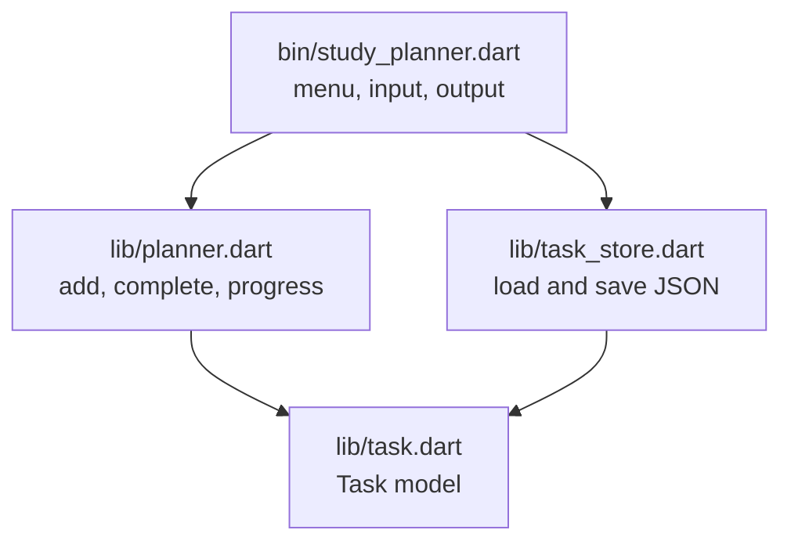

# Session 08: Practice Lab — Mini App: Study Planner

> Module: Dart Programming · Term 5 (ADSE) · ⏱ ~2 hours

Time to put the whole module together. You will build **Study Planner**, a small console app that lets you add study tasks, mark them done and save them to a file. It uses classes, null safety, collections, async file I/O, exceptions, a package structure and unit tests — the same layered thinking you will use in Flutter apps next module.

## 🎯 Learning Objectives

By the end of this lab you will be able to:

- Organise an app into model, logic, storage and user-interface layers
- Convert objects to and from JSON for saving
- Read and write files asynchronously with `dart:io`
- Build a menu-driven console app that reads user input safely
- Test the business logic with `package:test`

## 📖 Concepts Explained

### 1. What we are building

```text
=== Study Planner ===
1) Show tasks  2) Add task  3) Complete task  4) Save & quit
Choose an option: 1
1. [x] Revise OOP (Dart)
2. [ ] Practise streams (Dart)
Progress: 50% done
```

### 2. App architecture (layers)

Splitting code into layers keeps each file small and easy to test.



| Layer | File | Knows about | Session it uses |
|-------|------|-------------|-----------------|
| Model | `lib/task.dart` | One task's data, JSON conversion | 02 (classes, named constructors) |
| Logic | `lib/planner.dart` | Rules: add, complete, progress | 01, 03 (collections, getters) |
| Storage | `lib/task_store.dart` | Files and JSON | 03 (async, exceptions) |
| UI | `bin/study_planner.dart` | Keyboard and screen | 01 (switch, loops, null safety) |
| Tests | `test/planner_test.dart` | Checks the logic | 04 (package:test) |

### 3. JSON in Dart

JSON is plain text that stores data as objects and lists. Dart converts between JSON and Maps using `dart:convert`:

| Direction | Code |
|-----------|------|
| Object → Map | `task.toJson()` (we write this method) |
| Map → JSON text | `jsonEncode(map)` or `JsonEncoder.withIndent('  ').convert(map)` |
| JSON text → Map/List | `jsonDecode(text)` |
| Map → Object | `Task.fromJson(map)` (a named constructor) |

### 4. Reading console input safely

`stdin.readLineSync()` returns `String?` — it is `null` if the input stream ends (e.g. Ctrl+D or a piped file). Our `ask()` helper uses `?? ''` so the rest of the program always gets a real `String`. Numbers are read with `int.tryParse()` so typing "abc" never crashes the app.

### 5. Development steps

1. Write the `Task` model and test JSON round-trips.
2. Write `Planner` logic and its tests (no input/output yet!).
3. Add `TaskStore` for saving and loading.
4. Finally build the menu UI that connects everything.

## 💻 Code Examples

All files are in [`study_planner/`](./study_planner/).

### Step 1: Project file

📄 File: [`study_planner/pubspec.yaml`](./study_planner/pubspec.yaml)

```yaml
# Study Planner - a console mini app that ties the whole module together.
name: study_planner
description: Add, complete and save study tasks from the command line.
version: 1.0.0
publish_to: none

environment:
  sdk: ^3.5.0

dev_dependencies:
  test: ^1.25.0
```

### Step 2: The model

📄 File: [`study_planner/lib/task.dart`](./study_planner/lib/task.dart)

```dart
// lib/task.dart
// The data model: one study task.

class Task {
  final String title;
  final String subject;
  bool isDone;

  Task({required this.title, required this.subject, this.isDone = false});

  // Mark the task as finished.
  void complete() {
    isDone = true;
  }

  // Convert a Task into a Map so it can be saved as JSON.
  Map<String, dynamic> toJson() {
    return {'title': title, 'subject': subject, 'isDone': isDone};
  }

  // Named constructor: build a Task back from a JSON Map.
  Task.fromJson(Map<String, dynamic> json)
      : title = json['title'] as String,
        subject = json['subject'] as String,
        isDone = json['isDone'] as bool;

  // How a task looks when printed, e.g. "[x] Revise OOP (Dart)".
  @override
  String toString() {
    String box = isDone ? '[x]' : '[ ]';
    return '$box $title ($subject)';
  }
}
```

**How it works**

- Named `required` parameters make object creation clear: `Task(title: ..., subject: ...)`.
- `toJson` and `Task.fromJson` are mirror images, so saved data loads back exactly.

### Step 3: The logic

📄 File: [`study_planner/lib/planner.dart`](./study_planner/lib/planner.dart)

```dart
// lib/planner.dart
// Business logic: works with a list of tasks. No input/output here,
// which makes this class easy to test.

import 'task.dart';

class Planner {
  final List<Task> tasks;

  Planner(this.tasks);

  void addTask(String title, String subject) {
    tasks.add(Task(title: title, subject: subject));
  }

  // Completes the task at a 1-based position. Returns false if invalid.
  bool completeTask(int number) {
    int index = number - 1;
    if (index < 0 || index >= tasks.length) {
      return false;
    }
    tasks[index].complete();
    return true;
  }

  List<Task> get pendingTasks => tasks.where((task) => !task.isDone).toList();

  // Percentage of tasks finished, from 0 to 100.
  int get progressPercent {
    if (tasks.isEmpty) return 0;
    int done = tasks.length - pendingTasks.length;
    return (done * 100 / tasks.length).round();
  }
}
```

**How it works**

- Users count from 1, lists count from 0 — `completeTask` converts and checks the range.
- `pendingTasks` and `progressPercent` are computed getters, always up to date.

### Step 4: Saving and loading

📄 File: [`study_planner/lib/task_store.dart`](./study_planner/lib/task_store.dart)

```dart
// lib/task_store.dart
// Saves and loads tasks from a JSON file using async file operations.

import 'dart:convert';
import 'dart:io';

import 'task.dart';

class TaskStore {
  final File file;

  TaskStore(String path) : file = File(path);

  // Read tasks from the file. Returns an empty list if there is no file yet.
  Future<List<Task>> load() async {
    if (!await file.exists()) {
      return [];
    }
    try {
      String text = await file.readAsString();
      List<dynamic> data = jsonDecode(text);
      return data.map((item) => Task.fromJson(item)).toList();
    } on FormatException {
      // The file is broken (not valid JSON). Start fresh instead of crashing.
      print('Warning: could not read ${file.path}. Starting with no tasks.');
      return [];
    }
  }

  // Write all tasks to the file as pretty JSON.
  Future<void> save(List<Task> tasks) async {
    List<Map<String, dynamic>> data = tasks.map((task) => task.toJson()).toList();
    String text = JsonEncoder.withIndent('  ').convert(data);
    await file.writeAsString(text);
  }
}
```

**How it works**

- All file work is `async`, so a slow disk never freezes the program.
- A missing file gives an empty list; a corrupted file is caught as `FormatException`.

### Step 5: The console UI

📄 File: [`study_planner/bin/study_planner.dart`](./study_planner/bin/study_planner.dart)

```dart
// bin/study_planner.dart
// The console user interface. Run from the study_planner folder:
//   dart pub get
//   dart run

import 'dart:io';

import 'package:study_planner/planner.dart';
import 'package:study_planner/task_store.dart';

Future<void> main() async {
  // Step 1: load saved tasks (async) and create the planner.
  TaskStore store = TaskStore('tasks.json');
  Planner planner = Planner(await store.load());

  print('=== Study Planner ===');

  // Step 2: show the menu again and again until the user quits.
  while (true) {
    print('\n1) Show tasks  2) Add task  3) Complete task  4) Save & quit');
    stdout.write('Choose an option: ');
    String? choice = stdin.readLineSync(); // null if input ends

    switch (choice) {
      case '1':
        showTasks(planner);
      case '2':
        String title = ask('Task title: ');
        String subject = ask('Subject: ');
        if (title.isEmpty) {
          print('Title cannot be empty.');
        } else {
          planner.addTask(title, subject.isEmpty ? 'General' : subject);
          print('Task added.');
        }
      case '3':
        showTasks(planner);
        int? number = int.tryParse(ask('Task number to complete: '));
        if (number != null && planner.completeTask(number)) {
          print('Well done!');
        } else {
          print('Invalid task number.');
        }
      case '4' || null:
        await store.save(planner.tasks); // Step 3: save before leaving
        print('Saved ${planner.tasks.length} tasks. Allah Hafiz!');
        return;
      default:
        print('Please type 1, 2, 3 or 4.');
    }
  }
}

// Prints every task with its number and the overall progress.
void showTasks(Planner planner) {
  if (planner.tasks.isEmpty) {
    print('No tasks yet. Add one!');
    return;
  }
  for (int i = 0; i < planner.tasks.length; i++) {
    print('${i + 1}. ${planner.tasks[i]}');
  }
  print('Progress: ${planner.progressPercent}% done');
}

// Shows a prompt and returns what the user typed (never null).
String ask(String prompt) {
  stdout.write(prompt);
  return (stdin.readLineSync() ?? '').trim();
}
```

**How it works**

- `while (true)` shows the menu until option 4 (or end of input) saves and `return`s.
- `case '4' || null` uses a Dart 3 pattern to treat "no more input" like quitting.

### Step 6: Tests

📄 File: [`study_planner/test/planner_test.dart`](./study_planner/test/planner_test.dart)

```dart
// Tests for the Task and Planner classes. Run with:  dart test
import 'package:study_planner/planner.dart';
import 'package:study_planner/task.dart';
import 'package:test/test.dart';

void main() {
  test('a new task is not done', () {
    Task task = Task(title: 'Revise OOP', subject: 'Dart');
    expect(task.isDone, isFalse);
  });

  test('task survives a JSON round trip', () {
    Task original = Task(title: 'Read streams', subject: 'Dart', isDone: true);
    Task copy = Task.fromJson(original.toJson());
    expect(copy.title, equals('Read streams'));
    expect(copy.isDone, isTrue);
  });

  test('completeTask marks the right task and updates progress', () {
    Planner planner = Planner([]);
    planner.addTask('Task A', 'Dart');
    planner.addTask('Task B', 'Flutter');

    bool ok = planner.completeTask(1);

    expect(ok, isTrue);
    expect(planner.pendingTasks.length, equals(1));
    expect(planner.progressPercent, equals(50));
  });

  test('completeTask rejects an invalid number', () {
    Planner planner = Planner([]);
    expect(planner.completeTask(5), isFalse);
  });
}
```

**Run it:**

```bash
cd study_planner
dart pub get
dart test        # all tests should pass
dart run         # start the app; tasks are saved in tasks.json
```

## 🧪 Lab Practice

1. Run the app, add three tasks, complete one, quit, and open `tasks.json` to see the saved data. Run again — your tasks are still there.
2. Add menu option **5) Delete task** with a `deleteTask(int number)` method in `Planner` and a test for it.
3. Add a `DateTime? dueDate` to `Task` (save it as `toIso8601String()`), and print overdue tasks in red text or with a ⚠ marker.
4. Add option **6) Show by subject** that groups tasks using a `Map<String, List<Task>>`.
5. Write a test for `TaskStore` that saves two tasks to a temporary file and loads them back.

## 📝 Assignment

Extend Study Planner into your **module mini-project** (see the [module home](../README.md#-module-mini-project)): add priorities (`high`, `medium`, `low`) with sorting, due dates, and an **AI study tip** option that sends your pending task titles to the AI API from Session 07 and prints a suggested study order. Keep at least eight passing tests and write a README with screenshots of a sample run.

## ❓ Quick Quiz

1. Why is `planner.dart` free of `print` and `stdin` calls?
2. What does `stdin.readLineSync()` return when input ends?
3. Which two members convert a `Task` to and from JSON?
4. What happens if `tasks.json` contains invalid JSON?
5. Why do we use `int.tryParse` for the task number?

<details>
<summary>Show answers</summary>

1. So the logic can be tested automatically and reused with another UI (e.g. Flutter).
2. `null`.
3. `toJson()` and the named constructor `Task.fromJson()`.
4. `jsonDecode` throws a `FormatException`; `load()` catches it and starts with an empty list.
5. User input may not be a number; `tryParse` returns `null` instead of crashing.

</details>

## 💼 Interview Questions

1. **Why separate an app into layers?** — Each layer has one responsibility, so code is easier to read, test and change; for example the console UI could be replaced with a Flutter UI without touching the logic.
2. **How do you serialise a Dart object to JSON?** — Write a `toJson()` method returning a `Map<String, dynamic>` and a `fromJson` constructor, then use `jsonEncode`/`jsonDecode` (larger apps often generate these with `json_serializable`).
3. **What makes code easy to unit test?** — Pure logic without direct I/O, small methods with clear inputs and outputs, and dependencies (like storage) passed in rather than created inside.

## ✅ Summary

- You built a complete layered Dart app: model, logic, storage, UI and tests.
- JSON + `dart:io` gives simple persistence; async keeps it responsive.
- Null-safe input handling and `tryParse` prevent crashes from bad input.
- These same patterns carry straight into Flutter in the next module.

---

[⬅ Previous](../Session-07-AI-in-Dart/README.md) · [🏠 Module Home](../README.md) · [Next Module ➡](../../03-Cross-Platform-App-Development-with-Flutter-and-Dart/README.md)

Prepared by Zeeshan Abbas · Aptech Learning North Nazimabad
