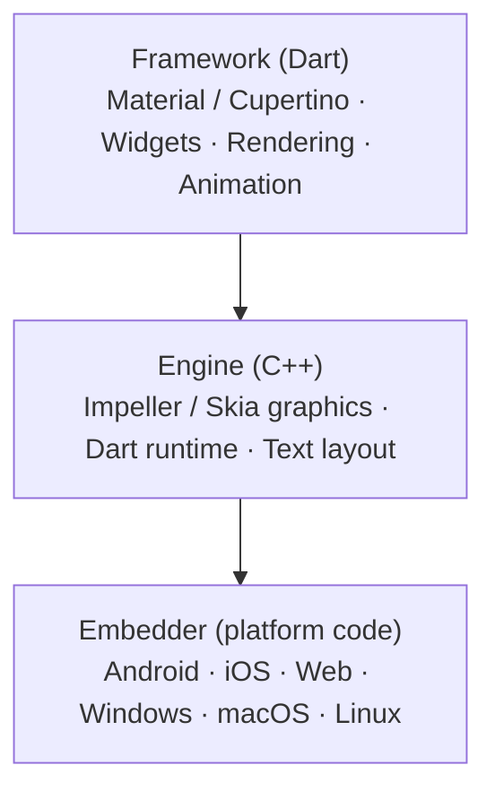
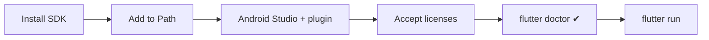

# Session 01: Introduction to Flutter and Setup

> Module: Cross-Platform App Development with Flutter and Dart · Term 5 (ADSE) · ⏱ ~2 hours

Flutter lets you write **one app in Dart** and run it on Android, iOS, the web, Windows, macOS and Linux.
In this session you learn what Flutter is, why companies choose it, how it works inside, and you install it and run your first app.

## 🎯 Learning Objectives

By the end of this session you will be able to:

- Define Flutter and list its main features and advantages
- Describe the three layers of the Flutter architecture
- Identify the main components of a Flutter project
- Install Flutter with Android Studio and fix problems using `flutter doctor`
- Create, run and hot reload your first Flutter app

## 📖 Concepts Explained

### 1. What is Flutter?

Flutter is a free, open-source **UI toolkit** from Google. You describe the screen in Dart code using small building blocks called **widgets**, and Flutter draws every pixel itself.

> **Analogy:** a normal app is like decorating a room with furniture the house already has (native buttons). Flutter brings its **own furniture**, so the room looks the same in every house (Android, iOS, web).

### 2. Features and advantages

| Feature | Why it helps you |
|---------|------------------|
| Single codebase | Write once, ship to mobile, web and desktop — less time and cost |
| Hot reload | Save the file and see the change in about a second, without losing app state |
| Everything is a widget | Text, padding, rows, buttons — all built the same way, easy to learn |
| Own rendering engine | Pixel-perfect, identical UI on every platform |
| Native performance | Release builds are compiled ahead-of-time (AOT) to machine code |
| Material 3 and Cupertino | Ready-made Android-style and iOS-style widgets |
| pub.dev ecosystem | Thousands of free packages (maps, Firebase, camera, ML…) |

Well-known apps built with Flutter include Google Pay, BMW, eBay Motors and many startup apps — a big job market for Flutter developers in Pakistan and abroad.

### 3. Flutter architecture (three layers)



| Layer | Written in | Job |
|-------|-----------|-----|
| **Framework** | Dart | The part you use: widgets, layouts, gestures, animations |
| **Engine** | C++ | Draws pixels on screen (Impeller/Skia), runs Dart, handles text |
| **Embedder** | Platform language | Gives the engine a window, input events and a run loop on each OS |

### 4. Components of a Flutter project

After `flutter create my_app` you get:

| Item | Purpose |
|------|---------|
| `lib/main.dart` | Your Dart code starts here (`main()` → `runApp()`) |
| `pubspec.yaml` | Project name, dependencies (packages), assets such as images and fonts |
| `android/`, `ios/`, `web/`, `windows/`… | Platform folders — you rarely edit them at first |
| `test/` | Automated widget and unit tests |
| `build/` | Generated output (never edit) |

Key building blocks inside the code: **widgets**, the **widget tree**, `MaterialApp` (app shell), `Scaffold` (page structure) and **packages** from pub.dev.

### 5. Installing Flutter with Android Studio (Windows)

1. Download the Flutter SDK ZIP from [docs.flutter.dev/get-started/install](https://docs.flutter.dev/get-started/install) and extract it to `C:\src\flutter` (avoid `Program Files` and paths with spaces).
2. Add `C:\src\flutter\bin` to the **Path** environment variable, then open a new terminal and run `flutter --version`.
3. Install [Android Studio](https://developer.android.com/studio). In **Settings → Plugins**, install the **Flutter** plugin (it adds Dart too).
4. In **SDK Manager → SDK Tools**, tick *Android SDK Command-line Tools*. Then run `flutter doctor --android-licenses` and accept.
5. Create an emulator: **Device Manager → Create Device → Pixel → latest system image**.
6. Run `flutter doctor`. Fix every red ✗ it reports. A yellow ! for Xcode on Windows is normal.



> **No powerful PC?** Run apps on Chrome with `flutter run -d chrome`, or connect your Android phone with USB debugging turned on.

### 6. Hot reload vs hot restart

| Action | Shortcut (terminal) | What happens |
|--------|--------------------|--------------|
| Hot reload | `r` | Injects new code, **keeps** current state (e.g. counter value) |
| Hot restart | `R` | Restarts the app, state is **reset** |
| Full rebuild | stop and `flutter run` | Needed after adding packages or native changes |

## 💻 Code Examples

### Example 1: The smallest Flutter app

📄 File: [`main.dart`](./main.dart)

```dart
// main.dart
// The smallest possible Flutter app: one line of text in the centre.

// Import the Material library. It gives us all the basic widgets.
import 'package:flutter/material.dart';

// main() is where every Dart program starts.
void main() {
  // runApp() takes a widget and makes it the root of the screen.
  runApp(
    // Center puts its child in the middle of the screen.
    const Center(
      child: Text(
        'Hello, Flutter!',
        // textDirection is needed only because we have no MaterialApp yet.
        textDirection: TextDirection.ltr,
      ),
    ),
  );
}
```

**How it works**

- `runApp()` attaches the widget to the screen. Everything you see is a widget.
- Without `MaterialApp`, Flutter does not know the reading direction, so we pass `textDirection` ourselves.

### Example 2: A proper app shell

📄 File: [`hello_app.dart`](./hello_app.dart)

```dart
// hello_app.dart
// A real app structure: MaterialApp -> Scaffold -> AppBar + body.

import 'package:flutter/material.dart';

void main() {
  runApp(const HelloApp());
}

// Our app is itself a widget.
class HelloApp extends StatelessWidget {
  const HelloApp({super.key});

  @override
  Widget build(BuildContext context) {
    // MaterialApp sets up theme, text direction and navigation.
    return MaterialApp(
      title: 'Hello App',
      debugShowCheckedModeBanner: false, // hide the red "DEBUG" ribbon
      home: Scaffold(
        // AppBar is the bar at the top of the screen.
        appBar: AppBar(
          title: const Text('My First Flutter App'),
          backgroundColor: Colors.teal,
          foregroundColor: Colors.white,
        ),
        // body is the main area of the page.
        body: const Center(
          child: Text(
            'Assalam-o-Alaikum, Students!',
            style: TextStyle(fontSize: 24),
          ),
        ),
      ),
    );
  }
}
```

**How it works**

- `MaterialApp` is the outer shell; `Scaffold` gives the standard page layout with `appBar` and `body`.
- `const` tells Flutter these widgets never change, so it can skip rebuilding them (faster).

### Example 3: Try hot reload

📄 File: [`hot_reload_demo.dart`](./hot_reload_demo.dart)

```dart
// hot_reload_demo.dart
// Run this app, then change the values marked "CHANGE ME" and press r (hot reload).

import 'package:flutter/material.dart';

void main() {
  runApp(const HotReloadDemo());
}

class HotReloadDemo extends StatelessWidget {
  const HotReloadDemo({super.key});

  @override
  Widget build(BuildContext context) {
    // CHANGE ME: try 'Karachi', 'Lahore' or your own city.
    const String city = 'Karachi';

    // CHANGE ME: try Colors.orange or Colors.purple.
    const Color boxColor = Colors.indigo;

    return MaterialApp(
      home: Scaffold(
        appBar: AppBar(title: const Text('Hot Reload Demo')),
        body: Center(
          // Container draws a coloured box around its child.
          child: Container(
            padding: const EdgeInsets.all(24),
            color: boxColor,
            child: const Text(
              'I am learning Flutter in $city',
              style: TextStyle(color: Colors.white, fontSize: 20),
            ),
          ),
        ),
      ),
    );
  }
}
```

**How it works**

- Change the city or colour, save, and press `r` in the terminal (or the ⚡ button in the IDE). The screen updates almost instantly.

## 🧪 Lab Practice

1. Install Flutter and Android Studio. Run `flutter doctor -v` and screenshot the result with all green ticks for Flutter and Android.
2. Create a project: `flutter create first_app`. Open it and run the default counter app on the emulator **and** on Chrome.
3. Replace `lib/main.dart` with `hello_app.dart`. Change the AppBar title and colour to your own choice.
4. Run `hot_reload_demo.dart`. Change the text three times using hot reload, then once using hot restart. Note the difference.
5. Open `pubspec.yaml` and write in your notebook what `name`, `environment` and `dependencies` mean.

## 📝 Assignment

Create `about_me_app.dart`: a `MaterialApp` with an AppBar showing your name and a centred body text showing your batch code and favourite programming language. Submit the code and a screenshot running on any device.

## ❓ Quick Quiz

1. Which language are Flutter apps written in?
2. Name the three layers of the Flutter architecture.
3. What is the difference between hot reload and hot restart?
4. Which file lists the packages your app depends on?
5. Which command checks that your Flutter setup is correct?

<details>
<summary>Show answers</summary>

1. Dart.
2. Framework (Dart), Engine (C++), Embedder (platform-specific).
3. Hot reload keeps the app state; hot restart resets it.
4. `pubspec.yaml`.
5. `flutter doctor`.

</details>

## 💼 Interview Questions

1. **Why does Flutter look the same on Android and iOS?** — It does not use native UI controls; its engine draws every pixel itself, so the same widget renders identically everywhere.
2. **How is Flutter fast in production?** — Release builds compile Dart ahead-of-time (AOT) into native machine code, and the Impeller engine renders directly using the GPU.
3. **What does `runApp()` do?** — It takes the given widget, makes it the root of the widget tree and attaches it to the screen.

## ✅ Summary

- Flutter is Google's UI toolkit for building cross-platform apps from one Dart codebase.
- Its architecture has three layers: Framework, Engine and Embedder.
- A project starts at `lib/main.dart`; packages and assets live in `pubspec.yaml`.
- `flutter doctor` checks your setup; hot reload makes development very fast.
- `MaterialApp` → `Scaffold` → `AppBar` + `body` is the standard app shape.

---

[⬅ Previous Module](../../02-Dart-Programming/README.md) · [🏠 Module Home](../README.md) · [Next ➡](../Session-02-Widgets-Stateless-and-Stateful/README.md)

Prepared by Zeeshan Abbas · Aptech Learning North Nazimabad
