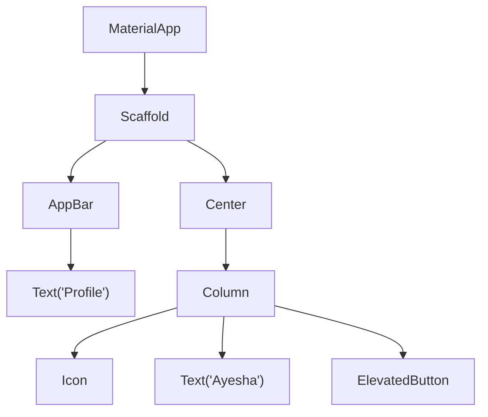
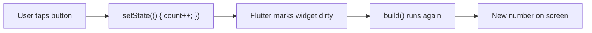

# Session 02: Widgets Basics — Stateless and Stateful

> Module: Cross-Platform App Development with Flutter and Dart · Term 5 (ADSE) · ⏱ ~2 hours

In Flutter, **everything you see is a widget**: text, an icon, a button, even the padding around them.
This session explains what widgets are, how they form a tree, the difference between Stateless and Stateful widgets, and the common widgets you will use every day.

## 🎯 Learning Objectives

By the end of this session you will be able to:

- Create a simple Flutter app in Android Studio or VS Code
- Explain what a widget is and how the widget tree works
- Choose between a `StatelessWidget` and a `StatefulWidget`
- Use common widgets: `Text`, `Icon`, `Image`, buttons and `Card`
- Identify the purpose of layout widgets such as `Column` and `Padding`

## 📖 Concepts Explained

### 1. What is a widget?

A widget is a **description of part of the screen**. It says *what* to show (a text, a colour, a button) — Flutter decides *how* to draw it.

> **Analogy:** widgets are like LEGO bricks. Small bricks (Text, Icon) snap inside bigger bricks (Row, Card), which snap inside the page (Scaffold).

### 2. The widget tree

Widgets are placed inside each other, which makes a **tree**. The `child` property holds one widget; `children` holds a list.



Every widget has a `build()` method that returns more widgets. Flutter keeps calling `build()` down the tree until it reaches basic drawable widgets.

### 3. Types of widgets

| Group | Examples | Purpose |
|-------|----------|---------|
| Structural (app shell) | `MaterialApp`, `Scaffold`, `AppBar` | Overall app and page structure |
| Display | `Text`, `Icon`, `Image` | Show content |
| Input / interaction | `ElevatedButton`, `TextButton`, `IconButton`, `TextField`, `Switch` | React to the user |
| Layout | `Center`, `Padding`, `Container`, `Row`, `Column`, `Stack` | Position and size other widgets |
| Material containers | `Card`, `ListTile` | Ready-made, nicely styled blocks |

Layout widgets do not show anything themselves — they **arrange** their children. Sessions 04 and 05 cover them in depth.

### 4. Stateless vs Stateful

**State** = data that can change while the app is running (a counter, a liked/not-liked flag, typed text).

| | StatelessWidget | StatefulWidget |
|---|----------------|----------------|
| Data changes? | No — fixed after creation | Yes — can change over time |
| Classes needed | 1 | 2 (the widget + its `State` class) |
| Rebuilds when | Parent gives it new values | You call `setState()` |
| Examples | Logo, title, profile text | Counter, like button, checkbox |



**Rule of thumb:** start with Stateless. Switch to Stateful only when something on *that* widget must change.

### 5. Stateful widget lifecycle (main methods)

| Method | When it runs | Typical use |
|--------|-------------|-------------|
| `initState()` | Once, when the widget is created | Set starting values, start timers |
| `build()` | Every time the UI must be drawn | Return the widget tree |
| `setState()` | You call it | Tell Flutter "data changed, rebuild" |
| `dispose()` | Once, when the widget is removed | Stop timers, close controllers |

## 💻 Code Examples

### Example 1: A Stateless profile card

📄 File: [`main.dart`](./main.dart)

```dart
// main.dart
// A StatelessWidget: shows fixed information that never changes.

import 'package:flutter/material.dart';

void main() {
  runApp(const MaterialApp(
    debugShowCheckedModeBanner: false,
    home: ProfilePage(),
  ));
}

// StatelessWidget = no changing data inside.
class ProfilePage extends StatelessWidget {
  const ProfilePage({super.key});

  @override
  Widget build(BuildContext context) {
    return Scaffold(
      appBar: AppBar(title: const Text('Student Profile')),
      body: Center(
        // Column places its children one below another.
        child: Column(
          mainAxisSize: MainAxisSize.min, // take only the space needed
          children: const [
            // Icon shows a Material icon.
            Icon(Icons.account_circle, size: 100, color: Colors.teal),
            SizedBox(height: 12), // empty gap of 12 pixels
            Text(
              'Ayesha Khan',
              style: TextStyle(fontSize: 26, fontWeight: FontWeight.bold),
            ),
            Text('ACCP AI · Batch 2501'),
          ],
        ),
      ),
    );
  }
}
```

**How it works**

- All values are fixed, so a `StatelessWidget` is the right choice.
- `SizedBox(height: 12)` is a simple way to add space between widgets.

### Example 2: A Stateful counter

📄 File: [`counter_app.dart`](./counter_app.dart)

```dart
// counter_app.dart
// A StatefulWidget: the number changes every time the button is pressed.

import 'package:flutter/material.dart';

void main() {
  runApp(const MaterialApp(home: CounterPage()));
}

// Part 1: the widget itself (it only creates the State object).
class CounterPage extends StatefulWidget {
  const CounterPage({super.key});

  @override
  State<CounterPage> createState() => _CounterPageState();
}

// Part 2: the State class holds the changing data and the build method.
class _CounterPageState extends State<CounterPage> {
  // This is our state: a number that will change.
  int count = 0;

  // Called when the button is pressed.
  void increaseCount() {
    // setState tells Flutter: "data changed, please rebuild".
    setState(() {
      count = count + 1;
    });
  }

  @override
  Widget build(BuildContext context) {
    return Scaffold(
      appBar: AppBar(title: const Text('Tasbeeh Counter')),
      body: Center(
        child: Text(
          '$count', // shows the current value
          style: const TextStyle(fontSize: 72),
        ),
      ),
      // The round button at the bottom-right.
      floatingActionButton: FloatingActionButton(
        onPressed: increaseCount, // run our function on tap
        child: const Icon(Icons.add),
      ),
    );
  }
}
```

**How it works**

- `count` lives in the `State` class so it survives rebuilds.
- Changing `count` **without** `setState` would not update the screen — try it and see.

### Example 3: Common widgets together

📄 File: [`common_widgets.dart`](./common_widgets.dart)

```dart
// common_widgets.dart
// A tour of everyday widgets: Text, Icon, Image, buttons, Card and ListTile.

import 'package:flutter/material.dart';

void main() {
  runApp(const MaterialApp(home: CommonWidgetsPage()));
}

class CommonWidgetsPage extends StatelessWidget {
  const CommonWidgetsPage({super.key});

  @override
  Widget build(BuildContext context) {
    return Scaffold(
      appBar: AppBar(title: const Text('Common Widgets')),
      // ListView lets the page scroll if it is taller than the screen.
      body: ListView(
        padding: const EdgeInsets.all(16),
        children: [
          // 1. Text with a style
          const Text('Text widget', style: TextStyle(fontSize: 22, color: Colors.blue)),
          const SizedBox(height: 16),

          // 2. Icons
          const Row(
            children: [
              Icon(Icons.favorite, color: Colors.red),
              Icon(Icons.star, color: Colors.amber),
              Icon(Icons.school, color: Colors.green),
            ],
          ),
          const SizedBox(height: 16),

          // 3. Image from the internet (needs internet permission on Android release builds)
          Image.network('https://picsum.photos/400/200', height: 150, fit: BoxFit.cover),
          const SizedBox(height: 16),

          // 4. Three kinds of buttons
          ElevatedButton(onPressed: () {}, child: const Text('ElevatedButton')),
          OutlinedButton(onPressed: () {}, child: const Text('OutlinedButton')),
          TextButton(onPressed: () {}, child: const Text('TextButton')),
          const SizedBox(height: 16),

          // 5. Card + ListTile: a ready-made row with icon, title and subtitle
          const Card(
            child: ListTile(
              leading: Icon(Icons.book),
              title: Text('Flutter Module'),
              subtitle: Text('18 sessions'),
              trailing: Icon(Icons.arrow_forward_ios),
            ),
          ),
        ],
      ),
    );
  }
}
```

**How it works**

- `onPressed: () {}` is an empty function — the button is enabled but does nothing yet. Passing `null` would disable it.
- `ListTile` saves you from building icon + title + subtitle rows by hand.

### Example 4: A like button (stateful toggle)

📄 File: [`like_button.dart`](./like_button.dart)

```dart
// like_button.dart
// A small stateful toggle: tap the heart to like / unlike.

import 'package:flutter/material.dart';

void main() {
  runApp(const MaterialApp(home: Scaffold(body: Center(child: LikeButton()))));
}

class LikeButton extends StatefulWidget {
  const LikeButton({super.key});

  @override
  State<LikeButton> createState() => _LikeButtonState();
}

class _LikeButtonState extends State<LikeButton> {
  bool isLiked = false; // state: liked or not

  @override
  Widget build(BuildContext context) {
    return IconButton(
      iconSize: 64,
      // Choose icon and colour based on the state.
      icon: Icon(isLiked ? Icons.favorite : Icons.favorite_border),
      color: isLiked ? Colors.red : Colors.grey,
      onPressed: () {
        setState(() {
          isLiked = !isLiked; // flip true <-> false
        });
      },
    );
  }
}
```

**How it works**

- Only the small `LikeButton` is stateful; the rest of the page can stay stateless. Keep state as low in the tree as possible.

## 🧪 Lab Practice

1. Create a new project in Android Studio (**File → New → New Flutter Project**) and run `main.dart` from this session.
2. Draw the widget tree of `main.dart` on paper, from `MaterialApp` down to each `Text`.
3. Run `counter_app.dart`. Add a second button that **decreases** the count, and stop it from going below 0.
4. In `common_widgets.dart`, add two more `Card` + `ListTile` items for other modules of this term.
5. Use `like_button.dart` and also show a `Text` with "Liked" or "Not liked" below the icon.

## 📝 Assignment

Build `score_board.dart`: a stateful page for a cricket match showing **runs** and **wickets**. Add buttons **+1**, **+4**, **+6** and **Wicket**. Show "All out!" when wickets reach 10 and disable the run buttons.

## ❓ Quick Quiz

1. What is a widget in Flutter?
2. Which method must you call to update the UI of a StatefulWidget?
3. What is the difference between `child` and `children`?
4. How many classes does a StatefulWidget need?
5. Which lifecycle method is used to clean up resources?

<details>
<summary>Show answers</summary>

1. An immutable description of part of the user interface.
2. `setState()`.
3. `child` takes one widget; `children` takes a list of widgets.
4. Two — the widget class and its `State` class.
5. `dispose()`.

</details>

## 💼 Interview Questions

1. **Why are widgets immutable?** — A widget is a cheap, fixed description. When data changes, Flutter builds a new widget and compares it with the old one, updating only what changed. Mutable data lives in the `State` object.
2. **When would you choose a StatefulWidget?** — When the widget itself owns data that changes during its lifetime, such as a counter, form input or animation.
3. **What is `BuildContext`?** — A handle to the widget's location in the tree, used to find theme data, navigate and look up parent widgets.

## ✅ Summary

- Everything in Flutter is a widget, and widgets nest to form the widget tree.
- `StatelessWidget` shows fixed data; `StatefulWidget` holds data that changes.
- `setState()` triggers a rebuild so the new data appears on screen.
- Common widgets: `Text`, `Icon`, `Image`, buttons, `Card`, `ListTile`.
- Layout widgets arrange children — more in Sessions 04 and 05.

---

[⬅ Previous](../Session-01-Introduction-to-Flutter-and-Setup/README.md) · [🏠 Module Home](../README.md) · [Next ➡](../Session-03-Practice-Lab-Widgets-Basics/README.md)

Prepared by Zeeshan Abbas · Aptech Learning North Nazimabad
