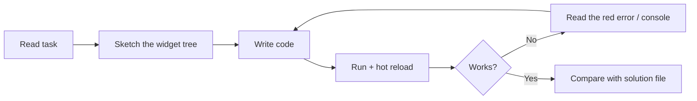

# Session 03: Practice Lab — Widgets Basics

> Module: Cross-Platform App Development with Flutter and Dart · Term 5 (ADSE) · ⏱ ~2 hours

This is a hands-on lab. You will practise everything from Sessions 01 and 02: app structure, common widgets, and Stateless vs Stateful widgets.
Try each task yourself first. The solution files are in this folder — open them only after you have tried.

## 🎯 Learning Objectives

By the end of this lab you will be able to:

- Build a complete screen from `MaterialApp`, `Scaffold` and common widgets without help
- Decide quickly whether a widget should be Stateless or Stateful
- Update the UI correctly with `setState()`
- React to user input from buttons, switches and text fields
- Debug common beginner errors using the error messages

## 📖 Concepts Explained

### 1. Quick recap

| Idea | Remember it as |
|------|---------------|
| `runApp(widget)` | "Put this widget on the screen" |
| `MaterialApp` | App shell (theme, navigation, direction) |
| `Scaffold` | One page: `appBar`, `body`, `floatingActionButton`, `bottomNavigationBar` |
| `StatelessWidget` | Fixed data — one class |
| `StatefulWidget` | Changing data — widget class + `State` class |
| `setState(() { ... })` | Change data **inside** the braces, then Flutter rebuilds |

### 2. Lab workflow



> **Tip:** sketching the widget tree on paper first (boxes inside boxes) saves a lot of time, especially for beginners.

### 3. Common beginner errors and fixes

| Error message (short) | Usual cause | Fix |
|-----------------------|-------------|-----|
| `No MaterialLocalizations found` / `No Directionality widget found` | Using Material widgets without `MaterialApp` | Wrap your page in `MaterialApp` |
| `setState() called after dispose()` | Updating state after the page closed (e.g. a timer) | Cancel timers in `dispose()` |
| Screen does not change after tap | Changed a variable without `setState` | Put the change inside `setState(() { ... })` |
| `A RenderFlex overflowed by N pixels` (yellow-black stripes) | Content is bigger than the screen | Wrap in `SingleChildScrollView` or use `ListView` |
| `Invalid constant value` | A `const` widget contains a changing variable | Remove `const` from that widget |

### 4. Stateless or Stateful? Decision guide

Ask one question: **"Will anything on this widget change while the user is looking at it?"**

- No → `StatelessWidget` (business card, about page, logo).
- Yes → `StatefulWidget` (quantity selector, switch, form input).

## 💻 Code Examples

These are the **solutions** to the lab tasks below.

### Task 1 solution: Digital business card (Stateless)

📄 File: [`main.dart`](./main.dart)

```dart
// main.dart
// Lab Task 1: a digital business card. Nothing changes, so it is Stateless.

import 'package:flutter/material.dart';

void main() {
  runApp(const MaterialApp(
    debugShowCheckedModeBanner: false,
    home: BusinessCardPage(),
  ));
}

class BusinessCardPage extends StatelessWidget {
  const BusinessCardPage({super.key});

  @override
  Widget build(BuildContext context) {
    return Scaffold(
      backgroundColor: Colors.teal, // colour of the whole page
      body: Center(
        child: Column(
          mainAxisSize: MainAxisSize.min,
          children: const [
            // CircleAvatar: a round picture or icon.
            CircleAvatar(
              radius: 50,
              backgroundColor: Colors.white,
              child: Icon(Icons.person, size: 60, color: Colors.teal),
            ),
            SizedBox(height: 12),
            Text(
              'Bilal Ahmed',
              style: TextStyle(fontSize: 30, color: Colors.white, fontWeight: FontWeight.bold),
            ),
            Text(
              'FLUTTER DEVELOPER',
              style: TextStyle(fontSize: 16, color: Colors.white70, letterSpacing: 2),
            ),
            SizedBox(height: 20),
            // Card + ListTile for each contact line.
            Card(
              margin: EdgeInsets.symmetric(horizontal: 32, vertical: 6),
              child: ListTile(
                leading: Icon(Icons.phone, color: Colors.teal),
                title: Text('+92 300 0000000'),
              ),
            ),
            Card(
              margin: EdgeInsets.symmetric(horizontal: 32, vertical: 6),
              child: ListTile(
                leading: Icon(Icons.email, color: Colors.teal),
                title: Text('bilal@example.com'),
              ),
            ),
          ],
        ),
      ),
    );
  }
}
```

**How it works**

- `CircleAvatar` gives a round picture; `Card` + `ListTile` make neat contact rows.
- Because every widget is fixed, the whole list can be `const`.

### Task 2 solution: Quantity selector (Stateful)

📄 File: [`quantity_selector.dart`](./quantity_selector.dart)

```dart
// quantity_selector.dart
// Lab Task 2: + and - buttons change a quantity and the total price.

import 'package:flutter/material.dart';

void main() {
  runApp(const MaterialApp(home: QuantityPage()));
}

class QuantityPage extends StatefulWidget {
  const QuantityPage({super.key});

  @override
  State<QuantityPage> createState() => _QuantityPageState();
}

class _QuantityPageState extends State<QuantityPage> {
  int quantity = 1;              // changing data
  final int pricePerItem = 350;  // fixed price in rupees

  void increase() {
    setState(() {
      quantity++;
    });
  }

  void decrease() {
    // Do not allow less than 1 item.
    if (quantity > 1) {
      setState(() {
        quantity--;
      });
    }
  }

  @override
  Widget build(BuildContext context) {
    int total = quantity * pricePerItem; // calculated on every build

    return Scaffold(
      appBar: AppBar(title: const Text('Zinger Burger')),
      body: Center(
        child: Column(
          mainAxisSize: MainAxisSize.min,
          children: [
            Row(
              mainAxisSize: MainAxisSize.min,
              children: [
                IconButton(onPressed: decrease, icon: const Icon(Icons.remove_circle)),
                Text('$quantity', style: const TextStyle(fontSize: 32)),
                IconButton(onPressed: increase, icon: const Icon(Icons.add_circle)),
              ],
            ),
            Text('Total: Rs. $total', style: const TextStyle(fontSize: 22)),
          ],
        ),
      ),
    );
  }
}
```

**How it works**

- The total is **calculated** inside `build()` from `quantity`, so it never gets out of sync.

### Task 3 solution: Light switch

📄 File: [`light_switch.dart`](./light_switch.dart)

```dart
// light_switch.dart
// Lab Task 3: a Switch turns a light bulb on and off.

import 'package:flutter/material.dart';

void main() {
  runApp(const MaterialApp(home: LightSwitchPage()));
}

class LightSwitchPage extends StatefulWidget {
  const LightSwitchPage({super.key});

  @override
  State<LightSwitchPage> createState() => _LightSwitchPageState();
}

class _LightSwitchPageState extends State<LightSwitchPage> {
  bool isOn = false;

  @override
  Widget build(BuildContext context) {
    return Scaffold(
      // Page colour depends on the state.
      backgroundColor: isOn ? Colors.yellow.shade100 : Colors.grey.shade800,
      body: Center(
        child: Column(
          mainAxisSize: MainAxisSize.min,
          children: [
            Icon(
              isOn ? Icons.lightbulb : Icons.lightbulb_outline,
              size: 120,
              color: isOn ? Colors.amber : Colors.white,
            ),
            // Switch gives us the new value in onChanged.
            Switch(
              value: isOn,
              onChanged: (newValue) {
                setState(() {
                  isOn = newValue;
                });
              },
            ),
          ],
        ),
      ),
    );
  }
}
```

**How it works**

- A `Switch` does not change itself: it shows `value` and reports taps through `onChanged`. You store the new value with `setState`.

### Task 4 solution: Live greeting from a text field

📄 File: [`greeting_input.dart`](./greeting_input.dart)

```dart
// greeting_input.dart
// Lab Task 4: type your name and see a greeting update while you type.

import 'package:flutter/material.dart';

void main() {
  runApp(const MaterialApp(home: GreetingPage()));
}

class GreetingPage extends StatefulWidget {
  const GreetingPage({super.key});

  @override
  State<GreetingPage> createState() => _GreetingPageState();
}

class _GreetingPageState extends State<GreetingPage> {
  String name = '';

  @override
  Widget build(BuildContext context) {
    // If nothing is typed yet, show a default word.
    String shownName = name.isEmpty ? 'Guest' : name;

    return Scaffold(
      appBar: AppBar(title: const Text('Greeting')),
      body: Padding(
        padding: const EdgeInsets.all(16),
        child: Column(
          children: [
            TextField(
              decoration: const InputDecoration(
                labelText: 'Your name',
                border: OutlineInputBorder(),
              ),
              // onChanged runs on every key press.
              onChanged: (text) {
                setState(() {
                  name = text;
                });
              },
            ),
            const SizedBox(height: 24),
            Text('Welcome, $shownName!', style: const TextStyle(fontSize: 24)),
          ],
        ),
      ),
    );
  }
}
```

**How it works**

- `onChanged` sends the latest text; `setState` stores it and the greeting rebuilds. (Session 08 shows the controller way.)

## 🧪 Lab Practice

1. **Business card:** build a card page with your photo icon, name, title, phone and email. Use only Stateless widgets.
2. **Quantity selector:** + / − buttons, minimum 1, show the total price. Bonus: maximum 10, show a message when reached.
3. **Light switch:** a `Switch` that changes an icon and the page background colour.
4. **Live greeting:** a `TextField` that updates a greeting while typing. Show "Guest" when empty.
5. **Debug challenge:** remove `setState` from Task 2, run it, explain why it breaks, then fix it.

## 📝 Assignment

Build `dice_roller.dart`: show a large number from 1 to 6 (or a dice icon) and a **Roll** button that picks a random number with `Random().nextInt(6) + 1` from `dart:math`. Also count and display how many times the user has rolled.

## ❓ Quick Quiz

1. Which widget gives a round profile picture?
2. Where should calculated values like a total price be computed?
3. What does a `Switch` do when tapped if you do not handle `onChanged` with `setState`?
4. What causes the yellow-black overflow stripes?
5. Why can't a `Text` showing a changing variable be `const`?

<details>
<summary>Show answers</summary>

1. `CircleAvatar`.
2. Inside `build()`, from the state values, so they always stay in sync.
3. It stays the same — the visible value comes only from `value`.
4. Content larger than the available space (a `RenderFlex` overflow).
5. `const` values must be known at compile time; a changing variable is not.

</details>

## 💼 Interview Questions

1. **What is a "controlled" widget like `Switch`?** — It shows the value you pass and reports changes through a callback; the parent stores the value, so the parent is the single source of truth.
2. **Why compute derived values in `build()` instead of storing them?** — Storing both the source and the derived value risks them getting out of sync; computing in `build()` keeps one source of truth.
3. **How do you debug a widget that does not update?** — Check that the data change happens inside `setState`, that the widget reading the value is below the State, and that it is not marked `const`.

## ✅ Summary

- Sketch the widget tree first, then code it.
- Stateless for fixed screens, Stateful for anything the user can change.
- Input widgets (`Switch`, `TextField`) report changes with callbacks; you store them with `setState`.
- Learn the common error messages — they usually tell you exactly what to fix.

---

[⬅ Previous](../Session-02-Widgets-Stateless-and-Stateful/README.md) · [🏠 Module Home](../README.md) · [Next ➡](../Session-04-Single-Child-Layout-Widgets/README.md)

Prepared by Zeeshan Abbas · Aptech Learning North Nazimabad
