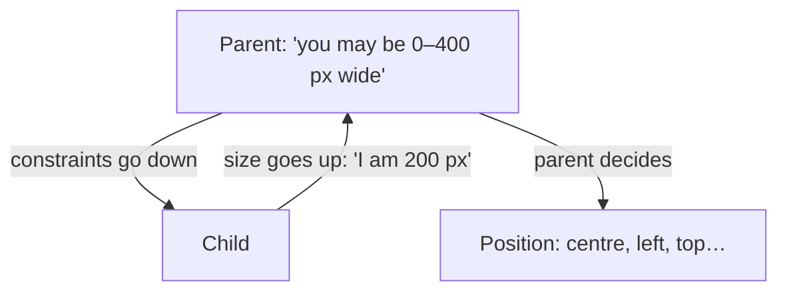
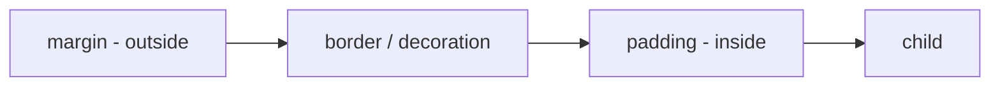

# Session 04: Single-Child Layout Widgets

> Module: Cross-Platform App Development with Flutter and Dart · Term 5 (ADSE) · ⏱ ~2 hours

Layout widgets decide **where** and **how big** things are. A *single-child* layout widget wraps exactly **one** child and changes its position, size or spacing.
In this session you master `Container`, `Padding`, `Center`, `Align` and `SizedBox` — the tools you will use on almost every screen.

## 🎯 Learning Objectives

By the end of this session you will be able to:

- Describe what a single-child layout widget is
- Use `Container` for size, colour, margin, padding, borders and rounded corners
- Add space with `Padding` and `SizedBox`
- Position a child with `Center` and `Align`
- Explain Flutter's layout rule: constraints go down, sizes go up

## 📖 Concepts Explained

### 1. Single-child vs multi-child

| Single-child (property: `child`) | Multi-child (property: `children`) |
|----------------------------------|------------------------------------|
| `Container`, `Padding`, `Center`, `Align`, `SizedBox`, `Expanded`, `AspectRatio`, `FittedBox` | `Row`, `Column`, `Stack`, `ListView`, `GridView`, `Wrap` (Session 05) |

### 2. How Flutter does layout

Flutter's golden rule: **constraints go down, sizes go up, the parent sets the position.**



> **Analogy:** a parent tells a child "you can spend up to Rs. 400". The child decides it needs Rs. 200 and reports back. The parent then decides where the child sits at the table.

This is why a `Container` with no size and no child becomes as big as possible, but a `Container` with a child shrinks to fit the child.

### 3. Container — the "Swiss army knife"

| Property | Meaning | Example |
|----------|---------|---------|
| `width`, `height` | Fixed size | `width: 200` |
| `color` | Background colour | `color: Colors.blue` |
| `padding` | Space **inside**, between border and child | `EdgeInsets.all(16)` |
| `margin` | Space **outside**, around the box | `EdgeInsets.symmetric(vertical: 8)` |
| `alignment` | Where the child sits inside | `Alignment.center` |
| `decoration` | Border, rounded corners, gradient, shadow | `BoxDecoration(...)` |

⚠ Use **either** `color` **or** `decoration` — if you need both, put the colour inside `BoxDecoration`, otherwise Flutter throws an error.



### 4. EdgeInsets cheat sheet

| Code | Space on |
|------|---------|
| `EdgeInsets.all(16)` | All four sides |
| `EdgeInsets.symmetric(horizontal: 20, vertical: 8)` | Left+right / top+bottom |
| `EdgeInsets.only(left: 10, top: 4)` | Only the sides you name |
| `EdgeInsets.fromLTRB(10, 20, 10, 0)` | Left, top, right, bottom |

### 5. Padding, Center, Align and SizedBox

| Widget | Job | When to use instead of Container |
|--------|-----|----------------------------------|
| `Padding` | Adds space around a child | When you only need spacing (lighter and clearer) |
| `Center` | Centres the child | When you only need centring |
| `Align` | Places the child at any position, e.g. `Alignment.topRight` | Corners, edges or custom positions |
| `SizedBox` | Fixed width/height, or an empty gap | Gaps between widgets; forcing a size on a button |

**Alignment coordinates:** `Alignment(x, y)` where x and y go from −1 to 1. `(-1, -1)` = top-left, `(0, 0)` = centre, `(1, 1)` = bottom-right.

## 💻 Code Examples

### Example 1: Container basics

📄 File: [`main.dart`](./main.dart)

```dart
// main.dart
// Container: size, colour, padding, margin and alignment.

import 'package:flutter/material.dart';

void main() {
  runApp(const MaterialApp(home: ContainerDemo()));
}

class ContainerDemo extends StatelessWidget {
  const ContainerDemo({super.key});

  @override
  Widget build(BuildContext context) {
    return Scaffold(
      appBar: AppBar(title: const Text('Container Basics')),
      body: Container(
        color: Colors.grey.shade300,              // outer grey area (whole body)
        child: Container(
          width: 250,                              // fixed width
          height: 150,                             // fixed height
          margin: const EdgeInsets.all(30),        // space OUTSIDE the blue box
          padding: const EdgeInsets.all(16),       // space INSIDE the blue box
          color: Colors.blue,                      // box colour
          alignment: Alignment.bottomRight,        // child goes bottom-right
          child: const Text(
            'Inside the box',
            style: TextStyle(color: Colors.white),
          ),
        ),
      ),
    );
  }
}
```

**How it works**

- The grey margin shows space *outside* the blue box; the text keeps 16 px away from the edges because of *padding*.
- `alignment` moves the child inside the box. Try `Alignment.topLeft`.

### Example 2: Decorated card with BoxDecoration

📄 File: [`decorated_box.dart`](./decorated_box.dart)

```dart
// decorated_box.dart
// BoxDecoration: rounded corners, border, shadow and gradient.

import 'package:flutter/material.dart';

void main() {
  runApp(const MaterialApp(home: DecoratedBoxDemo()));
}

class DecoratedBoxDemo extends StatelessWidget {
  const DecoratedBoxDemo({super.key});

  @override
  Widget build(BuildContext context) {
    return Scaffold(
      appBar: AppBar(title: const Text('BoxDecoration')),
      body: Center(
        child: Container(
          width: 280,
          padding: const EdgeInsets.all(20),
          // NOTE: colour goes INSIDE decoration, not as color: on Container.
          decoration: BoxDecoration(
            // Gradient: smooth change from one colour to another.
            gradient: const LinearGradient(
              colors: [Colors.purple, Colors.blue],
            ),
            borderRadius: BorderRadius.circular(20),          // rounded corners
            border: Border.all(color: Colors.white, width: 3), // white border
            boxShadow: const [
              BoxShadow(color: Colors.black26, blurRadius: 12, offset: Offset(0, 6)),
            ],
          ),
          child: const Text(
            'Fee Voucher\nRs. 12,500\nDue: 10th of month',
            style: TextStyle(color: Colors.white, fontSize: 18),
          ),
        ),
      ),
    );
  }
}
```

**How it works**

- `BoxDecoration` paints the background: gradient, rounded corners, border and shadow.
- `\n` inside a string starts a new line.

### Example 3: Padding, Center, Align and SizedBox

📄 File: [`align_and_spacing.dart`](./align_and_spacing.dart)

```dart
// align_and_spacing.dart
// Padding, Align, Center and SizedBox in one screen.

import 'package:flutter/material.dart';

void main() {
  runApp(const MaterialApp(home: AlignDemo()));
}

class AlignDemo extends StatelessWidget {
  const AlignDemo({super.key});

  @override
  Widget build(BuildContext context) {
    return Scaffold(
      appBar: AppBar(title: const Text('Align & Spacing')),
      // Padding: keep everything 16 px away from the screen edges.
      body: Padding(
        padding: const EdgeInsets.all(16),
        child: Column(
          children: [
            // Align: put the badge on the right side.
            const Align(
              alignment: Alignment.centerRight,
              child: Chip(label: Text('New')),
            ),

            // SizedBox as an empty gap of 40 px.
            const SizedBox(height: 40),

            // SizedBox to force a full-width button.
            SizedBox(
              width: double.infinity, // as wide as allowed
              height: 50,
              child: ElevatedButton(
                onPressed: () {},
                child: const Text('Full-width button'),
              ),
            ),

            const SizedBox(height: 40),

            // Center inside a fixed-size coloured box.
            Container(
              width: 200,
              height: 120,
              color: Colors.orange.shade200,
              child: const Center(child: Text('Centred text')),
            ),
          ],
        ),
      ),
    );
  }
}
```

**How it works**

- `double.infinity` means "take all the width the parent allows" — a common trick for full-width buttons.
- Prefer `Padding`/`SizedBox`/`Center` over `Container` when you need only one feature; your code reads more clearly.

### Example 4: Alignment coordinates

📄 File: [`alignment_grid.dart`](./alignment_grid.dart)

```dart
// alignment_grid.dart
// Move a ball around a box using Alignment(x, y). Tap the button to change position.

import 'package:flutter/material.dart';

void main() {
  runApp(const MaterialApp(home: AlignmentGrid()));
}

class AlignmentGrid extends StatefulWidget {
  const AlignmentGrid({super.key});

  @override
  State<AlignmentGrid> createState() => _AlignmentGridState();
}

class _AlignmentGridState extends State<AlignmentGrid> {
  // A list of positions to visit, one after another.
  final List<Alignment> positions = const [
    Alignment.topLeft,      // (-1, -1)
    Alignment.topRight,     // ( 1, -1)
    Alignment.center,       // ( 0,  0)
    Alignment.bottomLeft,   // (-1,  1)
    Alignment(0.5, 0.8),    // a custom position
  ];
  int index = 0;

  @override
  Widget build(BuildContext context) {
    return Scaffold(
      appBar: AppBar(title: Text('Alignment: ${positions[index]}')),
      body: Container(
        margin: const EdgeInsets.all(20),
        height: 300,
        color: Colors.green.shade100,
        child: Align(
          alignment: positions[index],
          child: const Icon(Icons.sports_cricket, size: 48),
        ),
      ),
      floatingActionButton: FloatingActionButton(
        onPressed: () {
          setState(() {
            // Go to the next position; % wraps back to 0 at the end.
            index = (index + 1) % positions.length;
          });
        },
        child: const Icon(Icons.navigate_next),
      ),
    );
  }
}
```

**How it works**

- Each tap picks the next `Alignment`; `%` (remainder) loops back to the first position.

## 🧪 Lab Practice

1. In `main.dart`, swap the values of `margin` and `padding` and describe what changed.
2. Change `decorated_box.dart` to make a circular avatar box using `shape: BoxShape.circle` (remove `borderRadius`).
3. Build a "notice" banner: full width, 12 px padding, amber background, rounded corners 8, with a warning icon and text.
4. Using only `Align`, place three small `Chip` widgets at top-left, centre and bottom-right of a 300 × 300 box (hint: use a `Stack` or three separate boxes).
5. Add your own custom `Alignment(x, y)` values to `alignment_grid.dart` and predict where the icon will appear before tapping.

## 📝 Assignment

Design `fee_voucher.dart`: a centred voucher card (width 320) with rounded corners, a shadow, a coloured header strip showing "Aptech North Nazimabad" and a body with student name, month and amount — using only the widgets from this session plus `Column` and `Text`.

## ❓ Quick Quiz

1. What is the difference between `margin` and `padding`?
2. Why does Flutter throw an error if you set both `color` and `decoration` on a Container?
3. Which widget would you use only to add a 20 px gap between two widgets?
4. What does `Alignment(1, 1)` mean?
5. Complete the rule: "Constraints go ____, sizes go ____."

<details>
<summary>Show answers</summary>

1. Margin is space outside the box; padding is space inside, between the border and the child.
2. `color` is a shortcut for `BoxDecoration(color:)`, so both would paint the background; put the colour inside the decoration.
3. `SizedBox(height: 20)` (or `width: 20` in a row).
4. Bottom-right.
5. Down; up (and the parent sets the position).

</details>

## 💼 Interview Questions

1. **Explain Flutter's layout constraints model.** — A parent passes min/max width and height constraints to its child; the child picks a size inside them and reports it; the parent then positions the child.
2. **Container vs SizedBox?** — `SizedBox` only sets a size (and can be `const`), while `Container` combines size, padding, margin, decoration and alignment. Use the simplest widget that does the job.
3. **Why does an empty Container fill the screen?** — With no child and no size, it expands to the largest size its constraints allow.

## ✅ Summary

- Single-child layout widgets wrap one `child` and control its size, space or position.
- `Container` does many jobs; `BoxDecoration` adds corners, borders, gradients and shadows.
- `Padding` and `SizedBox` add space; `Center` and `Align` position the child.
- Constraints go down, sizes go up, the parent sets the position.

---

[⬅ Previous](../Session-03-Practice-Lab-Widgets-Basics/README.md) · [🏠 Module Home](../README.md) · [Next ➡](../Session-05-Multi-Child-Layout-Widgets/README.md)

Prepared by Zeeshan Abbas · Aptech Learning North Nazimabad
