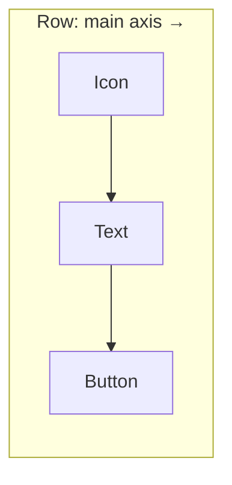

# Session 05: Multi-Child Layout Widgets (Row, Column, Stack, ListView, GridView)

> Module: Cross-Platform App Development with Flutter and Dart · Term 5 (ADSE) · ⏱ ~2 hours

Real screens show many things at once: a row of icons, a column of cards, a scrolling list, a grid of products.
*Multi-child* layout widgets take a list of `children` and arrange them. This session covers `Row`, `Column`, `Expanded`, `Stack`, `ListView`, `GridView` and `Table`.

## 🎯 Learning Objectives

By the end of this session you will be able to:

- Arrange widgets horizontally and vertically with `Row` and `Column`
- Control alignment with `mainAxisAlignment` and `crossAxisAlignment`
- Share space with `Expanded` and `Flexible`
- Overlap widgets with `Stack` and `Positioned`
- Build scrolling lists and grids with `ListView.builder` and `GridView`
- Describe recent Material 3 and layout improvements

## 📖 Concepts Explained

### 1. Row and Column — main axis and cross axis

| | Row | Column |
|---|-----|--------|
| Main axis (direction of children) | Horizontal → | Vertical ↓ |
| Cross axis | Vertical | Horizontal |



| `mainAxisAlignment` | Effect |
|--------------------|--------|
| `start` / `end` / `center` | Pack children at the start, end or middle |
| `spaceBetween` | First and last at the edges, equal gaps between |
| `spaceAround` | Equal space around each child (half-gaps at the edges) |
| `spaceEvenly` | All gaps equal, including the edges |

`crossAxisAlignment` uses `start`, `end`, `center` and `stretch` (fill the cross axis).

### 2. Expanded and Flexible — sharing space

A `Row` gives children only the space they ask for. `Expanded` says "take the **remaining** space". With `flex`, you share it in ratios.

> **Analogy:** three friends share one pizza. `flex: 2, 1, 1` means the first friend gets half, the others a quarter each.

`Flexible` is like `Expanded` but lets the child be **smaller** than its share. Use `Expanded` in 90% of cases.

### 3. Stack and Positioned — layers

`Stack` places children **on top of each other** (first child at the bottom). `Positioned` pins a child to `top`, `left`, `right` or `bottom`. Typical uses: a badge on an icon, text over an image, a floating label.

### 4. ListView — scrolling lists

| Constructor | Use when |
|-------------|----------|
| `ListView(children: [...])` | A few fixed items |
| `ListView.builder(itemCount:, itemBuilder:)` | Long or dynamic lists — builds only visible items (fast) |
| `ListView.separated(...)` | Same as builder but adds a divider between items |

### 5. GridView — rows and columns of items

| Constructor | Use when |
|-------------|----------|
| `GridView.count(crossAxisCount: 2, ...)` | Fixed number of columns |
| `GridView.builder(gridDelegate:, itemBuilder:)` | Long or dynamic grids |
| `GridView.extent(maxCrossAxisExtent: 150)` | Columns adapt to screen width (good for tablets) |

### 6. Table and Wrap

- `Table` arranges children in **rows and cells** like an HTML table — good for timetables and result cards.
- `Wrap` is like a `Row` that moves to the next line when space runs out — great for tags and chips.

### 7. Recent updates (Material 3 era)

| Update | What it means |
|--------|---------------|
| Material 3 is the **default** theme | Rounder cards, new colour system, `NavigationBar` replaces old bottom bar look |
| `spacing` on `Row` / `Column` (Flutter 3.27+) | Add equal gaps without many `SizedBox` widgets: `Column(spacing: 12, children: ...)` |
| `Card.filled()` / `Card.outlined()` | Ready-made Material 3 card variants |
| `CarouselView` | A Material 3 scrolling carousel widget |

> If your Flutter version is older, use `SizedBox` gaps instead of `spacing`. Check with `flutter --version`.

## 💻 Code Examples

### Example 1: Row and Column

📄 File: [`main.dart`](./main.dart)

```dart
// main.dart
// Row (horizontal) inside a Column (vertical), with alignment options.

import 'package:flutter/material.dart';

void main() {
  runApp(const MaterialApp(home: RowColumnDemo()));
}

class RowColumnDemo extends StatelessWidget {
  const RowColumnDemo({super.key});

  @override
  Widget build(BuildContext context) {
    return Scaffold(
      appBar: AppBar(title: const Text('Row & Column')),
      body: Column(
        // Main axis of a Column is vertical: spread children top to bottom.
        mainAxisAlignment: MainAxisAlignment.spaceEvenly,
        // Cross axis is horizontal: stretch children to full width.
        crossAxisAlignment: CrossAxisAlignment.stretch,
        children: [
          // A Row of three icons, spread out evenly.
          Container(
            color: Colors.blue.shade50,
            padding: const EdgeInsets.all(12),
            child: const Row(
              mainAxisAlignment: MainAxisAlignment.spaceBetween,
              children: [
                Icon(Icons.home, size: 40),
                Icon(Icons.search, size: 40),
                Icon(Icons.person, size: 40),
              ],
            ),
          ),
          // A Row with icon + text, centred.
          const Row(
            mainAxisAlignment: MainAxisAlignment.center,
            children: [
              Icon(Icons.location_on, color: Colors.red),
              SizedBox(width: 8),
              Text('North Nazimabad, Karachi', style: TextStyle(fontSize: 18)),
            ],
          ),
          // A full-width button (because of stretch).
          Padding(
            padding: const EdgeInsets.symmetric(horizontal: 16),
            child: ElevatedButton(onPressed: () {}, child: const Text('Enrol Now')),
          ),
        ],
      ),
    );
  }
}
```

**How it works**

- `spaceEvenly` spreads the three blocks down the screen; `stretch` makes them full width.
- Change `spaceBetween` in the icon row to `center` or `spaceAround` and hot reload to compare.

### Example 2: Expanded with flex

📄 File: [`expanded_demo.dart`](./expanded_demo.dart)

```dart
// expanded_demo.dart
// Expanded shares the remaining space. flex sets the ratio.

import 'package:flutter/material.dart';

void main() {
  runApp(const MaterialApp(home: ExpandedDemo()));
}

class ExpandedDemo extends StatelessWidget {
  const ExpandedDemo({super.key});

  @override
  Widget build(BuildContext context) {
    return Scaffold(
      appBar: AppBar(title: const Text('Expanded & flex')),
      body: Column(
        children: [
          // flex 2 : 1 : 1  -> red gets half the height, others a quarter each.
          Expanded(flex: 2, child: Container(color: Colors.red, child: const Center(child: Text('flex 2')))),
          Expanded(flex: 1, child: Container(color: Colors.green, child: const Center(child: Text('flex 1')))),
          Expanded(flex: 1, child: Container(color: Colors.blue, child: const Center(child: Text('flex 1')))),

          // A search bar row: TextField takes all space left after the button.
          Padding(
            padding: const EdgeInsets.all(8),
            child: Row(
              children: [
                const Expanded(
                  child: TextField(decoration: InputDecoration(hintText: 'Search courses')),
                ),
                IconButton(onPressed: () {}, icon: const Icon(Icons.search)),
              ],
            ),
          ),
        ],
      ),
    );
  }
}
```

**How it works**

- Without `Expanded`, a `TextField` inside a `Row` causes an error because it wants infinite width. `Expanded` gives it a fixed share.

### Example 3: Stack and Positioned

📄 File: [`stack_demo.dart`](./stack_demo.dart)

```dart
// stack_demo.dart
// Stack puts widgets on top of each other. Positioned pins them.

import 'package:flutter/material.dart';

void main() {
  runApp(const MaterialApp(home: StackDemo()));
}

class StackDemo extends StatelessWidget {
  const StackDemo({super.key});

  @override
  Widget build(BuildContext context) {
    return Scaffold(
      appBar: AppBar(title: const Text('Stack')),
      body: Center(
        child: Stack(
          children: [
            // Layer 1 (bottom): a big coloured box like a banner image.
            Container(width: 300, height: 180, color: Colors.indigo),

            // Layer 2: text pinned to the bottom-left corner.
            const Positioned(
              left: 16,
              bottom: 16,
              child: Text('Flutter Bootcamp', style: TextStyle(color: Colors.white, fontSize: 22)),
            ),

            // Layer 3 (top): a "SALE" badge pinned to the top-right corner.
            Positioned(
              top: 10,
              right: 10,
              child: Container(
                padding: const EdgeInsets.symmetric(horizontal: 8, vertical: 4),
                color: Colors.red,
                child: const Text('50% OFF', style: TextStyle(color: Colors.white)),
              ),
            ),
          ],
        ),
      ),
    );
  }
}
```

**How it works**

- Children are painted in order, so the badge (last) appears on top of the banner (first).

### Example 4: ListView.builder

📄 File: [`listview_builder.dart`](./listview_builder.dart)

```dart
// listview_builder.dart
// A scrolling list built from a Dart list. Only visible rows are created.

import 'package:flutter/material.dart';

void main() {
  runApp(const MaterialApp(home: CourseListPage()));
}

class CourseListPage extends StatelessWidget {
  const CourseListPage({super.key});

  // Our data: a simple list of course names.
  final List<String> courses = const [
    'Agile and DevOps', 'Dart Programming', 'Flutter', 'Python Apps',
    'Machine Learning', 'Deep Learning', 'NLP', 'Computer Vision',
    'Generative AI', 'Cloud Basics', 'Data Science', 'eProject',
  ];

  @override
  Widget build(BuildContext context) {
    return Scaffold(
      appBar: AppBar(title: const Text('Courses')),
      body: ListView.builder(
        itemCount: courses.length, // how many rows
        // itemBuilder is called for each visible row with its index.
        itemBuilder: (context, index) {
          return ListTile(
            leading: CircleAvatar(child: Text('${index + 1}')),
            title: Text(courses[index]),
            trailing: const Icon(Icons.chevron_right),
          );
        },
      ),
    );
  }
}
```

**How it works**

- `itemBuilder` runs only for rows on screen, so a list of 10,000 items is still fast.

### Example 5: GridView.count

📄 File: [`gridview_demo.dart`](./gridview_demo.dart)

```dart
// gridview_demo.dart
// A 2-column grid of menu tiles, like a dashboard.

import 'package:flutter/material.dart';

void main() {
  runApp(const MaterialApp(home: DashboardPage()));
}

class DashboardPage extends StatelessWidget {
  const DashboardPage({super.key});

  @override
  Widget build(BuildContext context) {
    // Each menu item: an icon and a label.
    final List<IconData> icons = [Icons.class_, Icons.assignment, Icons.payments, Icons.event, Icons.chat, Icons.settings];
    final List<String> labels = ['Classes', 'Assignments', 'Fees', 'Events', 'Chat', 'Settings'];

    return Scaffold(
      appBar: AppBar(title: const Text('Student Dashboard')),
      body: GridView.count(
        crossAxisCount: 2,      // 2 columns
        padding: const EdgeInsets.all(12),
        mainAxisSpacing: 12,    // vertical gap
        crossAxisSpacing: 12,   // horizontal gap
        // List.generate makes one Card per item.
        children: List.generate(icons.length, (index) {
          return Card(
            child: Column(
              mainAxisAlignment: MainAxisAlignment.center,
              children: [
                Icon(icons[index], size: 48, color: Colors.teal),
                const SizedBox(height: 8),
                Text(labels[index], style: const TextStyle(fontSize: 16)),
              ],
            ),
          );
        }),
      ),
    );
  }
}
```

**How it works**

- `crossAxisCount: 2` fixes two columns; the grid scrolls automatically when it is taller than the screen.

### Example 6: Table and Wrap

📄 File: [`table_and_wrap.dart`](./table_and_wrap.dart)

```dart
// table_and_wrap.dart
// Table for a timetable, Wrap for tags that flow onto the next line.

import 'package:flutter/material.dart';

void main() {
  runApp(const MaterialApp(home: TableWrapDemo()));
}

class TableWrapDemo extends StatelessWidget {
  const TableWrapDemo({super.key});

  // Small helper that makes one padded table cell.
  Widget cell(String text) {
    return Padding(padding: const EdgeInsets.all(8), child: Text(text));
  }

  @override
  Widget build(BuildContext context) {
    return Scaffold(
      appBar: AppBar(title: const Text('Table & Wrap')),
      body: Padding(
        padding: const EdgeInsets.all(16),
        child: Column(
          children: [
            Table(
              border: TableBorder.all(color: Colors.grey),
              children: [
                TableRow(children: [cell('Day'), cell('Module'), cell('Time')]),
                TableRow(children: [cell('Mon'), cell('Flutter'), cell('6–8 pm')]),
                TableRow(children: [cell('Wed'), cell('Python'), cell('6–8 pm')]),
              ],
            ),
            const SizedBox(height: 24),
            // Wrap: chips move to a new line when the row is full.
            Wrap(
              spacing: 8,     // horizontal gap
              runSpacing: 8,  // gap between lines
              children: ['Dart', 'Flutter', 'Firebase', 'REST', 'SQLite', 'TFLite', 'ML Kit']
                  .map((tag) => Chip(label: Text(tag)))
                  .toList(),
            ),
          ],
        ),
      ),
    );
  }
}
```

**How it works**

- Every `TableRow` must have the same number of cells. `.map(...).toList()` turns a list of strings into a list of `Chip` widgets.

## 🧪 Lab Practice

1. In `main.dart`, try all six `mainAxisAlignment` values on the icon row and write one line about each.
2. Build a profile header: `Row` with a `CircleAvatar` on the left and a `Column` (name, email) on the right, wrapped in `Expanded`.
3. Add a small red notification badge with a number on top of a bell icon using `Stack` + `Positioned`.
4. Change `listview_builder.dart` to `ListView.separated` with a `Divider` between rows.
5. Change `gridview_demo.dart` to 3 columns, then try `GridView.extent(maxCrossAxisExtent: 160)` and resize the Chrome window.

## 📝 Assignment

Build `product_catalogue.dart`: a `GridView.builder` of at least 8 products (name, price, icon) using a list of Dart maps. Each tile should use a `Stack` to show a "New" badge on the first three items.

## ❓ Quick Quiz

1. What is the main axis of a `Column`?
2. Which `mainAxisAlignment` puts equal space everywhere, including the edges?
3. Why should you use `ListView.builder` for long lists?
4. In a `Stack`, which child appears on top?
5. Why does a `TextField` directly inside a `Row` cause an error?

<details>
<summary>Show answers</summary>

1. Vertical (top to bottom).
2. `MainAxisAlignment.spaceEvenly`.
3. It builds only the visible items, saving memory and time.
4. The last child in the `children` list.
5. A `Row` gives unbounded width and a `TextField` tries to be infinitely wide; wrap it in `Expanded`.

</details>

## 💼 Interview Questions

1. **Expanded vs Flexible?** — Both share remaining space by `flex`; `Expanded` forces the child to fill its share, `Flexible` lets the child be smaller than its share.
2. **How do you make a long list efficient?** — Use `ListView.builder` (lazy building), give items stable keys when they can move, and keep each item widget light.
3. **When would you choose Stack over Column?** — When widgets need to overlap, such as text on an image or a badge on an icon.

## ✅ Summary

- `Row` is horizontal, `Column` is vertical; align with main and cross axis properties.
- `Expanded` shares remaining space in ratios using `flex`.
- `Stack` + `Positioned` layer widgets on top of each other.
- `ListView.builder` and `GridView` build scrolling lists and grids efficiently.
- `Table` and `Wrap` handle timetables and flowing tags; Material 3 adds `spacing`, new cards and more.

---

[⬅ Previous](../Session-04-Single-Child-Layout-Widgets/README.md) · [🏠 Module Home](../README.md) · [Next ➡](../Session-06-Practice-Lab-Layouts/README.md)

Prepared by Zeeshan Abbas · Aptech Learning North Nazimabad
