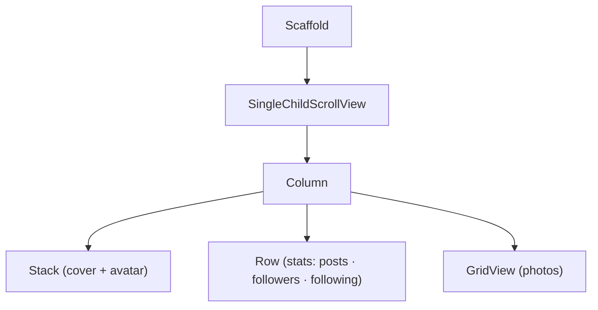

# Session 06: Practice Lab — Layouts

> Module: Cross-Platform App Development with Flutter and Dart · Term 5 (ADSE) · ⏱ ~2 hours

This lab turns Sessions 04 and 05 into real screens. You will rebuild layouts you see in everyday apps: a login page, a contact list, a recipe card and a profile header.
Try each task first, then compare with the solution files in this folder.

## 🎯 Learning Objectives

By the end of this lab you will be able to:

- Break any app screenshot into rows, columns and stacks
- Combine single-child and multi-child layout widgets on one screen
- Avoid and fix overflow errors with scrolling widgets and `Expanded`
- Build reusable small widgets (helper methods and custom widget classes)
- Use Flutter DevTools' layout explorer to inspect a screen

## 📖 Concepts Explained

### 1. How to read a screen like a developer

Look at a screen and ask three questions, from the outside in:

1. **Does it scroll?** → `ListView` or `SingleChildScrollView` at the top.
2. **Is it top-to-bottom or side-by-side?** → `Column` or `Row`.
3. **Does anything overlap?** → `Stack`.



### 2. Make small reusable widgets

When the same block appears more than once (a contact row, a stat box), turn it into its **own widget class** with constructor parameters.

| Approach | Example | Good for |
|----------|---------|----------|
| Helper method | `Widget statBox(String n, String label)` | Tiny pieces used in one file |
| Custom widget class | `class StatBox extends StatelessWidget` | Reuse across files; better performance with `const` |

### 3. Overflow survival guide

| Symptom | Fix |
|---------|-----|
| Column too tall (bottom stripes) | Wrap the body in `SingleChildScrollView` |
| Row too wide (side stripes) | Wrap the long child in `Expanded`; for text add `overflow: TextOverflow.ellipsis` |
| Keyboard covers fields | Use `SingleChildScrollView`; `Scaffold` resizes for the keyboard by default |
| GridView inside Column errors | Give it `shrinkWrap: true` and `physics: NeverScrollableScrollPhysics()`, or wrap it in `Expanded` |

### 4. Flutter DevTools

Run the app from Android Studio / VS Code and open **Flutter DevTools → Widget Inspector**. Click any widget on the device to see its place in the tree, its constraints and its size. Turn on **"Show guidelines"** to see padding and alignment lines drawn on the screen.

## 💻 Code Examples

These are the **solutions** to the lab tasks below.

### Task 1 solution: Login screen layout

📄 File: [`main.dart`](./main.dart)

```dart
// main.dart
// Lab Task 1: a login screen layout (no real login yet, only the UI).

import 'package:flutter/material.dart';

void main() {
  runApp(const MaterialApp(debugShowCheckedModeBanner: false, home: LoginPage()));
}

class LoginPage extends StatelessWidget {
  const LoginPage({super.key});

  @override
  Widget build(BuildContext context) {
    return Scaffold(
      // SingleChildScrollView stops overflow when the keyboard opens.
      body: SingleChildScrollView(
        padding: const EdgeInsets.all(24),
        child: Column(
          crossAxisAlignment: CrossAxisAlignment.stretch, // full-width children
          children: [
            const SizedBox(height: 60),
            const Icon(Icons.school, size: 80, color: Colors.indigo),
            const Text(
              'Student Portal',
              textAlign: TextAlign.center,
              style: TextStyle(fontSize: 28, fontWeight: FontWeight.bold),
            ),
            const SizedBox(height: 32),
            const TextField(
              decoration: InputDecoration(
                labelText: 'Email',
                prefixIcon: Icon(Icons.email),
                border: OutlineInputBorder(),
              ),
            ),
            const SizedBox(height: 16),
            const TextField(
              obscureText: true, // hide the password with dots
              decoration: InputDecoration(
                labelText: 'Password',
                prefixIcon: Icon(Icons.lock),
                border: OutlineInputBorder(),
              ),
            ),
            // "Forgot password?" aligned to the right.
            Align(
              alignment: Alignment.centerRight,
              child: TextButton(onPressed: () {}, child: const Text('Forgot password?')),
            ),
            SizedBox(
              height: 50,
              child: FilledButton(onPressed: () {}, child: const Text('Login')),
            ),
            const SizedBox(height: 16),
            // Row centred: text + link button.
            Row(
              mainAxisAlignment: MainAxisAlignment.center,
              children: [
                const Text("Don't have an account?"),
                TextButton(onPressed: () {}, child: const Text('Sign up')),
              ],
            ),
          ],
        ),
      ),
    );
  }
}
```

**How it works**

- `CrossAxisAlignment.stretch` makes fields and the button full width without setting widths.
- `SingleChildScrollView` lets the form scroll when the keyboard covers part of the screen.

### Task 2 solution: Contact list with a reusable widget

📄 File: [`contact_list.dart`](./contact_list.dart)

```dart
// contact_list.dart
// Lab Task 2: a contact list that uses our own reusable ContactTile widget.

import 'package:flutter/material.dart';

void main() {
  runApp(const MaterialApp(home: ContactListPage()));
}

class ContactListPage extends StatelessWidget {
  const ContactListPage({super.key});

  @override
  Widget build(BuildContext context) {
    // Data: each contact is a name and a phone number.
    final List<Map<String, String>> contacts = [
      {'name': 'Ali Raza', 'phone': '0300 1111111'},
      {'name': 'Fatima Noor', 'phone': '0301 2222222'},
      {'name': 'Hassan Javed', 'phone': '0302 3333333'},
      {'name': 'Sana Tariq', 'phone': '0303 4444444'},
    ];

    return Scaffold(
      appBar: AppBar(title: const Text('Contacts')),
      body: ListView.builder(
        itemCount: contacts.length,
        itemBuilder: (context, index) {
          // Reuse the same widget for every contact.
          return ContactTile(
            name: contacts[index]['name']!,
            phone: contacts[index]['phone']!,
          );
        },
      ),
    );
  }
}

// Our own reusable widget. It receives data through its constructor.
class ContactTile extends StatelessWidget {
  final String name;
  final String phone;

  const ContactTile({super.key, required this.name, required this.phone});

  @override
  Widget build(BuildContext context) {
    return Padding(
      padding: const EdgeInsets.symmetric(horizontal: 16, vertical: 8),
      child: Row(
        children: [
          // First letter of the name inside a circle.
          CircleAvatar(child: Text(name[0])),
          const SizedBox(width: 12),
          // Expanded so long names never overflow the row.
          Expanded(
            child: Column(
              crossAxisAlignment: CrossAxisAlignment.start,
              children: [
                Text(name, style: const TextStyle(fontWeight: FontWeight.bold)),
                Text(phone, style: const TextStyle(color: Colors.grey)),
              ],
            ),
          ),
          const Icon(Icons.call, color: Colors.green),
        ],
      ),
    );
  }
}
```

**How it works**

- `ContactTile` is written once and reused for every row; data comes in through `required` named parameters.
- `name[0]` takes the first letter of the name for the avatar.

### Task 3 solution: Recipe card with Stack

📄 File: [`recipe_card.dart`](./recipe_card.dart)

```dart
// recipe_card.dart
// Lab Task 3: an image card with a title over the picture and info below.

import 'package:flutter/material.dart';

void main() {
  runApp(const MaterialApp(home: Scaffold(body: Center(child: RecipeCard()))));
}

class RecipeCard extends StatelessWidget {
  const RecipeCard({super.key});

  @override
  Widget build(BuildContext context) {
    return Card(
      clipBehavior: Clip.antiAlias, // cut the image to the card's round corners
      margin: const EdgeInsets.all(16),
      child: Column(
        mainAxisSize: MainAxisSize.min,
        children: [
          // Stack: picture at the bottom, title on top of it.
          Stack(
            children: [
              Image.network(
                'https://picsum.photos/id/292/600/300',
                height: 180,
                width: double.infinity,
                fit: BoxFit.cover,
              ),
              Positioned(
                left: 12,
                bottom: 12,
                child: Container(
                  padding: const EdgeInsets.all(6),
                  color: Colors.black54,
                  child: const Text('Chicken Biryani', style: TextStyle(color: Colors.white, fontSize: 20)),
                ),
              ),
            ],
          ),
          // Info row: three icon + text pairs spread evenly.
          const Padding(
            padding: EdgeInsets.all(12),
            child: Row(
              mainAxisAlignment: MainAxisAlignment.spaceAround,
              children: [
                Row(children: [Icon(Icons.timer, size: 18), SizedBox(width: 4), Text('45 min')]),
                Row(children: [Icon(Icons.people, size: 18), SizedBox(width: 4), Text('4 people')]),
                Row(children: [Icon(Icons.local_fire_department, size: 18), SizedBox(width: 4), Text('Spicy')]),
              ],
            ),
          ),
        ],
      ),
    );
  }
}
```

**How it works**

- `clipBehavior: Clip.antiAlias` trims the picture so it follows the card's rounded corners.

### Task 4 solution: Profile header with stats

📄 File: [`profile_header.dart`](./profile_header.dart)

```dart
// profile_header.dart
// Lab Task 4: cover photo + overlapping avatar + a row of stats.

import 'package:flutter/material.dart';

void main() {
  runApp(const MaterialApp(home: ProfileHeaderPage()));
}

class ProfileHeaderPage extends StatelessWidget {
  const ProfileHeaderPage({super.key});

  // Helper method: one number with a label under it.
  Widget statBox(String number, String label) {
    return Column(
      children: [
        Text(number, style: const TextStyle(fontSize: 20, fontWeight: FontWeight.bold)),
        Text(label, style: const TextStyle(color: Colors.grey)),
      ],
    );
  }

  @override
  Widget build(BuildContext context) {
    return Scaffold(
      body: Column(
        children: [
          // Stack with clipBehavior none so the avatar can hang below the cover.
          Stack(
            clipBehavior: Clip.none,
            alignment: Alignment.center,
            children: [
              Container(height: 160, color: Colors.teal),
              const Positioned(
                bottom: -40, // half of the avatar sits below the cover
                child: CircleAvatar(
                  radius: 45,
                  backgroundColor: Colors.white,
                  child: Icon(Icons.person, size: 50),
                ),
              ),
            ],
          ),
          const SizedBox(height: 50), // room for the hanging avatar
          const Text('Zara Ahmed', style: TextStyle(fontSize: 22, fontWeight: FontWeight.bold)),
          const SizedBox(height: 16),
          // The stats row.
          Row(
            mainAxisAlignment: MainAxisAlignment.spaceEvenly,
            children: [
              statBox('24', 'Projects'),
              statBox('1.2k', 'Followers'),
              statBox('180', 'Following'),
            ],
          ),
        ],
      ),
    );
  }
}
```

**How it works**

- `clipBehavior: Clip.none` lets the avatar draw outside the Stack; a negative `bottom` pushes it halfway below the cover.
- Note: the hanging part does not take space in the column, so we add a `SizedBox(height: 50)` below.

## 🧪 Lab Practice

1. **Login screen:** build the login layout. Then rotate the emulator to landscape and confirm nothing overflows.
2. **Contact list:** create a `ContactTile` widget and show at least 6 contacts. Add an email line to the tile.
3. **Recipe card:** use `Stack` to place a title over an image and a row of three info items below.
4. **Profile header:** cover, overlapping avatar, name and a stats row. Add a photo `GridView` below it (`Expanded` + `GridView.count`).
5. **DevTools:** open the Widget Inspector on Task 4 and write down the size of the `CircleAvatar` and the constraints it received.

## 📝 Assignment

Recreate the home screen of any food-delivery or shopping app you use (search bar, horizontal category chips, a "Popular" grid of items). Submit your code and a side-by-side screenshot: original app vs your Flutter version.

## ❓ Quick Quiz

1. Which widget do you wrap around a form so the keyboard does not cause overflow?
2. How can a long name in a `Row` avoid overflow?
3. What does `clipBehavior: Clip.none` do on a `Stack`?
4. Why turn a repeated block into a custom widget class?
5. Which DevTools feature shows a widget's constraints and size?

<details>
<summary>Show answers</summary>

1. `SingleChildScrollView`.
2. Wrap it in `Expanded` (and optionally use `TextOverflow.ellipsis`).
3. Lets children paint outside the Stack's bounds.
4. Write once, reuse many times, cleaner code, and it can be `const` for better performance.
5. The Widget Inspector (layout explorer).

</details>

## 💼 Interview Questions

1. **How do you approach building a screen from a design?** — Break it from the outside in: scrolling area, then rows and columns, then overlaps; identify repeated parts and make them reusable widgets.
2. **Helper method vs widget class — which is better?** — Widget classes are preferred: Flutter can skip rebuilding them when inputs do not change, they can be `const`, and they show up clearly in DevTools.
3. **How do you put a GridView inside a Column?** — Wrap it in `Expanded`, or give it `shrinkWrap: true` with `NeverScrollableScrollPhysics` when the whole page scrolls.

## ✅ Summary

- Read screens outside-in: scroll → Column/Row → Stack.
- Turn repeated blocks into custom widgets with constructor parameters.
- Fix overflow with `SingleChildScrollView`, `Expanded` and ellipsis.
- DevTools' Widget Inspector shows the tree, sizes and constraints of any widget.

---

[⬅ Previous](../Session-05-Multi-Child-Layout-Widgets/README.md) · [🏠 Module Home](../README.md) · [Next ➡](../Session-07-State-Management-and-Dependency-Injection/README.md)

Prepared by Zeeshan Abbas · Aptech Learning North Nazimabad
