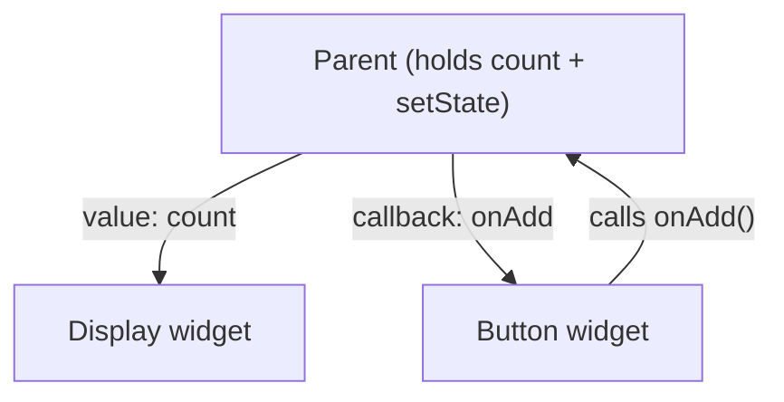
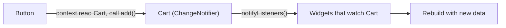

# Session 07: State Management and Dependency Injection

> Module: Cross-Platform App Development with Flutter and Dart · Term 5 (ADSE) · ⏱ ~2 hours

So far each widget kept its own data with `setState`. Real apps need to **share** data: the cart badge on the home page must know what you added on the product page.
This session explains state management in Flutter — `setState`, lifting state up, **Provider**, and a gentle introduction to **Riverpod** and **BLoC** — plus **dependency injection**, the idea of giving a class what it needs instead of letting it create it.

## 🎯 Learning Objectives

By the end of this session you will be able to:

- Describe state management and the difference between ephemeral and app state
- Share state between widgets by lifting state up
- Use Provider with `ChangeNotifier`, `context.watch` and `context.read`
- Recognise the basic shape of Riverpod and BLoC (Cubit) code
- Define dependency injection and apply constructor injection and Provider-based injection

## 📖 Concepts Explained

### 1. What is "state"?

**State** is any data that can change and affects what the user sees: a counter, a logged-in user, items in a cart, dark mode on/off.
*State management* is simply **where you keep that data and how widgets find out it changed**.

| Type | Lives where | Examples | Tool |
|------|-------------|----------|------|
| **Ephemeral (local) state** | Inside one widget | Current tab, a checkbox, animation progress | `setState` |
| **App (shared) state** | Needed by many widgets/screens | Cart, user profile, settings, to-do list | Provider, Riverpod, BLoC |

### 2. Lifting state up

If two sibling widgets need the same data, move the data to their **common parent**. The parent passes the value **down** and a callback function so children can ask for changes.



This works well for small apps, but when data must travel through many levels ("prop drilling"), a state management package is cleaner.

### 3. Provider — the officially recommended starting point

Provider has three parts:

| Part | Job |
|------|-----|
| `ChangeNotifier` class | Holds the data and methods; calls `notifyListeners()` after a change |
| `ChangeNotifierProvider` | Puts that object high in the widget tree so everything below can reach it |
| `context.watch<T>()` / `context.read<T>()` | `watch` = read **and rebuild** when it changes (use in `build`); `read` = just get it once (use in button callbacks) |



> **Analogy:** a `ChangeNotifier` is like a WhatsApp group admin. When news arrives, the admin posts once (`notifyListeners`) and every member who joined (`watch`) sees it.

### 4. Riverpod and BLoC — a first look

| Approach | Core idea | Good for |
|----------|-----------|----------|
| `setState` | Widget keeps its own data | Local UI state |
| **Provider** | `ChangeNotifier` placed in the tree | Small–medium apps, learning |
| **Riverpod** | Providers declared as global variables, compile-safe, no `BuildContext` needed to read | Medium–large apps, testable code |
| **BLoC / Cubit** | UI sends events/calls, BLoC **emits** new states as a stream | Large teams, strict separation of UI and logic |

You do not need to master all of them. Learn Provider well; recognise the others when you meet them in a job.

### 5. Dependency injection (DI)

A **dependency** is an object your class needs to work (an API service, a database helper).
**Dependency injection** means the dependency is **given** to the class from outside, instead of the class creating it with `new`/constructor call inside itself.

| Without DI | With DI |
|------------|---------|
| `final api = WeatherApi();` inside the widget | Widget receives `api` in its constructor or from Provider |
| Hard to swap for a fake in tests | Easy to pass a `FakeWeatherApi` for testing or demos |
| Classes tightly coupled | Classes loosely coupled |

Common DI styles in Flutter: **constructor injection**, **Provider / Riverpod** (inject through the tree), and **service locators** such as the `get_it` package.

## 💻 Code Examples

All examples can live in one project. Add the packages with:
`flutter pub add provider flutter_riverpod flutter_bloc`

📄 File: [`pubspec.yaml`](./pubspec.yaml)

```yaml
# pubspec.yaml (only the important parts for this session)
name: state_demo
description: Session 07 state management examples.
publish_to: 'none'
version: 1.0.0+1

environment:
  sdk: ^3.5.0

dependencies:
  flutter:
    sdk: flutter
  provider: ^6.1.2          # Provider + ChangeNotifier
  flutter_riverpod: ^2.6.1  # Riverpod (intro example)
  flutter_bloc: ^9.0.0      # BLoC / Cubit (intro example)

flutter:
  uses-material-design: true
```

### Example 1: Lifting state up with setState

📄 File: [`main.dart`](./main.dart)

```dart
// main.dart
// Lifting state up: the parent owns the score; two child widgets share it.

import 'package:flutter/material.dart';

void main() {
  runApp(const MaterialApp(home: ScorePage()));
}

// Parent: holds the state.
class ScorePage extends StatefulWidget {
  const ScorePage({super.key});

  @override
  State<ScorePage> createState() => _ScorePageState();
}

class _ScorePageState extends State<ScorePage> {
  int score = 0;

  void addPoint() {
    setState(() {
      score++;
    });
  }

  @override
  Widget build(BuildContext context) {
    return Scaffold(
      appBar: AppBar(title: const Text('Lifting State Up')),
      body: Center(
        child: Column(
          mainAxisSize: MainAxisSize.min,
          children: [
            ScoreDisplay(score: score),     // pass the value DOWN
            AddPointButton(onAdd: addPoint), // pass a callback DOWN
          ],
        ),
      ),
    );
  }
}

// Child 1: only shows the score (stateless).
class ScoreDisplay extends StatelessWidget {
  final int score;
  const ScoreDisplay({super.key, required this.score});

  @override
  Widget build(BuildContext context) {
    return Text('Score: $score', style: const TextStyle(fontSize: 40));
  }
}

// Child 2: only has a button; it calls the parent's function.
class AddPointButton extends StatelessWidget {
  final VoidCallback onAdd; // VoidCallback = a function with no inputs/outputs
  const AddPointButton({super.key, required this.onAdd});

  @override
  Widget build(BuildContext context) {
    return ElevatedButton(onPressed: onAdd, child: const Text('+1 Point'));
  }
}
```

**How it works**

- Neither child stores the score. The parent is the **single source of truth**; children receive a value and a callback.

### Example 2: Provider — a shared shopping cart

📄 File: [`provider_cart.dart`](./provider_cart.dart)

```dart
// provider_cart.dart
// Provider: a Cart shared by the AppBar badge and the product list.

import 'package:flutter/material.dart';
import 'package:provider/provider.dart';

// STEP 1: the state class. It extends ChangeNotifier.
class Cart extends ChangeNotifier {
  final List<String> items = [];

  int get count => items.length;

  void add(String item) {
    items.add(item);
    notifyListeners(); // tell all watching widgets to rebuild
  }

  void clear() {
    items.clear();
    notifyListeners();
  }
}

void main() {
  runApp(
    // STEP 2: put the Cart above the whole app.
    ChangeNotifierProvider(
      create: (context) => Cart(),
      child: const MaterialApp(home: ShopPage()),
    ),
  );
}

class ShopPage extends StatelessWidget {
  const ShopPage({super.key});

  @override
  Widget build(BuildContext context) {
    final List<String> products = ['Notebook', 'Pen', 'USB Drive', 'Headphones'];

    return Scaffold(
      appBar: AppBar(
        title: const Text('Mini Shop'),
        actions: const [CartBadge()], // the badge reads the Cart on its own
      ),
      body: ListView.builder(
        itemCount: products.length,
        itemBuilder: (context, index) {
          return ListTile(
            title: Text(products[index]),
            trailing: IconButton(
              icon: const Icon(Icons.add_shopping_cart),
              // STEP 3a: read = get the Cart without listening (inside callbacks).
              onPressed: () => context.read<Cart>().add(products[index]),
            ),
          );
        },
      ),
      floatingActionButton: FloatingActionButton(
        onPressed: () => context.read<Cart>().clear(),
        child: const Icon(Icons.delete),
      ),
    );
  }
}

class CartBadge extends StatelessWidget {
  const CartBadge({super.key});

  @override
  Widget build(BuildContext context) {
    // STEP 3b: watch = get the Cart AND rebuild when it changes.
    final int count = context.watch<Cart>().count;

    return Padding(
      padding: const EdgeInsets.only(right: 16),
      // Badge is a Material 3 widget that shows a small label on an icon.
      child: Badge(
        label: Text('$count'),
        child: const Icon(Icons.shopping_cart),
      ),
    );
  }
}
```

**How it works**

- The list and the badge never talk to each other directly — both talk to `Cart`.
- Use `watch` inside `build()` and `read` inside `onPressed`. Using `watch` in a callback causes an error.

### Example 3: Riverpod — counter (introduction)

📄 File: [`riverpod_counter.dart`](./riverpod_counter.dart)

```dart
// riverpod_counter.dart
// Riverpod intro: state lives in a Notifier; widgets read it with ref.

import 'package:flutter/material.dart';
import 'package:flutter_riverpod/flutter_riverpod.dart';

// STEP 1: a Notifier holds the state (here an int) and the methods.
class CounterNotifier extends Notifier<int> {
  @override
  int build() => 0; // starting value

  void increment() => state++; // changing "state" updates listeners
}

// STEP 2: declare the provider as a global variable.
final counterProvider = NotifierProvider<CounterNotifier, int>(CounterNotifier.new);

void main() {
  // STEP 3: ProviderScope stores all providers. It must wrap the app.
  runApp(const ProviderScope(child: MaterialApp(home: CounterPage())));
}

// STEP 4: ConsumerWidget gives us "ref" to read providers.
class CounterPage extends ConsumerWidget {
  const CounterPage({super.key});

  @override
  Widget build(BuildContext context, WidgetRef ref) {
    final int count = ref.watch(counterProvider); // rebuilds on change

    return Scaffold(
      appBar: AppBar(title: const Text('Riverpod Counter')),
      body: Center(child: Text('$count', style: const TextStyle(fontSize: 60))),
      floatingActionButton: FloatingActionButton(
        // .notifier gives us the CounterNotifier object to call methods.
        onPressed: () => ref.read(counterProvider.notifier).increment(),
        child: const Icon(Icons.add),
      ),
    );
  }
}
```

**How it works**

- Same `watch` / `read` idea as Provider, but through `ref`, and providers are declared outside the widget tree.

### Example 4: BLoC (Cubit) — counter (introduction)

📄 File: [`bloc_counter.dart`](./bloc_counter.dart)

```dart
// bloc_counter.dart
// BLoC intro using a Cubit: the simplest form of BLoC.

import 'package:flutter/material.dart';
import 'package:flutter_bloc/flutter_bloc.dart';

// STEP 1: a Cubit holds one state value and emits new ones.
class CounterCubit extends Cubit<int> {
  CounterCubit() : super(0); // starting state is 0

  void increment() => emit(state + 1); // emit = publish a new state
  void reset() => emit(0);
}

void main() {
  runApp(
    // STEP 2: BlocProvider creates the Cubit and shares it below.
    BlocProvider(
      create: (context) => CounterCubit(),
      child: const MaterialApp(home: CounterPage()),
    ),
  );
}

class CounterPage extends StatelessWidget {
  const CounterPage({super.key});

  @override
  Widget build(BuildContext context) {
    return Scaffold(
      appBar: AppBar(title: const Text('Cubit Counter')),
      body: Center(
        // STEP 3: BlocBuilder rebuilds only this part when the state changes.
        child: BlocBuilder<CounterCubit, int>(
          builder: (context, count) {
            return Text('$count', style: const TextStyle(fontSize: 60));
          },
        ),
      ),
      floatingActionButton: FloatingActionButton(
        onPressed: () => context.read<CounterCubit>().increment(),
        child: const Icon(Icons.add),
      ),
    );
  }
}
```

**How it works**

- The UI only **calls** `increment()`; the Cubit decides the new state and emits it. Logic and UI stay separate.

### Example 5: Dependency injection

📄 File: [`dependency_injection.dart`](./dependency_injection.dart)

```dart
// dependency_injection.dart
// Dependency injection: the page RECEIVES a quote service instead of creating it.

import 'package:flutter/material.dart';
import 'package:provider/provider.dart';

// An abstract "contract": any quote service must have getQuote().
abstract class QuoteService {
  String getQuote();
}

// Real version (imagine it calls an API later in Session 13).
class OnlineQuoteService implements QuoteService {
  @override
  String getQuote() => 'Learning never exhausts the mind.';
}

// Fake version for testing or offline demos.
class FakeQuoteService implements QuoteService {
  @override
  String getQuote() => 'This is a test quote.';
}

void main() {
  runApp(
    // Inject ONE service for the whole app. Swap to FakeQuoteService() to test.
    Provider<QuoteService>(
      create: (context) => OnlineQuoteService(),
      child: const MaterialApp(home: QuotePage()),
    ),
  );
}

class QuotePage extends StatelessWidget {
  const QuotePage({super.key});

  @override
  Widget build(BuildContext context) {
    // The page asks for "a QuoteService" — it does not care which one.
    final QuoteService service = context.read<QuoteService>();

    return Scaffold(
      appBar: AppBar(title: const Text('Dependency Injection')),
      body: Center(
        child: Padding(
          padding: const EdgeInsets.all(24),
          child: Text(service.getQuote(), style: const TextStyle(fontSize: 22)),
        ),
      ),
    );
  }
}
```

**How it works**

- `QuotePage` depends on the **abstract** `QuoteService`, not on a specific class. Changing one line in `main()` swaps the real service for the fake one — no change in the page.

## 🧪 Lab Practice

1. In `main.dart`, add a **Reset** button as a third child widget that receives an `onReset` callback.
2. Run `provider_cart.dart`. Add a second page that lists `cart.items` and open it from the cart icon (use `Navigator.push`, previewed in Session 08).
3. Add a `remove(String item)` method to `Cart` and a delete icon next to each item on the cart page.
4. Add a `decrement()` method to both the Riverpod and Cubit counters and a second button to call it.
5. In `dependency_injection.dart`, swap to `FakeQuoteService` and confirm the page changes without editing `QuotePage`.

## 📝 Assignment

Build `theme_switcher.dart` with Provider: a `SettingsModel extends ChangeNotifier` with `bool isDark` and `toggle()`. Use `context.watch` in `MaterialApp` to switch `themeMode` between light and dark, and put a `Switch` on the home page to toggle it.

## ❓ Quick Quiz

1. What is the difference between ephemeral and app state?
2. What must a `ChangeNotifier` call after changing its data?
3. When do you use `context.read` instead of `context.watch`?
4. In a Cubit, which method publishes a new state?
5. What is dependency injection in one sentence?

<details>
<summary>Show answers</summary>

1. Ephemeral state belongs to one widget; app state is shared by many widgets or screens.
2. `notifyListeners()`.
3. Inside callbacks such as `onPressed`, when you only need to call a method and not rebuild.
4. `emit()`.
5. Giving a class the objects it needs from outside instead of creating them inside it.

</details>

## 💼 Interview Questions

1. **How do you choose a state management approach?** — `setState` for local UI state; Provider for small/medium shared state; Riverpod or BLoC when the app grows, needs strong testability or a large team needs strict structure.
2. **What problem does Provider solve compared with passing data through constructors?** — It avoids "prop drilling" through many levels; any widget below the provider can access and listen to the data directly.
3. **Why is dependency injection useful for testing?** — You can inject a fake or mock implementation, so tests run without real network or database calls.

## ✅ Summary

- State is data that changes the UI; keep local state with `setState`, share app state with a state management tool.
- Lifting state up moves data to the common parent and passes callbacks down.
- Provider: `ChangeNotifier` + `notifyListeners()`, `ChangeNotifierProvider`, `watch` and `read`.
- Riverpod uses global providers and `ref`; BLoC/Cubit emits new states and keeps logic out of the UI.
- Dependency injection gives classes their dependencies from outside, making code flexible and testable.

---

[⬅ Previous](../Session-06-Practice-Lab-Layouts/README.md) · [🏠 Module Home](../README.md) · [Next ➡](../Session-08-Navigation-Routing-and-go-router/README.md)

Prepared by Zeeshan Abbas · Aptech Learning North Nazimabad
