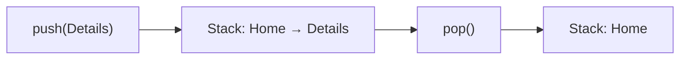
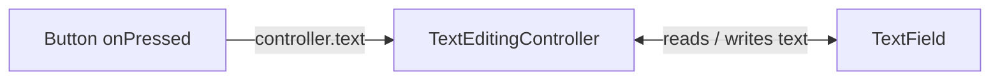

# Session 08: Navigation, Routing, Controllers and go_router

> Module: Cross-Platform App Development with Flutter and Dart · Term 5 (ADSE) · ⏱ ~2 hours

Almost every app has more than one screen: a list, a details page, settings, a login page.
This session teaches how to move between screens (**navigation**), how to organise screens by name or URL (**routing**) with the `Navigator` and the popular **go_router** package, and how to control widgets such as text fields with **controllers** — including writing your own.

## 🎯 Learning Objectives

By the end of this session you will be able to:

- Define navigation and routing and explain the route stack
- Move between screens with `Navigator.push` / `Navigator.pop`, and pass data both ways
- Set up URL-style routes with `go_router`, including path parameters
- Explain the difference between `context.go` and `context.push`
- Read and clear text input with `TextEditingController`
- Create a simple custom controller with `ValueNotifier`

## 📖 Concepts Explained

### 1. Navigation vs routing

| Term | Meaning |
|------|---------|
| **Route** | One screen (page) of your app |
| **Navigation** | The act of moving from one route to another |
| **Routing** | The rules/map that decide which screen belongs to which name or URL (e.g. `/courses/3`) |

### 2. The route stack

Flutter's `Navigator` keeps screens in a **stack**, like plates.



| Method | What it does |
|--------|--------------|
| `Navigator.push(context, MaterialPageRoute(builder: ...))` | Put a new screen on top |
| `Navigator.pop(context)` | Remove the top screen (go back) |
| `Navigator.pop(context, value)` | Go back **and return a value** |
| `Navigator.pushReplacement(...)` | Replace the current screen (e.g. after login) |

The Android back button and the AppBar back arrow call `pop` automatically.

### 3. Passing data

- **Forward:** pass data through the next screen's constructor: `DetailsPage(course: 'Flutter')`.
- **Backward:** `final result = await Navigator.push(...)`; the next screen calls `Navigator.pop(context, 'value')`.

### 4. Named routes vs go_router

| Approach | Pros | Cons |
|----------|------|------|
| `Navigator.push` with `MaterialPageRoute` | Simple, no setup | Hard to manage in big apps, no web URLs |
| Named routes (`routes: {'/': ..., '/about': ...}`) | Central list of screens | Limited; Flutter docs no longer recommend them for most apps |
| **go_router** (official Flutter team package) | Web URLs, deep links, path parameters, redirects (e.g. "if not logged in, go to /login") | Needs a package and a little setup |

### 5. go_router essentials

| Piece | Example |
|-------|---------|
| Router object | `final router = GoRouter(routes: [...]);` |
| A route | `GoRoute(path: '/courses', builder: (context, state) => const CoursesPage())` |
| Path parameter | `path: '/courses/:id'` then `state.pathParameters['id']` |
| App setup | `MaterialApp.router(routerConfig: router)` |
| `context.go('/courses')` | **Jump** to that location — rebuilds the stack to match the URL |
| `context.push('/courses/2')` | **Add** on top of the current stack (back button returns) |
| `context.pop()` | Go back |

### 6. Controllers

A **controller** is an object that lets your code **read and change** a widget from outside it.

| Controller | Controls |
|------------|----------|
| `TextEditingController` | Text in a `TextField` (read, set, clear) |
| `ScrollController` | Scroll position of a list (jump to top) |
| `PageController` | Current page in a `PageView` |
| `TabController` | Selected tab |
| **Custom controller** | Your own logic, e.g. `ValueNotifier<int>` for a counter |

⚠ Controllers hold resources. Create them in a `State` and call `.dispose()` in the `dispose()` method.



## 💻 Code Examples

Add go_router with: `flutter pub add go_router`

📄 File: [`pubspec.yaml`](./pubspec.yaml)

```yaml
# pubspec.yaml (only the important parts for this session)
name: navigation_demo
description: Session 08 navigation, go_router and controllers examples.
publish_to: 'none'
version: 1.0.0+1

environment:
  sdk: ^3.5.0

dependencies:
  flutter:
    sdk: flutter
  go_router: ^14.8.1   # 'flutter pub add go_router' installs the latest version

flutter:
  uses-material-design: true
```

### Example 1: Navigator push and pop with data

📄 File: [`main.dart`](./main.dart)

```dart
// main.dart
// Navigator: push a details screen, send data forward, get a result back.

import 'package:flutter/material.dart';

void main() {
  runApp(const MaterialApp(home: HomePage()));
}

class HomePage extends StatefulWidget {
  const HomePage({super.key});

  @override
  State<HomePage> createState() => _HomePageState();
}

class _HomePageState extends State<HomePage> {
  String message = 'No rating yet';

  // async because we WAIT for the details screen to return a value.
  Future<void> openDetails() async {
    final String? rating = await Navigator.push(
      context,
      MaterialPageRoute(
        builder: (context) => const DetailsPage(courseName: 'Flutter'), // data forward
      ),
    );

    // rating is null if the user pressed the back arrow instead.
    if (rating != null) {
      setState(() {
        message = 'You rated the course: $rating';
      });
    }
  }

  @override
  Widget build(BuildContext context) {
    return Scaffold(
      appBar: AppBar(title: const Text('Home')),
      body: Center(
        child: Column(
          mainAxisSize: MainAxisSize.min,
          children: [
            Text(message, style: const TextStyle(fontSize: 18)),
            const SizedBox(height: 16),
            ElevatedButton(onPressed: openDetails, child: const Text('Open Flutter course')),
          ],
        ),
      ),
    );
  }
}

class DetailsPage extends StatelessWidget {
  final String courseName; // received from the Home page
  const DetailsPage({super.key, required this.courseName});

  @override
  Widget build(BuildContext context) {
    return Scaffold(
      appBar: AppBar(title: Text(courseName)), // back arrow added automatically
      body: Center(
        child: Column(
          mainAxisSize: MainAxisSize.min,
          children: [
            Text('How was $courseName?', style: const TextStyle(fontSize: 22)),
            // pop with a value sends it back to the Home page.
            TextButton(onPressed: () => Navigator.pop(context, 'Excellent'), child: const Text('Excellent')),
            TextButton(onPressed: () => Navigator.pop(context, 'Good'), child: const Text('Good')),
          ],
        ),
      ),
    );
  }
}
```

**How it works**

- Data goes **forward** through the constructor and comes **back** as the value of `await Navigator.push(...)`.
- `String?` is used because pressing the back arrow returns `null`.

### Example 2: go_router with path parameters

📄 File: [`go_router_app.dart`](./go_router_app.dart)

```dart
// go_router_app.dart
// go_router: URL-style routes, a path parameter, go() vs push().

import 'package:flutter/material.dart';
import 'package:go_router/go_router.dart';

// Our data: a simple list of courses. The index is used as the id.
const List<String> courses = ['Dart', 'Flutter', 'Firebase', 'Machine Learning'];

// STEP 1: describe all routes in one place.
final GoRouter router = GoRouter(
  initialLocation: '/',
  routes: [
    GoRoute(
      path: '/',
      builder: (context, state) => const HomeScreen(),
    ),
    GoRoute(
      path: '/courses',
      builder: (context, state) => const CoursesScreen(),
    ),
    GoRoute(
      // ":id" is a path parameter, e.g. /courses/1
      path: '/courses/:id',
      builder: (context, state) {
        // Read the parameter as text and turn it into a number.
        final int id = int.parse(state.pathParameters['id']!);
        return CourseDetailScreen(id: id);
      },
    ),
  ],
);

void main() {
  // STEP 2: use MaterialApp.router and give it our router.
  runApp(MaterialApp.router(routerConfig: router));
}

class HomeScreen extends StatelessWidget {
  const HomeScreen({super.key});

  @override
  Widget build(BuildContext context) {
    return Scaffold(
      appBar: AppBar(title: const Text('Home')),
      body: Center(
        child: FilledButton(
          // go() jumps to /courses (good for main sections / menus).
          onPressed: () => context.go('/courses'),
          child: const Text('View courses'),
        ),
      ),
    );
  }
}

class CoursesScreen extends StatelessWidget {
  const CoursesScreen({super.key});

  @override
  Widget build(BuildContext context) {
    return Scaffold(
      appBar: AppBar(title: const Text('Courses')),
      body: ListView.builder(
        itemCount: courses.length,
        itemBuilder: (context, index) {
          return ListTile(
            title: Text(courses[index]),
            // push() adds the detail screen on top, so Back returns here.
            onTap: () => context.push('/courses/$index'),
          );
        },
      ),
    );
  }
}

class CourseDetailScreen extends StatelessWidget {
  final int id;
  const CourseDetailScreen({super.key, required this.id});

  @override
  Widget build(BuildContext context) {
    return Scaffold(
      appBar: AppBar(title: Text(courses[id])),
      body: Center(
        child: Column(
          mainAxisSize: MainAxisSize.min,
          children: [
            Text('Course id: $id', style: const TextStyle(fontSize: 22)),
            TextButton(onPressed: () => context.go('/'), child: const Text('Back to Home')),
          ],
        ),
      ),
    );
  }
}
```

**How it works**

- Run it on Chrome (`flutter run -d chrome -t lib/go_router_app.dart`) and watch the browser address bar change to `/courses/1`.
- Typing a URL in the address bar opens that screen directly — this is **deep linking**.

### Example 3: TextEditingController

📄 File: [`text_controller.dart`](./text_controller.dart)

```dart
// text_controller.dart
// TextEditingController: read, set and clear the text of a TextField.

import 'package:flutter/material.dart';

void main() {
  runApp(const MaterialApp(home: NotePage()));
}

class NotePage extends StatefulWidget {
  const NotePage({super.key});

  @override
  State<NotePage> createState() => _NotePageState();
}

class _NotePageState extends State<NotePage> {
  // STEP 1: create the controller once.
  final TextEditingController nameController = TextEditingController();
  String savedName = '';

  @override
  void dispose() {
    // STEP 4: always dispose controllers to free memory.
    nameController.dispose();
    super.dispose();
  }

  @override
  Widget build(BuildContext context) {
    return Scaffold(
      appBar: AppBar(title: const Text('TextEditingController')),
      body: Padding(
        padding: const EdgeInsets.all(16),
        child: Column(
          children: [
            // STEP 2: connect the controller to the TextField.
            TextField(
              controller: nameController,
              decoration: const InputDecoration(labelText: 'Student name', border: OutlineInputBorder()),
            ),
            const SizedBox(height: 12),
            Row(
              mainAxisAlignment: MainAxisAlignment.spaceEvenly,
              children: [
                // STEP 3: read the text with controller.text
                ElevatedButton(
                  onPressed: () => setState(() => savedName = nameController.text),
                  child: const Text('Save'),
                ),
                // Set the text from code.
                ElevatedButton(
                  onPressed: () => nameController.text = 'Ali Khan',
                  child: const Text('Fill sample'),
                ),
                // Clear the field.
                ElevatedButton(
                  onPressed: () => nameController.clear(),
                  child: const Text('Clear'),
                ),
              ],
            ),
            const SizedBox(height: 24),
            Text('Saved: $savedName', style: const TextStyle(fontSize: 20)),
          ],
        ),
      ),
    );
  }
}
```

**How it works**

- The controller is the "remote control" for the text field: `.text` reads or sets, `.clear()` empties it.

### Example 4: A custom controller with ValueNotifier

📄 File: [`custom_controller.dart`](./custom_controller.dart)

```dart
// custom_controller.dart
// A custom controller: our own class that holds a value and notifies listeners.

import 'package:flutter/material.dart';

// ValueNotifier<int> already knows how to store a value and notify listeners.
// We just add our own easy-to-read methods.
class StepController extends ValueNotifier<int> {
  StepController() : super(1); // start at step 1

  final int maxStep = 3;

  void next() {
    if (value < maxStep) value++; // changing value notifies listeners
  }

  void back() {
    if (value > 1) value--;
  }
}

void main() {
  runApp(const MaterialApp(home: StepperPage()));
}

class StepperPage extends StatefulWidget {
  const StepperPage({super.key});

  @override
  State<StepperPage> createState() => _StepperPageState();
}

class _StepperPageState extends State<StepperPage> {
  final StepController controller = StepController();

  @override
  void dispose() {
    controller.dispose();
    super.dispose();
  }

  @override
  Widget build(BuildContext context) {
    return Scaffold(
      appBar: AppBar(title: const Text('Admission Form Steps')),
      body: Center(
        // ValueListenableBuilder rebuilds only this part when the value changes.
        child: ValueListenableBuilder<int>(
          valueListenable: controller,
          builder: (context, step, child) {
            return Text('Step $step of ${controller.maxStep}', style: const TextStyle(fontSize: 28));
          },
        ),
      ),
      bottomNavigationBar: Padding(
        padding: const EdgeInsets.all(16),
        child: Row(
          mainAxisAlignment: MainAxisAlignment.spaceBetween,
          children: [
            OutlinedButton(onPressed: controller.back, child: const Text('Back')),
            FilledButton(onPressed: controller.next, child: const Text('Next')),
          ],
        ),
      ),
    );
  }
}
```

**How it works**

- No `setState` is needed: `ValueListenableBuilder` listens to the controller and rebuilds just the text.
- The page stays clean because the step rules (min 1, max 3) live inside the controller.

## 🧪 Lab Practice

1. In `main.dart`, add a third rating button and a `Navigator.pushReplacement` "Finish" button on the details page — notice that Back no longer returns.
2. Run `go_router_app.dart` on Chrome. Type `/courses/3` directly in the address bar. Then change one `push` to `go` and compare the Back behaviour.
3. Add an `/about` route to the router and a button on Home that opens it.
4. In `text_controller.dart`, show a `SnackBar` saying "Please enter a name" when Save is pressed with empty text.
5. Add a `reset()` method to `StepController` and a Reset button.

## 📝 Assignment

Create `contacts_router.dart` with go_router: `/` shows a list of 5 contacts, `/contact/:id` shows details of one contact, and `/add` has a form with two `TextEditingController`s (name, phone) that prints the values and returns to the list with `context.pop()`.

## ❓ Quick Quiz

1. Which data structure does `Navigator` use to keep screens?
2. How does a screen send a value back to the previous screen?
3. In go_router, how do you read the `:id` from `/courses/:id`?
4. What is the difference between `context.go()` and `context.push()`?
5. Why must you call `dispose()` on a controller?

<details>
<summary>Show answers</summary>

1. A stack (last in, first out).
2. `Navigator.pop(context, value)`, received by `await Navigator.push(...)`.
3. `state.pathParameters['id']`.
4. `go` jumps to a location and rebuilds the stack to match it; `push` adds a screen on top of the current stack.
5. To release resources and listeners and avoid memory leaks.

</details>

## 💼 Interview Questions

1. **Why use go_router instead of plain Navigator.push?** — It gives a central route table, real web URLs, deep linking, path/query parameters and redirects (e.g. auth guards) with little code.
2. **How do you pass data between screens?** — Forward through constructors or route parameters; backward through the value returned by `pop`; app-wide through state management like Provider.
3. **What is a controller in Flutter?** — An object that lets code read and change a widget's state from outside, such as `TextEditingController` or `ScrollController`; custom ones can extend `ChangeNotifier`/`ValueNotifier`.

## ✅ Summary

- Routes are screens; the `Navigator` keeps them in a stack (`push` / `pop`).
- Pass data forward with constructors and backward with `pop(context, value)`.
- go_router adds URL paths, path parameters and deep links: `context.go`, `context.push`, `context.pop`.
- Controllers (`TextEditingController`, custom `ValueNotifier`) control widgets from code — always dispose them.

---

[⬅ Previous](../Session-07-State-Management-and-Dependency-Injection/README.md) · [🏠 Module Home](../README.md) · [Next ➡](../Session-09-Practice-Lab-State-and-Navigation/README.md)

Prepared by Zeeshan Abbas · Aptech Learning North Nazimabad
