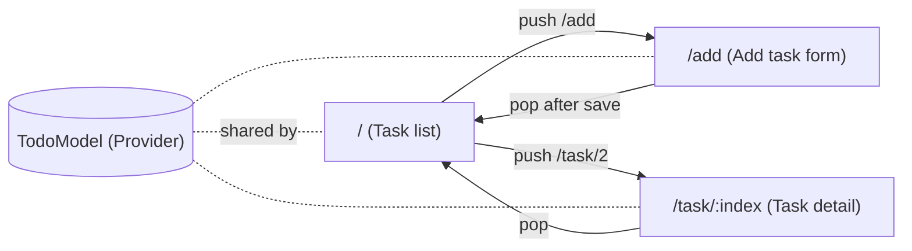

# Session 09: Practice Lab — State and Navigation

> Module: Cross-Platform App Development with Flutter and Dart · Term 5 (ADSE) · ⏱ ~2 hours

In this lab you combine Sessions 07 and 08 into one small but real app: a **Study To-Do** app.
It uses **Provider** to share the task list, **go_router** to move between three screens, and a **TextEditingController** to add new tasks.
The solution is split into small files — one job per file — exactly how professional Flutter projects are organised.

## 🎯 Learning Objectives

By the end of this lab you will be able to:

- Plan a multi-screen app: screens, routes and shared state
- Organise a project into model and screen files
- Share and update a list across screens with Provider
- Navigate with go_router using a path parameter
- Read form input with a controller and validate it

## 📖 Concepts Explained

### 1. Recap

| Need | Tool |
|------|------|
| Data used by many screens (the task list) | `ChangeNotifier` + `ChangeNotifierProvider` |
| Show data and rebuild on change | `context.watch<TodoModel>()` |
| Call a method from a button | `context.read<TodoModel>().add(...)` |
| Screens with URLs | `GoRouter` + `GoRoute` |
| Open a task by number | Path parameter `/task/:index` |
| Read a text field | `TextEditingController` |

### 2. App plan



### 3. Project structure

```
lib/
├── main.dart                 # app + router (start here)
├── todo_model.dart           # the shared state (ChangeNotifier)
├── todo_list_screen.dart     # screen 1: list of tasks
├── add_todo_screen.dart      # screen 2: form to add a task
└── todo_detail_screen.dart   # screen 3: one task's details
```

> **Why split files?** Each file has one job, so it is short and easy to read. When a bug appears in the form, you know to open `add_todo_screen.dart`.

### 4. Lab steps at a glance

1. Create the project and add packages: `flutter pub add provider go_router`.
2. Write the model first (data + methods) — no UI yet.
3. Write the three screens.
4. Connect everything in `main.dart` (provider + router).
5. Test: add, tick, open details, delete, rotate the screen, go back.

## 💻 Code Examples

Copy all `.dart` files into your project's `lib/` folder.

📄 File: [`pubspec.yaml`](./pubspec.yaml)

```yaml
# pubspec.yaml (only the important parts for this lab)
name: study_todo
description: Session 09 lab - Provider + go_router to-do app.
publish_to: 'none'
version: 1.0.0+1

environment:
  sdk: ^3.5.0

dependencies:
  flutter:
    sdk: flutter
  provider: ^6.1.2
  go_router: ^14.8.1

flutter:
  uses-material-design: true
```

### File 1: The shared state

📄 File: [`todo_model.dart`](./todo_model.dart)

```dart
// todo_model.dart
// The shared state of the app. Every screen reads tasks from here.

import 'package:flutter/foundation.dart';

// A single task: a title and whether it is done.
class Task {
  String title;
  bool isDone;

  Task({required this.title, this.isDone = false});
}

// The list of tasks plus the actions we can do on it.
class TodoModel extends ChangeNotifier {
  final List<Task> tasks = [
    Task(title: 'Revise Flutter layouts'),
    Task(title: 'Finish Provider assignment'),
  ];

  // How many tasks are finished (shown on the list screen).
  int get doneCount => tasks.where((task) => task.isDone).length;

  void add(String title) {
    tasks.add(Task(title: title));
    notifyListeners(); // tell screens to rebuild
  }

  void toggle(int index) {
    tasks[index].isDone = !tasks[index].isDone;
    notifyListeners();
  }

  void remove(int index) {
    tasks.removeAt(index);
    notifyListeners();
  }
}
```

**How it works**

- The model knows nothing about widgets. It only stores data and calls `notifyListeners()` after every change.

### File 2: App entry and router

📄 File: [`main.dart`](./main.dart)

```dart
// main.dart
// Connects the shared state (Provider) and the screens (go_router).

import 'package:flutter/material.dart';
import 'package:go_router/go_router.dart';
import 'package:provider/provider.dart';

import 'todo_model.dart';
import 'todo_list_screen.dart';
import 'add_todo_screen.dart';
import 'todo_detail_screen.dart';

// All routes of the app in one place.
final GoRouter router = GoRouter(
  routes: [
    GoRoute(path: '/', builder: (context, state) => const TodoListScreen()),
    GoRoute(path: '/add', builder: (context, state) => const AddTodoScreen()),
    GoRoute(
      path: '/task/:index',
      builder: (context, state) {
        final int index = int.parse(state.pathParameters['index']!);
        return TodoDetailScreen(index: index);
      },
    ),
  ],
);

void main() {
  runApp(
    // The model is placed ABOVE the app, so every screen can use it.
    ChangeNotifierProvider(
      create: (context) => TodoModel(),
      child: MaterialApp.router(
        title: 'Study To-Do',
        debugShowCheckedModeBanner: false,
        theme: ThemeData(colorSchemeSeed: Colors.indigo), // Material 3 colours
        routerConfig: router,
      ),
    ),
  );
}
```

**How it works**

- `ChangeNotifierProvider` wraps `MaterialApp.router`, so all routes share **one** `TodoModel`.
- `colorSchemeSeed` creates a full Material 3 colour scheme from one colour.

### File 3: Task list screen

📄 File: [`todo_list_screen.dart`](./todo_list_screen.dart)

```dart
// todo_list_screen.dart
// Screen 1: shows all tasks. Tap to open, tick to finish.

import 'package:flutter/material.dart';
import 'package:go_router/go_router.dart';
import 'package:provider/provider.dart';

import 'todo_model.dart';

class TodoListScreen extends StatelessWidget {
  const TodoListScreen({super.key});

  @override
  Widget build(BuildContext context) {
    // watch: rebuild this screen whenever the tasks change.
    final TodoModel model = context.watch<TodoModel>();

    return Scaffold(
      appBar: AppBar(
        title: Text('Tasks (${model.doneCount}/${model.tasks.length} done)'),
      ),
      // Show a friendly message when the list is empty.
      body: model.tasks.isEmpty
          ? const Center(child: Text('No tasks. Tap + to add one.'))
          : ListView.builder(
              itemCount: model.tasks.length,
              itemBuilder: (context, index) {
                final Task task = model.tasks[index];
                return ListTile(
                  leading: Checkbox(
                    value: task.isDone,
                    onChanged: (_) => context.read<TodoModel>().toggle(index),
                  ),
                  title: Text(
                    task.title,
                    // Strike through finished tasks.
                    style: TextStyle(
                      decoration: task.isDone ? TextDecoration.lineThrough : null,
                    ),
                  ),
                  trailing: const Icon(Icons.chevron_right),
                  onTap: () => context.push('/task/$index'),
                );
              },
            ),
      floatingActionButton: FloatingActionButton(
        onPressed: () => context.push('/add'),
        child: const Icon(Icons.add),
      ),
    );
  }
}
```

**How it works**

- `watch` keeps the title counter and the list up to date; the checkbox and buttons use `read` to call methods.

### File 4: Add task screen

📄 File: [`add_todo_screen.dart`](./add_todo_screen.dart)

```dart
// add_todo_screen.dart
// Screen 2: a form with a TextEditingController to add a new task.

import 'package:flutter/material.dart';
import 'package:go_router/go_router.dart';
import 'package:provider/provider.dart';

import 'todo_model.dart';

class AddTodoScreen extends StatefulWidget {
  const AddTodoScreen({super.key});

  @override
  State<AddTodoScreen> createState() => _AddTodoScreenState();
}

class _AddTodoScreenState extends State<AddTodoScreen> {
  final TextEditingController titleController = TextEditingController();
  String? errorText; // shown under the field when input is invalid

  @override
  void dispose() {
    titleController.dispose();
    super.dispose();
  }

  void save() {
    final String title = titleController.text.trim(); // remove extra spaces

    // Simple validation: the title must not be empty.
    if (title.isEmpty) {
      setState(() => errorText = 'Please type a task');
      return;
    }

    context.read<TodoModel>().add(title); // update shared state
    context.pop();                        // go back to the list
  }

  @override
  Widget build(BuildContext context) {
    return Scaffold(
      appBar: AppBar(title: const Text('Add Task')),
      body: Padding(
        padding: const EdgeInsets.all(16),
        child: Column(
          crossAxisAlignment: CrossAxisAlignment.stretch,
          children: [
            TextField(
              controller: titleController,
              autofocus: true, // open the keyboard straight away
              decoration: InputDecoration(
                labelText: 'Task title',
                border: const OutlineInputBorder(),
                errorText: errorText,
              ),
              onSubmitted: (_) => save(), // pressing Enter also saves
            ),
            const SizedBox(height: 16),
            FilledButton(onPressed: save, child: const Text('Save')),
          ],
        ),
      ),
    );
  }
}
```

**How it works**

- `trim()` stops a task made of only spaces; `errorText` shows a red message under the field.
- After saving, `context.pop()` returns to the list, which has already rebuilt with the new task.

### File 5: Task detail screen

📄 File: [`todo_detail_screen.dart`](./todo_detail_screen.dart)

```dart
// todo_detail_screen.dart
// Screen 3: details of one task, opened with /task/:index.

import 'package:flutter/material.dart';
import 'package:go_router/go_router.dart';
import 'package:provider/provider.dart';

import 'todo_model.dart';

class TodoDetailScreen extends StatelessWidget {
  final int index; // comes from the URL
  const TodoDetailScreen({super.key, required this.index});

  @override
  Widget build(BuildContext context) {
    final TodoModel model = context.watch<TodoModel>();

    // Guard: the index may be wrong if someone types a bad URL.
    if (index < 0 || index >= model.tasks.length) {
      return Scaffold(
        appBar: AppBar(title: const Text('Not found')),
        body: const Center(child: Text('This task does not exist.')),
      );
    }

    final Task task = model.tasks[index];

    return Scaffold(
      appBar: AppBar(title: const Text('Task Details')),
      body: Padding(
        padding: const EdgeInsets.all(24),
        child: Column(
          crossAxisAlignment: CrossAxisAlignment.start,
          children: [
            Text(task.title, style: const TextStyle(fontSize: 26, fontWeight: FontWeight.bold)),
            const SizedBox(height: 8),
            Chip(label: Text(task.isDone ? 'Done' : 'Pending')),
            const SizedBox(height: 24),
            SwitchListTile(
              title: const Text('Mark as done'),
              value: task.isDone,
              onChanged: (_) => context.read<TodoModel>().toggle(index),
            ),
            const Spacer(), // pushes the delete button to the bottom
            OutlinedButton.icon(
              icon: const Icon(Icons.delete),
              label: const Text('Delete task'),
              onPressed: () {
                context.read<TodoModel>().remove(index);
                context.pop();
              },
            ),
          ],
        ),
      ),
    );
  }
}
```

**How it works**

- The detail screen and the list share the same model, so toggling here updates the list instantly.
- The index check protects the app from a bad URL such as `/task/99`.

## 🧪 Lab Practice

1. Build the app step by step in the order shown (model → screens → `main.dart`) and run it on an emulator **and** Chrome.
2. Add a **Clear completed** icon button in the list AppBar that removes all done tasks (add `clearDone()` to the model).
3. On the add screen, add a second field "Subject" (another controller) and show it as the `ListTile` subtitle.
4. Show a `SnackBar` "Task added" on the list after a task is saved.
5. Add an `/about` route with your name and batch, opened from an info icon in the AppBar.

## 📝 Assignment

Turn the to-do app into a **Fee Reminder** app: each item has a student name, amount and paid/unpaid status. The list shows total unpaid amount in the AppBar; the detail screen lets you mark it paid. Keep the same file structure (model + 3 screens + `main.dart`).

## ❓ Quick Quiz

1. Why is `ChangeNotifierProvider` placed above `MaterialApp.router`?
2. Which screen uses a path parameter, and how is it read?
3. Why do we call `trim()` before validating the title?
4. Which widget pushes the delete button to the bottom of the column?
5. What happens on the list screen when the detail screen calls `toggle()`?

<details>
<summary>Show answers</summary>

1. So every route below it can access the same `TodoModel`.
2. The detail screen; `state.pathParameters['index']` in the router.
3. To remove spaces so a title of only spaces counts as empty.
4. `Spacer()`.
5. The model calls `notifyListeners()`, and the list (using `watch`) rebuilds with the new status.

</details>

## 💼 Interview Questions

1. **How would you structure a small Flutter app?** — Separate models (data and logic), screens (UI) and app setup (routing, providers) into their own files, often in `models/`, `screens/` and `widgets/` folders.
2. **How do two screens stay in sync?** — Both listen to the same shared state object; when it changes and notifies, every listening screen rebuilds.
3. **How do you handle an invalid deep link?** — Validate parameters in the route builder or screen and show a not-found page, or use go_router's `errorBuilder` / `redirect`.

## ✅ Summary

- Plan screens, routes and shared state before coding.
- Keep the model free of UI code; screens `watch` it and `read` it to call methods.
- go_router path parameters open a specific item; `context.pop()` returns.
- Controllers + simple validation make forms safe and user-friendly.

---

[⬅ Previous](../Session-08-Navigation-Routing-and-go-router/README.md) · [🏠 Module Home](../README.md) · [Next ➡](../Session-10-Themes-and-Responsive-Design/README.md)

Prepared by Zeeshan Abbas · Aptech Learning North Nazimabad
