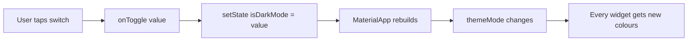

# Session 10: Themes and Responsive Design

> Module: Cross-Platform App Development with Flutter and Dart · Term 5 (ADSE) · ⏱ ~2 hours

A good app looks consistent on every screen and feels right on every device. Today you learn two skills: **themes** (one place to control colours and fonts) and **responsive design** (one layout that adapts to phone, tablet and desktop).

## 🎯 Learning Objectives

By the end of this session you will be able to:

- Explain what a theme is and why we avoid hard-coded colours
- Create light and dark themes with `ColorScheme.fromSeed`
- Toggle between themes at runtime using `themeMode`
- Read screen size with `MediaQuery` and available space with `LayoutBuilder`
- Build a layout that changes its number of columns at breakpoints

## 📖 Concepts Explained

### 1. What is a theme?

Think of a theme as the **uniform of your app**. Instead of telling every button "be teal, font size 16", you describe the uniform once and every widget wears it.

| Without a theme | With a theme |
|---|---|
| `color: Colors.teal` written in 40 places | Colour defined once in `ThemeData` |
| Changing brand colour = editing 40 files | Changing brand colour = edit 1 line |
| Dark mode is very hard | Dark mode is one extra `ThemeData` |

### 2. ThemeData and ColorScheme

`MaterialApp` takes three theme properties:

| Property | Meaning |
|---|---|
| `theme` | The light theme |
| `darkTheme` | The dark theme |
| `themeMode` | Which one to use: `ThemeMode.light`, `ThemeMode.dark` or `ThemeMode.system` (follow the phone setting) |

`ColorScheme.fromSeed(seedColor: Colors.teal)` takes **one colour** and generates a full, matching palette (primary, secondary, surface, error...). Material 3 (`useMaterial3: true`) is the default design system in Flutter 3.

### 3. Reading the theme inside a widget

```dart
final colors = Theme.of(context).colorScheme;   // colours
final textStyles = Theme.of(context).textTheme; // font styles
Text('Hi', style: textStyles.headlineMedium);
```

`Theme.of(context)` looks up the nearest theme in the widget tree. If the theme changes, every widget using it rebuilds automatically.

### 4. How the toggle works



The theme state lives in the **top** widget (`ThemeDemoApp`) because `MaterialApp` needs it. The switch lives lower down, so we pass a **callback** (`onToggle`) down to it. This is called *lifting state up*.

### 5. What is responsive design?

A responsive app **rearranges** itself based on available space. A phone shows one column, a tablet two, a desktop four. Flutter gives us two tools:

| Tool | Answers the question | Typical use |
|---|---|---|
| `MediaQuery.sizeOf(context)` | How big is the whole screen? | Font scaling, deciding to show a side menu |
| `LayoutBuilder` | How much space does *this* widget have? | Choosing columns for a grid or list |

### 6. Breakpoints

A breakpoint is a width where the layout changes. Common simple values:

| Width | Device | Columns |
|---|---|---|
| < 600 px | Phone | 1 |
| 600 – 999 px | Tablet | 2 |
| ≥ 1000 px | Desktop / web | 4 |

Other helpful widgets: `Expanded` and `Flexible` (share space in a Row/Column), `Wrap` (moves children to the next line when there is no room), `FittedBox` (shrinks content to fit), and `SafeArea` (avoids notches).

> 💡 Tip: run on **Chrome** (`flutter run -d chrome`) and drag the window edge. It is the fastest way to test responsiveness.

## 💻 Code Examples

### Example 1: Light/dark theme toggle

📄 Saved in this folder as [`main.dart`](main.dart).

```dart
// Session 10 - Example 1: Light / dark theme with a toggle switch
// Run: copy into lib/main.dart of a new Flutter project, then `flutter run`.
import 'package:flutter/material.dart';

void main() {
  runApp(const ThemeDemoApp());
}

// StatefulWidget because the chosen theme mode can change.
class ThemeDemoApp extends StatefulWidget {
  const ThemeDemoApp({super.key});

  @override
  State<ThemeDemoApp> createState() => _ThemeDemoAppState();
}

class _ThemeDemoAppState extends State<ThemeDemoApp> {
  // Step 1: remember whether dark mode is on.
  bool isDarkMode = false;

  // Step 2: a function that flips the value and rebuilds the app.
  void toggleTheme(bool value) {
    setState(() {
      isDarkMode = value;
    });
  }

  @override
  Widget build(BuildContext context) {
    return MaterialApp(
      title: 'Theme Demo',
      debugShowCheckedModeBanner: false,

      // Step 3: light theme built from ONE seed colour.
      theme: ThemeData(
        colorScheme: ColorScheme.fromSeed(seedColor: Colors.teal),
        useMaterial3: true,
      ),

      // Step 4: dark theme from the same seed colour.
      darkTheme: ThemeData(
        colorScheme: ColorScheme.fromSeed(
          seedColor: Colors.teal,
          brightness: Brightness.dark,
        ),
        useMaterial3: true,
      ),

      // Step 5: choose which theme is active right now.
      themeMode: isDarkMode ? ThemeMode.dark : ThemeMode.light,

      home: HomePage(isDarkMode: isDarkMode, onToggle: toggleTheme),
    );
  }
}

class HomePage extends StatelessWidget {
  final bool isDarkMode;
  final ValueChanged<bool> onToggle;

  const HomePage({super.key, required this.isDarkMode, required this.onToggle});

  @override
  Widget build(BuildContext context) {
    // Read colours and text styles from the current theme.
    final colors = Theme.of(context).colorScheme;
    final textStyles = Theme.of(context).textTheme;

    return Scaffold(
      appBar: AppBar(
        title: const Text('Themes in Flutter'),
        backgroundColor: colors.primaryContainer,
      ),
      body: Padding(
        padding: const EdgeInsets.all(16),
        child: Column(
          crossAxisAlignment: CrossAxisAlignment.start,
          children: [
            Text('Hello, students!', style: textStyles.headlineMedium),
            const SizedBox(height: 8),
            Text('All colours on this screen come from the theme.',
                style: textStyles.bodyLarge),
            const SizedBox(height: 16),
            // The switch calls onToggle, which changes the whole app theme.
            SwitchListTile(
              title: const Text('Dark mode'),
              value: isDarkMode,
              onChanged: onToggle,
            ),
            const SizedBox(height: 16),
            ElevatedButton(onPressed: () {}, child: const Text('Themed button')),
          ],
        ),
      ),
    );
  }
}
```

**How it works**

1. `isDarkMode` stores the user's choice inside a `StatefulWidget`.
2. Both themes are generated from the same seed colour, so they match.
3. `themeMode` picks the active theme from `isDarkMode`.
4. The switch calls `toggleTheme`, which uses `setState` to rebuild `MaterialApp`.
5. `HomePage` never hard-codes colours; it reads them with `Theme.of(context)`.

### Example 2: Responsive grid

📄 Saved in this folder as [`responsive_demo.dart`](responsive_demo.dart).

```dart
// Session 10 - Example 2: One screen that adapts to phone, tablet and desktop
// Run: copy into lib/main.dart, run on Chrome/desktop and resize the window.
import 'package:flutter/material.dart';

void main() {
  runApp(const MaterialApp(
    debugShowCheckedModeBanner: false,
    home: ResponsivePage(),
  ));
}

class ResponsivePage extends StatelessWidget {
  const ResponsivePage({super.key});

  @override
  Widget build(BuildContext context) {
    // MediaQuery tells us the full screen size.
    final screenWidth = MediaQuery.sizeOf(context).width;

    return Scaffold(
      appBar: AppBar(title: Text('Width: ${screenWidth.toInt()} px')),
      // LayoutBuilder tells us how much space THIS widget has.
      body: LayoutBuilder(
        builder: (context, constraints) {
          // Step 1: pick the number of columns from the available width.
          int columns;
          if (constraints.maxWidth < 600) {
            columns = 1; // phone
          } else if (constraints.maxWidth < 1000) {
            columns = 2; // tablet
          } else {
            columns = 4; // desktop
          }

          // Step 2: build a grid with that many columns.
          return GridView.count(
            crossAxisCount: columns,
            padding: const EdgeInsets.all(12),
            mainAxisSpacing: 12,
            crossAxisSpacing: 12,
            childAspectRatio: 3,
            children: List.generate(8, (index) {
              return Card(
                child: Center(child: Text('Course ${index + 1}')),
              );
            }),
          );
        },
      ),
    );
  }
}
```

**How it works**

1. `MediaQuery.sizeOf` shows the current screen width in the app bar.
2. `LayoutBuilder` gives `constraints.maxWidth`, the space available to the body.
3. An `if / else if` chooses 1, 2 or 4 columns.
4. `GridView.count` draws the cards in that many columns. Resize the window and watch it change.

## 🧪 Lab Practice

1. Create a project: `flutter create theme_lab`, paste Example 1 into `lib/main.dart` and run it. Toggle dark mode.
2. Change the seed colour to `Colors.deepPurple`. Notice that every widget updates.
3. Add a third option: a `SegmentedButton` or three radio buttons for **Light / Dark / System** using `ThemeMode.system`.
4. Run Example 2 on Chrome. Add a new breakpoint so screens wider than 1400 px show 6 columns.
5. In Example 2, replace `GridView.count` with a `Wrap` of 8 fixed-width `Card`s and compare the behaviour.

## 📝 Assignment

Build a **"Student Profile"** screen that:
- Has a light/dark toggle in the `AppBar` (use an `IconButton` with `Icons.dark_mode` / `Icons.light_mode`).
- On phones shows the photo **above** the details (a `Column`), and on screens wider than 600 px shows the photo **beside** the details (a `Row`). Use `LayoutBuilder`.
- Uses no hard-coded colours (only `Theme.of(context)`).

## ❓ Quick Quiz

1. Which `MaterialApp` property decides whether the light or dark theme is used?
2. What does `ColorScheme.fromSeed` do?
3. What is the difference between `MediaQuery` and `LayoutBuilder`?
4. Which `ThemeMode` follows the phone's own setting?
5. What is a breakpoint?

<details>
<summary>Show answers</summary>

1. `themeMode`.
2. It generates a complete, matching colour palette from one seed colour.
3. `MediaQuery` gives the whole screen size; `LayoutBuilder` gives the space available to one widget.
4. `ThemeMode.system`.
5. A screen width at which the layout changes (for example, 600 px from phone to tablet).

</details>

## 💼 Interview Questions

1. **How would you implement dark mode in a Flutter app?** Provide `theme` and `darkTheme` to `MaterialApp`, keep the chosen mode in state, and set `themeMode`. Read colours with `Theme.of(context)` instead of hard-coding them.
2. **Why prefer `LayoutBuilder` over `MediaQuery` for a grid?** A grid inside a split view or dialog may not get the full screen width; `LayoutBuilder` reports the real space it has.
3. **What is lifting state up?** Moving shared state to the nearest common parent and passing data and callbacks down to children.

## ✅ Summary

- A theme defines colours and text styles in one place; widgets read it with `Theme.of(context)`.
- `theme`, `darkTheme` and `themeMode` together give you light, dark and system modes.
- `ColorScheme.fromSeed` builds a full Material 3 palette from one colour.
- `MediaQuery` measures the screen, `LayoutBuilder` measures the parent's space.
- Breakpoints (600, 1000 px) let one codebase look right on phone, tablet and desktop.

---

[⬅ Previous](../Session-09-Practice-Lab-State-and-Navigation/README.md) · [🏠 Module Home](../README.md) · [Next ➡](../Session-11-Async-Data-sqflite-and-Firebase/README.md)

Prepared by Zeeshan Abbas · Aptech Learning North Nazimabad
