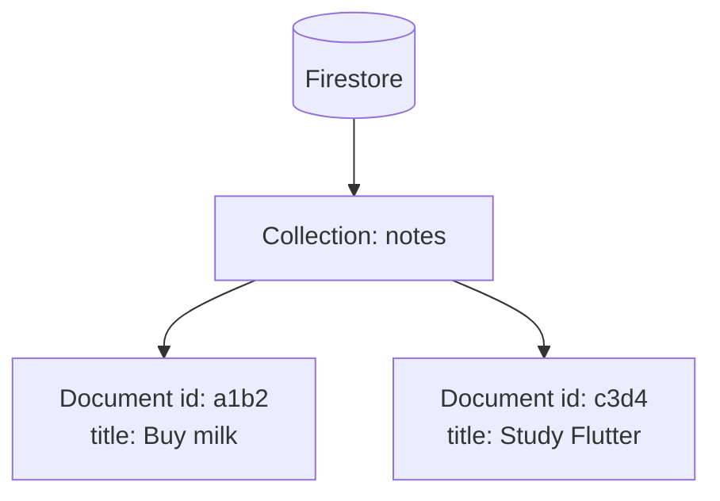

# Session 11: Async Data with sqflite and Firebase

> Module: Cross-Platform App Development with Flutter and Dart · Term 5 (ADSE) · ⏱ ~2 hours

Until now our apps forgot everything when closed. Today we make data **persistent**: first on the device with **sqflite** (SQLite), then in the cloud with **Cloud Firestore** (Firebase). Both use `async`/`await`, which you learned in the Dart module.

## 🎯 Learning Objectives

By the end of this session you will be able to:

- Explain local vs cloud storage and when to use each
- Create a SQLite database and table with `sqflite`
- Insert, read and delete rows using `async`/`await`
- Connect a Flutter app to Firebase with `flutterfire configure`
- Read live data from Firestore with a `StreamBuilder`

## 📖 Concepts Explained

### 1. Where can an app keep data?

| Option | Lives on | Good for | Example |
|---|---|---|---|
| Variables | RAM (lost on close) | Temporary screen data | Text being typed |
| `shared_preferences` | Device | Small settings | Dark mode on/off |
| **sqflite** (SQLite) | Device | Structured offline data | Notes, to-do list |
| **Cloud Firestore** | Google's servers | Shared, synced, multi-device data | Chat messages, orders |

Analogy: **sqflite** is a notebook in your bag; only you can read it, and it works without internet. **Firestore** is a shared Google Doc; everyone with access sees updates instantly, but you need internet (it does cache offline too).

### 2. Why everything is `async`

Reading a disk or a server takes time. If Flutter waited, the screen would freeze. So database methods return a `Future`, and we write `await` to get the value without blocking the UI.

```dart
final notes = await NoteDatabase.getNotes(); // waits, UI keeps running
```

### 3. sqflite in four steps

1. **Open** the database file with `openDatabase(path, version, onCreate)`.
2. **Create** tables inside `onCreate` (runs only the first time).
3. **Query** with helper methods: `insert`, `query`, `update`, `delete`.
4. **Refresh** the UI with `setState` after each change.

| SQL | sqflite helper |
|---|---|
| `INSERT INTO notes(title) VALUES('Hi')` | `db.insert('notes', {'title': 'Hi'})` |
| `SELECT * FROM notes ORDER BY id DESC` | `db.query('notes', orderBy: 'id DESC')` |
| `DELETE FROM notes WHERE id = 3` | `db.delete('notes', where: 'id = ?', whereArgs: [3])` |

> ⚠️ Always use `?` with `whereArgs` instead of joining strings. It protects against SQL injection.
>
> sqflite runs on Android, iOS and macOS. For Windows/Linux desktop use `sqflite_common_ffi`; for web, use Firestore or another web storage.

### 4. Firestore data model

Firestore is a **NoSQL** database: no tables, but **collections** that hold **documents** (like JSON objects).



### 5. Setting up Firebase (one time)

1. Create a project at the [Firebase console](https://console.firebase.google.com/).
2. Install the CLIs: `npm install -g firebase-tools` and `dart pub global activate flutterfire_cli`.
3. In your project folder run `firebase login`, then `flutterfire configure`. It creates `lib/firebase_options.dart`.
4. In the console, open **Firestore Database → Create database → Start in test mode** (for learning only).
5. Add packages: `flutter pub add firebase_core cloud_firestore`.

### 6. Future vs Stream

| `Future` | `Stream` |
|---|---|
| One value, once | Many values over time |
| `FutureBuilder` | `StreamBuilder` |
| sqflite query | Firestore `.snapshots()` (updates live) |

## 💻 Code Examples

Packages for this session:

📄 Saved in this folder as [`pubspec_snippet.yaml`](pubspec_snippet.yaml).

```yaml
# Add these under "dependencies:" in pubspec.yaml
# (or run: flutter pub add sqflite path firebase_core cloud_firestore)
dependencies:
  flutter:
    sdk: flutter
  sqflite: ^2.4.5          # local SQLite database (Android, iOS, macOS)
  path: ^1.9.1             # helps build the database file path
  firebase_core: ^5.1.0    # needed by every Firebase package
  cloud_firestore: ^7.1.0  # Firebase cloud database
```

### Example 1: Database helper (sqflite)

📄 Saved in this folder as [`note_database.dart`](note_database.dart).

```dart
// Session 11 - Example 1: A tiny helper class for a local SQLite database
import 'package:path/path.dart';
import 'package:sqflite/sqflite.dart';

class NoteDatabase {
  // We keep one open database and reuse it.
  static Database? _database;

  // Step 1: open the database (create it the first time).
  static Future<Database> getDatabase() async {
    if (_database != null) return _database!;

    final folder = await getDatabasesPath();       // where the phone keeps databases
    final filePath = join(folder, 'notes.db');     // e.g. .../databases/notes.db

    _database = await openDatabase(
      filePath,
      version: 1,
      // onCreate runs only once, when the file does not exist yet.
      onCreate: (db, version) {
        return db.execute(
          'CREATE TABLE notes(id INTEGER PRIMARY KEY AUTOINCREMENT, title TEXT)',
        );
      },
    );
    return _database!;
  }

  // Step 2: INSERT a new note.
  static Future<void> addNote(String title) async {
    final db = await getDatabase();
    await db.insert('notes', {'title': title});
  }

  // Step 3: SELECT all notes (newest first).
  static Future<List<Map<String, dynamic>>> getNotes() async {
    final db = await getDatabase();
    return db.query('notes', orderBy: 'id DESC');
  }

  // Step 4: DELETE one note by its id.
  static Future<void> deleteNote(int id) async {
    final db = await getDatabase();
    await db.delete('notes', where: 'id = ?', whereArgs: [id]);
  }
}
```

**How it works**

1. `getDatabase()` opens `notes.db` once and stores it in `_database` for reuse.
2. `onCreate` creates the `notes` table the very first time.
3. `addNote`, `getNotes` and `deleteNote` each `await` the database and run one operation.

### Example 2: Notes screen using the helper

📄 Saved in this folder as [`main.dart`](main.dart).

```dart
// Session 11 - Example 2: Notes app that saves to SQLite (works offline)
// Files needed in lib/: main.dart + note_database.dart
import 'package:flutter/material.dart';
import 'note_database.dart';

void main() {
  runApp(const MaterialApp(debugShowCheckedModeBanner: false, home: NotesPage()));
}

class NotesPage extends StatefulWidget {
  const NotesPage({super.key});

  @override
  State<NotesPage> createState() => _NotesPageState();
}

class _NotesPageState extends State<NotesPage> {
  final titleController = TextEditingController();
  List<Map<String, dynamic>> notes = [];

  @override
  void initState() {
    super.initState();
    loadNotes(); // read saved notes when the screen opens
  }

  // Read from the database, then refresh the screen.
  Future<void> loadNotes() async {
    final data = await NoteDatabase.getNotes();
    setState(() {
      notes = data;
    });
  }

  Future<void> saveNote() async {
    final text = titleController.text.trim();
    if (text.isEmpty) return;          // ignore empty input
    await NoteDatabase.addNote(text);  // wait until it is saved
    titleController.clear();
    await loadNotes();                 // show the new list
  }

  Future<void> removeNote(int id) async {
    await NoteDatabase.deleteNote(id);
    await loadNotes();
  }

  @override
  Widget build(BuildContext context) {
    return Scaffold(
      appBar: AppBar(title: const Text('My Notes (SQLite)')),
      body: Column(
        children: [
          Padding(
            padding: const EdgeInsets.all(12),
            child: Row(
              children: [
                Expanded(
                  child: TextField(
                    controller: titleController,
                    decoration: const InputDecoration(labelText: 'New note'),
                  ),
                ),
                IconButton(icon: const Icon(Icons.add), onPressed: saveNote),
              ],
            ),
          ),
          Expanded(
            child: ListView.builder(
              itemCount: notes.length,
              itemBuilder: (context, index) {
                final note = notes[index];
                return ListTile(
                  title: Text(note['title']),
                  trailing: IconButton(
                    icon: const Icon(Icons.delete),
                    onPressed: () => removeNote(note['id']),
                  ),
                );
              },
            ),
          ),
        ],
      ),
    );
  }
}
```

**How it works**

1. `initState` calls `loadNotes()` so saved notes appear when the app starts.
2. `saveNote` inserts the text, clears the box and reloads the list.
3. `ListView.builder` shows each row; the delete icon removes it by `id`.
4. Close and reopen the app: the notes are still there.

### Example 3: Cloud notes with Firestore

📄 Saved in this folder as [`firestore_example.dart`](firestore_example.dart).

```dart
// Session 11 - Example 3: The same notes idea, but stored in Cloud Firestore
// Before running: create a Firebase project and run `flutterfire configure`
// (it generates lib/firebase_options.dart).
import 'package:cloud_firestore/cloud_firestore.dart';
import 'package:firebase_core/firebase_core.dart';
import 'package:flutter/material.dart';
import 'firebase_options.dart';

Future<void> main() async {
  // Step 1: Flutter must be ready before we call native code.
  WidgetsFlutterBinding.ensureInitialized();
  // Step 2: connect the app to your Firebase project.
  await Firebase.initializeApp(options: DefaultFirebaseOptions.currentPlatform);
  runApp(const MaterialApp(debugShowCheckedModeBanner: false, home: CloudNotesPage()));
}

class CloudNotesPage extends StatelessWidget {
  const CloudNotesPage({super.key});

  // A reference to the "notes" collection in Firestore.
  CollectionReference<Map<String, dynamic>> get notesCollection =>
      FirebaseFirestore.instance.collection('notes');

  // Step 3: add a document with a title and a server timestamp.
  Future<void> addNote() async {
    await notesCollection.add({
      'title': 'Note at ${DateTime.now().toLocal()}',
      'createdAt': FieldValue.serverTimestamp(),
    });
  }

  @override
  Widget build(BuildContext context) {
    return Scaffold(
      appBar: AppBar(title: const Text('Cloud Notes (Firestore)')),
      floatingActionButton: FloatingActionButton(
        onPressed: addNote,
        child: const Icon(Icons.add),
      ),
      // Step 4: StreamBuilder listens for live changes in the collection.
      body: StreamBuilder<QuerySnapshot<Map<String, dynamic>>>(
        stream: notesCollection.orderBy('createdAt', descending: true).snapshots(),
        builder: (context, snapshot) {
          if (snapshot.hasError) {
            return Center(child: Text('Error: ${snapshot.error}'));
          }
          if (!snapshot.hasData) {
            return const Center(child: CircularProgressIndicator());
          }
          final docs = snapshot.data!.docs;
          return ListView.builder(
            itemCount: docs.length,
            itemBuilder: (context, index) {
              final doc = docs[index];
              return ListTile(
                title: Text(doc['title']),
                // Delete the document using its id.
                trailing: IconButton(
                  icon: const Icon(Icons.delete),
                  onPressed: () => notesCollection.doc(doc.id).delete(),
                ),
              );
            },
          );
        },
      ),
    );
  }
}
```

**How it works**

1. `Firebase.initializeApp` connects to your project before `runApp`.
2. The button calls `add()`, which creates a document with an auto id.
3. `snapshots()` is a stream; `StreamBuilder` rebuilds the list whenever the data changes, even from another phone.
4. `doc(id).delete()` removes a document.

## 🧪 Lab Practice

1. Run Examples 1 + 2 on an Android emulator. Add three notes, restart the app and confirm they persist.
2. Add an `update` method to `NoteDatabase` and let the user edit a note through an `AlertDialog`.
3. Add a second column `done INTEGER` and show a `Checkbox` for each note. (Hint: raise `version` to 2 and use `onUpgrade` to run `ALTER TABLE`.)
4. Set up Firebase and run Example 3. Open the Firestore console and watch documents appear live.
5. Add a document directly in the console and see it appear in the app without refreshing.

## 📝 Assignment

Build a **"Expense Tracker"** with sqflite: table `expenses(id, title, amount REAL)`. Show the list and the **total** at the top (use `SELECT SUM(amount) AS total FROM expenses` with `db.rawQuery`). Bonus: a second version that stores the same data in Firestore.

## ❓ Quick Quiz

1. When does the `onCreate` callback of `openDatabase` run?
2. Why do we use `whereArgs` instead of building the SQL string ourselves?
3. In Firestore, what holds documents?
4. Which widget shows live data from a `Stream`?
5. Which command generates `firebase_options.dart`?

<details>
<summary>Show answers</summary>

1. Only once, when the database file is created for the first time.
2. To avoid SQL injection and quoting mistakes.
3. A collection.
4. `StreamBuilder`.
5. `flutterfire configure`.

</details>

## 💼 Interview Questions

1. **sqflite or Firestore: how do you choose?** sqflite for private, offline, structured data on one device; Firestore for data that must sync across users and devices in real time.
2. **Why must database calls be asynchronous in Flutter?** Disk and network I/O are slow; awaiting a `Future` keeps the UI thread free so the app does not freeze.
3. **How do you change a SQLite table after the app is already released?** Increase the database `version` and apply the change in `onUpgrade` (a migration).

## ✅ Summary

- Persistent data survives app restarts; choose local (sqflite) or cloud (Firestore).
- sqflite: open → create table in `onCreate` → `insert`/`query`/`delete` with `await`.
- Firestore stores documents in collections and pushes live updates through `snapshots()`.
- `FutureBuilder` is for one-time results; `StreamBuilder` is for live data.
- `flutterfire configure` connects your Flutter project to Firebase.

---

[⬅ Previous](../Session-10-Themes-and-Responsive-Design/README.md) · [🏠 Module Home](../README.md) · [Next ➡](../Session-12-Practice-Lab-Data/README.md)

Prepared by Zeeshan Abbas · Aptech Learning North Nazimabad
