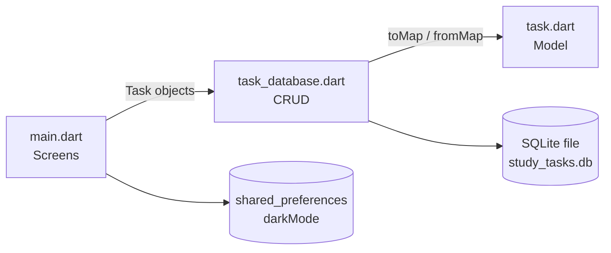

# Session 12: Practice Lab — Data (Study Tasks App)

> Module: Cross-Platform App Development with Flutter and Dart · Term 5 (ADSE) · ⏱ ~2 hours

In this lab you combine Sessions 10 and 11 into one small, complete app: **Study Tasks**. It saves tasks in SQLite, lets you tick them off, and remembers your dark-mode choice between launches.

## 🎯 Learning Objectives

By the end of this lab you will be able to:

- Design a model class with `toMap()` and `fromMap()`
- Keep all database code in a separate helper class (full CRUD)
- Store a simple setting with `shared_preferences`
- Load saved data before the first screen appears
- Show an empty state and a progress count in the UI

## 📖 Concepts Explained

### 1. What we are building

```text
┌──────────────────────────────────────┐
│ Study Tasks (1/3 done)          🌙   │
├──────────────────────────────────────┤
│ [ What will you study?            ]  │
│ ☑ ~~Revise themes~~              🗑  │
│ ☐ Practise sqflite               🗑  │
│ ☐ Read Firestore docs            🗑  │
└──────────────────────────────────────┘
```

### 2. Three files, three jobs

Splitting code makes it easier to read and test. Each file does **one** thing:

| File | Job | Knows about Flutter UI? |
|---|---|---|
| `task.dart` | Describes one task (data model) | No |
| `task_database.dart` | Saves and loads tasks (CRUD) | No |
| `main.dart` | Shows the screen and reacts to taps | Yes |



### 3. Why `toMap` and `fromMap`?

sqflite only understands **maps** (`{'title': 'Read', 'isDone': 0}`), while our UI prefers **objects** (`task.title`). The model converts between them. SQLite has no boolean type, so `true/false` is stored as `1/0`.

### 4. CRUD mapping

| Action in the app | CRUD | Method |
|---|---|---|
| Type + Enter | Create | `TaskDatabase.insert` |
| App opens / list refreshes | Read | `TaskDatabase.getAll` |
| Tick the checkbox | Update | `TaskDatabase.update` |
| Tap the bin icon | Delete | `TaskDatabase.delete` |

### 5. shared_preferences vs sqflite

`shared_preferences` is a tiny **key–value** store, perfect for one setting such as `darkMode = true`. A list of tasks with many fields belongs in a real database. We read the setting in `main()` **before** `runApp`, so the app opens in the right theme with no flicker. That is why `main` is `async` and calls `WidgetsFlutterBinding.ensureInitialized()` first.

## 💻 Code Examples

Packages:

📄 Saved in this folder as [`pubspec_snippet.yaml`](pubspec_snippet.yaml).

```yaml
# Run: flutter pub add sqflite path shared_preferences
dependencies:
  flutter:
    sdk: flutter
  sqflite: ^2.4.5             # tasks table
  path: ^1.9.1                # database file path
  shared_preferences: ^2.5.6  # remembers dark mode on/off
```

### Step 1: The model

📄 Saved in this folder as [`task.dart`](task.dart).

```dart
// Session 12 - Step 1: The Task model (one row of the "tasks" table)
class Task {
  final int? id;      // null until the database gives it an id
  final String title;
  final bool isDone;

  Task({this.id, required this.title, this.isDone = false});

  // Object -> Map, so sqflite can save it. SQLite has no bool, so we use 1/0.
  Map<String, dynamic> toMap() {
    return {
      'id': id,
      'title': title,
      'isDone': isDone ? 1 : 0,
    };
  }

  // Map -> Object, when we read a row back.
  factory Task.fromMap(Map<String, dynamic> map) {
    return Task(
      id: map['id'] as int,
      title: map['title'] as String,
      isDone: map['isDone'] == 1,
    );
  }
}
```

**How it works:** `id` is nullable because a brand-new task has no id until SQLite creates one. `toMap` converts `isDone` to `1/0`; `fromMap` converts it back.

### Step 2: The database helper

📄 Saved in this folder as [`task_database.dart`](task_database.dart).

```dart
// Session 12 - Step 2: All database work in one place (CRUD)
import 'package:path/path.dart';
import 'package:sqflite/sqflite.dart';
import 'task.dart';

class TaskDatabase {
  static Database? _db;

  static Future<Database> _open() async {
    if (_db != null) return _db!;
    _db = await openDatabase(
      join(await getDatabasesPath(), 'study_tasks.db'),
      version: 1,
      onCreate: (db, version) => db.execute(
        'CREATE TABLE tasks(id INTEGER PRIMARY KEY AUTOINCREMENT, '
        'title TEXT NOT NULL, isDone INTEGER NOT NULL)',
      ),
    );
    return _db!;
  }

  // CREATE
  static Future<void> insert(Task task) async {
    final db = await _open();
    final data = task.toMap()..remove('id'); // let SQLite choose the id
    await db.insert('tasks', data);
  }

  // READ
  static Future<List<Task>> getAll() async {
    final db = await _open();
    final rows = await db.query('tasks', orderBy: 'id DESC');
    return rows.map((row) => Task.fromMap(row)).toList();
  }

  // UPDATE
  static Future<void> update(Task task) async {
    final db = await _open();
    await db.update('tasks', task.toMap(), where: 'id = ?', whereArgs: [task.id]);
  }

  // DELETE
  static Future<void> delete(int id) async {
    final db = await _open();
    await db.delete('tasks', where: 'id = ?', whereArgs: [id]);
  }
}
```

**How it works:** `_open()` creates the database once. Each public method performs one CRUD action. In `insert` we remove `id` so `AUTOINCREMENT` can choose it.

### Step 3: The app

📄 Saved in this folder as [`main.dart`](main.dart).

```dart
// Session 12 - Step 3: Study Tasks app (sqflite + saved dark mode)
// lib/ needs: main.dart, task.dart, task_database.dart
import 'package:flutter/material.dart';
import 'package:shared_preferences/shared_preferences.dart';
import 'task.dart';
import 'task_database.dart';

Future<void> main() async {
  WidgetsFlutterBinding.ensureInitialized();
  // Read the saved theme choice before showing the app.
  final prefs = await SharedPreferences.getInstance();
  final savedDark = prefs.getBool('darkMode') ?? false;
  runApp(StudyTasksApp(startDark: savedDark));
}

class StudyTasksApp extends StatefulWidget {
  final bool startDark;
  const StudyTasksApp({super.key, required this.startDark});

  @override
  State<StudyTasksApp> createState() => _StudyTasksAppState();
}

class _StudyTasksAppState extends State<StudyTasksApp> {
  late bool isDark = widget.startDark;

  Future<void> toggleTheme() async {
    setState(() => isDark = !isDark);
    final prefs = await SharedPreferences.getInstance();
    await prefs.setBool('darkMode', isDark); // remember for next launch
  }

  @override
  Widget build(BuildContext context) {
    return MaterialApp(
      debugShowCheckedModeBanner: false,
      theme: ThemeData(colorSchemeSeed: Colors.indigo),
      darkTheme: ThemeData(colorSchemeSeed: Colors.indigo, brightness: Brightness.dark),
      themeMode: isDark ? ThemeMode.dark : ThemeMode.light,
      home: TasksPage(isDark: isDark, onToggleTheme: toggleTheme),
    );
  }
}

class TasksPage extends StatefulWidget {
  final bool isDark;
  final VoidCallback onToggleTheme;
  const TasksPage({super.key, required this.isDark, required this.onToggleTheme});

  @override
  State<TasksPage> createState() => _TasksPageState();
}

class _TasksPageState extends State<TasksPage> {
  final inputController = TextEditingController();
  List<Task> tasks = [];

  @override
  void initState() {
    super.initState();
    refresh();
  }

  Future<void> refresh() async {
    final all = await TaskDatabase.getAll();
    setState(() => tasks = all);
  }

  Future<void> addTask() async {
    final title = inputController.text.trim();
    if (title.isEmpty) return;
    await TaskDatabase.insert(Task(title: title));
    inputController.clear();
    await refresh();
  }

  Future<void> toggleDone(Task task) async {
    // Make a copy with the opposite isDone value and save it.
    await TaskDatabase.update(Task(id: task.id, title: task.title, isDone: !task.isDone));
    await refresh();
  }

  Future<void> deleteTask(Task task) async {
    await TaskDatabase.delete(task.id!);
    await refresh();
  }

  @override
  Widget build(BuildContext context) {
    final doneCount = tasks.where((t) => t.isDone).length;

    return Scaffold(
      appBar: AppBar(
        title: Text('Study Tasks ($doneCount/${tasks.length} done)'),
        actions: [
          IconButton(
            icon: Icon(widget.isDark ? Icons.light_mode : Icons.dark_mode),
            onPressed: widget.onToggleTheme,
          ),
        ],
      ),
      body: Column(
        children: [
          Padding(
            padding: const EdgeInsets.all(12),
            child: TextField(
              controller: inputController,
              decoration: const InputDecoration(
                labelText: 'What will you study?',
                border: OutlineInputBorder(),
              ),
              onSubmitted: (_) => addTask(), // press Enter to add
            ),
          ),
          Expanded(
            child: tasks.isEmpty
                ? const Center(child: Text('No tasks yet. Add one above!'))
                : ListView.builder(
                    itemCount: tasks.length,
                    itemBuilder: (context, index) {
                      final task = tasks[index];
                      return CheckboxListTile(
                        value: task.isDone,
                        onChanged: (_) => toggleDone(task),
                        title: Text(
                          task.title,
                          style: TextStyle(
                            decoration: task.isDone ? TextDecoration.lineThrough : null,
                          ),
                        ),
                        secondary: IconButton(
                          icon: const Icon(Icons.delete_outline),
                          onPressed: () => deleteTask(task),
                        ),
                      );
                    },
                  ),
          ),
        ],
      ),
    );
  }
}
```

**How it works**

1. `main()` reads `darkMode` from `shared_preferences` and passes it to the app.
2. `toggleTheme` flips the theme and saves the new value.
3. `TasksPage` loads tasks in `initState` and after every change calls `refresh()`.
4. `CheckboxListTile` ticks a task; the title gets a line-through when done.
5. The app bar shows progress: done count / total.

## 🧪 Lab Practice

1. Create `flutter create study_tasks`, add the packages, place the three files in `lib/` and run on an emulator.
2. Add 4 tasks, tick 2, switch to dark mode, then **fully close** the app and reopen it. Everything should be restored.
3. Add a **"Clear completed"** button in the app bar that deletes all done tasks (hint: `db.delete('tasks', where: 'isDone = ?', whereArgs: [1])`).
4. Wrap each list item in a `Dismissible` so the user can swipe to delete.
5. Make the layout responsive: on screens wider than 700 px, show the input box on the left and the list on the right.

## 📝 Assignment

Extend Study Tasks with a **subject** field (e.g. "Flutter", "Python"). Add a `DropdownButton` next to the text box, store the subject in a new column, and show it as the `subtitle` of each task. Remember to raise the database `version` and add the column in `onUpgrade`.

## ❓ Quick Quiz

1. Why is `Task.id` nullable?
2. How is a `bool` stored in SQLite here?
3. Why do we call `WidgetsFlutterBinding.ensureInitialized()` in `main`?
4. Which package stores the dark-mode setting?
5. Which widget gives a checkbox, title and trailing widget in one row?

<details>
<summary>Show answers</summary>

1. A new task has no id until the database assigns one.
2. As an integer: `1` for true, `0` for false.
3. Because we use a plugin (`shared_preferences`) before `runApp`.
4. `shared_preferences`.
5. `CheckboxListTile`.

</details>

## 💼 Interview Questions

1. **Why separate the database code from the UI?** It keeps widgets simple, allows reuse on other screens, and makes the data layer testable without the UI.
2. **What is a model class and why use `fromMap`?** A typed Dart class for a piece of data; `fromMap` turns raw database rows into safe, typed objects.
3. **When would you choose `shared_preferences` over SQLite?** For a few small settings (theme, language, logged-in flag), not for lists of records.

## ✅ Summary

- One app, three layers: model, database helper, UI.
- `toMap` / `fromMap` connect Dart objects with database rows.
- Full CRUD maps cleanly to add, list, tick and delete actions.
- `shared_preferences` remembers small settings like dark mode.
- Loading settings before `runApp` gives a smooth start.

---

[⬅ Previous](../Session-11-Async-Data-sqflite-and-Firebase/README.md) · [🏠 Module Home](../README.md) · [Next ➡](../Session-13-REST-APIs/README.md)

Prepared by Zeeshan Abbas · Aptech Learning North Nazimabad
