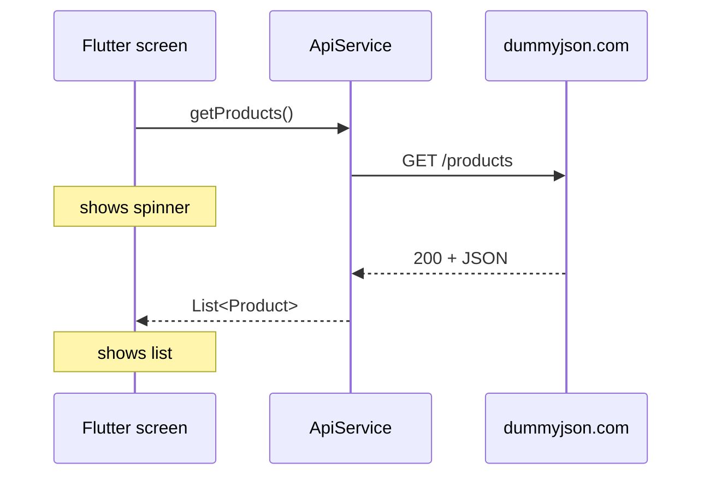

# Session 13: REST APIs in Flutter

> Module: Cross-Platform App Development with Flutter and Dart · Term 5 (ADSE) · ⏱ ~2 hours

Most real apps show data that lives on a server: products, weather, news, chat. Today you learn how a Flutter app **talks to a web API** using the `http` package. We use the free practice API at [dummyjson.com](https://dummyjson.com), which needs no key.

## 🎯 Learning Objectives

By the end of this session you will be able to:

- Explain REST, endpoints, HTTP methods and status codes
- Send GET and POST requests with the `http` package
- Convert JSON to Dart objects with `jsonDecode` and a `fromJson` factory
- Show loading, error and success states with `FutureBuilder`
- Organise network code in a separate service class

## 📖 Concepts Explained

### 1. What is a REST API?

An API is a **waiter in a restaurant**. Your app (the customer) does not walk into the kitchen (the server's database). It gives an order to the waiter (a request to a URL), and the waiter brings back food (a JSON response).

REST is a common style for such APIs: each **resource** has a URL, and the **HTTP method** says what you want to do with it.

| Method | Meaning | dummyjson example |
|---|---|---|
| GET | Read data | `GET /products` |
| POST | Create data | `POST /products/add` |
| PUT / PATCH | Update data | `PUT /products/1` |
| DELETE | Remove data | `DELETE /products/1` |

### 2. Anatomy of a request

```text
https://dummyjson.com/products?limit=20&select=title,price
└──── base URL ─────┘└endpoint┘└──── query parameters ────┘
```

### 3. Status codes you must know

| Code | Meaning | What your app should do |
|---|---|---|
| 200 / 201 | OK / Created | Show the data |
| 400 | Bad request | Check what you sent |
| 401 / 403 | Not logged in / not allowed | Ask the user to sign in |
| 404 | Not found | Show "not found" |
| 500 | Server error | Show "try again later" |

### 4. JSON ↔ Dart

The server sends **text** in JSON format. Dart turns it into maps and lists:

| Step | Function | Result |
|---|---|---|
| Text → Map | `jsonDecode(response.body)` | `Map<String, dynamic>` |
| Map → Object | `Product.fromJson(map)` | Typed `Product` |
| Map → Text (for POST) | `jsonEncode({...})` | JSON string |

A model with `fromJson` gives you **auto-complete and type safety** (`product.price` instead of `map['price']`).

### 5. The request life cycle in a widget



`FutureBuilder` handles the three states for you: **waiting** (spinner), **error** (message + retry), **data** (the list).

> ⚠️ Store the `Future` in a variable (in state). If you write `future: ApiService.getProducts()` directly inside `build`, a new request is sent on **every** rebuild.

### 6. Platform notes

- **Android:** release builds need `<uses-permission android:name="android.permission.INTERNET"/>` in `android/app/src/main/AndroidManifest.xml` (debug builds already have it).
- **macOS:** enable *Outgoing Connections* (`com.apple.security.network.client`) in the entitlements files.
- Other API styles exist too: **GraphQL** (one endpoint, client chooses fields) and **WebSockets** (live two-way connection, e.g. chat). REST is the most common starting point.

## 💻 Code Examples

Package:

📄 Saved in this folder as [`pubspec_snippet.yaml`](pubspec_snippet.yaml).

```yaml
# Run: flutter pub add http
dependencies:
  flutter:
    sdk: flutter
  http: ^1.6.0   # makes GET / POST requests to web APIs
```

### Example 1: One GET request (random quote)

📄 Saved in this folder as [`quote_example.dart`](quote_example.dart).

```dart
// Session 13 - Example 1: The smallest possible GET request
// Shows one random quote from https://dummyjson.com/quotes/random
import 'dart:convert';                     // jsonDecode
import 'package:flutter/material.dart';
import 'package:http/http.dart' as http;   // the http package

void main() {
  runApp(const MaterialApp(debugShowCheckedModeBanner: false, home: QuotePage()));
}

// Step 1: a function that calls the API and returns the quote text.
Future<String> fetchRandomQuote() async {
  final url = Uri.parse('https://dummyjson.com/quotes/random');
  final response = await http.get(url);               // send the request

  if (response.statusCode == 200) {                    // 200 = OK
    final data = jsonDecode(response.body);            // text -> Map
    return '"${data['quote']}"\n\n- ${data['author']}';
  } else {
    throw Exception('Server error: ${response.statusCode}');
  }
}

class QuotePage extends StatefulWidget {
  const QuotePage({super.key});

  @override
  State<QuotePage> createState() => _QuotePageState();
}

class _QuotePageState extends State<QuotePage> {
  // Step 2: keep the Future in a variable so it runs only when we ask.
  late Future<String> quoteFuture = fetchRandomQuote();

  @override
  Widget build(BuildContext context) {
    return Scaffold(
      appBar: AppBar(title: const Text('Random Quote')),
      body: Center(
        child: Padding(
          padding: const EdgeInsets.all(24),
          // Step 3: FutureBuilder shows loading, error or data.
          child: FutureBuilder<String>(
            future: quoteFuture,
            builder: (context, snapshot) {
              if (snapshot.connectionState == ConnectionState.waiting) {
                return const CircularProgressIndicator();
              }
              if (snapshot.hasError) {
                return Text('Oops: ${snapshot.error}');
              }
              return Text(snapshot.data!, textAlign: TextAlign.center,
                  style: const TextStyle(fontSize: 20));
            },
          ),
        ),
      ),
      // Step 4: get a new quote by creating a new Future.
      floatingActionButton: FloatingActionButton(
        onPressed: () => setState(() => quoteFuture = fetchRandomQuote()),
        child: const Icon(Icons.refresh),
      ),
    );
  }
}
```

**How it works**

1. `http.get` sends the request and `await` waits for the answer.
2. We check `statusCode == 200`, then `jsonDecode` the body into a map.
3. `FutureBuilder` shows a spinner, an error, or the quote.
4. The refresh button assigns a **new** Future inside `setState`, which triggers a new request.

### Example 2: Products app (model + service + screen)

📄 Saved in this folder as [`product.dart`](product.dart).

```dart
// Session 13 - Example 2a: Model for one product from dummyjson.com
class Product {
  final int id;
  final String title;
  final double price;
  final String thumbnail;

  Product({
    required this.id,
    required this.title,
    required this.price,
    required this.thumbnail,
  });

  // JSON Map -> Product object
  factory Product.fromJson(Map<String, dynamic> json) {
    return Product(
      id: json['id'] as int,
      title: json['title'] as String,
      price: (json['price'] as num).toDouble(), // price can be int or double
      thumbnail: json['thumbnail'] as String? ?? '', // missing -> empty text
    );
  }
}
```

📄 Saved in this folder as [`api_service.dart`](api_service.dart).

```dart
// Session 13 - Example 2b: All network calls in one class
import 'dart:convert';
import 'package:http/http.dart' as http;
import 'product.dart';

class ApiService {
  static const String baseUrl = 'https://dummyjson.com';

  // GET /products?limit=20  -> list of products
  static Future<List<Product>> getProducts() async {
    final url = Uri.parse('$baseUrl/products?limit=20&select=title,price,thumbnail');
    final response = await http.get(url);

    if (response.statusCode != 200) {
      throw Exception('Could not load products (${response.statusCode})');
    }

    final body = jsonDecode(response.body) as Map<String, dynamic>;
    final list = body['products'] as List;               // the array inside
    return list.map((item) => Product.fromJson(item)).toList();
  }

  // POST /products/add  -> the server echoes the new product with an id
  // (dummyjson only simulates saving; nothing is really stored)
  static Future<Product> addProduct(String title, double price) async {
    final url = Uri.parse('$baseUrl/products/add');
    final response = await http.post(
      url,
      headers: {'Content-Type': 'application/json'},
      body: jsonEncode({'title': title, 'price': price}), // Map -> JSON text
    );

    if (response.statusCode != 200 && response.statusCode != 201) {
      throw Exception('Could not add product (${response.statusCode})');
    }
    return Product.fromJson(jsonDecode(response.body));
  }
}
```

📄 Saved in this folder as [`main.dart`](main.dart).

```dart
// Session 13 - Example 2c: Product list (GET) + add button (POST)
// lib/ needs: main.dart, product.dart, api_service.dart
import 'package:flutter/material.dart';
import 'api_service.dart';
import 'product.dart';

void main() {
  runApp(const MaterialApp(debugShowCheckedModeBanner: false, home: ProductsPage()));
}

class ProductsPage extends StatefulWidget {
  const ProductsPage({super.key});

  @override
  State<ProductsPage> createState() => _ProductsPageState();
}

class _ProductsPageState extends State<ProductsPage> {
  late Future<List<Product>> productsFuture = ApiService.getProducts();

  // Send a POST request and show the server's answer in a SnackBar.
  Future<void> addDemoProduct() async {
    try {
      final created = await ApiService.addProduct('Aptech Notebook', 4.5);
      if (!mounted) return; // the screen may have closed while waiting
      ScaffoldMessenger.of(context).showSnackBar(
        SnackBar(content: Text('Server created id ${created.id}: ${created.title}')),
      );
    } catch (error) {
      if (!mounted) return;
      ScaffoldMessenger.of(context).showSnackBar(SnackBar(content: Text('$error')));
    }
  }

  @override
  Widget build(BuildContext context) {
    return Scaffold(
      appBar: AppBar(title: const Text('Products (dummyjson)')),
      floatingActionButton: FloatingActionButton.extended(
        onPressed: addDemoProduct,
        icon: const Icon(Icons.add),
        label: const Text('POST'),
      ),
      body: FutureBuilder<List<Product>>(
        future: productsFuture,
        builder: (context, snapshot) {
          // 1) still loading
          if (snapshot.connectionState == ConnectionState.waiting) {
            return const Center(child: CircularProgressIndicator());
          }
          // 2) something went wrong (no internet, server down...)
          if (snapshot.hasError) {
            return Center(
              child: Column(
                mainAxisSize: MainAxisSize.min,
                children: [
                  Text('Error: ${snapshot.error}'),
                  TextButton(
                    onPressed: () => setState(() => productsFuture = ApiService.getProducts()),
                    child: const Text('Try again'),
                  ),
                ],
              ),
            );
          }
          // 3) success: draw the list
          final products = snapshot.data!;
          return ListView.builder(
            itemCount: products.length,
            itemBuilder: (context, index) {
              final product = products[index];
              return ListTile(
                leading: Image.network(product.thumbnail, width: 56),
                title: Text(product.title),
                subtitle: Text('\$${product.price.toStringAsFixed(2)}'),
              );
            },
          );
        },
      ),
    );
  }
}
```

**How it works**

1. `Product.fromJson` converts one JSON object; `(json['price'] as num).toDouble()` accepts both `10` and `9.99`.
2. `ApiService.getProducts` reads the `products` array and maps every item to a `Product`.
3. `addProduct` sends JSON with a `Content-Type` header; dummyjson replies with a fake new id (it does not really save).
4. The screen handles all three states and offers a *Try again* button on error.
5. `if (!mounted) return;` prevents using `context` after the screen has closed.

## 🧪 Lab Practice

1. Run Example 1. Turn off Wi-Fi on the emulator and press refresh to see the error state.
2. Run Example 2. Change `limit=20` to `limit=50` and add `skip=10`. What changes?
3. Add a search box: call `https://dummyjson.com/products/search?q=phone` with the typed text.
4. Make each product tappable and open a detail page that calls `GET /products/{id}` and shows the `description`.
5. Add a `RefreshIndicator` so pulling down reloads the list.

## 📝 Assignment

Build a **"Users Directory"** app using `GET https://dummyjson.com/users?limit=30&select=firstName,lastName,email,image`. Create a `User` model with `fromJson`, an `ApiService.getUsers()` method, and a list with `CircleAvatar` images. Handle loading and error states.

## ❓ Quick Quiz

1. Which HTTP method is used to create new data?
2. What does `jsonDecode` return for a JSON object?
3. Which status code means "OK"?
4. Why should the `Future` not be created inside `build()`?
5. Which header tells the server we are sending JSON?

<details>
<summary>Show answers</summary>

1. POST.
2. A `Map<String, dynamic>`.
3. 200.
4. Because `build` runs many times, so the request would be sent again and again.
5. `Content-Type: application/json`.

</details>

## 💼 Interview Questions

1. **How do you parse a JSON API response in Flutter?** Decode with `jsonDecode`, then map it into model classes with a `fromJson` factory (or code generation such as `json_serializable` for large models).
2. **How do you handle errors in network calls?** Check status codes, throw meaningful exceptions, wrap calls in `try/catch`, and show an error state with a retry option.
3. **What is the difference between REST and GraphQL?** REST uses many endpoints with fixed responses; GraphQL uses one endpoint where the client asks for exactly the fields it needs.

## ✅ Summary

- REST APIs expose resources at URLs; methods (GET, POST, PUT, DELETE) say what to do.
- The `http` package sends requests; always check `statusCode`.
- `jsonDecode` + `fromJson` turn JSON into typed Dart objects.
- `FutureBuilder` shows loading, error and data states.
- Keep network code in a service class and keep the Future in state.

---

[⬅ Previous](../Session-12-Practice-Lab-Data/README.md) · [🏠 Module Home](../README.md) · [Next ➡](../Session-14-Practice-Lab-APIs/README.md)

Prepared by Zeeshan Abbas · Aptech Learning North Nazimabad
