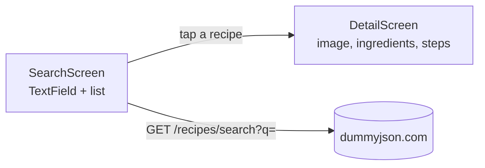

# Session 14: Practice Lab — APIs (Recipe Finder)

> Module: Cross-Platform App Development with Flutter and Dart · Term 5 (ADSE) · ⏱ ~2 hours

In this lab you build **Recipe Finder**, a two-screen app that searches recipes on [dummyjson.com](https://dummyjson.com/docs/recipes), shows them in a list and opens a detail page with ingredients and steps. You practise everything from Session 13 plus navigation and better state handling.

## 🎯 Learning Objectives

By the end of this lab you will be able to:

- Call a search endpoint with a safe, encoded query parameter
- Parse nested JSON (arrays inside objects) into a model
- Manage loading, error and empty states with simple variables
- Pass a model object to a second screen with `Navigator.push`
- Add pull-to-refresh, a timeout and a `Hero` animation

## 📖 Concepts Explained

### 1. The two screens



### 2. Endpoints we use

| Purpose | URL |
|---|---|
| First load (all) | `https://dummyjson.com/recipes?limit=30` |
| Search | `https://dummyjson.com/recipes/search?q=pizza` |

Part of a real response:

```json
{
  "recipes": [
    {
      "id": 1,
      "name": "Classic Margherita Pizza",
      "cuisine": "Italian",
      "rating": 4.6,
      "image": "https://cdn.dummyjson.com/recipe-images/1.webp",
      "ingredients": ["Pizza dough", "Tomato sauce", "..."],
      "instructions": ["Preheat the oven...", "..."]
    }
  ],
  "total": 1
}
```

### 3. Encoding user input

If a user types `mac & cheese`, the `&` would break the URL. `Uri.encodeQueryComponent` turns it into `mac+%26+cheese`, which the server understands. **Never put raw user text into a URL.**

### 4. Lists inside JSON

`json['ingredients']` arrives as `List<dynamic>`. `List<String>.from(...)` copies it into a typed `List<String>` so the rest of the app is type-safe.

### 5. FutureBuilder vs state variables

In Session 13 we used `FutureBuilder`. Here we use three variables, which is easier when the user can trigger many searches:

| Variable | Meaning |
|---|---|
| `isLoading` | Show a spinner |
| `errorMessage` | Show a friendly error (null = no error) |
| `recipes` | The results (empty list = "No recipes found") |

The `buildBody()` method checks them **in order**: loading → error → empty → list.

### 6. Passing data to another screen

The list already holds the full `Recipe`, so we pass the object through the constructor: `DetailScreen(recipe: recipe)`. No second network request is needed. A `Hero` widget with the same `tag` on both screens animates the picture between them.

### 7. Being a good network citizen

- `.timeout(Duration(seconds: 10))` stops waiting forever on a bad connection.
- `if (!mounted) return;` avoids calling `setState` after the user left the screen.
- A friendly message ("Check your internet") is better than a raw exception.

## 💻 Code Examples

📄 Saved in this folder as [`pubspec_snippet.yaml`](pubspec_snippet.yaml).

```yaml
# Run: flutter pub add http
dependencies:
  flutter:
    sdk: flutter
  http: ^1.6.0
```

### Step 1: Model

📄 Saved in this folder as [`recipe.dart`](recipe.dart).

```dart
// Session 14 - Step 1: Recipe model (matches https://dummyjson.com/recipes)
class Recipe {
  final int id;
  final String name;
  final String image;
  final String cuisine;
  final double rating;
  final List<String> ingredients;
  final List<String> instructions;

  Recipe({
    required this.id,
    required this.name,
    required this.image,
    required this.cuisine,
    required this.rating,
    required this.ingredients,
    required this.instructions,
  });

  factory Recipe.fromJson(Map<String, dynamic> json) {
    return Recipe(
      id: json['id'] as int,
      name: json['name'] as String,
      image: json['image'] as String,
      cuisine: json['cuisine'] as String,
      rating: (json['rating'] as num).toDouble(),
      // JSON arrays arrive as List<dynamic>; convert each item to String.
      ingredients: List<String>.from(json['ingredients']),
      instructions: List<String>.from(json['instructions']),
    );
  }
}
```

### Step 2: Service

📄 Saved in this folder as [`recipe_service.dart`](recipe_service.dart).

```dart
// Session 14 - Step 2: Network calls for recipes
import 'dart:convert';
import 'package:http/http.dart' as http;
import 'recipe.dart';

class RecipeService {
  static const String baseUrl = 'https://dummyjson.com/recipes';

  // Empty search text -> all recipes; otherwise -> /recipes/search?q=text
  static Future<List<Recipe>> search(String text) async {
    final Uri url;
    if (text.trim().isEmpty) {
      url = Uri.parse('$baseUrl?limit=30');
    } else {
      // Uri.encodeQueryComponent makes spaces and symbols safe in a URL.
      url = Uri.parse('$baseUrl/search?q=${Uri.encodeQueryComponent(text.trim())}');
    }

    final response = await http.get(url).timeout(const Duration(seconds: 10));
    if (response.statusCode != 200) {
      throw Exception('Server returned ${response.statusCode}');
    }

    final body = jsonDecode(response.body) as Map<String, dynamic>;
    final list = body['recipes'] as List;
    return list.map((item) => Recipe.fromJson(item)).toList();
  }
}
```

### Step 3: Detail screen

📄 Saved in this folder as [`detail_screen.dart`](detail_screen.dart).

```dart
// Session 14 - Step 3: Detail screen (receives a Recipe, no new request needed)
import 'package:flutter/material.dart';
import 'recipe.dart';

class DetailScreen extends StatelessWidget {
  final Recipe recipe;
  const DetailScreen({super.key, required this.recipe});

  @override
  Widget build(BuildContext context) {
    return Scaffold(
      appBar: AppBar(title: Text(recipe.name)),
      body: ListView(
        padding: const EdgeInsets.all(16),
        children: [
          // Hero animates the picture from the list to this page.
          Hero(
            tag: 'recipe-${recipe.id}',
            child: ClipRRect(
              borderRadius: BorderRadius.circular(12),
              child: Image.network(recipe.image, height: 220, fit: BoxFit.cover),
            ),
          ),
          const SizedBox(height: 12),
          Text('${recipe.cuisine} · ⭐ ${recipe.rating}',
              style: Theme.of(context).textTheme.titleMedium),
          const SizedBox(height: 16),
          Text('Ingredients', style: Theme.of(context).textTheme.titleLarge),
          // Spread operator (...) adds one Text per ingredient.
          ...recipe.ingredients.map((item) => Text('• $item')),
          const SizedBox(height: 16),
          Text('Steps', style: Theme.of(context).textTheme.titleLarge),
          // asMap().entries gives us the index for numbering.
          ...recipe.instructions.asMap().entries.map(
                (entry) => Padding(
                  padding: const EdgeInsets.symmetric(vertical: 4),
                  child: Text('${entry.key + 1}. ${entry.value}'),
                ),
              ),
        ],
      ),
    );
  }
}
```

### Step 4: Search screen and app

📄 Saved in this folder as [`main.dart`](main.dart).

```dart
// Session 14 - Step 4: Recipe Finder (search + list + navigation)
// lib/ needs: main.dart, recipe.dart, recipe_service.dart, detail_screen.dart
import 'package:flutter/material.dart';
import 'detail_screen.dart';
import 'recipe.dart';
import 'recipe_service.dart';

void main() {
  runApp(MaterialApp(
    debugShowCheckedModeBanner: false,
    theme: ThemeData(colorSchemeSeed: Colors.orange),
    home: const SearchScreen(),
  ));
}

class SearchScreen extends StatefulWidget {
  const SearchScreen({super.key});

  @override
  State<SearchScreen> createState() => _SearchScreenState();
}

class _SearchScreenState extends State<SearchScreen> {
  final searchController = TextEditingController();

  // Three simple state variables instead of FutureBuilder.
  List<Recipe> recipes = [];
  bool isLoading = false;
  String? errorMessage;

  @override
  void initState() {
    super.initState();
    runSearch(); // show all recipes at start
  }

  Future<void> runSearch() async {
    setState(() {
      isLoading = true;
      errorMessage = null;
    });
    try {
      final results = await RecipeService.search(searchController.text);
      if (!mounted) return; // screen closed while we were waiting
      setState(() {
        recipes = results;
        isLoading = false;
      });
    } catch (error) {
      if (!mounted) return;
      setState(() {
        errorMessage = 'Could not load recipes. Check your internet.';
        isLoading = false;
      });
    }
  }

  // Decide what to show in the body.
  Widget buildBody() {
    if (isLoading) return const Center(child: CircularProgressIndicator());
    if (errorMessage != null) return Center(child: Text(errorMessage!));
    if (recipes.isEmpty) return const Center(child: Text('No recipes found.'));

    return ListView.builder(
      itemCount: recipes.length,
      itemBuilder: (context, index) {
        final recipe = recipes[index];
        return ListTile(
          leading: Hero(
            tag: 'recipe-${recipe.id}',
            child: CircleAvatar(backgroundImage: NetworkImage(recipe.image)),
          ),
          title: Text(recipe.name),
          subtitle: Text('${recipe.cuisine} · ⭐ ${recipe.rating}'),
          onTap: () => Navigator.push(
            context,
            MaterialPageRoute(builder: (_) => DetailScreen(recipe: recipe)),
          ),
        );
      },
    );
  }

  @override
  Widget build(BuildContext context) {
    return Scaffold(
      appBar: AppBar(title: const Text('Recipe Finder')),
      body: Column(
        children: [
          Padding(
            padding: const EdgeInsets.all(12),
            child: TextField(
              controller: searchController,
              textInputAction: TextInputAction.search,
              onSubmitted: (_) => runSearch(),
              decoration: InputDecoration(
                hintText: 'Search e.g. pizza, chicken, salad',
                border: const OutlineInputBorder(),
                suffixIcon: IconButton(icon: const Icon(Icons.search), onPressed: runSearch),
              ),
            ),
          ),
          Expanded(child: RefreshIndicator(onRefresh: runSearch, child: buildBody())),
        ],
      ),
    );
  }
}
```

**How it works**

1. On start, `initState` calls `runSearch()` with empty text, so all recipes load.
2. Pressing Enter or the search icon calls `runSearch()` again with the typed word.
3. `runSearch` sets `isLoading`, awaits the service, then stores results or an error message.
4. Tapping a tile pushes `DetailScreen` with that recipe; `Hero` animates the image.
5. The detail page uses the spread operator `...` to turn lists into many `Text` widgets.

## 🧪 Lab Practice

1. Create `flutter create recipe_finder`, add `http`, copy the four files into `lib/` and run.
2. Search for `chicken`, `salad` and `xyz`. Check that the empty state appears for `xyz`.
3. Add `FilterChip`s for cuisines (Italian, Asian, Pakistani...). Use `https://dummyjson.com/recipes/tag/{tag}` or filter the loaded list by `cuisine`.
4. Show `prepTimeMinutes` and `difficulty` on the detail page (add them to the model first).
5. Use a `GridView` instead of a `ListView` when the screen is wider than 600 px (Session 10 skills).

## 📝 Assignment

Add **Favourites**: a heart icon on the detail page that saves the recipe id in `shared_preferences` (a `List<String>`), and a second tab in a `NavigationBar` that lists only favourite recipes using `GET https://dummyjson.com/recipes/{id}`.

## ❓ Quick Quiz

1. Why do we use `Uri.encodeQueryComponent`?
2. What does `List<String>.from(json['ingredients'])` do?
3. In which order does `buildBody()` check the states?
4. What must match on both screens for a `Hero` animation?
5. Why do we check `mounted` after `await`?

<details>
<summary>Show answers</summary>

1. To make user text (spaces, `&`, `?`) safe inside a URL.
2. Converts a `List<dynamic>` from JSON into a typed `List<String>`.
3. Loading → error → empty → list.
4. The `tag`.
5. The user may have left the screen; calling `setState` on a disposed widget throws an error.

</details>

## 💼 Interview Questions

1. **How do you pass data between screens in Flutter?** Through the constructor of the new screen with `Navigator.push`; return values come back through `Navigator.pop(context, value)`.
2. **How would you avoid sending a request on every keystroke in a search box?** Debounce: start a short `Timer` on each change and only search when the user stops typing.
3. **How do you handle slow or failed requests?** Add a timeout, catch exceptions, show a clear message, and offer retry or pull-to-refresh.

## ✅ Summary

- A search endpoint plus an encoded query parameter powers live search.
- Nested JSON lists become typed Dart lists in the model.
- Simple state variables give clear loading, error and empty states.
- Pass the selected object to the next screen; `Hero` makes it feel smooth.
- Timeouts, `mounted` checks and friendly errors make API apps robust.

---

[⬅ Previous](../Session-13-REST-APIs/README.md) · [🏠 Module Home](../README.md) · [Next ➡](../Session-15-TensorFlow-Lite-Image-Classification/README.md)

Prepared by Zeeshan Abbas · Aptech Learning North Nazimabad
