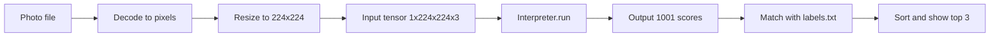

# Session 15: TensorFlow Lite Image Classification

> Module: Cross-Platform App Development with Flutter and Dart · Term 5 (ADSE) · ⏱ ~2 hours

Time to add **AI that runs on the phone itself**. You will load a pre-trained image model with **TensorFlow Lite (LiteRT)**, give it a photo, and show the top three guesses, all offline, with no server.

## 🎯 Learning Objectives

By the end of this session you will be able to:

- Explain on-device ML and why we use TensorFlow Lite on mobile
- Describe what a model, input tensor, output tensor and label file are
- Add a `.tflite` model and labels as Flutter assets
- Pre-process a photo (decode, resize, convert to numbers) for a model
- Run inference with `tflite_flutter` and show results with confidence bars

## 📖 Concepts Explained

### 1. What is image classification?

Image classification answers one question: **"What is the main thing in this picture?"** The model returns a score for every class it knows (e.g. 1001 classes: *golden retriever*, *banana*, *laptop*...). The highest score is its best guess.

### 2. Cloud AI vs on-device AI

| | Cloud API | On-device (TFLite) |
|---|---|---|
| Internet needed | Yes | No |
| Speed | Network delay | Very fast (milliseconds) |
| Privacy | Photo leaves the phone | Photo stays on the phone |
| Model size | Huge models possible | Small models (a few MB) |
| Cost | Pay per request | Free after download |

**TensorFlow Lite** (now also called **LiteRT**) is Google's runtime for running small, optimised ML models on phones and edge devices. A model is saved as a single `.tflite` file.

### 3. Key words

| Term | Simple meaning |
|---|---|
| **Model** | A trained "brain" stored in a `.tflite` file |
| **Tensor** | A multi-dimensional array of numbers |
| **Input shape** | The exact size the model expects, here `[1, 224, 224, 3]` = 1 image, 224×224 pixels, 3 colours (R, G, B) |
| **Output shape** | `[1, 1001]` = one score for each of 1001 labels |
| **Labels file** | `labels.txt`, one class name per line, in the same order as the scores |
| **Quantized** | Uses whole numbers 0–255 instead of decimals → smaller and faster |
| **Inference** | Running the model on new data to get a prediction |

### 4. The pipeline



The most common bug in ML apps is **wrong pre-processing**: wrong size, wrong colour order or wrong number type. Always check the model's expected input.

### 5. Getting the model

We use the MobileNet v1 quantized model that Google publishes for the official Flutter TFLite examples:

1. Create `assets/models/` in your project.
2. Download the model: `https://storage.googleapis.com/download.tensorflow.org/models/tflite/task_library/image_classification/android/mobilenet_v1_1.0_224_quantized_1_metadata_1.tflite` and save it as `assets/models/mobilenet_quant.tflite`.
3. That file also contains `labels.txt` (it is a zip archive inside). Extract it: `unzip assets/models/mobilenet_quant.tflite -d assets/models/` (on Windows, copy the file, rename the copy to `.zip` and extract).
4. Register both files under `assets:` in `pubspec.yaml` (see below).

### 6. Platform setup

- **Android:** if the build complains about `minSdk`, raise it in `android/app/build.gradle(.kts)` (e.g. `minSdk = 26`).
- **iOS:** add `NSCameraUsageDescription` and `NSPhotoLibraryUsageDescription` to `ios/Runner/Info.plist` for `image_picker`.
- Run on a **real phone** or emulator; this app does not run on Flutter web.

## 💻 Code Examples

📄 Saved in this folder as [`pubspec_snippet.yaml`](pubspec_snippet.yaml).

```yaml
# Run: flutter pub add tflite_flutter image_picker image
dependencies:
  flutter:
    sdk: flutter
  tflite_flutter: ^0.12.1   # runs .tflite models on the device
  image_picker: ^1.2.4      # pick a photo from camera or gallery
  image: ^4.12.0            # decode and resize images in Dart

flutter:
  uses-material-design: true
  # Tell Flutter to bundle the model and labels inside the app.
  assets:
    - assets/models/mobilenet_quant.tflite
    - assets/models/labels.txt
```

### Example 1: The classifier class

📄 Saved in this folder as [`classifier.dart`](classifier.dart).

```dart
// Session 15 - Example 1: A simple image classifier with TensorFlow Lite
// Model: MobileNet v1 (quantized). Input [1, 224, 224, 3] uint8, output [1, 1001] uint8.
import 'dart:io';
import 'package:flutter/services.dart';        // rootBundle (read asset files)
import 'package:image/image.dart' as img;      // decode + resize
import 'package:tflite_flutter/tflite_flutter.dart';

class Classifier {
  late Interpreter interpreter;
  late List<String> labels;

  // Step 1: load the model and the labels from assets (call once).
  Future<void> load() async {
    interpreter = await Interpreter.fromAsset('assets/models/mobilenet_quant.tflite');
    final labelText = await rootBundle.loadString('assets/models/labels.txt');
    labels = labelText
        .split('\n')
        .map((line) => line.trim())
        .where((line) => line.isNotEmpty) // skip a blank last line
        .toList();
  }

  // Step 2: classify one photo and return the top 3 (label, confidence).
  Future<List<MapEntry<String, double>>> classify(File photo) async {
    // 2a. Read the file and decode it into pixels.
    final bytes = await photo.readAsBytes();
    final original = img.decodeImage(bytes)!;

    // 2b. Resize to the size the model expects: 224 x 224.
    final resized = img.copyResize(original, width: 224, height: 224);

    // 2c. Build the input tensor: [1][224][224][3] numbers 0-255 (R, G, B).
    final input = [
      List.generate(224, (y) {
        return List.generate(224, (x) {
          final pixel = resized.getPixel(x, y);
          return [pixel.r.toInt(), pixel.g.toInt(), pixel.b.toInt()];
        });
      }),
    ];

    // 2d. Prepare an empty output: one score (0-255) for each of 1001 labels.
    //     We ask the model how many scores it returns (1001 for MobileNet).
    final scoreCount = interpreter.getOutputTensor(0).shape[1];
    final output = [List<int>.filled(scoreCount, 0)];

    // 2e. Run the model.
    interpreter.run(input, output);

    // 2f. Turn scores into (label, confidence 0.0-1.0) pairs and sort them.
    final results = <MapEntry<String, double>>[];
    for (var i = 0; i < scoreCount && i < labels.length; i++) {
      results.add(MapEntry(labels[i], output[0][i] / 255.0));
    }
    results.sort((a, b) => b.value.compareTo(a.value)); // highest first
    return results.take(3).toList();
  }

  void close() => interpreter.close();
}
```

**How it works**

1. `load()` creates an `Interpreter` from the asset and reads the labels into a list.
2. `classify()` decodes the photo, resizes it to 224×224 and builds a nested list of `[R, G, B]` values.
3. The output list is sized from the model's own output shape.
4. `interpreter.run(input, output)` fills `output` with 0–255 scores; we divide by 255 to get 0.0–1.0.
5. Results are sorted and the top 3 are returned.

### Example 2: The screen

📄 Saved in this folder as [`main.dart`](main.dart).

```dart
// Session 15 - Example 2: Pick a photo and show what the model sees
// lib/ needs: main.dart + classifier.dart. Assets: see pubspec_snippet.yaml
import 'dart:io';
import 'package:flutter/material.dart';
import 'package:image_picker/image_picker.dart';
import 'classifier.dart';

void main() {
  runApp(const MaterialApp(debugShowCheckedModeBanner: false, home: ClassifyPage()));
}

class ClassifyPage extends StatefulWidget {
  const ClassifyPage({super.key});

  @override
  State<ClassifyPage> createState() => _ClassifyPageState();
}

class _ClassifyPageState extends State<ClassifyPage> {
  final classifier = Classifier();
  final picker = ImagePicker();

  bool modelReady = false;
  File? selectedPhoto;
  List<MapEntry<String, double>> results = [];

  @override
  void initState() {
    super.initState();
    // Load the model once when the screen opens.
    classifier.load().then((_) {
      if (mounted) setState(() => modelReady = true);
    });
  }

  @override
  void dispose() {
    classifier.close(); // free native memory
    super.dispose();
  }

  Future<void> pickAndClassify(ImageSource source) async {
    final picked = await picker.pickImage(source: source);
    if (picked == null) return; // user cancelled

    final photo = File(picked.path);
    final top3 = await classifier.classify(photo);
    setState(() {
      selectedPhoto = photo;
      results = top3;
    });
  }

  @override
  Widget build(BuildContext context) {
    return Scaffold(
      appBar: AppBar(title: const Text('What is this? (TFLite)')),
      body: !modelReady
          ? const Center(child: CircularProgressIndicator())
          : ListView(
              padding: const EdgeInsets.all(16),
              children: [
                if (selectedPhoto != null)
                  Image.file(selectedPhoto!, height: 250, fit: BoxFit.cover)
                else
                  const SizedBox(height: 250, child: Center(child: Text('Pick a photo'))),
                const SizedBox(height: 16),
                // One row per result: label + confidence bar.
                for (final result in results)
                  ListTile(
                    title: Text(result.key),
                    subtitle: LinearProgressIndicator(value: result.value),
                    trailing: Text('${(result.value * 100).toStringAsFixed(1)}%'),
                  ),
              ],
            ),
      bottomNavigationBar: Padding(
        padding: const EdgeInsets.all(16),
        child: Row(
          children: [
            Expanded(
              child: FilledButton.icon(
                onPressed: modelReady ? () => pickAndClassify(ImageSource.camera) : null,
                icon: const Icon(Icons.camera_alt),
                label: const Text('Camera'),
              ),
            ),
            const SizedBox(width: 12),
            Expanded(
              child: OutlinedButton.icon(
                onPressed: modelReady ? () => pickAndClassify(ImageSource.gallery) : null,
                icon: const Icon(Icons.photo),
                label: const Text('Gallery'),
              ),
            ),
          ],
        ),
      ),
    );
  }
}
```

**How it works**

1. The model loads once in `initState`; a spinner shows until it is ready.
2. `image_picker` opens the camera or gallery and returns a file path.
3. The classifier returns the top 3, shown as `ListTile`s with a `LinearProgressIndicator` per result.
4. `dispose()` closes the interpreter to free native memory.

## 🧪 Lab Practice

1. Set up the project, download the model and labels, and run the app on a phone or emulator.
2. Test with photos of a cup, a keyboard, a banana and a dog. Record the top result and confidence in a table.
3. Hide results whose confidence is below 10% and show "Not sure" instead.
4. Measure speed: wrap `interpreter.run` with a `Stopwatch` and display the milliseconds.
5. Print `interpreter.getInputTensor(0).shape` and `.type` in the console and explain what you see.

## 📝 Assignment

Write a short report (half a page in your repo's `README`) with screenshots of 5 test photos: what the model predicted, whether it was right, and **why** you think it failed when it was wrong (lighting, angle, class not in the 1001 labels...).

## ❓ Quick Quiz

1. What does the input shape `[1, 224, 224, 3]` mean?
2. Why are quantized models popular on phones?
3. What is stored in `labels.txt`?
4. Name two advantages of on-device ML over a cloud API.
5. Why must we call `interpreter.close()`?

<details>
<summary>Show answers</summary>

1. One image of 224×224 pixels with 3 colour channels (RGB).
2. They are smaller and faster because they use 8-bit integers.
3. Class names, one per line, in the same order as the model's output scores.
4. Works offline, faster, more private, no per-request cost (any two).
5. To release native memory used by the model.

</details>

## 💼 Interview Questions

1. **What is TensorFlow Lite and why use it in mobile apps?** A lightweight runtime for running optimised ML models on-device, giving low latency, offline use and privacy.
2. **What can go wrong when you feed images to a model?** Wrong input size, wrong data type (uint8 vs float32), missing normalisation or wrong channel order; all give poor or crashing results.
3. **How would you keep the UI smooth during heavy inference?** Run inference in a background isolate (e.g. `Isolate.run`) or use the interpreter's isolate support, so the main thread keeps drawing frames.

## ✅ Summary

- Image classification gives a score for each known class; the top score is the guess.
- TensorFlow Lite runs small `.tflite` models on the device: fast, offline and private.
- Inputs must match the model exactly: here 224×224 RGB, uint8.
- `tflite_flutter`'s `Interpreter.run` fills an output list that we match with `labels.txt`.
- Pre-processing is where most ML app bugs hide.

---

[⬅ Previous](../Session-14-Practice-Lab-APIs/README.md) · [🏠 Module Home](../README.md) · [Next ➡](../Session-16-Practice-Lab-ML/README.md)

Prepared by Zeeshan Abbas · Aptech Learning North Nazimabad
