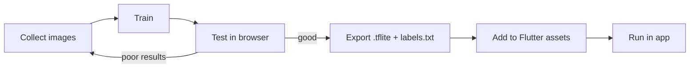

# Session 16: Practice Lab — ML (Train Your Own Model)

> Module: Cross-Platform App Development with Flutter and Dart · Term 5 (ADSE) · ⏱ ~2 hours

In Session 15 you used a model trained by Google. Today you **train your own** image model in the browser with **Teachable Machine** (no coding), export it as TensorFlow Lite, and build a **Fruit Checker** app around it.

## 🎯 Learning Objectives

By the end of this lab you will be able to:

- Collect and organise training images for a few classes
- Train and test an image model with Teachable Machine
- Export a floating-point `.tflite` model with its labels
- Normalise pixel values to the range the model expects (−1 to 1)
- Use a confidence threshold to avoid wrong, over-confident answers

## 📖 Concepts Explained

### 1. The ML workflow



Machine learning is **learning from examples**. Instead of writing rules ("if yellow and long → banana"), we show many labelled pictures and the model finds the patterns itself.

### 2. Transfer learning (why training is so quick)

Teachable Machine starts from a model that already knows general shapes and textures (MobileNet). It only re-trains the **last layer** on your classes. That is **transfer learning**: like a chef who already knows cooking and only needs to learn your three recipes.

### 3. Good training data

| Do | Avoid |
|---|---|
| 50–200 images per class | 5 images per class |
| Different angles, lighting, backgrounds | All photos on the same table |
| Similar number of images per class | 300 apples, 20 bananas |
| A **"Nothing"** class (empty table, hand) | Forcing every photo into a fruit |

### 4. Train in Teachable Machine (step by step)

1. Open [Teachable Machine](https://teachablemachine.withgoogle.com/) → **Get Started → Image Project → Standard image model**.
2. Rename the classes to `Apple`, `Banana`, `Orange`, and add a fourth class `Nothing`.
3. For each class, use **Webcam** (hold to record) or **Upload** to add images.
4. Click **Train Model** and wait (keep the tab open).
5. Test with the live preview. Weak? Add more varied images and train again.
6. **Export Model → TensorFlow Lite → Floating point → Download my model**.
7. Unzip. You get `model_unquant.tflite` and `labels.txt`. Copy both into `assets/` in your Flutter project.

### 5. Float vs quantized input

| | Session 15 (quantized) | Session 16 (float) |
|---|---|---|
| Input type | `int` 0–255 | `double` −1.0 to 1.0 |
| Output type | `int` 0–255 | `double` 0.0–1.0 |
| Pre-processing | Use pixel as is | `(value − 127.5) / 127.5` |

Teachable Machine's float model was trained on pixels scaled to −1…1, so we must scale the same way. Feeding raw 0–255 values gives nonsense.

### 6. Confidence threshold

A classifier **always** picks a class, even for a photo of your shoe. A threshold (here 70%) lets the app say **"Not sure"** instead of a wrong answer. The `Nothing` class helps too.

### 7. Labels format

Teachable Machine writes labels with an index: `0 Apple`, `1 Banana`. Our code keeps only the text after the first space.

## 💻 Code Examples

📄 Saved in this folder as [`pubspec_snippet.yaml`](pubspec_snippet.yaml).

```yaml
# Run: flutter pub add tflite_flutter image_picker image
dependencies:
  flutter:
    sdk: flutter
  tflite_flutter: ^0.12.1
  image_picker: ^1.2.4
  image: ^4.12.0

flutter:
  uses-material-design: true
  assets:
    - assets/model_unquant.tflite   # exported from Teachable Machine (Floating point)
    - assets/labels.txt             # lines look like: "0 Apple"
```

### Step 1: Classifier for your model

📄 Saved in this folder as [`custom_classifier.dart`](custom_classifier.dart).

```dart
// Session 16 - Step 1: Classifier for YOUR Teachable Machine model
// Floating-point model: input [1, 224, 224, 3] float32 in range -1..1, output [1, N] float32.
import 'dart:io';
import 'package:flutter/services.dart';
import 'package:image/image.dart' as img;
import 'package:tflite_flutter/tflite_flutter.dart';

// A small class to hold one prediction.
class Prediction {
  final String label;
  final double confidence; // 0.0 - 1.0
  Prediction(this.label, this.confidence);
}

class CustomClassifier {
  late Interpreter interpreter;
  late List<String> labels;

  Future<void> load() async {
    interpreter = await Interpreter.fromAsset('assets/model_unquant.tflite');

    // Teachable Machine labels look like "0 Apple". Keep only the name part.
    final text = await rootBundle.loadString('assets/labels.txt');
    labels = text
        .split('\n')
        .map((line) => line.trim())
        .where((line) => line.isNotEmpty)
        .map((line) => line.substring(line.indexOf(' ') + 1)) // "0 Apple" -> "Apple"
        .toList();
  }

  // Convert one colour value 0..255 into the range -1..1 the model was trained on.
  double normalize(num value) => (value - 127.5) / 127.5;

  Future<Prediction> classify(File photo) async {
    // 1. Decode and resize.
    final image = img.decodeImage(await photo.readAsBytes())!;
    final resized = img.copyResize(image, width: 224, height: 224);

    // 2. Build a float input tensor [1][224][224][3].
    final input = [
      List.generate(224, (y) => List.generate(224, (x) {
            final p = resized.getPixel(x, y);
            return [normalize(p.r), normalize(p.g), normalize(p.b)];
          })),
    ];

    // 3. One output score per label (scores already add up to 1.0).
    final output = [List<double>.filled(labels.length, 0)];
    interpreter.run(input, output);

    // 4. Find the index of the biggest score.
    final scores = output[0];
    var bestIndex = 0;
    for (var i = 1; i < scores.length; i++) {
      if (scores[i] > scores[bestIndex]) bestIndex = i;
    }
    return Prediction(labels[bestIndex], scores[bestIndex]);
  }

  void close() => interpreter.close();
}
```

**How it works:** `load()` reads the model and cleans the labels. `classify()` resizes the photo, normalises each RGB value to −1…1, runs the model and returns the label with the highest score as a `Prediction`.

### Step 2: Fruit Checker app

📄 Saved in this folder as [`main.dart`](main.dart).

```dart
// Session 16 - Step 2: "Fruit Checker" app using your own trained model
// lib/ needs: main.dart + custom_classifier.dart
import 'dart:io';
import 'package:flutter/material.dart';
import 'package:image_picker/image_picker.dart';
import 'custom_classifier.dart';

void main() {
  runApp(MaterialApp(
    debugShowCheckedModeBanner: false,
    theme: ThemeData(colorSchemeSeed: Colors.green),
    home: const FruitCheckerPage(),
  ));
}

class FruitCheckerPage extends StatefulWidget {
  const FruitCheckerPage({super.key});

  @override
  State<FruitCheckerPage> createState() => _FruitCheckerPageState();
}

class _FruitCheckerPageState extends State<FruitCheckerPage> {
  final classifier = CustomClassifier();
  final picker = ImagePicker();

  bool isReady = false;
  bool isBusy = false;
  File? photo;
  Prediction? latest;
  final List<Prediction> history = []; // last results, newest first

  // Results below this confidence are shown as "Not sure".
  static const double minConfidence = 0.70;

  @override
  void initState() {
    super.initState();
    classifier.load().then((_) {
      if (mounted) setState(() => isReady = true);
    });
  }

  @override
  void dispose() {
    classifier.close();
    super.dispose();
  }

  Future<void> check(ImageSource source) async {
    final picked = await picker.pickImage(source: source, maxWidth: 800);
    if (picked == null) return;

    setState(() => isBusy = true);
    final file = File(picked.path);
    final result = await classifier.classify(file);
    if (!mounted) return;

    setState(() {
      photo = file;
      latest = result;
      history.insert(0, result);
      if (history.length > 5) history.removeLast(); // keep only 5
      isBusy = false;
    });
  }

  // Friendly text for a prediction.
  String describe(Prediction p) {
    final percent = (p.confidence * 100).toStringAsFixed(0);
    if (p.confidence < minConfidence) return 'Not sure ($percent%)';
    return '${p.label} ($percent%)';
  }

  @override
  Widget build(BuildContext context) {
    if (!isReady) {
      return const Scaffold(body: Center(child: CircularProgressIndicator()));
    }

    return Scaffold(
      appBar: AppBar(title: const Text('Fruit Checker')),
      body: ListView(
        padding: const EdgeInsets.all(16),
        children: [
          AspectRatio(
            aspectRatio: 1,
            child: photo == null
                ? const Card(child: Center(child: Text('Take a photo of a fruit')))
                : Image.file(photo!, fit: BoxFit.cover),
          ),
          const SizedBox(height: 16),
          if (isBusy) const LinearProgressIndicator(),
          if (latest != null)
            Text(describe(latest!),
                textAlign: TextAlign.center,
                style: Theme.of(context).textTheme.headlineSmall),
          const Divider(height: 32),
          const Text('History (last 5)'),
          for (final item in history)
            ListTile(leading: const Icon(Icons.history), title: Text(describe(item))),
        ],
      ),
      floatingActionButton: FloatingActionButton.extended(
        onPressed: isBusy ? null : () => check(ImageSource.camera),
        icon: const Icon(Icons.camera_alt),
        label: const Text('Check fruit'),
      ),
    );
  }
}
```

**How it works**

1. The model loads once; the whole screen shows a spinner until then.
2. The button opens the camera (`maxWidth: 800` keeps photos small and fast).
3. While the model runs, `isBusy` shows a progress bar and disables the button.
4. `describe()` shows "Not sure" below 70% confidence.
5. The last 5 results are kept in `history` (newest first).

## 🧪 Lab Practice

1. Train the 4-class fruit model in Teachable Machine (at least 60 images per class) and export the float TFLite model.
2. Create `flutter create fruit_checker`, copy the model, labels and the two Dart files, update `pubspec.yaml`, and run on a phone.
3. Test 10 photos per class and fill a small **confusion table** (rows = real fruit, columns = predicted).
4. Try thresholds 0.5, 0.7 and 0.9. Which gives the best balance between "Not sure" and wrong answers?
5. Add a **Gallery** button next to the camera button.

## 📝 Assignment

Train a model for a **different problem you care about** (e.g. *mask / no mask*, *recyclable / not recyclable*, *cat / dog / nothing*). Build the app, then write in your README: number of images per class, your confusion table, and two ideas to improve accuracy.

## ❓ Quick Quiz

1. What is transfer learning?
2. Why do we add a "Nothing" class?
3. What formula converts a pixel value 0–255 to −1…1?
4. Which two files does the Teachable Machine TFLite export give you?
5. Why use a confidence threshold?

<details>
<summary>Show answers</summary>

1. Re-using a model that already learned general features and re-training only the last part on new classes.
2. So the model has a correct answer when no target object is in the photo.
3. `(value - 127.5) / 127.5`.
4. `model_unquant.tflite` (or a quantized model) and `labels.txt`.
5. To avoid showing confident-looking wrong answers when the model is unsure.

</details>

## 💼 Interview Questions

1. **Your model works in testing but fails in the real world. What do you check?** Training data variety (lighting, background, angle), class balance, pre-processing mismatch between training and app, and whether real inputs belong to any trained class.
2. **What is the difference between a quantized and a float model?** Quantized uses 8-bit integers (smaller, faster, slight accuracy loss); float uses 32-bit decimals (bigger, often more accurate).
3. **How would you update the model without releasing a new app version?** Download it at runtime from a server, for example with Firebase ML model downloader, and cache it on the device.

## ✅ Summary

- Teachable Machine trains an image model from your own photos in minutes using transfer learning.
- Good data (many, varied, balanced images plus a "Nothing" class) matters more than code.
- Float models need inputs normalised to −1…1 exactly as in training.
- A confidence threshold makes the app honest when it is unsure.
- The same Flutter code works for any image model you train.

---

[⬅ Previous](../Session-15-TensorFlow-Lite-Image-Classification/README.md) · [🏠 Module Home](../README.md) · [Next ➡](../Session-17-ML-Kit-and-Chatbot/README.md)

Prepared by Zeeshan Abbas · Aptech Learning North Nazimabad
