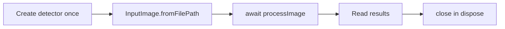

# Session 17: ML Kit and an AI Chatbot

> Module: Cross-Platform App Development with Flutter and Dart · Term 5 (ADSE) · ⏱ ~2 hours

Training your own model is powerful, but often you just need a **ready-made AI feature**: read text from a photo, recognise objects, or chat with a smart assistant. Today you use **Google ML Kit** for on-device vision and build a **chatbot**, first rule-based, then powered by **Gemini** through Firebase AI Logic.

## 🎯 Learning Objectives

By the end of this session you will be able to:

- Explain what ML Kit offers and when to choose it over a custom TFLite model
- Recognise text in a photo (OCR) with `google_mlkit_text_recognition`
- Label objects in a photo with `google_mlkit_image_labeling`
- Build a chat interface with message bubbles
- Compare a rule-based bot with an LLM-powered bot and connect Gemini via `firebase_ai`

## 📖 Concepts Explained

### 1. What is ML Kit?

**ML Kit** is Google's mobile SDK of **ready-made, on-device ML features**. You do not train anything. You give it an image, it gives back results.

| ML Kit API | What it does | Example use |
|---|---|---|
| Text recognition | Reads printed text (OCR) | Scan a business card |
| Image labeling | Names things in a photo | Auto-tag gallery photos |
| Face detection | Finds faces and landmarks | Selfie filters |
| Barcode scanning | Reads QR codes and barcodes | Attendance by QR |
| Translation | Translates text offline | Travel app |

In Flutter, each API is its own package (`google_mlkit_*`). ML Kit runs on **Android and iOS only**.

### 2. ML Kit vs TFLite vs a cloud LLM

| Need | Best choice |
|---|---|
| A common task (text, faces, barcodes) | **ML Kit**: easiest |
| Your own special classes (your fruits, your products) | **Custom TFLite** (Sessions 15–16) |
| Understanding and generating language (chat, summaries) | **Cloud LLM** such as Gemini |

### 3. The ML Kit pattern

Every ML Kit API follows the same four steps:



### 4. What is a chatbot?

A chatbot is a program you talk to in natural language. Two kinds:

| Rule-based bot | AI (LLM) bot |
|---|---|
| Looks for keywords with `if` statements | A large language model understands meaning |
| Predictable, free, offline | Flexible, answers almost anything |
| Breaks on unexpected questions | Can be wrong ("hallucinate"); costs money at scale |
| Good for FAQs | Good for open conversation and tutoring |

Many real apps combine them: rules for fixed facts (timings), AI for everything else.

### 5. Chat UI basics

- Store messages in a `List<Message>` where each has `text` and `isUser`.
- `ListView.builder` draws them; `Align` puts user bubbles on the right and bot bubbles on the left.
- A `TextField` + send button adds a message and the bot's reply.

### 6. Gemini through Firebase AI Logic

`firebase_ai` lets a Flutter app call Gemini **without putting an API key in the app**: Firebase handles it. Steps:

1. Create/choose a Firebase project and run `flutterfire configure`.
2. In the Firebase console open **AI Logic → Get started** and choose the **Gemini Developer API** (has a free tier).
3. `flutter pub add firebase_core firebase_ai`.
4. Create a model with `FirebaseAI.googleAI().generativeModel(...)`, start a chat with `startChat()`, and send messages with `sendMessage`.

A **system instruction** sets the bot's role ("You are a friendly Flutter tutor..."). A **ChatSession** keeps the history, so follow-up questions make sense.

> 🔐 Never paste API keys into Flutter code; anyone can extract them from the app. Use Firebase AI Logic (with App Check for production) or your own backend.

## 💻 Code Examples

📄 Saved in this folder as [`pubspec_snippet.yaml`](pubspec_snippet.yaml).

```yaml
# Run: flutter pub add google_mlkit_text_recognition google_mlkit_image_labeling image_picker
# For the Gemini chatbot also: flutter pub add firebase_core firebase_ai
dependencies:
  flutter:
    sdk: flutter
  google_mlkit_text_recognition: ^0.17.1  # read text from a photo (OCR)
  google_mlkit_image_labeling: ^0.16.1    # describe objects in a photo
  image_picker: ^1.2.4                    # camera / gallery
  firebase_core: ^5.1.0                   # only for chatbot_gemini.dart
  firebase_ai: ^5.1.0                     # Gemini through Firebase AI Logic
```

### Example 1: Text scanner (OCR)

📄 Saved in this folder as [`main.dart`](main.dart).

```dart
// Session 17 - Example 1: Read text from a photo with ML Kit (OCR)
// Runs on Android and iOS only (ML Kit is a mobile SDK).
import 'package:flutter/material.dart';
import 'package:google_mlkit_text_recognition/google_mlkit_text_recognition.dart';
import 'package:image_picker/image_picker.dart';

void main() {
  runApp(const MaterialApp(debugShowCheckedModeBanner: false, home: TextScannerPage()));
}

class TextScannerPage extends StatefulWidget {
  const TextScannerPage({super.key});

  @override
  State<TextScannerPage> createState() => _TextScannerPageState();
}

class _TextScannerPageState extends State<TextScannerPage> {
  // Step 1: create the recognizer once (Latin script = English, Urdu-roman, etc.).
  final textRecognizer = TextRecognizer(script: TextRecognitionScript.latin);
  String scannedText = 'Take a photo of a page, a sign or a business card.';

  @override
  void dispose() {
    textRecognizer.close(); // release native resources
    super.dispose();
  }

  Future<void> scan() async {
    // Step 2: get a photo from the camera.
    final photo = await ImagePicker().pickImage(source: ImageSource.camera);
    if (photo == null) return;

    // Step 3: wrap the file as an InputImage and process it.
    final inputImage = InputImage.fromFilePath(photo.path);
    final result = await textRecognizer.processImage(inputImage);

    // Step 4: result.text is all the text; result.blocks gives paragraphs.
    if (!mounted) return;
    setState(() {
      scannedText = result.text.isEmpty ? 'No text found.' : result.text;
    });
  }

  @override
  Widget build(BuildContext context) {
    return Scaffold(
      appBar: AppBar(title: const Text('Text Scanner (ML Kit)')),
      body: SingleChildScrollView(
        padding: const EdgeInsets.all(16),
        // SelectableText lets the user copy the result.
        child: SelectableText(scannedText, style: const TextStyle(fontSize: 18)),
      ),
      floatingActionButton: FloatingActionButton(
        onPressed: scan,
        child: const Icon(Icons.document_scanner),
      ),
    );
  }
}
```

**How it works:** the recognizer is created once, the camera photo becomes an `InputImage`, `processImage` returns a `RecognizedText`, and we show `result.text` in a copyable `SelectableText`.

### Example 2: Image labeling

📄 Saved in this folder as [`image_labeling.dart`](image_labeling.dart).

```dart
// Session 17 - Example 2: Describe a photo with ML Kit Image Labeling
// Uses ML Kit's built-in model (400+ everyday labels), no model file needed.
import 'package:flutter/material.dart';
import 'package:google_mlkit_image_labeling/google_mlkit_image_labeling.dart';
import 'package:image_picker/image_picker.dart';

void main() {
  runApp(const MaterialApp(debugShowCheckedModeBanner: false, home: LabelPage()));
}

class LabelPage extends StatefulWidget {
  const LabelPage({super.key});

  @override
  State<LabelPage> createState() => _LabelPageState();
}

class _LabelPageState extends State<LabelPage> {
  // Only return labels with at least 60% confidence.
  final labeler = ImageLabeler(options: ImageLabelerOptions(confidenceThreshold: 0.6));
  List<ImageLabel> labels = [];

  @override
  void dispose() {
    labeler.close();
    super.dispose();
  }

  Future<void> pickAndLabel() async {
    final photo = await ImagePicker().pickImage(source: ImageSource.gallery);
    if (photo == null) return;

    final found = await labeler.processImage(InputImage.fromFilePath(photo.path));
    if (!mounted) return;
    setState(() => labels = found);
  }

  @override
  Widget build(BuildContext context) {
    return Scaffold(
      appBar: AppBar(title: const Text('Image Labels (ML Kit)')),
      body: labels.isEmpty
          ? const Center(child: Text('Pick a photo to see what is in it.'))
          : ListView(
              children: [
                for (final label in labels)
                  ListTile(
                    leading: const Icon(Icons.label),
                    title: Text(label.label),
                    trailing: Text('${(label.confidence * 100).toStringAsFixed(0)}%'),
                  ),
              ],
            ),
      floatingActionButton: FloatingActionButton(
        onPressed: pickAndLabel,
        child: const Icon(Icons.photo_library),
      ),
    );
  }
}
```

**How it works:** `confidenceThreshold: 0.6` hides weak guesses. Each `ImageLabel` has a `label` and a `confidence`, shown in a list.

### Example 3: Rule-based chatbot

📄 Saved in this folder as [`chatbot_rules.dart`](chatbot_rules.dart).

```dart
// Session 17 - Example 3: A simple rule-based chatbot (no AI, no internet)
// Good for learning the chat UI. Runs on every platform, including web.
import 'package:flutter/material.dart';

void main() {
  runApp(const MaterialApp(debugShowCheckedModeBanner: false, home: ChatPage()));
}

// One chat message.
class Message {
  final String text;
  final bool isUser; // true = user, false = bot
  Message(this.text, this.isUser);
}

// The "brain": look for keywords and return an answer.
String getBotReply(String userText) {
  final text = userText.toLowerCase();
  if (text.contains('hello') || text.contains('salam')) {
    return 'Wa alaikum assalam! Ask me about timings, fees or courses.';
  }
  if (text.contains('timing') || text.contains('time')) {
    return 'Classes run Monday to Saturday, 9 am to 9 pm.';
  }
  if (text.contains('course')) {
    return 'We teach Flutter, Python, AI and web development.';
  }
  if (text.contains('fee')) {
    return 'Please visit the front desk for the latest fee details.';
  }
  return "Sorry, I don't understand yet. Try 'timing' or 'course'.";
}

class ChatPage extends StatefulWidget {
  const ChatPage({super.key});

  @override
  State<ChatPage> createState() => _ChatPageState();
}

class _ChatPageState extends State<ChatPage> {
  final inputController = TextEditingController();
  final List<Message> messages = [Message('Hi! I am CampusBot. How can I help?', false)];

  void send() {
    final text = inputController.text.trim();
    if (text.isEmpty) return;
    setState(() {
      messages.add(Message(text, true));             // user's message
      messages.add(Message(getBotReply(text), false)); // bot's answer
    });
    inputController.clear();
  }

  @override
  Widget build(BuildContext context) {
    final colors = Theme.of(context).colorScheme;

    return Scaffold(
      appBar: AppBar(title: const Text('CampusBot')),
      body: Column(
        children: [
          Expanded(
            child: ListView.builder(
              padding: const EdgeInsets.all(12),
              itemCount: messages.length,
              itemBuilder: (context, index) {
                final message = messages[index];
                // User bubbles on the right, bot bubbles on the left.
                return Align(
                  alignment: message.isUser ? Alignment.centerRight : Alignment.centerLeft,
                  child: Container(
                    margin: const EdgeInsets.symmetric(vertical: 4),
                    padding: const EdgeInsets.all(12),
                    constraints: const BoxConstraints(maxWidth: 300),
                    decoration: BoxDecoration(
                      color: message.isUser ? colors.primaryContainer : colors.surfaceContainerHighest,
                      borderRadius: BorderRadius.circular(16),
                    ),
                    child: Text(message.text),
                  ),
                );
              },
            ),
          ),
          SafeArea(
            child: Padding(
              padding: const EdgeInsets.all(8),
              child: Row(
                children: [
                  Expanded(
                    child: TextField(
                      controller: inputController,
                      onSubmitted: (_) => send(),
                      decoration: const InputDecoration(hintText: 'Type a message...'),
                    ),
                  ),
                  IconButton(icon: const Icon(Icons.send), onPressed: send),
                ],
              ),
            ),
          ),
        ],
      ),
    );
  }
}
```

**How it works:** `getBotReply` lower-cases the text and checks keywords in order. `send()` adds the user message and the bot reply in one `setState`. Bubble colours come from the theme.

### Example 4: Gemini chatbot

📄 Saved in this folder as [`chatbot_gemini.dart`](chatbot_gemini.dart).

```dart
// Session 17 - Example 4: The same chat idea, but answers come from Gemini
// Setup: Firebase project + `flutterfire configure` + enable "AI Logic" in the console.
import 'package:firebase_ai/firebase_ai.dart';
import 'package:firebase_core/firebase_core.dart';
import 'package:flutter/material.dart';
import 'firebase_options.dart';

Future<void> main() async {
  WidgetsFlutterBinding.ensureInitialized();
  await Firebase.initializeApp(options: DefaultFirebaseOptions.currentPlatform);
  runApp(const MaterialApp(debugShowCheckedModeBanner: false, home: GeminiChatPage()));
}

class GeminiChatPage extends StatefulWidget {
  const GeminiChatPage({super.key});

  @override
  State<GeminiChatPage> createState() => _GeminiChatPageState();
}

class _GeminiChatPageState extends State<GeminiChatPage> {
  // Step 1: choose a model. Model names change; check the Firebase AI Logic docs.
  final model = FirebaseAI.googleAI().generativeModel(
    model: 'gemini-3.5-flash-lite',
    // A system instruction gives the bot its role and rules.
    systemInstruction: Content.system(
      'You are a friendly tutor for beginner Flutter students. Answer in short, simple English.',
    ),
  );

  // Step 2: a chat session remembers earlier messages automatically.
  late final ChatSession chat = model.startChat();

  final inputController = TextEditingController();
  final List<String> lines = [];   // "You: ..." and "Bot: ..."
  bool isWaiting = false;

  Future<void> send() async {
    final question = inputController.text.trim();
    if (question.isEmpty || isWaiting) return;
    inputController.clear();
    setState(() {
      lines.add('You: $question');
      isWaiting = true;
    });

    try {
      // Step 3: send the message and wait for the reply.
      final response = await chat.sendMessage(Content.text(question));
      lines.add('Bot: ${response.text ?? '(no answer)'}');
    } catch (error) {
      lines.add('Bot: Sorry, something went wrong ($error).');
    }
    if (mounted) setState(() => isWaiting = false);
  }

  @override
  Widget build(BuildContext context) {
    return Scaffold(
      appBar: AppBar(title: const Text('Flutter Tutor (Gemini)')),
      body: Column(
        children: [
          Expanded(
            child: ListView(
              padding: const EdgeInsets.all(12),
              children: [
                for (final line in lines)
                  Padding(
                    padding: const EdgeInsets.symmetric(vertical: 6),
                    child: Text(line),
                  ),
              ],
            ),
          ),
          if (isWaiting) const LinearProgressIndicator(),
          SafeArea(
            child: Row(
              children: [
                Expanded(
                  child: Padding(
                    padding: const EdgeInsets.all(8),
                    child: TextField(
                      controller: inputController,
                      onSubmitted: (_) => send(),
                      decoration: const InputDecoration(hintText: 'Ask about Flutter...'),
                    ),
                  ),
                ),
                IconButton(icon: const Icon(Icons.send), onPressed: send),
              ],
            ),
          ),
        ],
      ),
    );
  }
}
```

**How it works**

1. Firebase is initialised before `runApp`.
2. The model gets a system instruction that defines its personality.
3. `startChat()` creates a session that remembers the conversation.
4. `sendMessage` returns a response; `response.text` is the answer.
5. `isWaiting` shows a progress bar and blocks double sending; errors are shown politely.

## 🧪 Lab Practice

1. Run Example 1 on a phone and scan a page of your notes. How accurate is it with handwriting vs print?
2. Run Example 2 with 5 different photos and note the labels and confidence.
3. Add three new rules to the rule-based bot (e.g. "address", "contact", "eproject").
4. Set up Firebase AI Logic and run Example 4. Ask a follow-up question to prove the chat remembers context.
5. Combine: if `getBotReply` returns the "don't understand" message, send the question to Gemini instead.

## 📝 Assignment

Build **"Card Saver"**: scan a business card with ML Kit text recognition, find the email and phone number with simple `RegExp`s, and show them in two `TextField`s the user can edit. Bonus: send the scanned text to Gemini and ask it to return the name, phone and email.

## ❓ Quick Quiz

1. Name three ML Kit features.
2. Which method processes an image in ML Kit?
3. What is one weakness of a rule-based chatbot?
4. What does a system instruction do?
5. Why should an API key not be placed in Flutter code?

<details>
<summary>Show answers</summary>

1. Any three of: text recognition, image labeling, face detection, barcode scanning, translation, pose detection.
2. `processImage(inputImage)`.
3. It cannot understand questions that do not match its keywords.
4. It gives the model a fixed role and rules for the whole conversation.
5. App files can be decompiled, so the key could be stolen and misused.

</details>

## 💼 Interview Questions

1. **When would you choose ML Kit over a custom TensorFlow Lite model?** When the task is a common one ML Kit already solves (OCR, barcodes, faces); it saves training time and is well optimised.
2. **How do you keep context in an LLM chatbot?** Send the previous messages with each request; SDKs like `ChatSession` do this automatically.
3. **What risks come with LLM chatbots in apps?** Wrong answers (hallucinations), cost, privacy of user data and prompt injection; mitigate with system instructions, limits, server-side checks and clear disclaimers.

## ✅ Summary

- ML Kit gives ready-made, on-device vision features with a simple detect → process → read → close pattern.
- Text recognition reads printed text; image labeling names objects.
- Rule-based bots are simple and predictable; LLM bots are flexible but need care.
- `firebase_ai` connects Flutter to Gemini safely, with chat history and system instructions.
- Choose the tool by the problem: ML Kit, custom TFLite, or a cloud LLM.

---

[⬅ Previous](../Session-16-Practice-Lab-ML/README.md) · [🏠 Module Home](../README.md) · [Next ➡](../Session-18-Capstone-Lab/README.md)

Prepared by Zeeshan Abbas · Aptech Learning North Nazimabad
