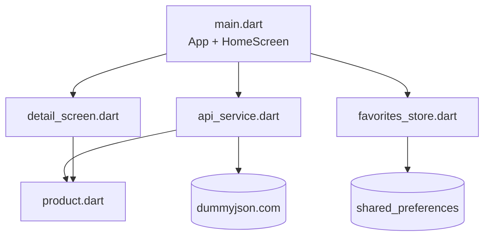

# Session 18: Capstone Lab — ShopEasy

> Module: Cross-Platform App Development with Flutter and Dart · Term 5 (ADSE) · ⏱ ~2 hours

This is the final lab of the module. You will build **ShopEasy**, a small shopping catalogue that brings together the main skills of the module: REST APIs, a responsive grid, light/dark themes, navigation and data saved on the device. Then you extend it with **one AI feature of your choice** from Sessions 15–17.

## 🎯 Learning Objectives

By the end of this lab you will be able to:

- Plan an app as screens, models, services and storage before coding
- Combine REST data, local storage and theming in one project
- Build a responsive product grid with search and a favourites filter
- Pass data and callbacks between screens
- Extend a working app with an AI feature and present it professionally

## 📖 Concepts Explained

### 1. What we are building

```text
┌────────────────────────────────────────────┐
│ ShopEasy                         ♡   🌙    │
│ [🔍 Search products (e.g. phone, watch)  ] │
│ ┌────────┐ ┌────────┐ ┌────────┐           │
│ │  img   │ │  img   │ │  img   │  ← 2/3/5  │
│ │ Title  │ │ Title  │ │ Title  │    columns│
│ │ $9.99 ♥│ │ $19  ♡ │ │ $5.5 ♡ │           │
│ └────────┘ └────────┘ └────────┘           │
└────────────────────────────────────────────┘
```

### 2. Which session gave us which skill?

| Feature | Skill | Session |
|---|---|---|
| Light/dark theme, saved | `ThemeData`, `themeMode`, `shared_preferences` | 10, 12 |
| Grid with 2/3/5 columns | `LayoutBuilder` + breakpoints | 10 |
| Favourites that survive restart | `shared_preferences` | 11–12 |
| Product list and search | `http`, `jsonDecode`, `fromJson` | 13–14 |
| Detail page | `Navigator.push`, constructor data, callbacks | 9, 14 |
| AI extension | TFLite / ML Kit / Gemini | 15–17 |

### 3. Architecture



Each file has **one job**. The UI never builds URLs, and the API service never touches widgets. This makes the app easier to read, change and test.

### 4. Plan before you code

1. **Screens:** Home (grid + search), Detail.
2. **Data:** `Product` (id, title, description, category, price, rating, thumbnail).
3. **State on Home:** `products`, `favoriteIds`, `isLoading`, `errorMessage`, `showOnlyFavorites`.
4. **Storage:** favourite ids as a `List<String>`, dark mode as a `bool`.
5. **API:** `GET /products?limit=30` and `GET /products/search?q=`.

### 5. Why save ids, not whole products?

Product details (price, stock) can change on the server. Saving only the **id** keeps local data small and always shows fresh details from the API.

### 6. Callbacks between screens

The detail screen does not own the favourites. It receives `onToggleFavorite` from Home and calls it; Home updates its state and saves. One owner of the data = no out-of-sync bugs.

## 💻 Code Examples

📄 Saved in this folder as [`pubspec_snippet.yaml`](pubspec_snippet.yaml).

```yaml
# Run: flutter pub add http shared_preferences
dependencies:
  flutter:
    sdk: flutter
  http: ^1.6.0                # products from dummyjson.com
  shared_preferences: ^2.5.6  # favourites + dark mode survive restarts
```

📄 Saved in this folder as [`product.dart`](product.dart).

```dart
// Capstone - File 1: Product model
class Product {
  final int id;
  final String title;
  final String description;
  final String category;
  final double price;
  final double rating;
  final String thumbnail;

  Product({
    required this.id,
    required this.title,
    required this.description,
    required this.category,
    required this.price,
    required this.rating,
    required this.thumbnail,
  });

  factory Product.fromJson(Map<String, dynamic> json) {
    return Product(
      id: json['id'] as int,
      title: json['title'] as String,
      description: json['description'] as String? ?? '',
      category: json['category'] as String? ?? '',
      price: (json['price'] as num).toDouble(),
      rating: (json['rating'] as num? ?? 0).toDouble(),
      thumbnail: json['thumbnail'] as String? ?? '',
    );
  }
}
```

📄 Saved in this folder as [`api_service.dart`](api_service.dart).

```dart
// Capstone - File 2: REST calls to https://dummyjson.com
import 'dart:convert';
import 'package:http/http.dart' as http;
import 'product.dart';

class ApiService {
  static const String baseUrl = 'https://dummyjson.com/products';
  static const String fields = 'select=title,description,category,price,rating,thumbnail';

  // Empty text -> first 30 products, otherwise search results.
  static Future<List<Product>> fetchProducts(String searchText) async {
    final query = searchText.trim();
    final url = query.isEmpty
        ? Uri.parse('$baseUrl?limit=30&$fields')
        : Uri.parse('$baseUrl/search?q=${Uri.encodeQueryComponent(query)}&$fields');

    final response = await http.get(url).timeout(const Duration(seconds: 10));
    if (response.statusCode != 200) {
      throw Exception('Server error ${response.statusCode}');
    }
    final list = jsonDecode(response.body)['products'] as List;
    return list.map((item) => Product.fromJson(item)).toList();
  }
}
```

📄 Saved in this folder as [`favorites_store.dart`](favorites_store.dart).

```dart
// Capstone - File 3: Save favourite product ids and the theme on the device
import 'package:shared_preferences/shared_preferences.dart';

class FavoritesStore {
  static const String favoritesKey = 'favoriteIds';
  static const String darkModeKey = 'darkMode';

  // shared_preferences stores a List<String>, so we convert ids to text.
  static Future<Set<int>> loadFavorites() async {
    final prefs = await SharedPreferences.getInstance();
    final saved = prefs.getStringList(favoritesKey) ?? [];
    return saved.map(int.parse).toSet();
  }

  static Future<void> saveFavorites(Set<int> ids) async {
    final prefs = await SharedPreferences.getInstance();
    await prefs.setStringList(favoritesKey, ids.map((id) => '$id').toList());
  }

  static Future<bool> loadDarkMode() async {
    final prefs = await SharedPreferences.getInstance();
    return prefs.getBool(darkModeKey) ?? false;
  }

  static Future<void> saveDarkMode(bool isDark) async {
    final prefs = await SharedPreferences.getInstance();
    await prefs.setBool(darkModeKey, isDark);
  }
}
```

📄 Saved in this folder as [`detail_screen.dart`](detail_screen.dart).

```dart
// Capstone - File 4: Product detail screen
import 'package:flutter/material.dart';
import 'product.dart';

class DetailScreen extends StatelessWidget {
  final Product product;
  final bool isFavorite;
  final VoidCallback onToggleFavorite;

  const DetailScreen({
    super.key,
    required this.product,
    required this.isFavorite,
    required this.onToggleFavorite,
  });

  @override
  Widget build(BuildContext context) {
    final textStyles = Theme.of(context).textTheme;

    return Scaffold(
      appBar: AppBar(title: Text(product.title)),
      body: ListView(
        padding: const EdgeInsets.all(16),
        children: [
          Image.network(product.thumbnail, height: 240),
          const SizedBox(height: 16),
          Text(product.title, style: textStyles.headlineSmall),
          Text('${product.category} · ⭐ ${product.rating}', style: textStyles.bodyMedium),
          const SizedBox(height: 8),
          Text('\$${product.price.toStringAsFixed(2)}', style: textStyles.titleLarge),
          const SizedBox(height: 16),
          Text(product.description, style: textStyles.bodyLarge),
          const SizedBox(height: 24),
          FilledButton.icon(
            onPressed: () {
              onToggleFavorite();      // update the list screen's state
              Navigator.pop(context);  // go back to see the change
            },
            icon: Icon(isFavorite ? Icons.favorite : Icons.favorite_border),
            label: Text(isFavorite ? 'Remove from favourites' : 'Add to favourites'),
          ),
        ],
      ),
    );
  }
}
```

📄 Saved in this folder as [`main.dart`](main.dart).

```dart
// Capstone - File 5: ShopEasy app
// Uses: REST (Session 13-14), responsive grid + themes (Session 10), saved data (Session 11-12)
// lib/ needs: main.dart, product.dart, api_service.dart, favorites_store.dart, detail_screen.dart
import 'package:flutter/material.dart';
import 'api_service.dart';
import 'detail_screen.dart';
import 'favorites_store.dart';
import 'product.dart';

Future<void> main() async {
  WidgetsFlutterBinding.ensureInitialized();
  final startDark = await FavoritesStore.loadDarkMode();
  runApp(ShopEasyApp(startDark: startDark));
}

class ShopEasyApp extends StatefulWidget {
  final bool startDark;
  const ShopEasyApp({super.key, required this.startDark});

  @override
  State<ShopEasyApp> createState() => _ShopEasyAppState();
}

class _ShopEasyAppState extends State<ShopEasyApp> {
  late bool isDark = widget.startDark;

  void toggleTheme() {
    setState(() => isDark = !isDark);
    FavoritesStore.saveDarkMode(isDark);
  }

  @override
  Widget build(BuildContext context) {
    return MaterialApp(
      title: 'ShopEasy',
      debugShowCheckedModeBanner: false,
      theme: ThemeData(colorSchemeSeed: Colors.blue),
      darkTheme: ThemeData(colorSchemeSeed: Colors.blue, brightness: Brightness.dark),
      themeMode: isDark ? ThemeMode.dark : ThemeMode.light,
      home: HomeScreen(isDark: isDark, onToggleTheme: toggleTheme),
    );
  }
}

class HomeScreen extends StatefulWidget {
  final bool isDark;
  final VoidCallback onToggleTheme;
  const HomeScreen({super.key, required this.isDark, required this.onToggleTheme});

  @override
  State<HomeScreen> createState() => _HomeScreenState();
}

class _HomeScreenState extends State<HomeScreen> {
  final searchController = TextEditingController();
  List<Product> products = [];
  Set<int> favoriteIds = {};
  bool isLoading = true;
  bool showOnlyFavorites = false;
  String? errorMessage;

  @override
  void initState() {
    super.initState();
    FavoritesStore.loadFavorites().then((ids) {
      if (mounted) setState(() => favoriteIds = ids);
    });
    loadProducts();
  }

  Future<void> loadProducts() async {
    setState(() {
      isLoading = true;
      errorMessage = null;
    });
    try {
      final result = await ApiService.fetchProducts(searchController.text);
      if (!mounted) return;
      setState(() {
        products = result;
        isLoading = false;
      });
    } catch (error) {
      if (!mounted) return;
      setState(() {
        errorMessage = 'Could not load products. Check your internet.';
        isLoading = false;
      });
    }
  }

  void toggleFavorite(int productId) {
    setState(() {
      if (favoriteIds.contains(productId)) {
        favoriteIds.remove(productId);
      } else {
        favoriteIds.add(productId);
      }
    });
    FavoritesStore.saveFavorites(favoriteIds);
  }

  // Responsive: 2 columns on phones, more on wider screens.
  int columnsFor(double width) {
    if (width < 600) return 2;
    if (width < 1000) return 3;
    return 5;
  }

  Widget buildProductCard(Product product) {
    final isFavorite = favoriteIds.contains(product.id);
    return Card(
      clipBehavior: Clip.antiAlias,
      child: InkWell(
        onTap: () => Navigator.push(
          context,
          MaterialPageRoute(
            builder: (_) => DetailScreen(
              product: product,
              isFavorite: isFavorite,
              onToggleFavorite: () => toggleFavorite(product.id),
            ),
          ),
        ),
        child: Column(
          crossAxisAlignment: CrossAxisAlignment.start,
          children: [
            Expanded(child: Center(child: Image.network(product.thumbnail))),
            Padding(
              padding: const EdgeInsets.all(8),
              child: Text(product.title, maxLines: 1, overflow: TextOverflow.ellipsis),
            ),
            Row(
              children: [
                const SizedBox(width: 8),
                Text('\$${product.price.toStringAsFixed(2)}'),
                const Spacer(),
                IconButton(
                  icon: Icon(isFavorite ? Icons.favorite : Icons.favorite_border),
                  onPressed: () => toggleFavorite(product.id),
                ),
              ],
            ),
          ],
        ),
      ),
    );
  }

  Widget buildBody() {
    if (isLoading) return const Center(child: CircularProgressIndicator());
    if (errorMessage != null) {
      return Center(
        child: Column(
          mainAxisSize: MainAxisSize.min,
          children: [
            Text(errorMessage!),
            TextButton(onPressed: loadProducts, child: const Text('Try again')),
          ],
        ),
      );
    }

    // Apply the favourites filter.
    final visible = showOnlyFavorites
        ? products.where((p) => favoriteIds.contains(p.id)).toList()
        : products;
    if (visible.isEmpty) return const Center(child: Text('Nothing to show.'));

    return LayoutBuilder(
      builder: (context, constraints) => GridView.builder(
        padding: const EdgeInsets.all(8),
        itemCount: visible.length,
        gridDelegate: SliverGridDelegateWithFixedCrossAxisCount(
          crossAxisCount: columnsFor(constraints.maxWidth),
          childAspectRatio: 0.75,
        ),
        itemBuilder: (context, index) => buildProductCard(visible[index]),
      ),
    );
  }

  @override
  Widget build(BuildContext context) {
    return Scaffold(
      appBar: AppBar(
        title: const Text('ShopEasy'),
        actions: [
          IconButton(
            tooltip: 'Favourites only',
            icon: Icon(showOnlyFavorites ? Icons.favorite : Icons.favorite_outline),
            onPressed: () => setState(() => showOnlyFavorites = !showOnlyFavorites),
          ),
          IconButton(
            tooltip: 'Theme',
            icon: Icon(widget.isDark ? Icons.light_mode : Icons.dark_mode),
            onPressed: widget.onToggleTheme,
          ),
        ],
      ),
      body: Column(
        children: [
          Padding(
            padding: const EdgeInsets.all(8),
            child: TextField(
              controller: searchController,
              onSubmitted: (_) => loadProducts(),
              decoration: const InputDecoration(
                hintText: 'Search products (e.g. phone, watch)',
                prefixIcon: Icon(Icons.search),
                border: OutlineInputBorder(),
              ),
            ),
          ),
          Expanded(child: buildBody()),
        ],
      ),
    );
  }
}
```

**How it works**

1. `main()` loads the saved theme before the first frame; Home loads saved favourites and the products.
2. `fetchProducts` calls the list or search endpoint and maps JSON to `Product` objects.
3. `buildBody()` shows loading → error (with retry) → empty → grid.
4. `LayoutBuilder` + `columnsFor` choose 2, 3 or 5 columns.
5. The heart toggles an id in `favoriteIds` and saves it; the app-bar heart filters to favourites only.
6. Tapping a card opens `DetailScreen`, which calls back to Home to change a favourite.

## 🧪 Lab Practice

1. **Setup (15 min):** `flutter create shop_easy`, add packages, copy the five files into `lib/`, run on Chrome and on an emulator.
2. **Test (15 min):** search "phone", add 3 favourites, switch to dark mode, restart. Resize the browser to see 2/3/5 columns.
3. **Category chips (20 min):** load `https://dummyjson.com/products/category-list` and show a horizontal list of `ChoiceChip`s; tapping one loads `https://dummyjson.com/products/category/{name}`.
4. **Cart (25 min):** add a cart with quantities, a badge on a cart icon, and a total. Save it with `shared_preferences` or sqflite.
5. **AI extension (35 min), choose one:**
   - **Gemini assistant:** a "Ask about this product" button on the detail page that sends the title and description to Gemini (Session 17).
   - **Visual search:** label a photo with ML Kit and use the top label as the search text (Session 17).
   - **Barcode/QR:** scan a code with ML Kit barcode scanning and open that product id.

## 📝 Assignment — Capstone Submission

Push your finished project to a public GitHub repository with:

- [ ] A `README.md` with app description, screenshots (phone + wide screen, light + dark) and setup steps
- [ ] Clean folders: `lib/models`, `lib/services`, `lib/screens`
- [ ] Loading, error and empty states on every network screen
- [ ] At least one AI feature from the list above
- [ ] A 2-minute screen recording link (demo)

**Suggested marking (100):** features working 40 · code structure and naming 20 · UI/UX and responsiveness 15 · AI feature 15 · README and demo 10.

## ❓ Quick Quiz

1. Why do we store favourite **ids** instead of full product objects?
2. Which widget lets the grid change its column count based on available width?
3. Why does `main()` call `WidgetsFlutterBinding.ensureInitialized()`?
4. How does the detail screen change a favourite that Home owns?
5. Name the four states `buildBody()` handles.

<details>
<summary>Show answers</summary>

1. Ids are small and details stay fresh from the API.
2. `LayoutBuilder` (with a `GridView` delegate).
3. Because it reads `shared_preferences` (a plugin) before `runApp`.
4. Through the `onToggleFavorite` callback passed in its constructor.
5. Loading, error, empty and data (grid).

</details>

## 💼 Interview Questions

1. **Walk me through the architecture of an app you built.** Describe layers: models, services (API, storage), screens; who owns state, how data flows, and why.
2. **How would you scale this app's state management?** Move shared state (favourites, cart, theme) into a state management solution such as Provider or Riverpod so any screen can read and update it.
3. **How do you make a Flutter app production-ready?** Error handling, offline/caching, tests (unit, widget), accessibility, performance checks, secure keys, analytics/crash reporting, and store-ready icons and builds.

## ✅ Summary

- ShopEasy combines REST, local storage, themes, responsive layout and navigation.
- Plan screens, models, state, storage and endpoints before writing code.
- Separate files by responsibility: model, service, store, screens.
- One owner per piece of state; pass callbacks to child screens.
- Extending with an AI feature turns a CRUD app into a modern smart app. Congratulations on finishing the module!

---

[⬅ Previous](../Session-17-ML-Kit-and-Chatbot/README.md) · [🏠 Module Home](../README.md) · [Next Module ➡](../../04-Application-Based-Programming-in-Python/README.md)

Prepared by Zeeshan Abbas · Aptech Learning North Nazimabad
