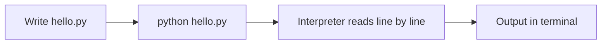

# Session 01: Python Basics and Language Constructs

> Module: Application Based Programming in Python · Term 5 (ADSE) · ⏱ ~2 hours

Python is one of the most popular programming languages in the world. It is used for websites, automation, data analysis and artificial intelligence.
In this session you install Python, run your first program and learn the building blocks: variables, data types, operators, decisions, loops and collections.

## 🎯 Learning Objectives

By the end of this session you will be able to:

- Explain what Python is and why it is used so widely
- Install Python 3.12 and run a `.py` file from the terminal
- Create variables and work with `int`, `float`, `str` and `bool`
- Use arithmetic, comparison and logical operators
- Control the flow of a program with `if/elif/else`, `match`, `for` and `while`
- Store groups of values in lists, tuples, sets and dictionaries

## 📖 Concepts Explained

### 1. What is Python?

Python is a **high-level, interpreted** language created by Guido van Rossum (first released 1991). "High-level" means it reads almost like English. "Interpreted" means Python runs your code line by line, so you see results immediately.

| Feature | What it means for you |
|---------|-----------------------|
| Simple syntax | Fewer symbols, no semicolons; indentation (spaces) shows code blocks |
| Dynamically typed | You do not declare types; Python works them out at run time |
| Huge library collection | Ready-made packages for web (Flask), data (Pandas), AI (scikit-learn) |
| Cross-platform | Same code runs on Windows, macOS and Linux |
| Free and open source | Download from python.org, use anywhere |

> **Analogy:** if other languages are a manual car, Python is an automatic. You still drive, but you think less about the gears.

### 2. Installing and running Python

1. Download Python 3.12 or newer from [python.org/downloads](https://www.python.org/downloads/). On Windows, **tick "Add python.exe to PATH"** during setup.
2. Open a terminal and check: `python --version` (on macOS/Linux use `python3`).
3. Install [VS Code](https://code.visualstudio.com/) and the official **Python** extension.
4. Save code in a file ending with `.py`, then run: `python hello.py`.
5. For quick experiments, type `python` alone to open the **interactive shell** (`>>>`). Type `exit()` to leave.



### 3. Variables and data types

A variable is a **name tag** attached to a value. You create it with `=`.

| Type | Holds | Example |
|------|-------|---------|
| `int` | Whole numbers | `age = 19` |
| `float` | Decimal numbers | `cgpa = 3.45` |
| `str` | Text, in quotes | `city = "Karachi"` |
| `bool` | `True` / `False` | `is_paid = True` |
| `NoneType` | "No value yet" | `result = None` |

Naming rules: start with a letter or `_`, no spaces, case-sensitive (`Age` and `age` are different). Use **snake_case**, e.g. `total_marks`.

### 4. Operators

- **Arithmetic:** `+ - * / // % **`. Note `/` always gives a float; `//` drops the decimal part.
- **Comparison:** `== != > < >= <=` return `True` or `False`.
- **Logical:** `and` (both true), `or` (at least one true), `not` (reverse).

### 5. Indentation and decisions

Python uses **indentation (4 spaces)** instead of curly braces. Everything indented under an `if` belongs to it.
`if / elif / else` checks conditions top to bottom and runs the **first** block that is true. `match / case` (Python 3.10+) is a clean way to compare one value against many options.

### 6. Loops

| Loop | Use it when | Example |
|------|-------------|---------|
| `for` | You know the items or the count | `for i in range(5):` |
| `while` | You repeat until a condition changes | `while balance > 0:` |

`range(1, 6)` produces 1, 2, 3, 4, 5 (the stop value is excluded). `break` leaves the loop; `continue` jumps to the next round.

### 7. Collections

| Collection | Brackets | Ordered? | Changeable? | Duplicates? |
|------------|----------|----------|-------------|-------------|
| List | `[ ]` | Yes | Yes | Yes |
| Tuple | `( )` | Yes | No | Yes |
| Set | `{ }` | No | Yes | No |
| Dictionary | `{key: value}` | Yes (insertion order) | Yes | Keys unique |

Indexing starts at **0**; `-1` means the last item. Slicing `text[0:5]` takes items 0 to 4.

## 💻 Code Examples

All files are in this folder. Run each with `python <file>.py`.

### Example 1: First program (`hello.py`)

```python
# hello.py - your very first Python program
# Run it with:  python hello.py

# print() shows text on the screen
print("Assalam o Alaikum! Welcome to Python.")

# You can print several values separated by commas
print("Python version we use:", 3.12)

# A comment starts with # and is ignored by Python
```

**How it works:** `print()` sends text to the screen. Lines starting with `#` are comments for humans.

### Example 2: Variables and types (`variables_and_types.py`)

```python
# variables_and_types.py - storing values in variables

# Step 1: create variables (no type keyword needed)
student_name = "Ayesha"      # str  (text)
age = 19                     # int  (whole number)
cgpa = 3.45                  # float (decimal number)
is_enrolled = True           # bool (True or False)

# Step 2: print the values
print("Name:", student_name)
print("Age:", age)
print("CGPA:", cgpa)
print("Enrolled:", is_enrolled)

# Step 3: type() tells us the data type of a value
print(type(student_name))
print(type(age))
print(type(cgpa))
print(type(is_enrolled))

# Step 4: convert between types (type casting)
age_text = str(age)          # int  -> str
marks = int("85")            # str  -> int
price = float("99.5")        # str  -> float
print("Age as text:", age_text + " years")
print("Marks + 5 =", marks + 5)
print("Price x 2 =", price * 2)

# Step 5: f-strings put variables inside text easily
print(f"{student_name} is {age} years old and has CGPA {cgpa}")
```

**How it works:** Python decides the type from the value. `type()` reveals it, `int()`, `float()` and `str()` convert between types, and an **f-string** (`f"...{name}..."`) inserts values into text.

### Example 3: Operators (`operators.py`)

```python
# operators.py - arithmetic, comparison and logical operators

a = 17
b = 5

# Arithmetic operators
print("a + b  =", a + b)    # addition
print("a - b  =", a - b)    # subtraction
print("a * b  =", a * b)    # multiplication
print("a / b  =", a / b)    # division (always gives float)
print("a // b =", a // b)   # floor division (whole part only)
print("a % b  =", a % b)    # remainder (modulus)
print("a ** 2 =", a ** 2)   # power

# Comparison operators give True or False
print("a > b  :", a > b)
print("a == b :", a == b)
print("a != b :", a != b)

# Logical operators combine conditions
has_id_card = True
fee_paid = False
print("Can enter exam:", has_id_card and fee_paid)  # both must be True
print("Can enter library:", has_id_card or fee_paid)  # one is enough
print("Fee not paid:", not fee_paid)
```

**How it works:** `17 // 5` is `3` and `17 % 5` is `2`, because 5 fits three times into 17 with 2 left over. `and`/`or`/`not` combine True/False values.

### Example 4: Decisions (`conditions.py`)

```python
# conditions.py - making decisions with if / elif / else

# Step 1: a fixed value so the program runs without typing
marks = 72

# Step 2: check conditions from top to bottom
if marks >= 80:
    grade = "A"
elif marks >= 70:
    grade = "B"
elif marks >= 60:
    grade = "C"
else:
    grade = "F"

print(f"Marks: {marks}  Grade: {grade}")

# Step 3: one-line conditional (ternary) expression
result = "Pass" if marks >= 60 else "Fail"
print("Result:", result)

# Step 4: match-case (Python 3.10+) compares one value to many cases
day = "Sat"
match day:
    case "Sat" | "Sun":
        print("Weekend: lab is open 10am - 2pm")
    case "Fri":
        print("Friday: short day")
    case _:
        print("Normal working day")
```

**How it works:** only the first true branch runs. The ternary line is a short `if/else`. In `match`, `|` means "or" and `_` catches everything else.

### Example 5: Loops (`loops.py`)

```python
# loops.py - repeating work with for and while

# for loop with range(start, stop) -> stop is NOT included
print("Counting 1 to 5:")
for number in range(1, 6):
    print(number)

# for loop over a list
subjects = ["Python", "Flutter", "DevOps"]
for subject in subjects:
    print("I am studying", subject)

# while loop: repeats while the condition is True
balance = 1000
month = 0
while balance > 0:
    balance = balance - 300   # spend 300 every month
    month = month + 1
print(f"Money finished after {month} months")

# break stops the loop, continue skips one round
for number in range(1, 11):
    if number == 8:
        break          # stop completely at 8
    if number % 2 == 0:
        continue       # skip even numbers
    print("Odd number:", number)
```

**How it works:** the `for` loop walks through each value; the `while` loop keeps going until `balance` is no longer above zero.

### Example 6: Collections (`collections_demo.py`)

```python
# collections_demo.py - list, tuple, set and dictionary

# LIST: ordered, changeable, allows duplicates
marks = [78, 85, 62, 90]
marks.append(70)               # add at the end
print("Marks:", marks)
print("First:", marks[0], "Last:", marks[-1])
print("Highest:", max(marks), "Average:", sum(marks) / len(marks))

# TUPLE: ordered but cannot be changed
location = (24.86, 67.01)      # latitude, longitude of Karachi
print("Latitude:", location[0])

# SET: no duplicates, no order
cities = {"Karachi", "Lahore", "Karachi", "Quetta"}
print("Unique cities:", cities)

# DICTIONARY: key -> value pairs
student = {"name": "Bilal", "batch": "ADSE-5", "cgpa": 3.2}
student["cgpa"] = 3.4          # update a value
student["city"] = "Karachi"    # add a new key
print("Name:", student["name"])
for key, value in student.items():
    print(key, "=>", value)

# LIST COMPREHENSION: build a new list in one line
passed = [m for m in marks if m >= 70]
print("Marks 70 or above:", passed)

# Strings are sequences too
course = "Application Based Programming"
print(course.upper())
print(course.split())          # list of words
print(course[0:11])            # slicing -> "Application"
```

**How it works:** lists change with `append()`, dictionaries are read with `student["name"]` and looped with `.items()`. The list comprehension keeps only marks of 70 or more.

### Example 7: Keyboard input (`input_output.py`)

```python
# input_output.py - reading input from the keyboard
# Run it and type your answers in the terminal.

name = input("Enter your name: ")          # input() always returns text
year_text = input("Enter your birth year: ")

birth_year = int(year_text)                 # convert text to number
age = 2026 - birth_year

print(f"Hello {name}! You will be about {age} years old in 2026.")
```

**How it works:** `input()` waits for the user and always returns a string, so we convert with `int()` before doing maths.

## 🧪 Lab Practice

1. **Profile card:** store your name, age, city and favourite subject in variables and print them in one f-string sentence.
2. **Even or odd:** ask the user for a number with `input()`, then print whether it is even or odd using `%`.
3. **Times table:** print the multiplication table of 7 from 1 to 10 using a `for` loop.
4. **Marks list:** create a list of 5 marks, print the highest, lowest and average, and how many are above 60.
5. **Phone book:** create a dictionary of 3 friends and their phone numbers, add one more, then loop and print all of them.

## 📝 Assignment

Write `electricity_bill.py`. Ask the user for units consumed and calculate the bill: first 100 units at Rs 10, next 100 at Rs 15, anything above 200 at Rs 20 per unit. Add 5% tax and print a neat bill. Use `if/elif/else` and f-strings.

## ❓ Quick Quiz

1. What does `7 // 2` return?
2. Which collection does **not** allow duplicate values?
3. What type does `input()` always return?
4. What will `range(2, 5)` produce?
5. How does Python know which lines belong to an `if` block?

<details>
<summary>Show answers</summary>

1. `3` (floor division)
2. A set
3. `str` (text)
4. 2, 3, 4
5. By indentation (the lines are indented under it)

</details>

## 💼 Interview Questions

1. **What is the difference between a list and a tuple?** — A list is mutable (can be changed) and uses `[ ]`; a tuple is immutable and uses `( )`. Tuples are slightly faster and are used for fixed data such as coordinates.
2. **Is Python compiled or interpreted?** — Python source is first compiled to bytecode, which the Python Virtual Machine then interprets. In everyday terms it is called an interpreted language.
3. **What does "dynamically typed" mean?** — The type belongs to the value, not the variable, and is checked at run time. The same variable can later hold a value of a different type.

## ✅ Summary

- Python is simple, readable and used in web, automation, data and AI.
- Variables are created with `=`; common types are `int`, `float`, `str`, `bool`.
- Indentation defines code blocks; `if/elif/else` and `match` make decisions.
- `for` and `while` repeat work; `break` and `continue` control loops.
- Lists, tuples, sets and dictionaries store groups of values.

---

[⬅ Previous Module](../../03-Cross-Platform-App-Development-with-Flutter-and-Dart/README.md) · [🏠 Module Home](../README.md) · [Next ➡](../Session-02-Functions-Modules-and-Packages/README.md)

Prepared by Zeeshan Abbas · Aptech Learning North Nazimabad
