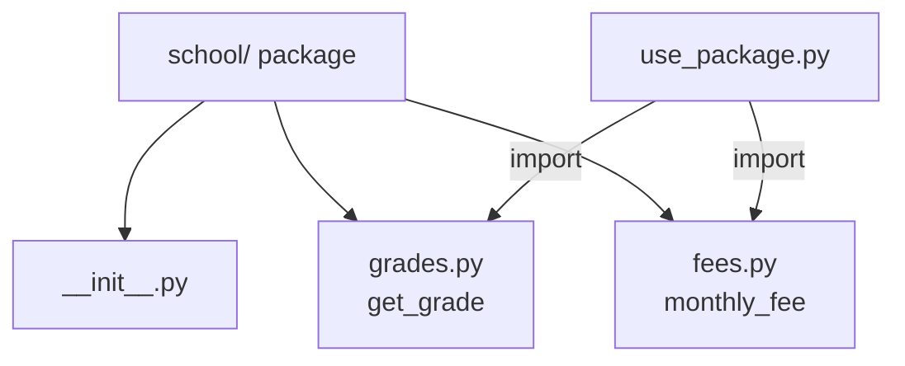

# Session 02: Functions, Modules and Packages

> Module: Application Based Programming in Python · Term 5 (ADSE) · ⏱ ~2 hours

As programs grow, you need a way to organise code so it is easy to reuse and understand. **Functions** group lines of code under a name, **modules** group functions into files, and **packages** group modules into folders.
This session shows you all three, plus the standard library and `pip` for installing third-party packages.

## 🎯 Learning Objectives

By the end of this session you will be able to:

- Define functions with `def`, pass arguments and return values
- Use default, keyword, `*args` and `**kwargs` arguments
- Explain local and global scope and write `lambda` functions
- Import modules from the Python Standard Library
- Create your own module and package and import them
- Install third-party packages with `pip` inside a virtual environment

## 📖 Concepts Explained

### 1. What is a function?

A function is a **named, reusable block of code**. You define it once and call it many times.

> **Analogy:** a function is like a juicer. You put fruit in (arguments), it does its job, and gives juice back (return value). You do not care how it works inside each time you use it.

```python
def function_name(parameter1, parameter2):
    # body (indented)
    return result
```

- **Parameter** = the name in the definition (`name`). **Argument** = the actual value you pass (`"Ali"`).
- A function without `return` gives back `None`.

### 2. Types of arguments

| Kind | Example definition | Example call |
|------|--------------------|--------------|
| Positional | `def area(l, w)` | `area(4, 5)` |
| Default | `def price(p, discount=0)` | `price(100)` |
| Keyword | same as above | `price(discount=10, p=100)` |
| `*args` (many values) | `def add_all(*nums)` | `add_all(1, 2, 3)` |
| `**kwargs` (many named) | `def profile(**info)` | `profile(name="Ali")` |

### 3. Scope: where a variable lives

- **Local** variables are created inside a function and disappear when it ends.
- **Global** variables are created at the top level of a file and can be read inside functions.
- Avoid changing globals from inside functions; pass values in and return results instead. It keeps code predictable.

### 4. Lambda functions

A `lambda` is a small anonymous function written in one line: `lambda x: x * 2`. It is most useful as a quick helper for `sorted()`, `map()` and `filter()`.

### 5. Modules

A **module** is simply a `.py` file. Python ships with a big **Standard Library** of modules such as `math`, `random`, `datetime`, `os`, `json` and `csv`.

| Import style | Example | Then use |
|--------------|---------|----------|
| Whole module | `import math` | `math.sqrt(16)` |
| One name | `from random import randint` | `randint(1, 6)` |
| Alias | `import datetime as dt` | `dt.date.today()` |

`if __name__ == "__main__":` lets a file act both as a module (when imported) and as a program (when run directly).

### 6. Packages

A **package** is a folder of modules with an `__init__.py` file. You import with dots: `from school.grades import get_grade`.



### 7. pip and virtual environments

**pip** downloads packages from [PyPI](https://pypi.org/). A **virtual environment** keeps each project's packages separate so versions do not clash.

```bash
python -m venv .venv                 # create the environment once
.venv\Scripts\activate               # Windows
source .venv/bin/activate            # macOS / Linux
pip install requests                 # install a package
pip freeze > requirements.txt        # save the list of packages
pip install -r requirements.txt      # install the same list on another PC
```

## 💻 Code Examples

### Example 1: Defining functions (`functions_basics.py`)

```python
# functions_basics.py - defining and calling functions

# Step 1: a function with no parameters
def greet():
    print("Welcome to the Python module!")

# Step 2: a function with parameters
def greet_student(name, batch):
    print(f"Hello {name} from batch {batch}")

# Step 3: a function that RETURNS a value
def calculate_average(marks_list):
    total = sum(marks_list)
    average = total / len(marks_list)
    return average

# Step 4: call (use) the functions
greet()
greet_student("Hamza", "ADSE-5")

my_marks = [80, 72, 91]
avg = calculate_average(my_marks)
print(f"Average marks: {avg:.2f}")   # :.2f = 2 decimal places
```

**How it works:** `calculate_average` receives a list, computes the average and **returns** it, so the caller can store it in `avg`.

### Example 2: Argument types (`arguments_demo.py`)

```python
# arguments_demo.py - default, keyword and variable-length arguments

# Default value: discount is 0 unless we pass something else
def final_price(price, discount=0):
    return price - (price * discount / 100)

print(final_price(1000))          # uses default discount 0
print(final_price(1000, 10))      # positional: discount = 10
print(final_price(discount=25, price=2000))  # keyword arguments, any order

# *args collects any number of positional values into a tuple
def add_all(*numbers):
    total = 0
    for n in numbers:
        total = total + n
    return total

print("Sum:", add_all(2, 4, 6, 8))

# **kwargs collects named values into a dictionary
def show_profile(**details):
    for key, value in details.items():
        print(f"{key}: {value}")

show_profile(name="Zara", city="Karachi", course="ADSE")

# A function can return more than one value (as a tuple)
def min_max(values):
    return min(values), max(values)

lowest, highest = min_max([45, 88, 67])
print("Lowest:", lowest, "Highest:", highest)
```

**How it works:** `discount=0` is used when no value is given. `*numbers` becomes a tuple and `**details` becomes a dictionary. Returning `min(...), max(...)` sends back a tuple that we unpack into two variables.

### Example 3: Scope and lambda (`scope_and_lambda.py`)

```python
# scope_and_lambda.py - local vs global variables, and lambda functions

college = "Aptech"          # GLOBAL: visible everywhere in this file

def show_info():
    room = "Lab 3"          # LOCAL: exists only inside this function
    print(college, room)

show_info()
# print(room)  # would cause NameError: room is not defined outside

# lambda = a tiny one-line function without a name
square = lambda x: x * x
print("Square of 6:", square(6))

# lambdas are handy with sorted(), map() and filter()
students = [("Ali", 72), ("Sana", 91), ("Omar", 65)]

by_marks = sorted(students, key=lambda s: s[1], reverse=True)
print("Sorted by marks:", by_marks)

marks = [72, 91, 65]
bonus = list(map(lambda m: m + 5, marks))       # add 5 to each
passed = list(filter(lambda m: m >= 70, marks)) # keep 70+
print("With bonus:", bonus)
print("Passed:", passed)
```

**How it works:** `key=lambda s: s[1]` tells `sorted()` to sort by the second item (marks). `map()` changes every item; `filter()` keeps only items where the lambda returns `True`.

### Example 4: Standard library modules (`builtin_modules.py`)

```python
# builtin_modules.py - using modules from the Python Standard Library

import math                      # import the whole module
from random import randint       # import one function
import datetime as dt            # import with a short alias

print("Square root of 49:", math.sqrt(49))
print("Pi:", round(math.pi, 4))

dice = randint(1, 6)             # random whole number from 1 to 6
print("Dice rolled:", dice)

today = dt.date.today()
print("Today is:", today)
print("Year:", today.year)
```

**How it works:** three import styles are shown. Each module gives ready-made tools you do not have to write yourself.

### Example 5: Your own module (`my_math.py` and `use_my_math.py`)

```python
# my_math.py - OUR OWN module (any .py file is a module)

PI = 3.14159

def circle_area(radius):
    return PI * radius * radius

def rectangle_area(length, width):
    return length * width

# This block runs only when you run my_math.py directly,
# NOT when another file imports it.
if __name__ == "__main__":
    print("Testing my_math:", circle_area(2))
```

```python
# use_my_math.py - importing our own module (my_math.py must be in the same folder)

import my_math

print("Circle area (r=3):", my_math.circle_area(3))
print("Rectangle area (4 x 5):", my_math.rectangle_area(4, 5))
print("PI from module:", my_math.PI)
```

**How it works:** because both files are in the same folder, `import my_math` finds the file. The test line in `my_math.py` does not run during the import thanks to the `__name__` check.

### Example 6: Your own package (`school/` and `use_package.py`)

```python
# school/grades.py - a module inside the "school" package

def get_grade(marks):
    if marks >= 80:
        return "A"
    elif marks >= 70:
        return "B"
    elif marks >= 60:
        return "C"
    return "F"
```

```python
# use_package.py - importing modules from our "school" package

from school.grades import get_grade
from school import fees
import school

print("Package version:", school.__version__)
print("Grade for 75:", get_grade(75))
print("Monthly fee:", fees.monthly_fee(120000, 12))
```

**How it works:** the `school` folder contains `__init__.py`, `grades.py` and `fees.py`. Run `python use_package.py` from this session folder so Python can find the package.

## 🧪 Lab Practice

1. Write `is_even(n)` that returns `True` or `False`, and test it with 5 numbers.
2. Write `bill(amount, tip=10)` that returns the total with tip; call it with and without the tip argument.
3. Create a module `converter.py` with `km_to_miles()` and `celsius_to_fahrenheit()`, then import and use it from `main.py`.
4. Sort a list of `(product, price)` tuples by price using `sorted()` and a `lambda`.
5. Create a virtual environment, install `requests`, and save `requirements.txt`.

## 📝 Assignment

Create a package `shop/` with two modules: `cart.py` (functions `add_item`, `remove_item`, `cart_total`) and `discounts.py` (function `apply_coupon(total, code)` where `"EID10"` gives 10% off). Write `main.py` that uses both modules to build a cart of 4 items and prints the final bill.

## ❓ Quick Quiz

1. What does a function return if it has no `return` statement?
2. What does `*args` collect the extra arguments into?
3. Which file turns a folder into a regular package?
4. What is the purpose of `if __name__ == "__main__":`?
5. Which command installs a package from PyPI?

<details>
<summary>Show answers</summary>

1. `None`
2. A tuple
3. `__init__.py`
4. To run some code only when the file is executed directly, not when it is imported
5. `pip install <package-name>`

</details>

## 💼 Interview Questions

1. **What is the difference between a module and a package?** — A module is a single `.py` file; a package is a directory of modules (usually with `__init__.py`) that can be imported with dotted names.
2. **Why should you avoid mutable default arguments like `def f(items=[])`?** — The default list is created once and shared between calls, so values from earlier calls leak into later ones. Use `items=None` and create a new list inside.
3. **Why use a virtual environment?** — It isolates each project's dependencies so different projects can use different package versions without conflicts, and makes setups reproducible with `requirements.txt`.

## ✅ Summary

- Functions make code reusable; they take arguments and can return values.
- Default, keyword, `*args` and `**kwargs` make functions flexible.
- Local variables live inside a function; lambdas are short anonymous functions.
- Any `.py` file is a module; a folder of modules with `__init__.py` is a package.
- `pip` installs third-party packages; virtual environments keep them separate per project.

---

[⬅ Previous](../Session-01-Python-Basics-and-Language-Constructs/README.md) · [🏠 Module Home](../README.md) · [Next ➡](../Session-03-Practice-Lab-Python-Foundations/README.md)

Prepared by Zeeshan Abbas · Aptech Learning North Nazimabad
