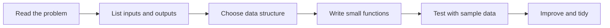

# Session 03: Practice Lab — Python Foundations

> Module: Application Based Programming in Python · Term 5 (ADSE) · ⏱ ~2 hours

This is a hands-on lab. You will combine everything from Sessions 01 and 02 (variables, decisions, loops, collections, functions and modules) to build five small programs.
Read the short revision first, then type and run each lab. Try the "Extend it" ideas to stretch yourself.

## 🎯 Learning Objectives

By the end of this session you will be able to:

- Break a problem into small functions that each do one job
- Use lists of dictionaries to represent real-world records
- Build a menu-driven console program with a `while True` loop
- Format output neatly with f-string alignment
- Create a reusable module and test it with `assert`

## 📖 Concepts Explained

### 1. Quick revision

| Concept | Remember |
|---------|----------|
| Variables & types | `int`, `float`, `str`, `bool`; convert with `int()`, `str()` |
| Decisions | `if / elif / else`, `match / case` |
| Loops | `for item in items`, `while condition`, `break`, `continue` |
| Collections | list `[ ]`, tuple `( )`, set `{ }`, dict `{k: v}` |
| Functions | `def name(params): return value` |
| Modules | any `.py` file; `import name` |

### 2. How to approach a lab problem



1. **Inputs and outputs:** what does the user give, and what should be printed?
2. **Data structure:** one value → variable; many similar values → list; labelled values → dictionary; many records → list of dictionaries.
3. **Functions:** give each step its own function with a clear name (`average`, `grade`, `show_cart`).
4. **Test early:** run the program after every few lines, not only at the end.

### 3. Formatting tables with f-strings

| Format | Meaning | Example output |
|--------|---------|----------------|
| `{name:<10}` | left-align in 10 spaces | `Ali       ` |
| `{value:>8}` | right-align in 8 spaces | `      72` |
| `{avg:.1f}` | 1 decimal place | `78.3` |
| `{price:,}` | thousands separator | `1,500` |

### 4. Menu-driven programs

A **menu loop** shows options, reads a choice, performs the action and repeats until the user chooses Exit. `while True:` with `break` is the simplest pattern. `dict.get(key, 0)` is useful to read a value with a default when the key does not exist yet.

### 5. Testing with `assert`

`assert condition` does nothing if the condition is `True`, and stops the program with an `AssertionError` if it is `False`. It is the simplest way to check that your functions return what you expect. (Professional projects use `pytest`, which builds on the same idea.)

## 💻 Code Examples

### Lab 1: Grade report (`grade_report.py`)

```python
# grade_report.py - Lab 1: student grade report using lists, dicts and functions

# Step 1: data - each student is a dictionary
students = [
    {"name": "Ayesha", "marks": [85, 78, 92]},
    {"name": "Bilal",  "marks": [55, 61, 48]},
    {"name": "Sana",   "marks": [72, 69, 80]},
]

# Step 2: small helper functions (one job each)
def average(marks):
    return sum(marks) / len(marks)

def grade(avg):
    if avg >= 80:
        return "A"
    elif avg >= 70:
        return "B"
    elif avg >= 60:
        return "C"
    return "F"

# Step 3: print a report table
print(f"{'Name':<10}{'Average':>8}{'Grade':>7}")
print("-" * 25)
for student in students:
    avg = average(student["marks"])
    print(f"{student['name']:<10}{avg:>8.1f}{grade(avg):>7}")

# Step 4: find the top student with max() and a lambda
top = max(students, key=lambda s: average(s["marks"]))
print("\nTop student:", top["name"])
```

**How it works:** each student is a dictionary inside a list. Two helper functions calculate the average and grade, and alignment codes make a tidy table. `max()` with a `key` finds the best student.

**Extend it:** add a fourth subject, and print the class average at the bottom.

### Lab 2: Shopping cart menu (`shopping_cart.py`)

```python
# shopping_cart.py - Lab 2: menu-driven cart (uses while loop + dictionary)
# Run it and type menu numbers. Choose 4 to exit.

prices = {"pen": 50, "notebook": 200, "bag": 1500}   # item -> price
cart = {}                                            # item -> quantity

def show_cart():
    total = 0
    for item, qty in cart.items():
        line_total = prices[item] * qty
        total = total + line_total
        print(f"  {item} x {qty} = Rs {line_total}")
    print(f"  TOTAL = Rs {total}")

while True:
    print("\n1) Show items  2) Add item  3) View cart  4) Exit")
    choice = input("Choose: ")

    if choice == "1":
        for item, price in prices.items():
            print(f"  {item}: Rs {price}")
    elif choice == "2":
        item = input("Item name: ").lower()
        if item in prices:
            qty = int(input("Quantity: "))
            cart[item] = cart.get(item, 0) + qty   # add to existing quantity
            print("Added!")
        else:
            print("Sorry, item not found.")
    elif choice == "3":
        show_cart()
    elif choice == "4":
        print("Thank you for shopping!")
        break
    else:
        print("Invalid choice, try again.")
```

**How it works:** `prices` is the catalogue and `cart` stores quantities. `cart.get(item, 0) + qty` adds to the existing quantity or starts from 0.

**Extend it:** add option "Remove item", and apply a 10% discount when the total is above Rs 3,000.

### Lab 3: Number guessing game (`number_guess.py`)

```python
# number_guess.py - Lab 3: guessing game (random module + while loop)

import random

secret = random.randint(1, 20)   # computer picks a number
tries = 0

print("I am thinking of a number between 1 and 20.")
while True:
    guess = int(input("Your guess: "))
    tries = tries + 1
    if guess < secret:
        print("Too low!")
    elif guess > secret:
        print("Too high!")
    else:
        print(f"Correct! You found it in {tries} tries.")
        break
```

**How it works:** `random.randint(1, 20)` picks the secret. The loop counts tries and gives hints until the guess is correct.

**Extend it:** limit the player to 5 tries and reveal the number if they lose.

### Lab 4: Your own module (`text_utils.py`)

```python
# text_utils.py - Lab 4: a small module of string helper functions

def count_vowels(text):
    count = 0
    for letter in text.lower():
        if letter in "aeiou":
            count = count + 1
    return count

def is_palindrome(word):
    clean = word.lower().replace(" ", "")
    return clean == clean[::-1]      # [::-1] reverses a string

def word_frequency(sentence):
    freq = {}
    for word in sentence.lower().split():
        freq[word] = freq.get(word, 0) + 1
    return freq

if __name__ == "__main__":
    print(count_vowels("Karachi"))          # 3
    print(is_palindrome("Madam"))           # True
    print(word_frequency("to be or not to be"))
```

**How it works:** three independent helper functions. `clean[::-1]` reverses the string, and `freq.get(word, 0) + 1` counts words.

### Lab 5: Testing the module (`test_text_utils.py`)

```python
# test_text_utils.py - Lab 5: check our functions with simple assert tests
# If every assert is True, nothing happens. If one fails, Python shows an AssertionError.

from text_utils import count_vowels, is_palindrome, word_frequency

assert count_vowels("Python") == 1
assert count_vowels("AEIOU") == 5
assert is_palindrome("Race car") is True
assert is_palindrome("Flutter") is False
assert word_frequency("a b a") == {"a": 2, "b": 1}

print("All tests passed!")
```

**How it works:** we import the functions and check known answers. If you break a function, the test file tells you immediately.

## 🧪 Lab Practice

1. Run all five programs and change at least one value in each to see a different result.
2. **Temperature table:** print Celsius values 0 to 100 (step 10) with their Fahrenheit values in an aligned table.
3. **ATM simulator:** menu with Check balance, Deposit, Withdraw and Exit. Do not allow a withdrawal above the balance.
4. **Word counter:** ask for a sentence and print the 3 most common words using your `word_frequency` function.
5. Add 3 more `assert` tests to `test_text_utils.py`, including one for an empty string.

## 📝 Assignment

Build `library_manager.py`: store books as a list of dictionaries (`title`, `author`, `available`). Provide a menu to list books, search by title, issue a book (set `available` to `False`) and return a book. Put the book functions in a separate module `library.py` and write at least 4 `assert` tests for them.

## ❓ Quick Quiz

1. Which data structure is best for a list of student records with names and marks?
2. What does `f"{3.14159:.2f}"` print?
3. What does `"abc"[::-1]` return?
4. What happens when an `assert` condition is false?
5. How do you exit a `while True` loop?

<details>
<summary>Show answers</summary>

1. A list of dictionaries
2. `3.14`
3. `"cba"`
4. Python raises an `AssertionError` and stops
5. With `break`

</details>

## 💼 Interview Questions

1. **How would you count how many times each word appears in a text?** — Loop over the words and use a dictionary (`freq[w] = freq.get(w, 0) + 1`), or use `collections.Counter`.
2. **Why break a program into small functions?** — Small functions are easier to read, test, debug and reuse, and each one can be changed without affecting the others.
3. **What is the difference between `assert` and an `if` check?** — `assert` is meant for developer checks and tests (it can be disabled with `python -O`); real input validation should use `if` and raise proper errors.

## ✅ Summary

- Real programs combine variables, loops, decisions, collections and functions.
- Lists of dictionaries are a simple way to store records.
- Menu-driven apps use `while True` and `break`.
- f-string alignment makes clean console tables.
- Put helpers in a module and protect them with `assert` tests.

---

[⬅ Previous](../Session-02-Functions-Modules-and-Packages/README.md) · [🏠 Module Home](../README.md) · [Next ➡](../Session-04-Files-Exceptions-Regex-and-Tokenisation/README.md)

Prepared by Zeeshan Abbas · Aptech Learning North Nazimabad
