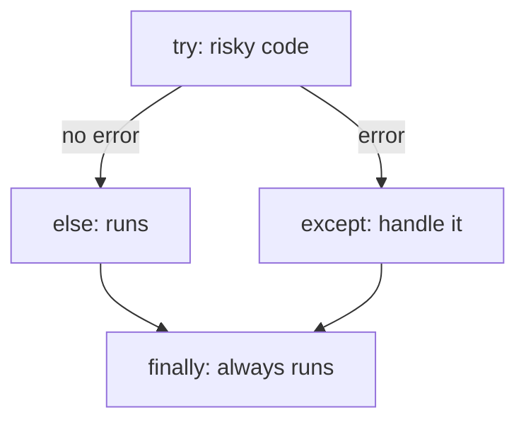

# Session 04: Files, Exceptions, Regular Expressions and Tokenisation

> Module: Application Based Programming in Python · Term 5 (ADSE) · ⏱ ~2 hours

Real applications must **save data**, **survive errors** and **understand text**. In this session you learn to read and write files (text, CSV, JSON), handle errors with `try/except`, search text with regular expressions, and split text into tokens — the first step of every Natural Language Processing (NLP) task.

## 🎯 Learning Objectives

By the end of this session you will be able to:

- Open, write, append and read text files safely with `with open(...)`
- Read CSV files and save/load JSON data
- Handle errors with `try`, `except`, `else`, `finally` and `raise`
- Use the `re` module to search, extract, validate and replace patterns
- Tokenise text into words and sentences and count keywords

## 📖 Concepts Explained

### 1. Working with files

A file stores data permanently on disk. Python's `open(filename, mode)` returns a file object.

| Mode | Meaning | If file does not exist |
|------|---------|------------------------|
| `"r"` | Read (default) | Error |
| `"w"` | Write (erases old content) | Creates it |
| `"a"` | Append to the end | Creates it |
| `"x"` | Create new only | Creates it (error if it exists) |
| `"rb"` / `"wb"` | Binary (images, PDFs) | — |

Always use **`with open(...) as f:`** — Python closes the file automatically, even if an error happens. Add `encoding="utf-8"` so Urdu or special characters work everywhere.

### 2. CSV and JSON

- **CSV** (comma-separated values) is a simple table format that Excel can open. `csv.DictReader` gives each row as a dictionary using the header row as keys.
- **JSON** is the standard format for APIs and config files. `json.dump()` writes Python data to a file; `json.load()` reads it back.

### 3. Exceptions

An **exception** is an error that happens while the program runs. If you do not handle it, the program crashes.



| Common exception | When it happens |
|------------------|-----------------|
| `ValueError` | `int("abc")` |
| `ZeroDivisionError` | `10 / 0` |
| `FileNotFoundError` | opening a missing file |
| `KeyError` | `d["missing"]` |
| `IndexError` | `my_list[99]` |
| `TypeError` | `"5" + 5` |

Catch **specific** exceptions rather than a bare `except:` so real bugs are not hidden. Use `raise` to signal your own errors.

### 4. Regular expressions (regex)

A regex is a **search pattern** for text. Python's `re` module uses them.

| Symbol | Meaning | Example matches |
|--------|---------|-----------------|
| `\d` | any digit | `7` |
| `\w` | letter, digit or `_` | `a`, `9` |
| `\s` | whitespace | space, tab |
| `.` | any character | `x` |
| `+` / `*` / `?` | 1+ / 0+ / 0 or 1 times | `\d+` → `2026` |
| `{n}` | exactly n times | `\d{4}` → `0300` |
| `[abc]` | one of a, b, c | `b` |
| `^` / `$` | start / end of text | — |

Main functions: `re.search()` (first match), `re.findall()` (all matches), `re.match()` (at the start), `re.fullmatch()` (whole string), `re.sub()` (replace), `re.split()` (split). Write patterns as **raw strings** `r"..."` so backslashes are kept.

### 5. Tokenisation

**Tokenisation** means breaking text into smaller pieces called **tokens** — usually words or sentences. Computers cannot understand a paragraph directly; they work on tokens. It is the first step in chatbots, search engines and sentiment analysis.

| Step | Example |
|------|---------|
| Raw text | `"Python is easy. Is it?"` |
| Word tokens | `['python', 'is', 'easy', 'is', 'it']` |
| Sentence tokens | `['Python is easy.', 'Is it?']` |
| Remove stop words | `['python', 'easy']` |

Libraries like NLTK and spaCy offer advanced tokenisers, but regex is enough to understand the idea.

## 💻 Code Examples

### Example 1: Text files (`write_read_file.py`)

```python
# write_read_file.py - writing and reading a text file

# Step 1: WRITE ("w" creates the file or overwrites it)
with open("notes.txt", "w", encoding="utf-8") as file:
    file.write("Python is fun\n")
    file.write("Files keep data after the program ends\n")

# Step 2: APPEND ("a" adds to the end without deleting)
with open("notes.txt", "a", encoding="utf-8") as file:
    file.write("This line was appended\n")

# Step 3: READ the whole file at once
with open("notes.txt", "r", encoding="utf-8") as file:
    content = file.read()
print("Whole file:\n" + content)

# Step 4: READ line by line (good for big files)
with open("notes.txt", "r", encoding="utf-8") as file:
    for line_number, line in enumerate(file, start=1):
        print(line_number, line.strip())   # strip() removes the \n
```

**How it works:** `"w"` creates `notes.txt`, `"a"` adds a line, and `"r"` reads it back. `enumerate()` gives line numbers.

### Example 2: CSV and JSON (`csv_and_json.py` + `students.csv`)

```csv
name,city,marks
Ayesha,Karachi,85
Bilal,Lahore,62
Sana,Karachi,91
Omar,Quetta,48
Hira,Multan,77
```

```python
# csv_and_json.py - reading a CSV file and saving JSON

import csv
import json

# Step 1: read students.csv as dictionaries (first row = headers)
students = []
with open("students.csv", "r", encoding="utf-8") as file:
    reader = csv.DictReader(file)
    for row in reader:
        row["marks"] = int(row["marks"])   # CSV values are text, convert
        students.append(row)

# Step 2: process the data
for s in students:
    print(f"{s['name']:<8} {s['city']:<10} {s['marks']}")
average = sum(s["marks"] for s in students) / len(students)
print("Class average:", round(average, 1))

# Step 3: save the result as JSON
with open("students.json", "w", encoding="utf-8") as file:
    json.dump(students, file, indent=2)
print("Saved students.json")

# Step 4: load the JSON back into Python
with open("students.json", "r", encoding="utf-8") as file:
    loaded = json.load(file)
print("First record from JSON:", loaded[0])
```

**How it works:** `DictReader` turns each row into a dictionary. We convert marks to `int`, compute the average and save everything as `students.json`.

### Example 3: Exceptions (`exceptions_demo.py`)

```python
# exceptions_demo.py - handling errors with try / except / else / finally

# Example 1: dividing safely
def safe_divide(a, b):
    try:
        result = a / b
    except ZeroDivisionError:
        print("Cannot divide by zero!")
        return None
    else:
        return result          # runs only when no error happened
    finally:
        print("Division attempted")   # always runs

print(safe_divide(10, 2))
print(safe_divide(10, 0))

# Example 2: catching different errors separately
values = ["25", "abc", "0"]
for text in values:
    try:
        number = int(text)          # may raise ValueError
        print(100 / number)         # may raise ZeroDivisionError
    except ValueError:
        print(f"'{text}' is not a number")
    except ZeroDivisionError:
        print("Zero is not allowed")

# Example 3: a missing file
try:
    with open("does_not_exist.txt") as f:
        print(f.read())
except FileNotFoundError as error:
    print("File problem:", error)

# Example 4: raising our own error
def set_age(age):
    if age < 0:
        raise ValueError("Age cannot be negative")
    return age

try:
    set_age(-5)
except ValueError as error:
    print("Error:", error)
```

**How it works:** each risky line sits inside `try`. The matching `except` block handles the error and the program keeps running.

### Example 4: Regex (`regex_basics.py`)

```python
# regex_basics.py - finding patterns in text with the re module

import re

text = "Call 0300-1234567 or 0321-7654321. Email: info@aptech.pk, admin@example.com"

# search(): first match only
first = re.search(r"\d{4}-\d{7}", text)
print("First phone:", first.group())

# findall(): every match, returned as a list
phones = re.findall(r"\d{4}-\d{7}", text)
print("All phones:", phones)

emails = re.findall(r"[\w.]+@[\w.]+\.\w+", text)
print("Emails:", emails)

# match(): checks only at the START of the string
print("Starts with 'Call'?", bool(re.match(r"Call", text)))

# sub(): replace matches (hide phone numbers)
hidden = re.sub(r"\d{4}-\d{7}", "XXXX-XXXXXXX", text)
print("Hidden:", hidden)

# fullmatch(): validate a whole value
cnic = "42101-1234567-1"
if re.fullmatch(r"\d{5}-\d{7}-\d", cnic):
    print(cnic, "is a valid CNIC format")
```

**How it works:** `\d{4}-\d{7}` means four digits, a dash, seven digits — a Pakistani mobile number. `fullmatch` checks the entire CNIC string.

### Example 5: Tokenisation (`tokenise_text.py`)

```python
# tokenise_text.py - splitting text into words and sentences (tokenisation)

import re
from collections import Counter

text = "Python is easy. Python is powerful! Is Python used in AI? Yes, it is."

# 1) Simple split on spaces (keeps punctuation attached)
print("split():", text.split())

# 2) Word tokens with regex: \w+ means "one or more letters/digits"
words = re.findall(r"\w+", text.lower())
print("Word tokens:", words)

# 3) Sentence tokens: split after . ! or ? followed by a space
sentences = re.split(r"(?<=[.!?])\s+", text)
print("Sentences:")
for s in sentences:
    print(" -", s)

# 4) Remove common "stop words" and count the rest
stop_words = {"is", "in", "it", "yes"}
keywords = [w for w in words if w not in stop_words]
print("Top keywords:", Counter(keywords).most_common(3))
```

**How it works:** `re.findall(r"\w+")` extracts words, the look-behind `(?<=[.!?])` splits after sentence punctuation, and `Counter` counts keywords.

## 🧪 Lab Practice

1. Write a program that asks for 3 to-do items and saves them to `todo.txt`, then reads and numbers them.
2. Add a new student to `students.csv` using `csv.writer` in append mode and re-run the average.
3. Ask the user for two numbers and divide them; handle `ValueError` and `ZeroDivisionError` with friendly messages.
4. Extract all dates in the form `dd-mm-yyyy` from a paragraph using `re.findall`.
5. Tokenise a news paragraph and print the 5 most common words without stop words.

## 📝 Assignment

Write `log_analyzer.py` that reads a text file of server logs (create 10 sample lines like `2026-10-01 10:15:22 ERROR Database timeout`). Use regex to count how many lines are `ERROR`, `WARNING` and `INFO`, extract all times, and save a summary to `summary.json`. Handle a missing log file gracefully.

## ❓ Quick Quiz

1. Which file mode erases existing content?
2. Why is `with open(...)` preferred?
3. Which exception does `int("hello")` raise?
4. What does the pattern `\d+` match?
5. What is tokenisation?

<details>
<summary>Show answers</summary>

1. `"w"`
2. It closes the file automatically, even if an error happens
3. `ValueError`
4. One or more digits
5. Splitting text into smaller units (tokens) such as words or sentences

</details>

## 💼 Interview Questions

1. **What is the difference between `re.match()` and `re.search()`?** — `match()` only checks at the beginning of the string; `search()` scans the whole string and returns the first match anywhere.
2. **When does the `finally` block run?** — Always: after `try` succeeds, after an exception is handled, and even if a `return` happens inside `try`. It is used for clean-up such as closing connections.
3. **Why is a bare `except:` considered bad practice?** — It catches every exception, including typing mistakes and `KeyboardInterrupt`, hiding real bugs. Catch specific exceptions instead.

## ✅ Summary

- `with open()` reads and writes files safely; modes `r`, `w`, `a` control behaviour.
- `csv` and `json` modules handle the two most common data formats.
- `try/except/else/finally` keeps programs running when errors occur; `raise` signals errors.
- Regex finds, validates and replaces text patterns.
- Tokenisation splits text into words or sentences — the first step of NLP.

---

[⬅ Previous](../Session-03-Practice-Lab-Python-Foundations/README.md) · [🏠 Module Home](../README.md) · [Next ➡](../Session-05-Flask-and-Web-Scraping/README.md)

Prepared by Zeeshan Abbas · Aptech Learning North Nazimabad
