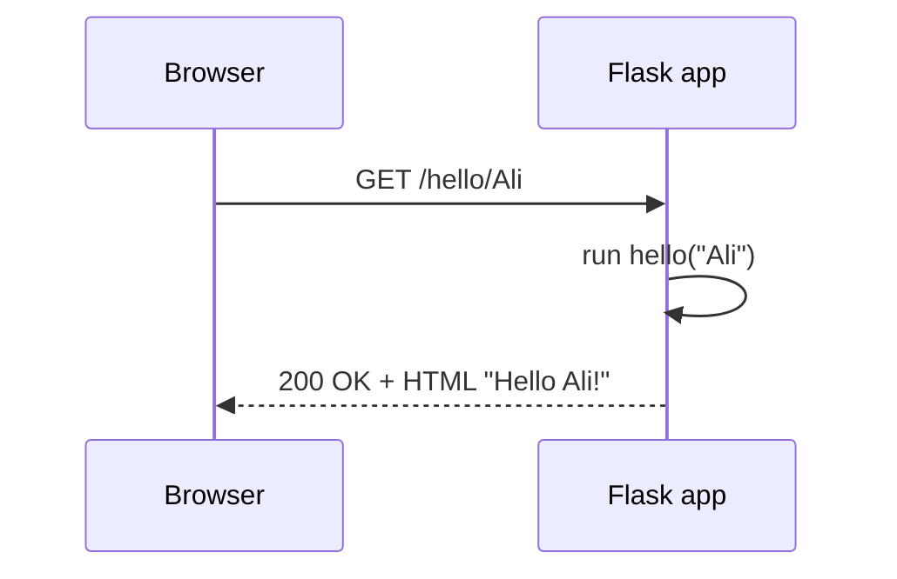

# Session 05: Web Development with Flask and Web Scraping

> Module: Application Based Programming in Python · Term 5 (ADSE) · ⏱ ~2 hours

Python can both **serve** web pages and **read** web pages. In the first half of this session you build a small website and a JSON API with **Flask**. In the second half you collect data from web pages with **requests** and **BeautifulSoup** — a skill used to build datasets for analysis and machine learning.

## 🎯 Learning Objectives

By the end of this session you will be able to:

- Explain how a web framework handles requests and responses
- Set up Flask and create routes, URL variables and HTML templates
- Handle a form with `GET` and `POST` and return JSON for an API
- Describe web scraping and its legal and ethical rules
- Download a page with `requests` and extract data with BeautifulSoup
- Save scraped data to a CSV file

## 📖 Concepts Explained

### 1. How the web works (in one minute)

A **browser** (client) sends an HTTP **request** to a **server**; the server returns a **response** (HTML, JSON, an image). A **web framework** like Flask lets you write Python functions that build those responses.



### 2. What is Flask?

Flask is a **micro web framework**: small core, easy to learn, extended with add-ons when needed. (Django is a bigger "batteries included" alternative.)

| Flask idea | Meaning |
|------------|---------|
| `app = Flask(__name__)` | Creates the application |
| `@app.route("/path")` | Connects a URL to a Python function (a **view**) |
| `<name>` in a route | A URL variable passed to the function |
| `render_template()` | Fills an HTML file in `templates/` with data (Jinja2) |
| `request.form` | Data sent from an HTML form (POST) |
| `jsonify()` | Returns Python data as JSON — perfect for mobile apps |

**Setup steps:** create a virtual environment → `pip install flask` → write `app.py` → `python app.py` → open `http://127.0.0.1:5000`.

**Jinja2 template syntax:** `{{ value }}` prints a value; ` ... ` and ` ... ` add logic inside HTML.

### 3. GET vs POST

| Method | Used for | Data travels in |
|--------|----------|-----------------|
| GET | Reading a page | The URL (`?q=python`) |
| POST | Sending a form | The request body (hidden from URL) |

### 4. What is web scraping?

**Web scraping** is using a program to download web pages and pull out specific information (prices, headlines, job posts) automatically.

**Rules of responsible scraping:**

1. Prefer an official **API** if the site offers one.
2. Read the site's **Terms of Service** and `robots.txt` (e.g. `https://site.com/robots.txt`).
3. Do not overload servers — add delays (`time.sleep(1)`) between requests.
4. Never scrape personal data or content behind a login without permission.
5. Identify your script with a `User-Agent` header and respect copyright.

### 5. Scraping libraries

| Library | Job |
|---------|-----|
| `requests` | Downloads the page (HTTP GET) |
| `BeautifulSoup` (bs4) | Parses HTML and finds elements |
| `lxml` | A faster parser (optional) |
| Selenium / Playwright | Controls a real browser for JavaScript-heavy sites |
| Scrapy | A full framework for large crawling projects |

**Key BeautifulSoup methods:** `find()` (first match), `find_all()` (all matches), `select()` (CSS selectors), `.text` (inner text), `tag["href"]` (attribute value).

> **Tip:** right-click on a web page → **Inspect** to see the HTML tags and class names you need.

## 💻 Code Examples

Install the libraries once: `pip install flask requests beautifulsoup4`

### Example 1: Smallest Flask app (`hello_flask.py`)

```python
# hello_flask.py - the smallest Flask web app
# Install once:  pip install flask
# Run:           python hello_flask.py   then open http://127.0.0.1:5000

from flask import Flask

app = Flask(__name__)          # create the web application

@app.route("/")                # when someone visits the home page "/"
def home():
    return "<h1>Hello from Flask!</h1><p>My first Python website.</p>"

@app.route("/about")           # a second page at /about
def about():
    return "This site is built in the Python module."

if __name__ == "__main__":
    app.run(debug=True)        # debug=True reloads when you save the file
```

**How it works:** each `@app.route` decorator connects a URL to the function below it. The returned string is sent to the browser.

### Example 2: Templates, form and API (`app.py` + `templates/`)

```python
# app.py - Flask with templates, URL variables, a form and a JSON API
# Run: python app.py   then open http://127.0.0.1:5000

from flask import Flask, render_template, request, jsonify

app = Flask(__name__)

# Sample data (in Session 08 this will come from a database)
courses = [
    {"id": 1, "name": "Python", "sessions": 16},
    {"id": 2, "name": "Flutter", "sessions": 18},
    {"id": 3, "name": "Dart", "sessions": 8},
]

# 1) Home page: send the list to an HTML template
@app.route("/")
def home():
    return render_template("index.html", courses=courses)

# 2) URL variable: /hello/Ali shows "Hello Ali"
@app.route("/hello/<name>")
def hello(name):
    return f"<h2>Hello {name}!</h2>"

# 3) Form: GET shows the form, POST receives the submitted data
@app.route("/contact", methods=["GET", "POST"])
def contact():
    message = ""
    if request.method == "POST":
        visitor = request.form["visitor_name"]
        message = f"Thank you {visitor}, we will contact you soon."
    return render_template("contact.html", message=message)

# 4) JSON API: useful for mobile apps (e.g. your Flutter app)
@app.route("/api/courses")
def api_courses():
    return jsonify(courses)

if __name__ == "__main__":
    app.run(debug=True)
```

```html
<!-- templates/index.html - Jinja2 template used by app.py -->
<!DOCTYPE html>
<html lang="en">
<head>
  <meta charset="UTF-8">
  <title>Courses</title>
</head>
<body>
  <h1>Our Courses</h1>
  <ul>
    
      <li>{{ course.name }} - {{ course.sessions }} sessions</li>
    
  </ul>
  <a href="/contact">Contact us</a> | <a href="/api/courses">JSON API</a>
</body>
</html>
```

**How it works:** `render_template` passes `courses` into `index.html`, where the Jinja `for` loop builds the list. `/contact` shows the form on GET and reads `request.form` on POST. `/api/courses` returns JSON (see `templates/contact.html` for the form).

### Example 3: Testing Flask without a browser (`test_app.py`)

```python
# test_app.py - test the Flask app WITHOUT opening a browser

from app import app

client = app.test_client()          # a fake browser provided by Flask

response = client.get("/")
print("Home status:", response.status_code)          # 200 means OK

response = client.get("/api/courses")
print("API data:", response.get_json())

response = client.post("/contact", data={"visitor_name": "Hira"})
print("Form reply contains thanks?", b"Thank you Hira" in response.data)
```

**How it works:** `app.test_client()` sends fake requests, which is a quick way to check routes.

### Example 4: Scraping a local page (`scrape_local.py` + `sample_page.html`)

```python
# scrape_local.py - learn BeautifulSoup on a LOCAL html file (works offline)
# Install once:  pip install beautifulsoup4

from bs4 import BeautifulSoup

# Step 1: read the HTML text
with open("sample_page.html", "r", encoding="utf-8") as file:
    html = file.read()

# Step 2: parse it into a "soup" object we can search
soup = BeautifulSoup(html, "html.parser")

# Step 3: find single elements
print("Page title:", soup.title.text)
print("Main heading:", soup.find("h1").text)

# Step 4: find ALL book blocks and read the parts inside each
for book in soup.find_all("div", class_="book"):
    title = book.find("h2", class_="title").text
    price = book.find("span", class_="price").text
    link = book.find("a")["href"]          # read an attribute
    print(f"{title:<28} {price:<8} {link}")

# Step 5: CSS selectors are another way to search
prices = [tag.text for tag in soup.select("div.book span.price")]
print("All prices:", prices)
```

**How it works:** BeautifulSoup turns HTML text into a searchable tree. We loop over every `div.book` and read its title, price and link.

### Example 5: Scraping a real practice site (`scrape_quotes.py`)

```python
# scrape_quotes.py - scrape a real practice website and save to CSV
# quotes.toscrape.com is a public sandbox site made for scraping practice.
# Install once:  pip install requests beautifulsoup4

import csv
import requests
from bs4 import BeautifulSoup

URL = "https://quotes.toscrape.com/"
headers = {"User-Agent": "Mozilla/5.0 (student practice script)"}

# Step 1: download the page (timeout stops it from waiting forever)
try:
    response = requests.get(URL, headers=headers, timeout=10)
    response.raise_for_status()           # error if status is not 200
except requests.RequestException as error:
    print("Could not download the page:", error)
    raise SystemExit

# Step 2: parse the HTML
soup = BeautifulSoup(response.text, "html.parser")

# Step 3: extract each quote, author and tags
rows = []
for box in soup.find_all("div", class_="quote"):
    text = box.find("span", class_="text").text
    author = box.find("small", class_="author").text
    tags = [t.text for t in box.find_all("a", class_="tag")]
    rows.append({"quote": text, "author": author, "tags": ", ".join(tags)})

# Step 4: save to CSV and show a preview
with open("quotes.csv", "w", newline="", encoding="utf-8") as file:
    writer = csv.DictWriter(file, fieldnames=["quote", "author", "tags"])
    writer.writeheader()
    writer.writerows(rows)

print(f"Saved {len(rows)} quotes to quotes.csv")
for row in rows[:3]:
    print("-", row["author"], ":", row["quote"][:50], "...")
```

**How it works:** `requests.get` downloads the page, `raise_for_status()` stops on errors, BeautifulSoup extracts the quotes, and `csv.DictWriter` saves them.

## 🧪 Lab Practice

1. Add a `/services` route to `hello_flask.py` that returns an HTML list of three services.
2. In `app.py`, add a route `/course/<int:course_id>` that shows a single course or "Not found".
3. Create a `templates/about.html` page and link it from the home page.
4. Change `scrape_local.py` to print only books cheaper than Rs 4000 (convert the price text to a number).
5. Extend `scrape_quotes.py` to follow the **Next** button and scrape the first 3 pages (add `time.sleep(1)` between pages).

## 📝 Assignment

Build **Book Finder**: scrape the titles and prices from the first page of `https://books.toscrape.com/` into `books.csv`. Then create a Flask app that reads `books.csv` and shows the books in an HTML table, with a search box (GET parameter `q`) that filters by title, plus an `/api/books` JSON route.

## ❓ Quick Quiz

1. Which decorator connects a URL to a function in Flask?
2. In which folder does Flask look for HTML templates?
3. Which HTTP method should a form that saves data use?
4. Which BeautifulSoup method returns **all** matching elements?
5. Name two rules of ethical web scraping.

<details>
<summary>Show answers</summary>

1. `@app.route()`
2. `templates/`
3. POST
4. `find_all()` (or `select()` for CSS selectors)
5. Any two: check robots.txt/terms, prefer an API, add delays, avoid personal data, do not scrape behind logins without permission

</details>

## 💼 Interview Questions

1. **What is the difference between Flask and Django?** — Flask is a lightweight micro-framework where you choose your own extensions; Django is a full-stack framework with an ORM, admin panel and authentication built in. Flask suits small apps and APIs; Django suits large projects.
2. **How would you scrape a site that loads its content with JavaScript?** — First look for the JSON API the page calls (browser DevTools → Network). If none, use a browser automation tool such as Playwright or Selenium to render the page before parsing.
3. **Why should `debug=True` never be used in production?** — It exposes an interactive debugger that can run code on the server and shows internal details; production apps run behind a real server such as Gunicorn with debug off.

## ✅ Summary

- Flask maps URLs to Python functions with `@app.route`.
- Templates (Jinja2) build HTML from data; `request.form` reads forms; `jsonify` builds APIs.
- Web scraping downloads pages (`requests`) and extracts data (BeautifulSoup).
- Always scrape responsibly: robots.txt, terms of service, delays, no personal data.

---

[⬅ Previous](../Session-04-Files-Exceptions-Regex-and-Tokenisation/README.md) · [🏠 Module Home](../README.md) · [Next ➡](../Session-06-GUI-Programming-with-Tkinter/README.md)

Prepared by Zeeshan Abbas · Aptech Learning North Nazimabad
