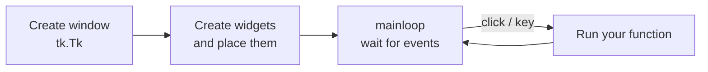

# Session 06: GUI Programming with Tkinter

> Module: Application Based Programming in Python · Term 5 (ADSE) · ⏱ ~2 hours

So far our programs have talked to the user through the terminal. Most people, however, expect **windows, buttons and text boxes**. In this session you will build desktop apps with **Tkinter**, the GUI toolkit that ships with Python, so there is nothing extra to install.

## 🎯 Learning Objectives

By the end of this session you will be able to:

- Explain what a GUI is and why Tkinter is a good first GUI library
- Create a main window and run the event loop
- Use common widgets (Label, Entry, Button, Checkbutton, Radiobutton, Listbox, Frame) and set their properties
- Arrange widgets with the `pack()` and `grid()` layout managers
- Respond to clicks and key presses with `command=` and `bind()`
- Build a small complete application such as a BMI calculator

## 📖 Concepts Explained

### 1. CLI vs GUI

| Command-line program (CLI) | Graphical program (GUI) |
|----------------------------|-------------------------|
| Runs top to bottom, then ends | Opens a window and **waits** for the user |
| Uses `input()` and `print()` | Uses text boxes, buttons, labels |
| The program decides the order | The **user** decides the order (event-driven) |

### 2. What is Tkinter?

**Tkinter** ("Tk interface") is Python's standard library for desktop windows. It works on Windows, macOS and Linux. It is simple, which makes it ideal for learning, for tools used inside an office, and for quick front-ends to a database (Session 08).

Other options you may hear about: **PyQt / PySide** (powerful, larger), **Kivy** (touch apps), **CustomTkinter** (modern look built on Tkinter).

> **Linux tip:** if `import tkinter` fails, install the Tk package, e.g. `sudo apt install python3-tk`. On Windows and macOS, the python.org installer already includes it.

### 3. The three steps of every Tkinter app



**Analogy:** `mainloop()` is a shopkeeper sitting at the counter. Nothing happens until a customer (an event) arrives, then the shopkeeper serves them (calls your function) and waits again.

### 4. Widgets and their properties

A **widget** is any element on the window. The first argument is always the **parent** (where it lives).

| Widget | Purpose | Useful properties / methods |
|--------|---------|-----------------------------|
| `Label` | Show text or an image | `text`, `fg`, `bg`, `font`, `textvariable` |
| `Entry` | One line of input | `width`, `show="*"`, `.get()`, `.delete(0, tk.END)` |
| `Button` | Run a function on click | `text`, `command`, `width`, `state` |
| `Checkbutton` | Yes/no option | `variable=BooleanVar()` |
| `Radiobutton` | One choice from a group | shared `variable`, `value` |
| `Listbox` | A list of items | `.insert()`, `.curselection()`, `.get()` |
| `Text` | Multi-line text | `.get("1.0", tk.END)` |
| `Frame` | A box that groups widgets | used as a parent |
| `messagebox` | Pop-up dialogs | `showinfo`, `showerror`, `askyesno` |

You set properties when you **create** a widget (`tk.Label(window, text="Hi")`) or **later** with `.config(text="Bye")`.

### 5. Tkinter variables

`StringVar`, `IntVar`, `DoubleVar` and `BooleanVar` are "live" variables. Connect one to a widget and the screen updates automatically when you call `.set()`.

### 6. Layout managers

| Manager | How it places widgets | Best for |
|---------|-----------------------|----------|
| `pack()` | One after another (top to bottom, or `side="left"`) | Simple stacks |
| `grid()` | Rows and columns like a table | Forms |
| `place()` | Exact x/y pixels | Rare, special cases |

**Rule:** do not mix `pack()` and `grid()` inside the **same** parent. Use a `Frame` if you need both.

Spacing options: `padx`, `pady` (outer space), `sticky="w"` (align left inside a grid cell), `columnspan` (stretch across columns).

### 7. Events

- `command=function_name` on a Button: called on click (no brackets, we pass the function itself).
- `widget.bind("<Return>", handler)`: connect any event. Common events: `<Button-1>` (left click), `<Return>` (Enter key), `<KeyPress>`, `<space>`.

## 💻 Code Examples

Run each file with `python file_name.py`. A window opens; close it to end the program.

### Example 1: First window (`tk_hello.py`)

```python
import tkinter as tk

window = tk.Tk()
window.title("My First GUI")
window.geometry("300x150")

label = tk.Label(window, text="Hello from Tkinter!", font=("Arial", 14))
label.pack(pady=40)

window.mainloop()
```

**How it works:** `tk.Tk()` creates the window, the Label is placed with `pack()`, and `mainloop()` keeps the window open.

### Example 2: Widget tour (`tk_widgets.py`)

A form with an Entry, a Checkbutton, two Radiobuttons, a Listbox and a Button. The key part:

```python
def show_details():
    selected = courses.curselection()
    course = courses.get(selected[0]) if selected else "none"
    result.config(text=f"{name_entry.get()} | {gender.get()} | "
                       f"Python fan: {likes_python.get()} | {course}")

tk.Button(window, text="Show", width=12, command=show_details).pack(pady=5)
```

**How it works:** each widget stores its value (`.get()` on Entry and variables, `.curselection()` on Listbox). The Button calls `show_details`, which updates the result Label with `.config()`.

### Example 3: Grid layout login form (`tk_layouts.py`)

```python
tk.Label(window, text="Username:").grid(row=0, column=0, padx=8, pady=8, sticky="w")
user_entry = tk.Entry(window)
user_entry.grid(row=0, column=1, padx=8)

pass_entry = tk.Entry(window, show="*")
```

**How it works:** `grid()` places labels in column 0 and entries in column 1, giving a neat form. `show="*"` hides the password.

### Example 4: Events and live variables (`tk_counter.py`)

```python
count = tk.IntVar(value=0)
tk.Label(window, textvariable=count, font=("Arial", 32)).pack(pady=10)

def add_one():
    count.set(count.get() + 1)

window.bind("<space>", lambda event: add_one())
```

**How it works:** the Label shows `count` through `textvariable`, so every `.set()` redraws it. `bind()` makes the space bar work like the +1 button.

### Example 5: Complete app (`bmi_calculator.py`)

```python
def calculate_bmi(weight_kg, height_cm):
    height_m = height_cm / 100
    return round(weight_kg / (height_m ** 2), 1)

def on_calculate():
    try:
        weight = float(weight_entry.get())
        height = float(height_entry.get())
    except ValueError:
        messagebox.showerror("Input error", "Please type numbers only.")
        return
    bmi = calculate_bmi(weight, height)
    result_label.config(text=f"BMI: {bmi}  ({bmi_category(bmi)})")
```

**How it works:** the maths lives in plain functions (easy to test), while `on_calculate` only reads the boxes, handles bad input with a message box, and shows the result. Keeping logic and GUI separate is a good habit.

## 🧪 Lab Practice

1. Change `tk_hello.py` so the label is blue on a light-yellow background and the window cannot be resized.
2. In `tk_counter.py`, add a **−1** button that never goes below zero.
3. Add an **Email** row to `tk_layouts.py` and a **Clear** button that empties all boxes with `.delete(0, tk.END)`.
4. Make `bmi_calculator.py` also calculate when the user presses **Enter** (`window.bind("<Return>", ...)`).
5. Build a **temperature converter**: one Entry, two Radiobuttons (C→F, F→C) and a Convert button.

## 📝 Assignment

Build a **To-Do List** desktop app: an Entry to type a task, an **Add** button that inserts it into a Listbox, a **Delete** button that removes the selected task, and a Label that shows the number of tasks. Show an error with `messagebox` if the user adds an empty task.

## ❓ Quick Quiz

1. Which method keeps a Tkinter window open and listening for events?
2. Which widget would you use for a password box, and which property hides the text?
3. What is the difference between `pack()` and `grid()`?
4. How do you change a Label's text after it is created?
5. Why do we write `command=add_one` and not `command=add_one()`?

<details>
<summary>Show answers</summary>

1. `mainloop()`
2. `Entry` with `show="*"`
3. `pack()` stacks widgets one after another; `grid()` places them in rows and columns
4. `label.config(text="new text")` (or use a `StringVar` with `textvariable`)
5. We pass the function so Tkinter can call it later on click; `add_one()` would run it immediately once

</details>

## 💼 Interview Questions

1. **What does "event-driven programming" mean?** — The program waits in a loop and reacts to events (clicks, key presses, timers) by calling handler functions, instead of running in a fixed order.
2. **Why should a long task not run directly inside a button handler?** — It blocks `mainloop()`, so the window freezes. Long work should run in a thread or be split up with `window.after()`.
3. **How would you keep GUI code maintainable?** — Separate the logic (pure functions or classes) from the widgets, group widgets in Frames, and for bigger apps wrap the window in a class.

## ✅ Summary

- Tkinter is Python's built-in GUI library: window → widgets → `mainloop()`.
- Widgets have properties set at creation or with `.config()`.
- `pack()` stacks, `grid()` builds forms; do not mix them in one parent.
- Buttons use `command=`; any event can be handled with `bind()`.
- Keep calculations in plain functions and let the GUI only read inputs and show results.

---

[⬅ Previous](../Session-05-Flask-and-Web-Scraping/README.md) · [🏠 Module Home](../README.md) · [Next ➡](../Session-07-Practice-Lab-Files-Web-and-GUI/README.md)

Prepared by Zeeshan Abbas · Aptech Learning North Nazimabad
