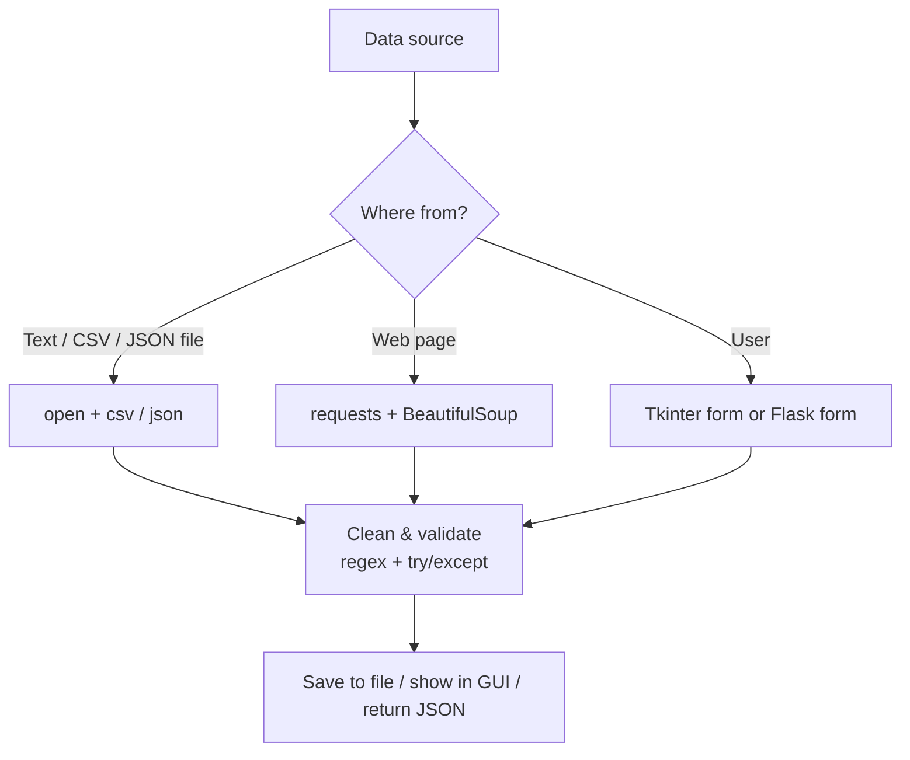

# Session 07: Practice Lab — Files, Web and GUI

> Module: Application Based Programming in Python · Term 5 (ADSE) · ⏱ ~2 hours

This lab session brings together Sessions 04 to 06: **files, exceptions, regular expressions, Flask, web scraping and Tkinter**. You will build six small programs. Each one is short and focuses on one skill, so you can finish it, run it, and then extend it.

## 🎯 Learning Objectives

By the end of this session you will be able to:

- Read, process and write text, CSV and JSON files safely
- Validate input with regular expressions and your own exception class
- Build and test a small JSON API with Flask
- Turn HTML data into a CSV file with BeautifulSoup
- Combine Tkinter widgets with file dialogs to build a useful desktop tool

## 📖 Concepts Explained

### 1. Quick revision map



Almost every real program follows this shape: **get data → check it → use it → save or show it**.

### 2. Revision table

| Skill | Key tools | Remember |
|-------|-----------|----------|
| Files | `with open(path, mode, encoding="utf-8")` | `"r"` read, `"w"` overwrite, `"a"` append |
| CSV | `csv.writer`, `csv.DictReader` | Use `newline=""` when writing |
| JSON | `json.load`, `json.dump` | Python dict ⇄ JSON object |
| Exceptions | `try / except / else / finally`, `raise` | Catch **specific** errors (`ValueError`), not everything |
| Custom exception | `class MyError(Exception): pass` | Gives clear meaning to your errors |
| Regex | `re.findall`, `re.fullmatch`, `re.sub`, `re.split` | Use raw strings `r"..."` |
| Flask | `@app.route`, `request.get_json()`, `jsonify` | Return `(data, status_code)` |
| Scraping | `find`, `find_all`, `.text` | Prefer APIs; be polite |
| Tkinter | widgets, `grid/pack`, `command`, `mainloop` | Keep logic in functions |

### 3. Writing your own exception

A custom exception is a class that inherits from `Exception`. It makes your error messages meaningful and lets the caller catch **only** that kind of problem:

```python
class InvalidDataError(Exception):
    """Our own exception type for bad user data."""

raise InvalidDataError("mobile number is wrong")
```

### 4. HTTP status codes used in APIs

| Code | Meaning | When we return it |
|------|---------|-------------------|
| 200 | OK | Data returned |
| 201 | Created | A new note was saved |
| 400 | Bad Request | Required data is missing |
| 404 | Not Found | The item does not exist |

## 💻 Code Examples

All files are in this folder. Run them with `python file_name.py`. Labs 4 and 5 need `pip install flask beautifulsoup4`.

### Lab 1: Word counter (`lab1_word_counter.py` + `story.txt`)

```python
words = re.findall(r"[a-z]+", text.lower())
counts = {}
for word in words:
    counts[word] = counts.get(word, 0) + 1
top_words = sorted(counts.items(), key=lambda pair: pair[1], reverse=True)[:5]
```

**How it works:** the file is read inside `try` (in case it is missing), regex keeps only letters (tokenising), a dictionary counts each word, and `sorted` with `reverse=True` gives the most common words first.

### Lab 2: Contact validator (`lab2_contact_validator.py`)

```python
def check_mobile(mobile):
    if not re.fullmatch(r"03\d{2}-\d{7}", mobile):
        raise InvalidDataError(f"'{mobile}' should look like 0300-1234567")
    return mobile
```

**How it works:** each check function raises our own `InvalidDataError` with a helpful message. The loop at the bottom catches it, so one bad record does not stop the program.

### Lab 3: Expense logger (`lab3_expense_logger.py`)

```python
is_new_file = not os.path.exists(FILE_NAME)
with open(FILE_NAME, "a", newline="", encoding="utf-8") as file:
    writer = csv.writer(file)
    if is_new_file:
        writer.writerow(["item", "amount"])
    writer.writerow([item, amount])
```

**How it works:** append mode `"a"` adds rows without deleting old ones; the header is written only the first time. When totalling, a bad amount (`"abc"`) raises `ValueError`, which we catch and skip.

### Lab 4: Notes API with Flask (`lab4_notes_api.py` + `test_notes_api.py`)

```python
@app.route("/notes", methods=["POST"])
def add_note():
    data = request.get_json()
    if not data or not data.get("text"):
        return jsonify({"error": "text is required"}), 400
    notes = load_notes()
    note = {"id": len(notes) + 1, "text": data["text"]}
    notes.append(note)
    save_notes(notes)
    return jsonify(note), 201
```

**How it works:** GET `/notes` returns all notes; POST `/notes` checks the body, saves the note in `notes.json` and returns status 201. Run `python test_notes_api.py` to test it without a browser.

### Lab 5: HTML table to CSV (`lab5_scrape_to_csv.py`)

```python
rows = soup.find("table", id="results").find_all("tr")
for row in rows[1:]:
    cells = [td.text for td in row.find_all("td")]
    data.append({"student": cells[0], "marks": int(cells[1])})
```

**How it works:** BeautifulSoup finds the table by its `id`, skips the header row, and builds a list of dictionaries that `csv.DictWriter` saves.

### Lab 6: Mini notepad (`lab6_tk_notepad.py`)

```python
def open_file():
    path = filedialog.askopenfilename(filetypes=[("Text files", "*.txt")])
    if not path:
        return
    with open(path, "r", encoding="utf-8") as file:
        text_box.delete("1.0", tk.END)
        text_box.insert("1.0", file.read())
```

**How it works:** a `Text` widget holds many lines. `filedialog` shows the normal Open/Save windows; an empty path means the user cancelled. A `Menu` adds **File → Open / Save / Exit**.

## 🧪 Lab Practice

1. **Lab 1:** ignore common words such as "is", "a", "the" (put them in a set called `stop_words`).
2. **Lab 2:** add a `check_cnic()` function for the format `42101-1234567-1`.
3. **Lab 3:** print the most expensive item, and let the user type new expenses with `input()` until they type `q`.
4. **Lab 4:** add `DELETE /notes/<int:note_id>` that removes a note or returns 404.
5. **Lab 6:** add a status Label that shows the number of words in the text box when you press a **Count** button.

## 📝 Assignment

Create **Student Marks Manager** (desktop): a Tkinter form with Name and Marks fields and an **Add** button that appends the record to `marks.csv` (validate that marks are a whole number 0–100 with a custom exception). A **Report** button reads the CSV and shows the class average and the top student in a message box.

## ❓ Quick Quiz

1. Which file mode adds to the end of a file without deleting it?
2. What does `re.fullmatch()` check that `re.search()` does not?
3. Which status code should an API return after creating a new item?
4. How do you create your own exception type?
5. What does `filedialog.askopenfilename()` return if the user clicks Cancel?

<details>
<summary>Show answers</summary>

1. `"a"` (append)
2. That the **whole** string matches the pattern, not just a part of it
3. `201 Created`
4. Write a class that inherits from `Exception`, e.g. `class InvalidDataError(Exception): pass`
5. An empty string `""`

</details>

## 💼 Interview Questions

1. **Why use `with open(...)` instead of `open()` and `close()`?** — The `with` block closes the file automatically, even if an error happens inside it, which prevents locked or half-written files.
2. **When would you store data in JSON instead of CSV?** — JSON suits nested or varied data (objects inside lists) and web APIs; CSV suits flat tables that open in Excel.
3. **How do you test a Flask API without running a server?** — Use `app.test_client()` to send fake GET/POST requests and check the status codes and JSON responses (or use `pytest` with it).

## ✅ Summary

- Real programs follow one pattern: get data, validate it, use it, save or show it.
- `with open`, `csv` and `json` handle files; `try/except` and custom exceptions handle bad data.
- Regex validates formats like emails, mobiles and CNICs.
- Flask builds JSON APIs; `test_client()` tests them.
- BeautifulSoup extracts tables; Tkinter plus `filedialog` builds handy desktop tools.

---

[⬅ Previous](../Session-06-GUI-Programming-with-Tkinter/README.md) · [🏠 Module Home](../README.md) · [Next ➡](../Session-08-Database-Integration-with-Python/README.md)

Prepared by Zeeshan Abbas · Aptech Learning North Nazimabad
