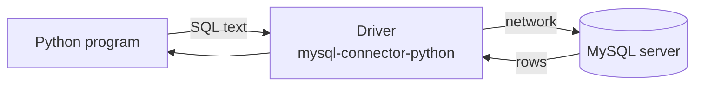

# Session 08: Database Integration with Python

> Module: Application Based Programming in Python · Term 5 (ADSE) · ⏱ ~2 hours

Files are fine for small data, but real applications (a school system, a shop, a hospital) keep their data in a **database**. In this session you connect Python to **MySQL**, create a database and table from the MySQL command line, run Insert/Update/Delete/Select queries from Python, and finally put a **Tkinter** front-end on top of it.

## 🎯 Learning Objectives

By the end of this session you will be able to:

- Explain what database connectivity means and how a Python driver works
- Create a database, a table and a user with the MySQL command-line client
- Connect to MySQL from Python using `mysql-connector-python`
- Run safe parameterised INSERT, UPDATE, DELETE and SELECT queries
- Build a Tkinter application that manages records in a database
- Practise the same ideas with SQLite when no server is available

## 📖 Concepts Explained

### 1. Why a database?

| Text/CSV file | Database (MySQL) |
|---------------|------------------|
| Whole file is read to find one record | Finds records fast with indexes and `WHERE` |
| One program at a time | Many users at the same time |
| No rules on data | Data types, `NOT NULL`, primary keys |
| Easy to corrupt | Transactions: changes are saved fully or not at all |

### 2. How Python talks to MySQL

Python cannot speak to MySQL by itself. A **driver** (connector library) does the talking. Python defines a standard way for drivers to work (the **DB-API**, PEP 249), so the steps are the same for MySQL, SQLite and PostgreSQL.



**The five steps of every database program:**

1. **Connect** — `connection = mysql.connector.connect(host, user, password, database)`
2. **Cursor** — `cursor = connection.cursor()` (the "pen" that writes SQL and reads results)
3. **Execute** — `cursor.execute(sql, values)`
4. **Commit or fetch** — `connection.commit()` for changes; `fetchall()` / `fetchone()` for reads
5. **Close** — `cursor.close()` and `connection.close()`

**Analogy:** the connection is a phone call to the database; the cursor is the conversation you have during that call; `commit()` is saying "yes, finalise my order".

### 3. Setting up MySQL

1. Install **MySQL Community Server** (and optionally MySQL Workbench) from the official site.
2. Open the command-line client: `mysql -u root -p` and type your root password.
3. Run the script in this folder: `SOURCE create_database.sql;`
4. Install the driver in your virtual environment: `pip install mysql-connector-python`

Useful MySQL CLI commands:

| Command | Purpose |
|---------|---------|
| `SHOW DATABASES;` | List databases |
| `CREATE DATABASE college;` | Make a new database |
| `USE college;` | Select it |
| `SHOW TABLES;` / `DESCRIBE students;` | List tables / see columns |
| `EXIT;` | Leave the client |

### 4. CRUD and SQL

| Operation | SQL | Python method after execute |
|-----------|-----|------------------------------|
| **C**reate | `INSERT INTO ... VALUES (...)` | `commit()`, `cursor.lastrowid` |
| **R**ead | `SELECT ... FROM ... WHERE ...` | `fetchall()`, `fetchone()` |
| **U**pdate | `UPDATE ... SET ... WHERE ...` | `commit()`, `cursor.rowcount` |
| **D**elete | `DELETE FROM ... WHERE ...` | `commit()`, `cursor.rowcount` |

> ⚠️ Always write a `WHERE` in UPDATE and DELETE, otherwise **every** row changes.

### 5. SQL injection and placeholders

Never build SQL by joining strings with user input:

```python
# DANGEROUS - a user could type:  1 OR 1=1
cursor.execute(f"DELETE FROM students WHERE id = {user_input}")
# SAFE - the driver escapes the value
cursor.execute("DELETE FROM students WHERE id = %s", (user_input,))
```

MySQL's connector uses `%s`; SQLite uses `?`. Note the comma in `(user_input,)` — values must be a **tuple**.

### 6. SQLite: a database in a file

**SQLite** comes with Python (`import sqlite3`). There is no server or password; the whole database is one `.db` file. It is used inside mobile apps and is perfect for practice. The code is almost identical to MySQL.

## 💻 Code Examples

### Example 1: Create the database (`create_database.sql`)

```sql
CREATE DATABASE IF NOT EXISTS college;
USE college;
CREATE TABLE IF NOT EXISTS students (
    id      INT AUTO_INCREMENT PRIMARY KEY,
    name    VARCHAR(50)  NOT NULL,
    course  VARCHAR(30)  NOT NULL,
    marks   INT          DEFAULT 0
);
```

**How it works:** `AUTO_INCREMENT PRIMARY KEY` gives every student a unique number automatically. The script also inserts sample rows and creates a `student_app` user for Python.

### Example 2: Connect and read (`mysql_connect.py`)

```python
connection = mysql.connector.connect(
    host="localhost", user="student_app", password="Pass@1234", database="college",
)
cursor = connection.cursor()
cursor.execute("SELECT id, name, course, marks FROM students")
for student_id, name, course, marks in cursor.fetchall():
    print(f"{student_id:<3} {name:<10} {course:<8} {marks}")
```

**How it works:** each row comes back as a tuple, which we unpack into four variables. The real file wraps this in `try/except Error/finally` so the connection is always closed.

### Example 3: CRUD from Python (`mysql_crud.py`)

```python
cursor.execute(
    "INSERT INTO students (name, course, marks) VALUES (%s, %s, %s)",
    ("Zara", "Dart", 75),
)
connection.commit()
new_id = cursor.lastrowid
cursor.execute("UPDATE students SET marks = %s WHERE id = %s", (81, new_id))
connection.commit()
```

**How it works:** placeholders keep the query safe, `commit()` saves the change, `lastrowid` gives the new id, and `rowcount` tells how many rows were affected.

### Example 4: Practise offline with SQLite (`sqlite_crud.py`)

```python
connection = sqlite3.connect("college.db")
cursor.executemany("INSERT INTO students (name, course, marks) VALUES (?, ?, ?)", students)
cursor.execute("SELECT AVG(marks) FROM students")
print("Average marks:", cursor.fetchone()[0])
```

**How it works:** same five steps, but no server. `executemany` inserts a whole list in one call. Output: two students and `Average marks: 80.0`.

### Example 5: Tkinter + MySQL app (`tk_student_crud.py`)

```python
def run_query(sql, values=()):
    connection = mysql.connector.connect(**DB_SETTINGS)
    cursor = connection.cursor()
    cursor.execute(sql, values)
    rows = cursor.fetchall() if sql.strip().upper().startswith("SELECT") else None
    connection.commit()
    cursor.close()
    connection.close()
    return rows
```

**How it works:** one helper runs any query. The buttons **Add / Update / Delete / Refresh** call it with the right SQL. Clicking a row in the Listbox (`<<ListboxSelect>>`) copies its values into the form so you can edit or delete it.

## 🧪 Lab Practice

1. Run `create_database.sql` in the MySQL client and check the data with `SELECT * FROM students;`.
2. Add a `city` column (`ALTER TABLE students ADD city VARCHAR(30);`) and update two students from Python.
3. Write `search_by_course.py` that asks for a course name and prints matching students.
4. In `sqlite_crud.py`, print the highest and lowest marks with `MAX()` and `MIN()`.
5. Add a **Search** Entry and button to `tk_student_crud.py` that filters the Listbox by name (`WHERE name LIKE %s` with `f"%{text}%"`).

## 📝 Assignment

Build a **Library Book Manager** with Tkinter and MySQL (or SQLite): a `books` table (id, title, author, year, available). The app must add, update, delete and list books, mark a book as issued/returned, and show the count of available books in a Label.

## ❓ Quick Quiz

1. Which library connects Python to MySQL in this session?
2. What does `connection.commit()` do?
3. Which placeholder does MySQL Connector use, and which does SQLite use?
4. What is the risk of an UPDATE without a WHERE clause?
5. Which cursor method returns only the next single row?

<details>
<summary>Show answers</summary>

1. `mysql-connector-python` (`import mysql.connector`)
2. Permanently saves INSERT/UPDATE/DELETE changes to the database
3. MySQL: `%s`; SQLite: `?`
4. Every row in the table is changed
5. `fetchone()`

</details>

## 💼 Interview Questions

1. **What is SQL injection and how do you prevent it in Python?** — It is when user input changes the meaning of a SQL query. Prevent it with parameterised queries (placeholders), never string formatting.
2. **What is a transaction?** — A group of changes treated as one unit: either all are saved with `commit()` or all are undone with `rollback()`, keeping data consistent.
3. **When would you choose SQLite over MySQL?** — For single-user, embedded or mobile apps, prototypes and tests; MySQL suits multi-user web or office systems needing a server.

## ✅ Summary

- Python uses a driver (DB-API) to talk to databases: connect → cursor → execute → commit/fetch → close.
- The MySQL CLI creates databases, tables and users.
- Use placeholders (`%s` / `?`) for every value to stay safe from SQL injection.
- Tkinter + a small `run_query` helper is enough for a full CRUD desktop app.
- SQLite lets you practise the same code without a server.

---

[⬅ Previous](../Session-07-Practice-Lab-Files-Web-and-GUI/README.md) · [🏠 Module Home](../README.md) · [Next ➡](../Session-09-Data-Handling-with-Pandas/README.md)

Prepared by Zeeshan Abbas · Aptech Learning North Nazimabad
