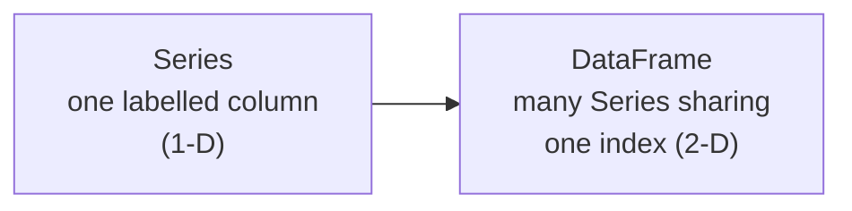

# Session 09: Data Handling with Pandas

> Module: Application Based Programming in Python · Term 5 (ADSE) · ⏱ ~2 hours

Every AI or data project starts with **data in a table**: sales, marks, sensor readings, survey answers. **Pandas** is the Python library that loads, cleans, filters and summarises tables with a few lines of code. Think of it as **Excel inside Python**, but faster and repeatable.

## 🎯 Learning Objectives

By the end of this session you will be able to:

- Describe what Pandas is and why data analysts and ML engineers use it
- Create and use the two Pandas data structures: **Series** and **DataFrame**
- Load a CSV file and explore it with `head`, `info`, `describe` and `value_counts`
- Select, filter and sort data with `[]`, `loc`, `iloc` and conditions
- Clean data: missing values, duplicates, types and dates; summarise with `groupby`
- Process text columns with the `.str` functions

## 📖 Concepts Explained

### 1. What is Pandas?

**Pandas** is an open-source library built on top of **NumPy**. It gives Python labelled, table-shaped data and hundreds of ready-made functions for reading, cleaning and analysing it.

| Task | Plain Python | Pandas |
|------|--------------|--------|
| Read a CSV | `csv` module + loops | `pd.read_csv("file.csv")` |
| Average of a column | Loop and add | `df["marks"].mean()` |
| Filter rows | `for` + `if` | `df[df["marks"] > 70]` |
| Group totals | Dictionary logic | `df.groupby("city")["total"].sum()` |

Install it with `pip install pandas` and import it with the standard nickname: `import pandas as pd`.

### 2. The two data structures



| Structure | Shape | Like... | Create with |
|-----------|-------|---------|-------------|
| **Series** | 1-D | A single Excel column with row labels | `pd.Series([..], index=[..])` |
| **DataFrame** | 2-D | A whole Excel sheet | `pd.DataFrame({"col": [..]})` |

The **index** is the set of row labels (0, 1, 2… by default). Every column of a DataFrame is a Series.

### 3. Exploring data

| Function | Shows |
|----------|-------|
| `df.head(n)` / `df.tail(n)` | First / last rows |
| `df.shape` | `(rows, columns)` |
| `df.info()` | Column types and **non-null counts** (reveals missing data) |
| `df.describe()` | Count, mean, std, min, quartiles, max |
| `df["col"].value_counts()` | How many times each value appears |
| `df["col"].unique()` | Distinct values |

### 4. Selecting data

| Syntax | Meaning |
|--------|---------|
| `df["price"]` | One column (Series) |
| `df[["city", "price"]]` | Several columns (DataFrame) — note double brackets |
| `df.loc[0:2, ["product"]]` | By **labels**; the end label is included |
| `df.iloc[0:2, 0:3]` | By **positions**; the end position is excluded |
| `df[df["city"] == "Karachi"]` | Rows where the condition is True |
| `(cond1) & (cond2)`, `(cond1) | (cond2)` | AND / OR — brackets are required |

### 5. Data manipulation functions

| Problem | Function |
|---------|----------|
| Find missing values | `df.isnull().sum()` |
| Fill or remove missing values | `fillna(value)`, `dropna()` |
| Duplicate rows | `duplicated()`, `drop_duplicates()` |
| Change a type | `astype(int)`, `pd.to_datetime()` |
| New column | `df["total"] = df["qty"] * df["price"]` |
| Sort | `sort_values("col", ascending=False)` |
| Summarise by group | `groupby("col").agg(...)` |
| Save | `to_csv("file.csv", index=False)` |

**Analogy for `groupby`:** put all orders into separate baskets by city, then add up each basket.

### 6. Text processing with `.str`

Text columns have a `.str` accessor that applies string methods to every value at once: `strip()`, `lower()`, `upper()`, `title()`, `len()`, `contains()`, `replace()`, `split()`, and slicing like `.str[:3]`. This is how you clean messy names, emails and product titles before analysis.

## 💻 Code Examples

Run each file inside this folder (it uses `sales.csv`, which has a few missing values, a duplicate row and messy names on purpose).

### Example 1: Series (`series_basics.py`)

```python
marks = pd.Series([78, 92, 65, 88], index=["Ali", "Sara", "Usman", "Hira"])
print("Sara:", marks["Sara"])
print(marks + 5)
print(marks[marks >= 70])
print("Top student:", marks.idxmax())
```

**How it works:** labels make values easy to find; `marks + 5` adds to every value without a loop (vectorised); a condition inside `[]` filters.

### Example 2: DataFrame (`dataframe_basics.py`)

```python
df = pd.DataFrame({"name": ["Ali", "Sara", "Usman", "Hira"],
                   "course": ["Python", "Flutter", "Python", "Dart"],
                   "marks": [78, 92, 65, 88]})
df["passed"] = df["marks"] >= 70
df = pd.concat([df, new_row], ignore_index=True)
```

**How it works:** each dictionary key becomes a column. A new column is calculated from another; `pd.concat` adds a row.

### Example 3: Explore a CSV (`explore_csv.py`)

```python
df = pd.read_csv("sales.csv")
print(df.head())
df.info()
print(df.describe())
print(df["city"].value_counts())
```

**How it works:** `info()` shows 10 non-null quantities out of 11 rows, which tells us data is missing.

### Example 4: Select, filter, sort (`select_filter_sort.py`)

```python
big_laptops = df[(df["product"] == "Laptop") & (df["price"] > 150000)]
print(df[df["city"].isin(["Lahore", "Islamabad"])])
print(df.sort_values("price", ascending=False).head(3))
```

**How it works:** each condition gives a True/False Series; `&` combines them and only True rows are kept.

### Example 5: Clean and group (`clean_and_group.py`)

```python
df = df.drop_duplicates()
df["quantity"] = df["quantity"].fillna(1)
df["price"] = df["price"].fillna(df["price"].median())
df["total"] = df["quantity"] * df["price"]
summary = df.groupby("product").agg(orders=("order_id", "count"),
                                    revenue=("total", "sum"))
```

**How it works:** we remove the repeated order, fill gaps with sensible values, calculate totals, then summarise per product. The clean data is saved as `sales_clean.csv`.

### Example 6: Text processing (`text_processing.py`)

```python
df["customer"] = df["customer"].str.strip().str.title()
df[["first_name", "last_name"]] = df["customer"].str.split(" ", n=1, expand=True)
print(df[df["customer"].str.contains("ali", case=False)])
```

**How it works:** `" ali khan "` becomes `"Ali Khan"`, then splits into two new columns. `contains(case=False)` searches ignoring capitals.

## 🧪 Lab Practice

1. Create a Series of 7 daily temperatures with day names as the index; print the hottest day and days above 35.
2. From `sales.csv`, show only orders from Karachi with quantity of 2 or more.
3. Find the total revenue per **day** (group by `date`) after cleaning.
4. Add a column `category` that is `"High"` when total > 50000 else `"Low"` (hint: `df["total"].apply(lambda t: ...)`).
5. Make all product names upper case and count how many customer names have more than 10 letters.

## 📝 Assignment

Download (or create) a CSV of at least 30 students with columns `name, gender, course, attendance, marks`, leaving some values blank. Write `student_analysis.py` that cleans the data, adds a `grade` column (A/B/C/F), and prints: average marks per course, the top 3 students, the attendance-vs-pass rate per course, and saves the clean file.

## ❓ Quick Quiz

1. What are the two main data structures in Pandas?
2. What is the difference between `loc` and `iloc`?
3. Which function shows the number of missing values in each column?
4. Why do we need brackets around each condition when using `&`?
5. Which accessor lets you use string methods on a whole column?

<details>
<summary>Show answers</summary>

1. Series (1-D) and DataFrame (2-D)
2. `loc` selects by labels (end included); `iloc` selects by integer positions (end excluded)
3. `df.isnull().sum()`
4. `&` has higher priority than `==` and `>`, so without brackets Python evaluates the wrong part first
5. `.str`

</details>

## 💼 Interview Questions

1. **How do you handle missing data in Pandas?** — First measure it with `isnull().sum()`. Then drop rows/columns with `dropna()` if few values are missing, or fill them with `fillna()` using a constant, the mean/median, or the previous value, depending on the meaning of the column.
2. **What is the difference between `apply()` and vectorised operations?** — Vectorised operations (`df["a"] * 2`) run in fast compiled code over the whole column; `apply()` calls a Python function row by row, which is flexible but slower.
3. **What does `groupby` do?** — It splits the data into groups by one or more keys, applies a function (sum, mean, count) to each group, and combines the results into a new table (split-apply-combine).

## ✅ Summary

- Pandas = labelled tables in Python; import it as `pd`.
- Series is one column; DataFrame is a table of Series.
- Explore with `head`, `info`, `describe`, `value_counts`.
- Select with `[]`, `loc`, `iloc`; filter with conditions joined by `&` and `|`.
- Clean with `drop_duplicates`, `fillna`, `astype`, `to_datetime`; summarise with `groupby`.
- Clean text with `.str` functions.

---

[⬅ Previous](../Session-08-Database-Integration-with-Python/README.md) · [🏠 Module Home](../README.md) · [Next ➡](../Session-10-Data-Visualization-and-ML-Data-Processing/README.md)

Prepared by Zeeshan Abbas · Aptech Learning North Nazimabad
