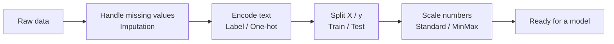
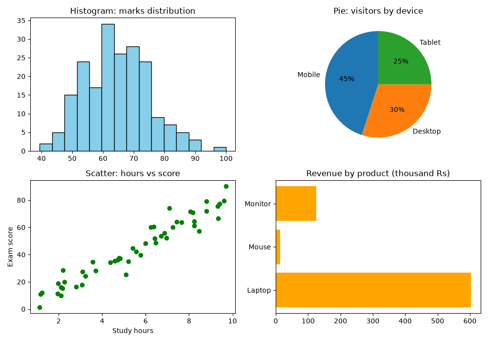
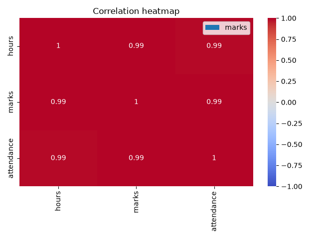

# Session 10: Data Visualization and Data Processing for Machine Learning

> Module: Application Based Programming in Python · Term 5 (ADSE) · ⏱ ~2 hours

A table of 10,000 numbers tells you very little; one good chart can tell the whole story. In the first half of this session you will **visualize** data with Matplotlib, Pandas and Seaborn. In the second half you will learn how to **prepare data for machine learning**: filling gaps, turning text into numbers, scaling and splitting.

## 🎯 Learning Objectives

By the end of this session you will be able to:

- Explain what data visualization is and why it matters
- Name the main Python visualization libraries and when to use each
- Draw line, bar, histogram, pie, scatter, box and heatmap charts
- Describe machine learning in one sentence and explain why raw data must be processed first
- Apply imputation, encoding, scaling and train/test splitting with scikit-learn

## 📖 Concepts Explained

### 1. What is data visualization?

**Data visualization** means showing data as pictures (charts, maps, graphs) so that patterns, trends and outliers are easy to spot. It is used to **explore** data (for you) and to **explain** results (for a manager or client).

### 2. Python visualization libraries

| Library | Strength | Typical use |
|---------|----------|-------------|
| **Matplotlib** | The foundation; full control over every detail | Any static chart, reports |
| **Pandas `.plot()`** | One-line charts directly from a DataFrame | Quick exploration |
| **Seaborn** | Beautiful statistical charts with little code | Distributions, correlations |
| **Plotly** | Interactive charts (zoom, hover) in the browser | Dashboards, web apps |

### 3. Choosing the right chart

| Question you want to answer | Chart |
|-----------------------------|-------|
| How does a value change over time? | **Line** |
| Which category is biggest? | **Bar** (horizontal bar for long names) |
| How are values spread out? | **Histogram** or **box plot** |
| What share does each part have of the whole? | **Pie** (only for a few parts) |
| Are two numbers related? | **Scatter** |
| Which columns move together? | **Heatmap** of correlations |

**Anatomy of a Matplotlib chart:** a **Figure** (the whole image) contains one or more **Axes** (individual plots). Each Axes has a title, x-label, y-label, legend and grid. `plt.subplots(2, 2)` creates a figure with four axes.

### 4. What is machine learning?

**Machine learning (ML)** is teaching a computer to find patterns in examples so it can make predictions on new data, instead of us writing every rule by hand. Example: from past customers' age and salary, predict whether a new customer will buy.

### 5. Why process data first?

ML algorithms do maths, so they need **clean, complete, numeric** data on a similar scale. Real data is messy. "Garbage in, garbage out."



| Technique | Problem it solves | scikit-learn / Pandas tool |
|-----------|-------------------|-----------------------------|
| **Imputation** | Empty cells | `SimpleImputer(strategy="mean")`, `fillna()` |
| **Label encoding** | Yes/No or ordered text (Low < Medium < High) | `map()`, `LabelEncoder`, `OrdinalEncoder` |
| **One-hot encoding** | Text with no order (cities) | `pd.get_dummies()`, `OneHotEncoder` |
| **Standardization** | Different scales; result has mean 0, std 1 | `StandardScaler` |
| **Normalization** | Squeeze values into 0–1 | `MinMaxScaler` |
| **Train/test split** | Check the model on data it has never seen | `train_test_split` |

**Why one-hot for cities?** If we write Karachi=0, Lahore=1, Islamabad=2, the model may think Islamabad is "bigger" than Karachi. One-hot gives each city its own 0/1 column, so no false order is created.

**Golden rule:** `fit` the scaler on the **training** data only, then `transform` the test data with the same scaler. Otherwise information from the test set "leaks" into training.

### 6. Python libraries for ML data processing

- **NumPy** — fast arrays and maths
- **Pandas** — loading and cleaning tables
- **scikit-learn** — imputers, encoders, scalers, splitting and the ML models themselves

Install them all: `pip install numpy pandas matplotlib seaborn scikit-learn`

## 💻 Code Examples

### Example 1: Line and bar charts (`line_and_bar.py`)

```python
plt.plot(months, sales_karachi, marker="o", label="Karachi")
plt.plot(months, sales_lahore, marker="s", linestyle="--", label="Lahore")
plt.title("Monthly Sales (thousand Rs)")
plt.xlabel("Month")
plt.ylabel("Sales")
plt.legend()
plt.savefig("line_chart.png")
plt.show()
```

**How it works:** each `plot` call draws one line; `label` + `legend()` names them. `savefig` stores a PNG, `show` opens a window. The second chart uses `plt.bar` and writes each value above its bar with `plt.text`.

### Example 2: Four charts in one figure (`more_charts.py`)

```python
fig, axes = plt.subplots(2, 2, figsize=(10, 7))
axes[0, 0].hist(marks, bins=15, color="skyblue", edgecolor="black")
axes[0, 1].pie([45, 30, 25], labels=["Mobile", "Desktop", "Tablet"], autopct="%1.0f%%")
axes[1, 0].scatter(study_hours, exam_score, color="green")
axes[1, 1].barh(["Laptop", "Mouse", "Monitor"], [603, 13, 125])
plt.tight_layout()
```

**How it works:** `axes[row, column]` picks one small chart. NumPy creates sample data with a fixed seed so you get the same picture every time.



### Example 3: Pandas and Seaborn (`pandas_seaborn_charts.py`)

```python
df.groupby("course")["marks"].mean().plot(kind="bar", title="Average marks per course")
sns.boxplot(data=df, x="course", y="marks")
sns.heatmap(df[["hours", "marks", "attendance"]].corr(), annot=True, cmap="coolwarm")
```

**How it works:** Pandas draws a bar chart from a grouped result in one line. Seaborn's box plot shows median and spread per course; the heatmap colours the correlation table (close to 1 = strongly related).



### Example 4: Preparing data for ML (`ml_data_processing.py`)

```python
imputer = SimpleImputer(strategy="mean")
df[["age", "salary"]] = imputer.fit_transform(df[["age", "salary"]])
df["bought"] = df["bought"].map({"no": 0, "yes": 1})
df = pd.get_dummies(df, columns=["city"], dtype=int)

X = df.drop(columns=["bought"])
y = df["bought"]
X_train, X_test, y_train, y_test = train_test_split(X, y, test_size=0.2, random_state=1)

scaler = StandardScaler()
X_train[["age", "salary"]] = scaler.fit_transform(X_train[["age", "salary"]])
X_test[["age", "salary"]] = scaler.transform(X_test[["age", "salary"]])
```

**How it works:** missing ages and salaries get the column mean; yes/no becomes 1/0; city becomes three 0/1 columns; data is split 80/20; and age and salary are standardised so neither dominates just because its numbers are bigger.

## 🧪 Lab Practice

1. Change `line_and_bar.py` to add a third city and a title font size of 14.
2. Draw a pie chart of your weekly time: study, sleep, travel, other.
3. Using `sales.csv` from Session 09, draw a bar chart of total revenue per city.
4. In `ml_data_processing.py`, replace mean imputation with `strategy="median"` and compare the values.
5. Add an `education` column with values `Matric < Inter < Bachelor < Master` and encode it with `map()` to 0–3 (ordered data).

## 📝 Assignment

Take any public CSV dataset (for example from Kaggle or data.gov) with at least one text column and some missing values. Produce **four** meaningful charts saved as PNG files, then write `prepare.py` that cleans and encodes the data, splits it 80/20 and scales the numeric columns. Write three lines in a `findings.md` file about what the charts show.

## ❓ Quick Quiz

1. Which chart is best to see the relationship between two numeric variables?
2. What does `plt.subplots(2, 3)` create?
3. Why is one-hot encoding preferred for a "city" column?
4. What is the difference between `StandardScaler` and `MinMaxScaler`?
5. Why do we call `scaler.transform()` and not `fit_transform()` on the test set?

<details>
<summary>Show answers</summary>

1. Scatter plot
2. A figure with 6 axes (2 rows × 3 columns)
3. Cities have no natural order; numbers 0/1/2 would create a false order
4. StandardScaler gives mean 0 and standard deviation 1; MinMaxScaler squeezes values into 0–1
5. The scaler must learn only from training data; fitting on test data leaks information

</details>

## 💼 Interview Questions

1. **What is data leakage?** — When information from outside the training set (such as the test set or the future) is used during training, making the model look better than it really is. Fitting scalers on the full dataset is a common cause.
2. **How do you handle a categorical feature with 500 unique values?** — One-hot would create 500 columns, so group rare values into "Other", use frequency or target encoding, or use models that handle categories natively.
3. **Matplotlib or Seaborn?** — Seaborn for quick, good-looking statistical charts; Matplotlib when you need full control. They work together, since Seaborn is built on Matplotlib.

## ✅ Summary

- Visualization turns numbers into insight: choose the chart that answers your question.
- Matplotlib is the base; Pandas and Seaborn give one-line charts on top of it.
- ML learns patterns from examples, but needs clean numeric data.
- Process data with imputation, encoding, splitting and scaling, fitting only on the training set.

---

[⬅ Previous](../Session-09-Data-Handling-with-Pandas/README.md) · [🏠 Module Home](../README.md) · [Next ➡](../Session-11-Types-of-Machine-Learning/README.md)

Prepared by Zeeshan Abbas · Aptech Learning North Nazimabad
