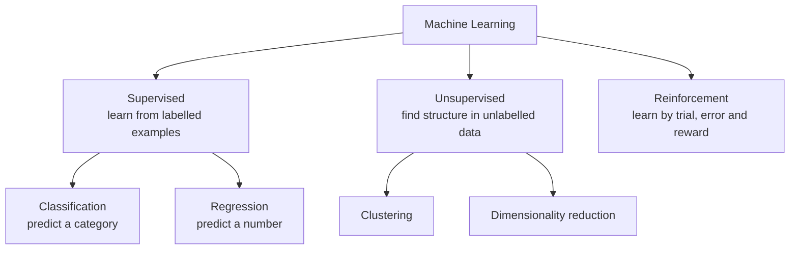
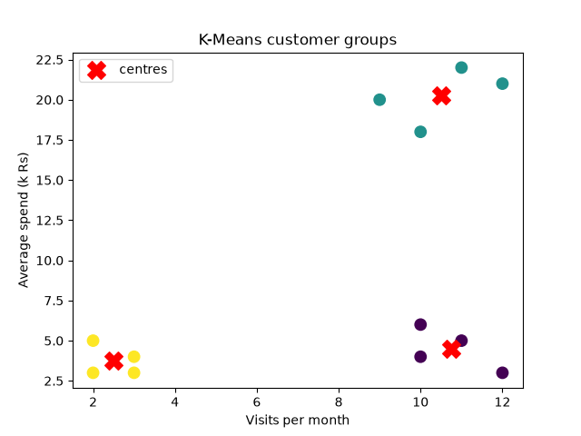

# Session 11: Types of Machine Learning in Python

> Module: Application Based Programming in Python · Term 5 (ADSE) · ⏱ ~2 hours

Machine learning is not one technique but a family. In this session you will meet the three main types — **supervised, unsupervised and reinforcement learning** — and write a tiny working example of each: **logistic regression** (supervised), **K-Means clustering** (unsupervised) and **Q-learning** (reinforcement).

## 🎯 Learning Objectives

By the end of this session you will be able to:

- Describe the three types of machine learning and give real examples of each
- Explain the difference between classification and regression problems
- Explain how logistic regression turns inputs into a probability with the sigmoid function
- Train a logistic regression model with scikit-learn and make predictions
- Group unlabelled data with the K-Means clustering algorithm
- Explain agent, environment, action and reward in reinforcement learning

## 📖 Concepts Explained

### 1. The three types at a glance



| Type | Data | Goal | Real examples |
|------|------|------|---------------|
| **Supervised** | Inputs **with** correct answers (labels) | Predict the label for new inputs | Spam filter, loan approval, house price |
| **Unsupervised** | Inputs **without** labels | Discover groups or patterns | Customer segments, topic grouping |
| **Reinforcement** | No dataset; an environment gives rewards | Learn the best actions | Game AI, robot walking, ad bidding |

**Classroom analogy:**
- Supervised = a teacher gives worksheets **with** an answer key.
- Unsupervised = you sort a box of mixed stationery into groups on your own.
- Reinforcement = learning to ride a bicycle: falling hurts (negative reward), balancing feels good (positive reward).

### 2. Classification vs regression (both supervised)

| | Classification | Regression |
|-|----------------|------------|
| Output | A **category** (pass/fail, spam/not spam) | A **number** (price, temperature) |
| Example algorithm | Logistic regression, decision tree | Linear regression |

> Do not be confused by the name: **logistic regression is a classification algorithm.**

### 3. Logistic regression

1. It multiplies each input by a learned **weight**, adds them with a **bias**: `z = w1·hours + w2·attendance + b`.
2. It passes `z` through the **sigmoid** function: `p = 1 / (1 + e^(-z))`, which always gives a value between 0 and 1.
3. If `p ≥ 0.5` it predicts class 1 (pass), otherwise class 0 (fail).

Training (`fit`) means finding the weights that make the predicted probabilities match the real labels as closely as possible.

### 4. K-Means clustering

K-Means splits data into **K** groups:

1. Pick K random **centres** (centroids).
2. Assign every point to its **nearest** centre.
3. Move each centre to the **average** of its points.
4. Repeat steps 2–3 until the centres stop moving.

You must choose K yourself (Session 15 shows the **elbow method** to help). Because distance is used, features should be on similar scales.

### 5. Reinforcement learning

| Term | Meaning in our example |
|------|------------------------|
| **Agent** | The robot that learns |
| **Environment** | A row of 5 cells with a goal at the end |
| **State** | The cell where the robot is |
| **Action** | Move left or right |
| **Reward** | +10 at the goal, −1 for every other step |
| **Policy** | The rule "in this state, take this action" that the agent learns |

**Q-learning** keeps a table of scores `Q[state][action]`. After every step it updates the score with:
`Q = Q + learning_rate × (reward + discount × best future Q − Q)`.
It sometimes **explores** (random action) and otherwise **exploits** (best known action).

### 6. The scikit-learn pattern

Almost every scikit-learn model follows the same three lines:

```python
model = SomeModel()          # 1. create
model.fit(X, y)              # 2. learn  (unsupervised: fit(X) only)
model.predict(new_X)         # 3. use
```

## 💻 Code Examples

Install once: `pip install numpy matplotlib scikit-learn`

### Example 1: Supervised — pass/fail (`supervised_logistic.py`)

```python
X = [[1, 40], [2, 55], [2, 70], [3, 50], [4, 65],
     [5, 80], [6, 75], [7, 90], [8, 85], [9, 95]]
y = [0, 0, 0, 0, 1, 1, 1, 1, 1, 1]

model = LogisticRegression()
model.fit(X, y)
predictions = model.predict([[2, 45], [5, 70], [8, 92]])
probabilities = model.predict_proba([[2, 45], [5, 70], [8, 92]])
```

**How it works:** `X` holds study hours and attendance; `y` holds the answers. After `fit`, the model predicts **FAIL (1%)**, **PASS (89%)** and **PASS (100%)** for the three new students. `predict_proba` gives the chance of each class.

### Example 2: The sigmoid curve (`sigmoid_demo.py`)

```python
def sigmoid(z):
    return 1 / (1 + np.exp(-z))
```

**How it works:** `sigmoid(0) = 0.5`, large positive `z` → close to 1, large negative `z` → close to 0. The script draws the S-curve with the 0.5 threshold line.

### Example 3: Unsupervised — customer groups (`unsupervised_kmeans.py`)

```python
kmeans = KMeans(n_clusters=3, n_init=10, random_state=0)
groups = kmeans.fit_predict(customers)
print("Cluster centres:\n", kmeans.cluster_centers_.round(1))
print("New customer [11, 19] belongs to cluster", kmeans.predict([[11, 19]])[0])
```

**How it works:** no labels are given. K-Means finds three groups by itself: rare visitors, frequent low spenders and frequent high spenders. A new customer is placed in the nearest group. The chart colours each cluster and marks centres with a red X.



### Example 4: Reinforcement — Q-learning (`reinforcement_q_learning.py`)

```python
if random.random() < explore_chance:
    action = random.choice(ACTIONS)
else:
    action = 0 if q_table[state][0] > q_table[state][1] else 1

next_state, reward = take_step(state, action)
best_future = max(q_table[next_state])
q_table[state][action] = old_value + learning_rate * (
    reward + discount * best_future - old_value)
```

**How it works:** after 50 practice games, the Q-table shows that "right" has the higher score in every state, so the robot has learned the shortest path to the goal without anyone telling it the rule.

## 🧪 Lab Practice

1. In `supervised_logistic.py`, predict for a student with 4 hours and 60% attendance. Print `model.coef_` and `model.intercept_` (the learned weights).
2. Use scikit-learn's built-in Iris dataset (`from sklearn.datasets import load_iris`) and train `LogisticRegression(max_iter=200)` on it. Predict one flower.
3. Run `unsupervised_kmeans.py` with `n_clusters=2` and `4`. Which looks most sensible?
4. Change the reward in `reinforcement_q_learning.py` to −5 per step. Does the agent still learn "right"?
5. Make the corridor 8 cells long and the goal cell 7. How many episodes are needed now?

## 📝 Assignment

Write a short report (`ml_types.md`) with **two** real-life problems for each ML type (six total), stating the inputs, the output and the type of ML. Then implement one of your supervised problems with `LogisticRegression` using at least 15 made-up but realistic examples, and print predictions with probabilities for three new cases.

## ❓ Quick Quiz

1. Which type of ML uses labelled data?
2. Is logistic regression used for classification or regression?
3. What range of values does the sigmoid function output?
4. In K-Means, what does K mean and who chooses it?
5. In reinforcement learning, what tells the agent whether an action was good?

<details>
<summary>Show answers</summary>

1. Supervised learning
2. Classification
3. Between 0 and 1
4. The number of clusters; the programmer chooses it
5. The reward from the environment

</details>

## 💼 Interview Questions

1. **Explain the difference between supervised and unsupervised learning with examples.** — Supervised learns a mapping from inputs to known labels (predicting whether an email is spam); unsupervised finds structure in data without labels (grouping customers by behaviour).
2. **Why is it called logistic "regression" if it classifies?** — It first regresses (fits) a linear combination of inputs, then uses the logistic (sigmoid) function to turn it into a probability, which is thresholded to give a class.
3. **What is the exploration–exploitation trade-off?** — An RL agent must balance trying new actions to discover better rewards (exploration) with using the best action it already knows (exploitation).

## ✅ Summary

- Supervised: labelled data → predict categories (classification) or numbers (regression).
- Unsupervised: unlabelled data → find groups (clustering) or simpler representations.
- Reinforcement: an agent learns a policy from rewards by trial and error.
- Logistic regression uses the sigmoid to output a probability; K-Means groups by nearest centre; Q-learning updates a table of action scores.
- scikit-learn models share one pattern: create → `fit` → `predict`.

---

[⬅ Previous](../Session-10-Data-Visualization-and-ML-Data-Processing/README.md) · [🏠 Module Home](../README.md) · [Next ➡](../Session-12-Regression-Techniques-for-Machine-Learning/README.md)

Prepared by Zeeshan Abbas · Aptech Learning North Nazimabad
