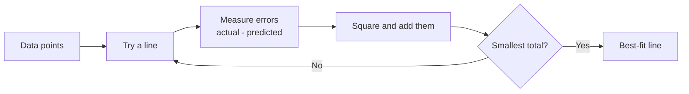
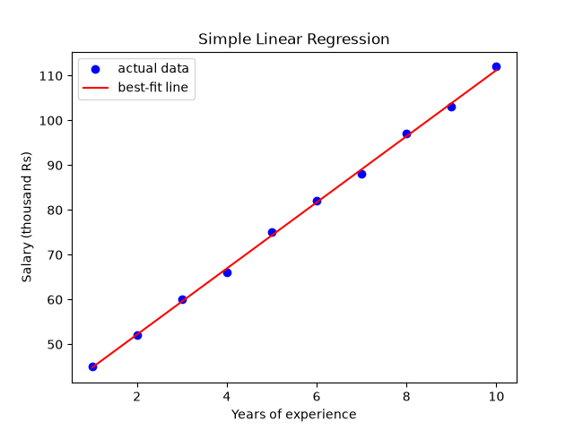

# Session 12: Regression Techniques for Machine Learning

> Module: Application Based Programming in Python · Term 5 (ADSE) · ⏱ ~2 hours

"How much will this house sell for?" "What will next month's electricity bill be?" Questions whose answer is a **number** are solved with **regression**. In this session you will learn what regression is, meet its main types, build **linear regression** both by hand and with scikit-learn, and measure how good your model is.

## 🎯 Learning Objectives

By the end of this session you will be able to:

- Describe regression and when to use it in machine learning
- Compare the main types: simple linear, multiple linear, polynomial, Ridge, Lasso (and how logistic differs)
- Explain the best-fit line, slope, intercept and least squares
- Implement simple and multiple linear regression with scikit-learn
- Evaluate a regression model with MAE, MSE, RMSE and R²
- Explain overfitting and how regularisation (Ridge/Lasso) helps

## 📖 Concepts Explained

### 1. What is regression?

**Regression** is a supervised learning technique that predicts a **continuous number** from one or more inputs.

| Term | Meaning | Example |
|------|---------|---------|
| **Features** (X, independent variables) | The inputs | Area, bedrooms, age of a house |
| **Target** (y, dependent variable) | The number to predict | Price |
| **Model** | The learned formula linking X to y | `price = 0.12·area + 0.9·bedrooms − 0.2·age + 3.7` |

### 2. Types of regression

| Type | Shape of the relationship | When to use |
|------|---------------------------|-------------|
| **Simple linear** | Straight line, one feature | Salary vs experience |
| **Multiple linear** | Flat plane, many features | House price from area, rooms, age |
| **Polynomial** | Curve (adds x², x³ …) | Fuel use vs speed (U-shape) |
| **Ridge** (L2) | Linear + penalty on large weights | Many related features, avoid overfitting |
| **Lasso** (L1) | Linear + penalty that can set weights to 0 | Automatic feature selection |
| **Logistic** | S-curve probability | **Classification** (yes/no), not numbers |

Others you may meet later: decision tree regression, random forest regression, support vector regression.

### 3. Simple linear regression: the best-fit line

The model is the school formula of a line:

**y = m·x + c**  (m = **slope**, c = **intercept**)

- **Slope**: how much y changes when x increases by 1 (salary rises Rs 7.38k per extra year).
- **Intercept**: the value of y when x is 0.



**Least squares** chooses the line with the smallest sum of squared errors. Squaring makes all errors positive and punishes big mistakes more. For one feature there is a direct formula:

`m = Σ(x − x̄)(y − ȳ) / Σ(x − x̄)²`   and   `c = ȳ − m·x̄`

### 4. Multiple linear regression

With several features the model learns **one weight per feature**:
`y = w1·x1 + w2·x2 + w3·x3 + b`.
The sign of a weight tells the direction: a negative weight for `age_years` means older houses are cheaper.

### 5. Evaluating a regression model

Always evaluate on a **test set** the model did not see during training.

| Metric | Formula idea | How to read it |
|--------|--------------|----------------|
| **MAE** | Average of \|actual − predicted\| | "On average we are off by 1.35 million" |
| **MSE** | Average of (actual − predicted)² | Big errors count heavily; units are squared |
| **RMSE** | √MSE | Same units as y; easy to explain |
| **R²** | 1 − (model error / error of just guessing the mean) | 1 = perfect, 0 = no better than the mean |

### 6. Overfitting and regularisation

- **Underfitting**: model too simple (a straight line for curved data) → bad on train and test.
- **Overfitting**: model memorises noise (a very high-degree curve) → great on train, bad on test.

**Ridge** and **Lasso** add a penalty for large weights, controlled by `alpha` (bigger alpha = stronger penalty). Scale features first so the penalty is fair.

## 💻 Code Examples

Install once: `pip install numpy pandas matplotlib scikit-learn`. The dataset `houses.csv` (40 houses) is in this folder.

### Example 1: Simple linear regression (`simple_linear_regression.py`)

```python
experience = np.array([1, 2, 3, 4, 5, 6, 7, 8, 9, 10]).reshape(-1, 1)
salary = np.array([45, 52, 60, 66, 75, 82, 88, 97, 103, 112])

model = LinearRegression()
model.fit(experience, salary)
print(model.coef_[0], model.intercept_)       # 7.38 and 37.40
print(model.predict([[12]]))                  # about 126
```

**How it works:** scikit-learn expects X as a 2-D table, so `reshape(-1, 1)` turns the list into one column. The model learns slope 7.38 and intercept 37.40, then draws the red best-fit line through the blue points.



### Example 2: The same line by hand (`linear_from_scratch.py`)

```python
for xi, yi in zip(x, y):
    top += (xi - mean_x) * (yi - mean_y)
    bottom += (xi - mean_x) ** 2
m = top / bottom
c = mean_y - m * mean_x
```

**How it works:** plain Python applies the least squares formula and gets exactly the same answer (`salary = 7.38 * experience + 37.40`), proving there is no magic inside the library.

### Example 3: Multiple regression with evaluation (`multiple_linear_regression.py`)

```python
X = df[["area_sq_yd", "bedrooms", "age_years"]]
y = df["price_million"]
X_train, X_test, y_train, y_test = train_test_split(X, y, test_size=0.25, random_state=42)

model = LinearRegression().fit(X_train, y_train)
predictions = model.predict(X_test)
print(mean_absolute_error(y_test, predictions))
print(mean_squared_error(y_test, predictions) ** 0.5)
print(r2_score(y_test, predictions))
```

**How it works:** the model learns a weight for each feature (area +0.118, bedrooms +0.924, age −0.210), then scores **R² ≈ 0.96** on unseen houses with an average error of about 1.35 million.

### Example 4: Polynomial regression (`polynomial_regression.py`)

```python
poly = PolynomialFeatures(degree=2, include_bias=False)
speed_poly = poly.fit_transform(speed)        # [speed, speed^2]
curve_model = LinearRegression().fit(speed_poly, fuel)
```

**How it works:** fuel use is U-shaped, so a straight line scores R² 0.10 while the degree-2 curve scores 0.99. Polynomial regression is still linear regression, just on extra columns (x²).

### Example 5: Ridge and Lasso (`ridge_lasso.py`)

```python
models = {
    "Linear": LinearRegression(),
    "Ridge (alpha=1)": Ridge(alpha=1.0),
    "Lasso (alpha=0.5)": Lasso(alpha=0.5),
}
```

**How it works:** a useless `random_noise` column is added on purpose. Linear regression gives it a small weight, Ridge shrinks it, and **Lasso sets it to exactly 0**, removing the useless feature automatically.

## 🧪 Lab Practice

1. In `simple_linear_regression.py`, predict the salary for 0, 15 and 20 years. Are the far predictions realistic? (This is the danger of **extrapolation**.)
2. In `multiple_linear_regression.py`, train using only `area_sq_yd`. How much does R² drop?
3. Change the polynomial degree to 3 and 8. Watch R² on the training data and think about overfitting.
4. Try `alpha` values 0.1, 1 and 5 for Lasso. When does it start removing real features?
5. Add a scatter plot of **actual vs predicted** prices with a diagonal `y = x` line.

## 📝 Assignment

Find a small public dataset with a numeric target (for example car prices, student performance or used mobile prices). Build a **price/score predictor**: explore with two charts, train Linear, Ridge and Lasso models with an 80/20 split, compare them in a table of MAE, RMSE and R², and write which model you would choose and why.

## ❓ Quick Quiz

1. What kind of output does a regression model predict?
2. In `y = m·x + c`, what does `m` represent?
3. Which metric has the same units as the target and punishes large errors more than MAE?
4. What does an R² of 0 mean?
5. Which regularised model can set a feature's weight to exactly zero?

<details>
<summary>Show answers</summary>

1. A continuous number
2. The slope: change in y for a one-unit increase in x
3. RMSE
4. The model is no better than always predicting the average value
5. Lasso

</details>

## 💼 Interview Questions

1. **What are the assumptions of linear regression?** — A roughly linear relationship, independent observations, errors with constant spread (homoscedasticity) and roughly normal errors, and features not too strongly correlated with each other (low multicollinearity).
2. **What is the difference between Ridge and Lasso?** — Ridge (L2) shrinks all weights towards zero but rarely to zero; Lasso (L1) can make weights exactly zero, which performs feature selection.
3. **How do you detect overfitting in regression?** — Compare training and test (or cross-validation) scores: a high training R² with a much lower test R² signals overfitting.

## ✅ Summary

- Regression predicts numbers; logistic regression is the exception that classifies.
- Linear regression finds the best-fit line by least squares: `y = m·x + c`.
- Multiple regression learns one weight per feature; polynomial regression bends the line.
- Evaluate on a test set with MAE, RMSE and R².
- Ridge and Lasso fight overfitting; Lasso can drop useless features.

---

[⬅ Previous](../Session-11-Types-of-Machine-Learning/README.md) · [🏠 Module Home](../README.md) · [Next ➡](../Session-13-Practice-Lab-Data-Analysis-and-ML/README.md)

Prepared by Zeeshan Abbas · Aptech Learning North Nazimabad
