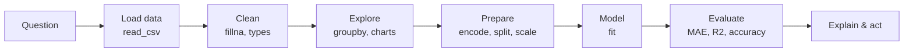
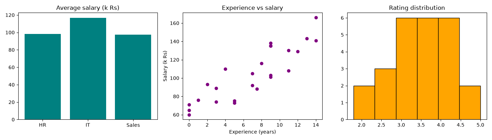

# Session 13: Practice Lab — Data Analysis and Machine Learning

> Module: Application Based Programming in Python · Term 5 (ADSE) · ⏱ ~2 hours

This lab joins Sessions 09 to 12 into one complete workflow on a small HR dataset (`employees.csv`): **clean it with Pandas → chart it → predict salaries with regression → classify with logistic regression → find groups with K-Means.** Work through the labs in order, because Lab 1 creates the clean file that the others use.

## 🎯 Learning Objectives

By the end of this session you will be able to:

- Follow the complete data-to-model workflow on a real-looking dataset
- Clean missing values and summarise data with `groupby` and `crosstab`
- Choose and draw charts that answer business questions
- Encode categorical columns and train a multiple linear regression model
- Train and evaluate a multi-class classifier on the Iris dataset
- Scale features and segment people with K-Means

## 📖 Concepts Explained

### 1. The end-to-end workflow



**Always start with a question.** "Which department pays the most?" needs a `groupby`. "What salary should we offer a new hire?" needs regression. "Which type of employee is this?" needs classification. "What natural groups exist?" needs clustering.

### 2. Which tool for which question?

| Question | Technique | Tool |
|----------|-----------|------|
| Average / total per group | Aggregation | `groupby().mean()` |
| Count combinations of two categories | Cross-tabulation | `pd.crosstab()` |
| Predict a number | Regression | `LinearRegression` |
| Predict a category | Classification | `LogisticRegression` |
| Find hidden groups | Clustering | `KMeans` |

### 3. Encoding reminder

| Column | Values | Encoding used |
|--------|--------|---------------|
| `education` | Bachelor, Master | Binary 0/1 (`is_master`) |
| `department` | IT, Sales, HR (no order) | One-hot (`pd.get_dummies`) |

### 4. Metrics reminder

| Task | Metric | Good value |
|------|--------|------------|
| Regression | MAE (average error in the target's units) | Small |
| Regression | R² | Close to 1 |
| Classification | Accuracy (correct ÷ total) | Close to 100% |

### 5. Why scale before K-Means?

K-Means measures distance. Salary values (70–170) are much bigger than ratings (1–5), so without scaling the rating would be ignored. `StandardScaler` puts both on the same footing.

## 💻 Code Examples

Install once: `pip install pandas matplotlib scikit-learn`. Run the labs in order from this folder.

### Lab 1: Clean and explore (`lab1_clean_explore.py`)

```python
df["experience_years"] = df["experience_years"].fillna(df["experience_years"].median())
df["salary_k"] = df["salary_k"].fillna(df["salary_k"].mean()).round()
df["rating"] = df["rating"].fillna(df["rating"].mean()).round(1)

print(df.groupby("department")["salary_k"].mean().round(1))
print(pd.crosstab(df["department"], df["education"]))
df.to_csv("employees_clean.csv", index=False)
```

**How it works:** three missing cells are filled, average salary per department is printed, `crosstab` counts Bachelor/Master per department, and the clean file is saved for the next labs.

### Lab 2: Charts (`lab2_charts.py`)

```python
fig, axes = plt.subplots(1, 3, figsize=(14, 4))
axes[0].bar(avg_salary.index, avg_salary.values, color="teal")
axes[1].scatter(df["experience_years"], df["salary_k"], color="purple")
axes[2].hist(df["rating"], bins=6, color="orange", edgecolor="black")
```

**How it works:** one figure answers three questions: who pays most (bar), does experience raise salary (scatter), and how are ratings spread (histogram).



### Lab 3: Predict salary (`lab3_salary_regression.py`)

```python
df["is_master"] = (df["education"] == "Master").astype(int)
df = pd.get_dummies(df, columns=["department"], dtype=int)
model = LinearRegression().fit(X_train, y_train)
print("MAE:", mean_absolute_error(y_test, predictions))
```

**How it works:** text columns become numbers, the model trains on 80% of employees and scores **R² ≈ 0.93** on the rest. The weights read like a pay policy: about +5.6k per year of experience and +20k for a Master's degree.

### Lab 4: Classify flowers (`lab4_iris_classifier.py`)

```python
iris = load_iris()
X_train, X_test, y_train, y_test = train_test_split(
    iris.data, iris.target, test_size=0.3, random_state=42, stratify=iris.target)
model = LogisticRegression(max_iter=200).fit(X_train, y_train)
print(accuracy_score(y_test, model.predict(X_test)))
```

**How it works:** logistic regression also handles **three** classes. `stratify` keeps the same share of each species in train and test. Accuracy is about **93%**.

### Lab 5: Employee groups (`lab5_cluster_employees.py`)

```python
scaled = StandardScaler().fit_transform(df[["salary_k", "rating"]])
df["group"] = KMeans(n_clusters=3, n_init=10, random_state=0).fit_predict(scaled)
print(df.groupby("group")[["salary_k", "rating"]].mean())
```

**How it works:** after scaling, K-Means finds three groups, e.g. "well paid, good rating", "mid pay, low rating" and "lower pay, high rating" (a group HR may want to reward). Group numbers are arbitrary labels.

## 🧪 Lab Practice

1. **Lab 1:** add a column `seniority` = "Junior" (< 3 yrs), "Mid" (3–8), "Senior" (> 8) using `pd.cut`, and count each level.
2. **Lab 2:** add a fourth chart: a pie of employees per department.
3. **Lab 3:** use `pd.get_dummies(..., drop_first=True)` and update `feature_columns`. Does R² change? (Search "dummy variable trap".)
4. **Lab 4:** print the test accuracy using only the two petal features. What do you notice?
5. **Lab 5:** try 2 and 4 clusters and describe each group in one sentence for a manager.

## 📝 Assignment

**Mini analytics report:** choose one public dataset (e.g. Kaggle "Student Performance" or a cricket stats CSV). In one script or notebook: clean it, make three charts, train **one regression** or **one classification** model with a proper train/test split and metric, and run K-Means on two scaled columns. Submit the code plus a `report.md` with your charts and five bullet-point findings.

## ❓ Quick Quiz

1. Which Pandas function counts combinations of two categorical columns?
2. Why is `education` encoded as 0/1 while `department` uses one-hot?
3. What does `stratify=y` do in `train_test_split`?
4. Why must salary and rating be scaled before K-Means?
5. Which metric did we use for classification and which for regression?

<details>
<summary>Show answers</summary>

1. `pd.crosstab()`
2. Education has only two values, so one 0/1 column is enough; department has three unordered values, so each gets its own column
3. Keeps the same proportion of each class in the training and testing sets
4. K-Means uses distance, and the larger salary numbers would dominate the rating
5. Accuracy for classification; MAE and R² for regression

</details>

## 💼 Interview Questions

1. **Walk me through how you would approach a new dataset.** — Clarify the question, load and inspect it (`info`, `describe`), clean missing values and types, explore with charts, prepare features (encode, split, scale), train a simple baseline model, evaluate on test data, then iterate and explain the results.
2. **What is the dummy variable trap?** — With one-hot encoding plus an intercept, the dummy columns always add up to 1, making them perfectly correlated; dropping one column (`drop_first=True`) avoids it.
3. **Is 93% accuracy always good?** — Not necessarily; it depends on class balance and the cost of mistakes. With 95% of one class, a model that always guesses that class gets 95%. Check precision, recall and the confusion matrix (Session 14).

## ✅ Summary

- Start every project with a question, then follow load → clean → explore → prepare → model → evaluate.
- `groupby`, `crosstab` and charts answer descriptive questions.
- Regression predicts numbers; logistic regression predicts classes; K-Means finds groups.
- Encode text, split before training, and scale features for distance-based methods.

---

[⬅ Previous](../Session-12-Regression-Techniques-for-Machine-Learning/README.md) · [🏠 Module Home](../README.md) · [Next ➡](../Session-14-Machine-Learning-Classification/README.md)

Prepared by Zeeshan Abbas · Aptech Learning North Nazimabad
