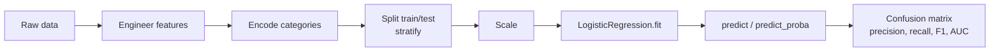

# Session 14: Machine Learning — Classification

> Module: Application Based Programming in Python · Term 5 (ADSE) · ⏱ ~2 hours

Will this loan be approved? Is this email spam? Will this customer leave? These are **classification** problems: the answer is a category. In this session you will handle **categorical variables**, create better inputs with **feature engineering**, build a complete **logistic regression classifier**, and judge it with the right **evaluation metrics** — because accuracy alone can fool you.

## 🎯 Learning Objectives

By the end of this session you will be able to:

- Define categorical variables and tell nominal from ordinal data
- Encode categorical variables with mapping, `OrdinalEncoder` and `OneHotEncoder`
- Explain feature engineering and create ratio, binned, flag and log features
- Build an end-to-end classifier with logistic regression
- Read a confusion matrix and calculate accuracy, precision, recall and F1
- Explain decision thresholds and ROC-AUC

## 📖 Concepts Explained

### 1. Categorical variables

A **categorical variable** holds labels from a fixed set instead of measured numbers.

| Kind | Has an order? | Examples | Encoding |
|------|---------------|----------|----------|
| **Binary** | Two values | Yes/No, Pass/Fail | 1/0 with `map()` |
| **Nominal** | No | City, colour, employment type | One-hot (`OneHotEncoder`, `get_dummies`) |
| **Ordinal** | Yes | Matric < Inter < Bachelor < Master; Small < Medium < Large | `OrdinalEncoder(categories=[...])` or `map()` |

Models need numbers, but the numbers must not invent meaning. Giving cities 0, 1, 2 suggests "Islamabad > Lahore > Karachi", which is false — so cities get one-hot. Education **does** have an order, so 0–3 is correct.

`OneHotEncoder(handle_unknown="ignore")` is safer in real apps: a category never seen in training (e.g. a new city) becomes all zeros instead of crashing.

### 2. Feature engineering

**Feature engineering** means using your knowledge of the problem to create input columns that make patterns easier for the model to learn. Good features often matter more than a fancy algorithm.

| Technique | Example | Why it helps |
|-----------|---------|--------------|
| **Ratio** | `loan_to_income = loan / income` | A 2M loan is risky for one person and easy for another |
| **Binning** | Credit score → Poor/Fair/Good/Excellent | Captures thresholds banks really use |
| **Flag** | `is_high_income = income > 200k` | A simple business rule as a 0/1 column |
| **Log transform** | `log1p(loan_amount)` | Shrinks very large values that distort the model |
| **Date parts** | Day of week, month from a date | Shopping differs on weekends |
| **Dropping** | Remove IDs, names | They carry no general pattern |

### 3. Classification with logistic regression

Recap from Session 11: logistic regression computes a weighted sum, passes it through the sigmoid to get a **probability**, and predicts class 1 if the probability ≥ **threshold** (0.5 by default). After scaling, the **weights** show which features push towards approval (+) or rejection (−).



### 4. Evaluating a classifier

**Confusion matrix** (positive = 1, e.g. spam):

| | Predicted 0 | Predicted 1 |
|-|-------------|-------------|
| **Actual 0** | TN (true negative) | FP (false positive — false alarm) |
| **Actual 1** | FN (false negative — missed) | TP (true positive) |

| Metric | Formula | Question it answers |
|--------|---------|---------------------|
| **Accuracy** | (TP + TN) / all | How often is the model right overall? |
| **Precision** | TP / (TP + FP) | When it says "spam", how often is it really spam? |
| **Recall** (sensitivity) | TP / (TP + FN) | Of all real spam, how much did it catch? |
| **F1-score** | 2·P·R / (P + R) | One balanced number for precision and recall |
| **ROC-AUC** | Area under the ROC curve | How well does it rank positives above negatives? (0.5 random, 1.0 perfect) |

**Which matters more?**
- Disease screening: **recall** (missing a sick patient is worse than a false alarm).
- Spam filter: **precision** (sending a real email to spam is worse).
- Imbalanced data (1% fraud): accuracy is misleading — a model that always says "not fraud" scores 99%.

**Threshold:** raising it (0.5 → 0.7) makes the model more cautious: precision usually rises, recall falls.

## 💻 Code Examples

Install once: `pip install pandas numpy scikit-learn`. The dataset `loan_applications.csv` (80 made-up applications) is in this folder.

### Example 1: Encoding categories (`categorical_variables.py`)

```python
df["approved_num"] = df["approved"].map({"No": 0, "Yes": 1})

levels = [["Matric", "Intermediate", "Bachelor", "Master"]]
df["education_num"] = OrdinalEncoder(categories=levels).fit_transform(df[["education"]]).astype(int)

one_hot = OneHotEncoder(sparse_output=False, handle_unknown="ignore")
city_columns = one_hot.fit_transform(df[["city"]])
```

**How it works:** binary → 1/0, ordinal → 0–3 in the order we give, nominal → one column per city. An unknown city ("Quetta") becomes `[0, 0, 0]`.

### Example 2: Feature engineering (`feature_engineering.py`)

```python
df["loan_to_income"] = (df["loan_amount_k"] / df["monthly_income_k"]).round(2)
df["credit_band"] = pd.cut(df["credit_score"], bins=[0, 580, 670, 740, 850],
                           labels=["Poor", "Fair", "Good", "Excellent"])
df["is_high_income"] = (df["monthly_income_k"] > 200).astype(int)
df["log_loan"] = np.log1p(df["loan_amount_k"]).round(2)
```

**How it works:** four new columns are built from existing ones. The approval rate climbs from **21% (Poor)** to **67% (Excellent)**, proving the credit band is a useful feature.

### Example 3: Complete loan classifier (`loan_classifier.py`)

```python
df = pd.get_dummies(df, columns=["employment", "city"], drop_first=True, dtype=int)
X = df.drop(columns=["app_id", "approved"])
y = df["approved"]
X_train, X_test, y_train, y_test = train_test_split(X, y, test_size=0.25,
                                                    random_state=7, stratify=y)
scaler = StandardScaler()
X_train = scaler.fit_transform(X_train)
X_test = scaler.transform(X_test)
model = LogisticRegression().fit(X_train, y_train)
```

**How it works:** the model reaches about **95% test accuracy**. Its weights make sense: higher income and credit score push towards approval; a bigger loan and being a student push towards rejection.

### Example 4: Metrics by hand and by scikit-learn (`evaluation_metrics.py`)

```python
matrix = confusion_matrix(actual, predicted)
tn, fp, fn, tp = matrix.ravel()
print("Precision TP/(TP+FP):", round(tp / (tp + fp), 2))
print(classification_report(actual, predicted, target_names=["not spam", "spam"]))
```

**How it works:** for 12 test emails the spam filter has TP=3, FN=2, FP=1, TN=6, giving accuracy 0.75, precision 0.75, recall 0.60 and F1 0.67. The report shows these for both classes.

### Example 5: Thresholds and ROC-AUC (`threshold_and_roc.py`)

```python
probabilities = model.predict_proba(X_test)[:, 1]
for threshold in [0.3, 0.5, 0.7]:
    predictions = (probabilities >= threshold).astype(int)
print("ROC-AUC:", roc_auc_score(y_test, probabilities))
```

**How it works:** at 0.3 recall is 1.00 (no approved applicant missed); at 0.7 precision is 1.00 (no wrong approvals). AUC ≈ 0.98 means the model ranks applicants very well.

## 🧪 Lab Practice

1. Add a `property_type` column (Rented/Owned/Family) to the DataFrame in `categorical_variables.py` and one-hot encode it.
2. In `feature_engineering.py`, bin `monthly_income_k` into Low/Medium/High with `pd.qcut` (equal-sized groups).
3. Remove `loan_to_income` from `loan_classifier.py`. Does accuracy change?
4. Print `confusion_matrix` and `classification_report` for `loan_classifier.py`.
5. Choose the threshold you would use as a bank risk manager and explain why in a comment.

## 📝 Assignment

Build a **Student Pass/Fail Predictor**: create or download a dataset with at least one nominal column (e.g. section), one ordinal column (e.g. previous grade A/B/C) and numeric columns (attendance, assignment marks). Engineer two new features, encode correctly, train logistic regression, and report the confusion matrix, precision, recall, F1 and ROC-AUC. Explain in three sentences whether precision or recall matters more for a teacher here.

## ❓ Quick Quiz

1. Is "T-shirt size: S, M, L, XL" nominal or ordinal?
2. Why should a `city` column not be encoded as 0, 1, 2?
3. What is a false negative in a disease test?
4. Which metric answers "of all real positives, how many did we find"?
5. What usually happens to precision and recall when you raise the threshold?

<details>
<summary>Show answers</summary>

1. Ordinal — it has a natural order
2. It creates a false order/size between cities; use one-hot encoding
3. A sick person the test says is healthy
4. Recall
5. Precision tends to rise and recall tends to fall

</details>

## 💼 Interview Questions

1. **Why is accuracy a poor metric for imbalanced data?** — A model can score high by always predicting the majority class while never finding the minority class; precision, recall, F1 and ROC-AUC reveal this.
2. **What is feature engineering? Give an example.** — Creating new informative inputs from raw data using domain knowledge, e.g. a debt-to-income ratio for credit risk or "hour of day" from a timestamp for fraud detection.
3. **Explain the precision–recall trade-off.** — Lowering the threshold catches more positives (higher recall) but adds false alarms (lower precision); raising it does the opposite. The right balance depends on the cost of each type of error.

## ✅ Summary

- Categorical variables are binary, nominal or ordinal; encode each type correctly.
- Feature engineering (ratios, bins, flags, logs) often improves models more than changing algorithms.
- Logistic regression classifies using probabilities and a threshold.
- Evaluate with a confusion matrix, precision, recall, F1 and ROC-AUC, not accuracy alone.

---

[⬅ Previous](../Session-13-Practice-Lab-Data-Analysis-and-ML/README.md) · [🏠 Module Home](../README.md) · [Next ➡](../Session-15-Unsupervised-Learning-Clustering-and-PCA/README.md)

Prepared by Zeeshan Abbas · Aptech Learning North Nazimabad
