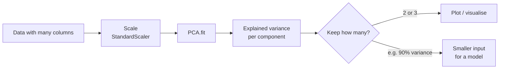
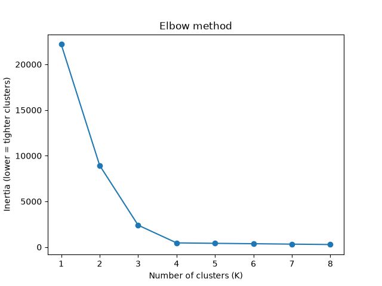
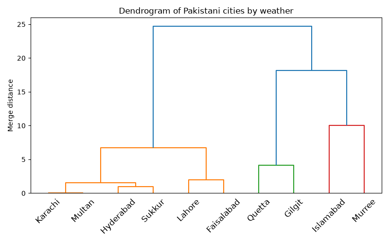
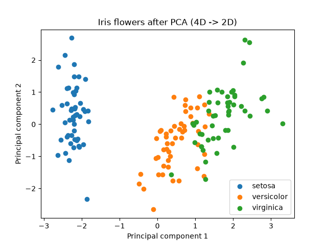

# Session 15: Unsupervised Machine Learning — Clustering and PCA

> Module: Application Based Programming in Python · Term 5 (ADSE) · ⏱ ~2 hours

Most data in the world has **no labels**: nobody has marked which customers are "bargain hunters" or which songs are "chill". Unsupervised learning finds that hidden structure. In this session you will go deeper into **clustering** (K-Means with the elbow method, hierarchical clustering and DBSCAN) and learn **Principal Component Analysis (PCA)** to shrink many columns into a few.

## 🎯 Learning Objectives

By the end of this session you will be able to:

- Define unsupervised learning and list its main techniques
- Choose the number of clusters with the elbow method and the silhouette score
- Explain and apply hierarchical (agglomerative) clustering and read a dendrogram
- Use DBSCAN for oddly shaped clusters and outlier detection
- Explain PCA, explained variance and why scaling comes first
- Use PCA to visualise high-dimensional data and to speed up a model

## 📖 Concepts Explained

### 1. What is unsupervised learning?

**Unsupervised learning** works with input data **only** (no target column). The algorithm looks for structure on its own.

| Technique | What it does | Real use |
|-----------|--------------|----------|
| **Clustering** | Groups similar rows | Customer segments, grouping news articles |
| **Dimensionality reduction** | Fewer columns, same story | Visualising data, faster models, noise removal |
| **Anomaly detection** | Finds rows unlike the rest | Card fraud, faulty sensors |
| **Association rules** | "People who buy X also buy Y" | Shopping-basket analysis |

Because there is no answer key, judging results needs scores like **silhouette** and, most importantly, **human sense**: do the groups mean something useful?

### 2. Clustering algorithms compared

| Algorithm | Idea | You choose | Good at | Weak at |
|-----------|------|------------|---------|---------|
| **K-Means** | Points join the nearest of K centres | K | Round, similar-sized groups; fast | Odd shapes, outliers |
| **Hierarchical (agglomerative)** | Start with every point alone, keep merging the closest groups | Where to cut the tree | Small data; shows a family tree | Slow on big data |
| **DBSCAN** | Clusters are dense areas; lonely points are noise | `eps`, `min_samples` | Any shape; finds outliers (`-1`) | Clusters of very different density |

### 3. How many clusters? Elbow and silhouette

- **Inertia** = total squared distance of points from their cluster centre. It always falls as K grows, so look for the **elbow**: the K after which it stops falling sharply.
- **Silhouette score** (−1 to 1) asks for each point "am I closer to my own cluster than to the next one?". **Higher is better**; pick the K with the highest score.

### 4. Reading a dendrogram

A **dendrogram** is a tree of merges. The height of each join shows how different the merged groups were. Draw an imaginary horizontal line: the number of vertical lines it crosses is the number of clusters at that cut. **Ward linkage** merges the pair that increases the total within-group spread the least.

### 5. Principal Component Analysis (PCA)

Many datasets have dozens of columns, and many of them move together (height and weight, for example). **PCA** creates new axes called **principal components**:

- **PC1** points in the direction where the data spreads the most.
- **PC2** is at right angles to PC1 and captures the next most spread, and so on.
- Keeping only the first few components keeps most of the information with far fewer columns.

**Analogy:** photographing a 3-D object. A smart camera angle (PC1 + PC2) shows almost everything about its shape in a flat 2-D picture.



| Term | Meaning |
|------|---------|
| **Explained variance ratio** | Share of total information each component keeps |
| `n_components=2` | Keep exactly 2 components |
| `n_components=0.90` | Keep as many as needed for 90% of the variance |

**Rules:** scale first (otherwise big-number columns dominate), and fit PCA on training data only. Components are mixtures of the original columns, so they are harder to explain to a non-technical audience.

## 💻 Code Examples

Install once: `pip install scikit-learn scipy matplotlib`. All datasets are generated or built into scikit-learn, so no downloads are needed.

### Example 1: Elbow method and silhouette (`kmeans_elbow.py`)

```python
X, _ = make_blobs(n_samples=300, centers=4, cluster_std=0.9, random_state=7)
for k in range(1, 9):
    model = KMeans(n_clusters=k, n_init=10, random_state=0).fit(X)
    inertias.append(model.inertia_)
    if k > 1:
        sil = silhouette_score(X, model.labels_)
```

**How it works:** inertia drops sharply up to K = 4 and then flattens (the elbow), and the silhouette score peaks at **0.826 for K = 4**. Both methods agree with the four groups hidden in the data.



### Example 2: Hierarchical clustering (`hierarchical_clustering.py`)

```python
model = AgglomerativeClustering(n_clusters=3, linkage="ward")
labels = model.fit_predict(weather)
merges = linkage(weather, method="ward")
dendrogram(merges, labels=cities, leaf_rotation=45)
```

**How it works:** ten cities are described by temperature and rainfall. The algorithm forms three sensible groups: hot and dry plains (Karachi, Multan, Lahore …), cool and dry (Quetta, Gilgit) and wet hill areas (Islamabad, Murree). The dendrogram shows Karachi and Multan merging first because their weather is almost the same.



### Example 3: DBSCAN for strange shapes (`dbscan_demo.py`)

```python
X, true_groups = make_moons(n_samples=200, noise=0.06, random_state=0)
kmeans_labels = KMeans(n_clusters=2, n_init=10, random_state=0).fit_predict(X)
dbscan_labels = DBSCAN(eps=0.2, min_samples=5).fit_predict(X)
print(adjusted_rand_score(true_groups, dbscan_labels))
```

**How it works:** on two interlocking half-moons, K-Means cuts straight across them (agreement 0.26), while DBSCAN follows the dense shapes perfectly (agreement 1.0). Any point DBSCAN labels `-1` is an outlier.

### Example 4: PCA for visualisation (`pca_iris.py`)

```python
X_scaled = StandardScaler().fit_transform(iris.data)
pca = PCA(n_components=2)
X_2d = pca.fit_transform(X_scaled)
print(pca.explained_variance_ratio_)
```

**How it works:** four flower measurements become two components that keep **95.8%** of the information (PC1 73.0%, PC2 22.9%). The 2-D scatter shows the three species clearly separated, even though PCA never saw the species labels.



### Example 5: PCA to shrink model input (`pca_digits_speed.py`)

```python
pca = PCA(n_components=0.90)
X_train_small = pca.fit_transform(X_train)
X_test_small = pca.transform(X_test)
small_model = LogisticRegression(max_iter=3000).fit(X_train_small, y_train)
```

**How it works:** handwritten digit images have 64 pixel features. PCA keeps 90% of the variance with only **21 components**, and accuracy barely changes (0.953 → 0.947) while the model works with one-third of the columns.

## 🧪 Lab Practice

1. Change `centers=4` to `centers=6` in `kmeans_elbow.py`. Do the elbow and silhouette still find the right K?
2. In `hierarchical_clustering.py`, add three more cities with your own estimates and try `n_clusters=4`.
3. In `dbscan_demo.py`, try `eps=0.1` and `eps=0.4`. What happens to the number of clusters and outliers?
4. Run `pca_iris.py` without scaling. How do the explained variance numbers change?
5. In `pca_digits_speed.py`, try `n_components` of 0.70, 0.80 and 0.99 and make a small table of components vs accuracy.

## 📝 Assignment

**Customer segmentation:** create or download a dataset of at least 100 customers with four or more numeric columns (age, income, visits, spend, etc.). Scale the data, use the elbow method and silhouette score to choose K, run K-Means, and describe each segment in one marketing sentence. Then apply PCA to 2 components and draw the segments in colour. Bonus: compare with DBSCAN and list any outliers it finds.

## ❓ Quick Quiz

1. What is the main difference between supervised and unsupervised data?
2. On an elbow chart, what are you looking for?
3. Which clustering algorithm labels outliers as `-1`?
4. What does an explained variance ratio of 0.73 for PC1 mean?
5. Why must data be scaled before PCA?

<details>
<summary>Show answers</summary>

1. Unsupervised data has no target/label column
2. The point where inertia stops falling sharply (the "bend")
3. DBSCAN
4. The first component keeps 73% of the total variance (information) in the data
5. PCA follows the largest spread, so columns with large numbers would dominate unfairly

</details>

## 💼 Interview Questions

1. **How do you choose K in K-Means?** — Use the elbow method on inertia, the silhouette score, and domain knowledge (how many segments the business can act on); try several values and compare.
2. **When would you prefer DBSCAN over K-Means?** — When clusters have irregular shapes, when the number of clusters is unknown, or when you need to detect outliers; K-Means assumes round clusters and forces every point into one.
3. **Is PCA feature selection?** — No. Feature selection keeps some original columns; PCA creates new columns that are combinations of all the original ones (feature extraction).

## ✅ Summary

- Unsupervised learning finds structure without labels: clustering, dimensionality reduction, anomaly detection.
- Choose K with the elbow method and silhouette score; check the groups make business sense.
- Hierarchical clustering builds a dendrogram; DBSCAN finds any-shaped clusters and outliers.
- PCA turns many correlated columns into a few components that keep most of the variance; scale first.

---

[⬅ Previous](../Session-14-Machine-Learning-Classification/README.md) · [🏠 Module Home](../README.md) · [Next ➡](../Session-16-Practice-Lab-ML-Review-and-Mini-Project/README.md)

Prepared by Zeeshan Abbas · Aptech Learning North Nazimabad
