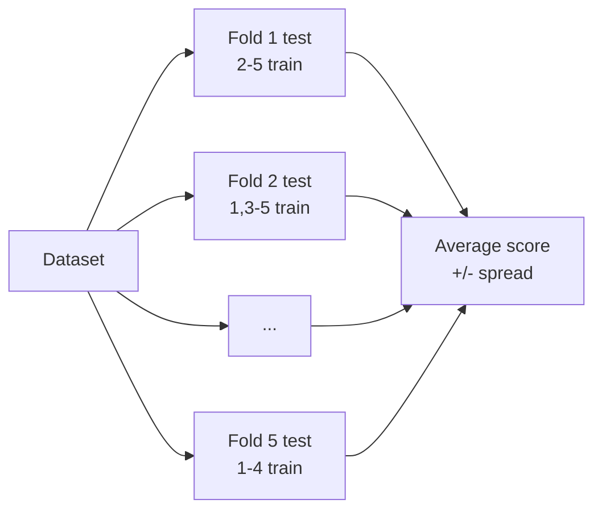

# Session 16: Practice Lab — Machine Learning Review and Mini Project

> Module: Application Based Programming in Python · Term 5 (ADSE) · ⏱ ~2 hours

The final session reviews Sessions 12 to 15 on **real built-in datasets**: regression on medical data, classification on tumour measurements, and clustering with PCA on wine chemistry. You will then learn two professional habits — **cross-validation** and **saving a trained model** — and finish by serving your model through a **Flask API**, joining the web skills from Session 05 with your new ML skills.

## 🎯 Learning Objectives

By the end of this session you will be able to:

- Compare several regression models with MAE and R² and explain the result
- Build a leak-free classifier with a scikit-learn `Pipeline` and read its full report
- Combine scaling, PCA and K-Means and check clusters against known groups
- Use k-fold cross-validation to compare models fairly
- Save a trained model with `joblib` and load it in another program
- Serve predictions from a Flask JSON API

## 📖 Concepts Explained

### 1. Module 2nd-half review

| Session | Big idea | Key tools |
|---------|----------|-----------|
| 12 Regression | Predict numbers | `LinearRegression`, `Ridge`, `Lasso`, MAE, R² |
| 14 Classification | Predict categories | Encoding, feature engineering, `LogisticRegression`, precision/recall |
| 15 Unsupervised | Find structure | `KMeans`, `AgglomerativeClustering`, `DBSCAN`, `PCA` |
| 16 (today) | Work like a professional | `Pipeline`, `cross_val_score`, `joblib`, Flask API |

### 2. Pipelines

A **Pipeline** chains preparation steps and a model into one object.

```python
model = make_pipeline(StandardScaler(), LogisticRegression())
model.fit(X_train, y_train)      # scaler fitted on training data only
model.predict(X_test)            # test data scaled with the SAME scaler
```

**Why:** less code, no forgotten steps, and **no data leakage**, because each step is fitted only on the data passed to `fit`. The whole pipeline can be saved as one file.

### 3. Cross-validation

One train/test split can be lucky or unlucky. **k-fold cross-validation** splits the data into k parts (folds), trains on k−1 and tests on the remaining one, k times, then averages.



A smaller **±** (standard deviation) means the model is more **stable**. Today's comparison also includes two new classifiers so you can see how others perform: **K-Nearest Neighbours** (votes of the closest examples) and a **Decision Tree** (a chain of yes/no questions).

### 4. Saving and deploying a model

Training can take minutes or hours; you do it **once** and save the result.

| Step | Code |
|------|------|
| Save | `joblib.dump(model, "model.joblib")` |
| Load | `model = joblib.load("model.joblib")` |
| Serve | Load once at app start, call `model.predict()` inside a Flask route |

> ⚠️ Only load model files you trust: loading a joblib/pickle file can run code. Keep the same scikit-learn version for saving and loading.

### 5. ML project checklist

1. Define the question and the success metric.
2. Load, clean and explore the data with charts.
3. Engineer and encode features; split (stratify for classes).
4. Build a pipeline; compare models with cross-validation.
5. Evaluate the best on the test set (MAE/R² or confusion matrix, precision, recall, AUC).
6. Save the model; serve it through an API or GUI; document how to run it.

## 💻 Code Examples

Install once: `pip install scikit-learn pandas flask`. All datasets are built into scikit-learn.

### Lab 1: Regression review (`lab1_regression_review.py`)

```python
X, y = load_diabetes(return_X_y=True, as_frame=True)
models = {"Linear": LinearRegression(), "Ridge": Ridge(alpha=0.5), "Lasso": Lasso(alpha=0.1)}
for name, model in models.items():
    model.fit(X_train, y_train)
    predictions = model.predict(X_test)
```

**How it works:** all three models reach R² ≈ 0.45–0.47 (medical data is noisy, so this is normal). Lasso scores best and switches off `age`, `s2` and `s4`, showing they add little.

### Lab 2: Classification with a Pipeline (`lab2_classification_review.py`)

```python
model = make_pipeline(StandardScaler(), LogisticRegression(max_iter=1000))
model.fit(X_train, y_train)
print(confusion_matrix(y_test, predictions))
print(classification_report(y_test, predictions, target_names=data.target_names))
```

**How it works:** on 143 test tumours the model is 96% accurate with only 3 false alarms and 3 misses, and ROC-AUC is 0.995. In medicine, the 3 missed malignant cases (recall 0.94) would be the number doctors care about most.

### Lab 3: PCA + K-Means review (`lab3_unsupervised_review.py`)

```python
X_scaled = StandardScaler().fit_transform(wine.data)
clusters = KMeans(n_clusters=3, n_init=10, random_state=0).fit_predict(X_scaled)
print(adjusted_rand_score(wine.target, clusters))
print(pd.crosstab(wine.target, clusters))
```

**How it works:** the silhouette score is highest at K = 3. Without ever seeing the labels, K-Means rebuilds the three real wine farms almost perfectly (ARI 0.897). The crosstab shows only 6 wines in the "wrong" group.

### Lab 4: Cross-validation (`lab4_cross_validation.py`)

```python
scores = cross_val_score(model, X, y, cv=5, scoring="accuracy")
print(f"{name:<22} mean={scores.mean():.3f}  (+/- {scores.std():.3f})")
```

**How it works:** Logistic Regression (0.981 ± 0.007) beats K-Nearest Neighbours (0.965) and a Decision Tree (0.916), and is also the most stable.

### Lab 5: Save and load (`lab5_save_and_load_model.py`)

```python
joblib.dump(model, "iris_model.joblib")
loaded_model = joblib.load("iris_model.joblib")
print(iris.target_names[loaded_model.predict([[5.1, 3.5, 1.4, 0.2]])[0]])   # setosa
```

**How it works:** the whole pipeline (scaler + model) is stored in one file and reloaded ready to predict.

### Mini project: Flask prediction API (`mini_project_flask_predictor.py` + `test_predictor.py`)

```python
model = joblib.load("iris_model.joblib")

@app.route("/predict")
def predict():
    try:
        features = [[float(request.args["sl"]), float(request.args["sw"]),
                     float(request.args["pl"]), float(request.args["pw"])]]
    except (KeyError, ValueError):
        return jsonify({"error": "send numbers sl, sw, pl, pw"}), 400
    number = int(model.predict(features)[0])
    confidence = float(model.predict_proba(features)[0][number])
    return jsonify({"species": SPECIES[number], "confidence": round(confidence, 3)})
```

**How it works:** run Lab 5 first to create the model file. The API returns e.g. `{"species": "setosa", "confidence": 0.985}`, and returns status 400 for missing or non-numeric input. `test_predictor.py` checks it with Flask's test client. A Flutter app could call this same URL.

## 🧪 Lab Practice

1. **Lab 1:** add `alpha` values 0.01, 0.5 and 1.0 for Lasso and record which features disappear each time.
2. **Lab 2:** change the threshold to 0.3 for the "malignant" class and compare the number of missed cases.
3. **Lab 3:** plot the 2 PCA components coloured by cluster and save it as `wine_clusters.png`.
4. **Lab 4:** change `cv=5` to `cv=10` and add `DecisionTreeClassifier(max_depth=2)`. What changes?
5. **Mini project:** add a Tkinter window with four Entry boxes and a **Predict** button that uses the saved model directly.

## 📝 Assignment

**Module capstone:** choose one dataset (built-in, Kaggle or your own). Deliver: (1) a cleaning + charts script, (2) a pipeline compared with at least two other models using 5-fold cross-validation, (3) the best model saved with `joblib`, (4) a Flask `/predict` API **or** a Tkinter GUI that uses it, and (5) a README explaining the problem, metric, results table and how to run the project. See the module mini-project for full details.

## ❓ Quick Quiz

1. What two problems does a `Pipeline` solve?
2. In 5-fold cross-validation, how many times is the model trained?
3. Which library is commonly used to save scikit-learn models?
4. Why load the model once at app start instead of inside the route?
5. What HTTP status should an API return for invalid input?

<details>
<summary>Show answers</summary>

1. It keeps all preparation steps together (less code, nothing forgotten) and prevents data leakage by fitting steps on training data only
2. Five times
3. `joblib`
4. Loading is slow; doing it on every request would make each prediction slow
5. 400 Bad Request

</details>

## 💼 Interview Questions

1. **How would you deploy a machine learning model?** — Train and evaluate it, save the full pipeline (e.g. with joblib), load it in a web service (Flask/FastAPI) that validates input and returns predictions as JSON, then containerise and monitor it for accuracy drift.
2. **Why use cross-validation instead of a single train/test split?** — It uses all data for both training and testing across folds, gives a more reliable average score and shows how much the score varies.
3. **Your model scores 99% in training but 70% in production. What could be wrong?** — Overfitting, data leakage during training, or production data that differs from training data (data drift); check the pipeline, validate properly and monitor incoming data.

## ✅ Summary

- Regression, classification and clustering follow the same scikit-learn pattern: prepare → fit → predict → evaluate.
- Pipelines keep preparation and model together and prevent leakage.
- Cross-validation gives a fairer, more stable comparison of models.
- `joblib` saves trained models; Flask turns them into an API any app can call.
- You can now take a problem from raw data to a working, served model.

---

[⬅ Previous](../Session-15-Unsupervised-Learning-Clustering-and-PCA/README.md) · [🏠 Module Home](../README.md) · [Term 5 eProject ➡](../../eProject/README.md)

Prepared by Zeeshan Abbas · Aptech Learning North Nazimabad
