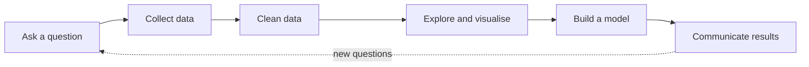

# Session 01: Introduction to Data Science with Python

> Module: Data Science with Python · Term 5 (ADSE) · ⏱ ~2 hours

Every app you use collects data: food orders, bus rides, exam results, cricket scores. **Data science** is the skill of turning that raw data into answers and decisions. In this session you meet the field, learn the main kinds of data, see why Python is the favourite language for this work, and set up the tools (Anaconda, Jupyter Notebook and Google Colab) you will use for the rest of the module.

## 🎯 Learning Objectives

By the end of this session you will be able to:

- Explain what data science is and the steps of a data science project
- Identify types of data: numerical, categorical, structured and unstructured
- Explain why Python is widely used for data science and name its key libraries
- Describe the role and skills of a data scientist
- Give real-world examples of data science, including examples from Pakistan
- Run Python code in Jupyter Notebook, Google Colab or VS Code

## 📖 Concepts Explained

### 1. What is data science?

Data science mixes three things: **programming**, **statistics** and **knowledge of the problem area** (business, health, education). The goal is always the same: ask a useful question, use data to answer it, and explain the answer clearly.

> **Analogy:** a data scientist is like a detective. The data is the evidence, Python is the magnifying glass, and the final report is the case solved.

### 2. The data science workflow



Most of the real time (often more than half) goes into **collecting and cleaning** data. Fancy models come later.

### 3. Types of data

| Type | Sub-type | Example | What you can do |
|------|----------|---------|-----------------|
| Numerical | Discrete (counted) | number of siblings: 3 | add, average |
| Numerical | Continuous (measured) | height: 172.5 cm | add, average |
| Categorical | Nominal (no order) | city: Karachi, Lahore | count per group |
| Categorical | Ordinal (has order) | grade: A, B, C | sort, compare |
| Boolean | Yes / No | has_laptop: True | count, filter |

Data also differs by **shape**:

- **Structured**: neat rows and columns (Excel sheets, SQL tables, CSV files).
- **Semi-structured**: has labels but no fixed table (JSON, XML, MongoDB documents).
- **Unstructured**: no fixed format (photos, voice notes, WhatsApp messages, PDFs).

### 4. Why Python for data science?

- **Easy to read**: code looks almost like English, so you focus on the problem.
- **Huge library ecosystem**: ready-made tools for every step.
- **Free and open source** with a giant community and lots of tutorials.
- **Works everywhere**: Windows, Linux, macOS, and in the browser with Colab.

| Library | Used for | Session |
|---------|----------|---------|
| NumPy | fast arrays and maths | 02 |
| pandas | tables (DataFrames), cleaning, grouping | 03–08 |
| Matplotlib | basic charts | 09 |
| Seaborn | beautiful statistical charts | 11 |
| scikit-learn | machine learning models | 12–18 |

### 5. Who is a data scientist?

A data scientist asks good questions, writes code to get and clean data, uses statistics to find patterns, builds models to predict, and tells the story with charts. Related roles: **data analyst** (reports and dashboards), **data engineer** (builds data pipelines), **ML engineer** (puts models into apps).

### 6. Real-world uses

- **E-commerce** (Daraz, Amazon): "customers who bought this also bought..." recommendations.
- **Banking**: spotting fraud in card transactions in real time.
- **Ride hailing** (Careem, Uber): predicting demand and setting fares.
- **Health**: predicting disease risk from test results.
- **Agriculture**: forecasting crop yield from weather data.
- **Cricket**: analysing player performance to pick the best team.

### 7. Your tools

| Tool | What it is | When to use |
|------|-----------|-------------|
| **Anaconda** | a Python installer that already includes NumPy, pandas, Jupyter and more | your own PC, offline work |
| **Jupyter Notebook** | code + notes + charts in one document (`.ipynb`), run cell by cell | exploring data step by step |
| **Google Colab** | free Jupyter in the browser, no install, free GPU | weak PC, sharing with classmates |
| **VS Code** | code editor; runs `.py` files and notebooks | larger projects |

In this repository every example is a plain `.py` file so it runs anywhere. You can paste any file into a Jupyter or Colab cell as well. Charts are saved as `.png` images next to the script.

## 💻 Code Examples

### Example 1: Check your setup

File: [`check_setup.py`](./check_setup.py)

```python
# check_setup.py - confirm your data science libraries are installed
# Run: python check_setup.py

import sys
print("Python version:", sys.version.split()[0])

# Try to import each library and print its version
libraries = ["numpy", "pandas", "matplotlib", "seaborn", "sklearn"]

for name in libraries:
    try:
        module = __import__(name)                 # import by name
        print(f"OK   {name:<11} {module.__version__}")
    except ImportError:
        print(f"MISSING {name}  ->  pip install {name if name != 'sklearn' else 'scikit-learn'}")
```

**How it works:** it imports each library by name and prints its version. If one is missing, it tells you the exact `pip install` command. Anaconda users already have all of them.

### Example 2: Types of data in Python

File: [`data_types_demo.py`](./data_types_demo.py)

```python
# data_types_demo.py - the different kinds of data a data scientist meets

# 1. Numerical data (numbers we can do maths on)
age = 21                 # discrete: whole numbers you can count
height_cm = 172.5        # continuous: can have decimals

# 2. Categorical data (labels or groups)
city = "Karachi"         # nominal: no natural order
grade = "B"              # ordinal: has an order (A > B > C)

# 3. Boolean data (yes / no)
has_laptop = True

# 4. Text data (free sentences)
feedback = "The class was very helpful!"

# Print each value with its Python type
print("age        ->", age, type(age))
print("height_cm  ->", height_cm, type(height_cm))
print("city       ->", city, type(city))
print("grade      ->", grade, type(grade))
print("has_laptop ->", has_laptop, type(has_laptop))
print("feedback   ->", feedback, type(feedback))

# Structured data looks like a table: rows (records) and columns (fields)
students = [
    {"name": "Ayesha", "age": 20, "city": "Karachi"},
    {"name": "Bilal", "age": 22, "city": "Lahore"},
]
print("\nStructured data (list of rows):")
for row in students:
    print(row)
```

**How it works:** each variable holds a different kind of data and `type()` shows how Python stores it. The list of dictionaries at the end is **structured data**: every row has the same fields.

### Example 3: Plain Python for quick analysis

File: [`python_for_data.py`](./python_for_data.py)

```python
# python_for_data.py - plain Python tools that every data scientist uses

marks = [78, 85, 62, 91, 70, 88]    # a list of exam marks

# Basic statistics with built-in functions
total = sum(marks)
count = len(marks)
average = total / count
print("Total:", total)
print("Count:", count)
print("Average:", round(average, 2))
print("Highest:", max(marks), "Lowest:", min(marks))

# A list comprehension: keep only the marks of students who passed (>= 70)
passed = [m for m in marks if m >= 70]
print("Passed marks:", passed)

# A dictionary: count how many students are in each city
cities = ["Karachi", "Lahore", "Karachi", "Islamabad", "Karachi"]
city_count = {}
for c in cities:
    city_count[c] = city_count.get(c, 0) + 1   # add 1 to this city's count
print("Students per city:", city_count)

# A small function we can reuse on any list of numbers
def describe(values):
    """Return the min, max and average of a list."""
    return min(values), max(values), sum(values) / len(values)

low, high, avg = describe([3, 7, 5, 9])
print(f"min={low}, max={high}, avg={avg}")
```

**How it works:** `sum`, `len`, `max` and `min` give quick statistics. A list comprehension filters values, and a dictionary counts items per group. Later, pandas will do all of this in one line.

### Example 4: Your first mini workflow

File: [`first_analysis.py`](./first_analysis.py)

```python
# first_analysis.py - a tiny end-to-end data science workflow
# Question: "Do students who study more hours score higher?"

import pandas as pd
import matplotlib
matplotlib.use("Agg")            # draw to a file (works without a screen)
import matplotlib.pyplot as plt

# Step 1: collect data (here we type it in)
data = {
    "hours": [1, 2, 3, 4, 5, 6, 7, 8],
    "score": [45, 50, 58, 62, 70, 74, 81, 88],
}

# Step 2: put it in a table (DataFrame)
df = pd.DataFrame(data)
print(df)

# Step 3: explore with simple statistics
print("\nAverage score:", df["score"].mean())
print("Correlation hours vs score:", round(df["hours"].corr(df["score"]), 3))

# Step 4: visualise
plt.scatter(df["hours"], df["score"], color="teal")
plt.title("Study hours vs exam score")
plt.xlabel("Hours studied per day")
plt.ylabel("Score")
plt.savefig("hours_vs_score.png")
print("\nChart saved as hours_vs_score.png")

# Step 5: communicate the insight
print("Insight: more study hours go with higher scores (strong positive correlation).")
```

**How it works:** it follows the workflow from Concept 2: data, table, statistics, chart, insight. `corr()` returns a value between -1 and 1; close to 1 means "when one goes up, the other goes up". The chart is saved as `hours_vs_score.png`.

## 🧪 Lab Practice

1. Install Anaconda (or open Google Colab), then run `check_setup.py`. Fix anything marked MISSING.
2. Open Jupyter Notebook (`jupyter notebook` in the Anaconda Prompt), create a notebook, and run `first_analysis.py` there cell by cell. Add a Markdown cell explaining each step.
3. In `data_types_demo.py`, add five more variables of your own (for example your favourite cricket team, number of courses) and label each one as nominal, ordinal, discrete or continuous.
4. Change the data in `first_analysis.py` so that more hours give *lower* scores. What happens to the correlation?

## 📝 Assignment

Pick one area you know (your family shop, a cricket team, your college canteen). Write half a page answering: What question would you ask? What data would you collect? What type is each column? What chart would you draw? Then create a small Python list or dictionary with 8 rows of made-up data and print its average and maximum.

## ❓ Quick Quiz

1. Name the six steps of the data science workflow.
2. Is "T-shirt size: S, M, L" nominal or ordinal?
3. A folder of customer voice notes is which shape of data?
4. Which library is used mainly for tables of data?
5. Give one advantage of Google Colab over a local install.

<details>
<summary>Show answers</summary>

1. Ask, collect, clean, explore/visualise, model, communicate
2. Ordinal (the sizes have an order)
3. Unstructured
4. pandas
5. No installation needed, runs in the browser, free GPU, easy to share

</details>

## 💼 Interview Questions

1. **What is the difference between a data analyst and a data scientist?** — An analyst mainly describes what happened using reports and dashboards; a data scientist also builds predictive models and experiments to explain why and predict what will happen next.
2. **Why do people say cleaning takes most of the time?** — Real data has missing values, typos, duplicates and mixed formats. Models trained on dirty data give wrong answers, so cleaning is essential and slow.
3. **Structured vs unstructured data?** — Structured data fits rows and columns with a fixed schema (SQL tables, CSV). Unstructured data has no fixed schema (images, audio, free text) and needs extra processing before analysis.

## ✅ Summary

- Data science turns raw data into answers using programming, statistics and domain knowledge.
- The workflow is: ask, collect, clean, explore, model, communicate.
- Data can be numerical or categorical, and structured, semi-structured or unstructured.
- Python is popular because it is simple and has NumPy, pandas, Matplotlib, Seaborn and scikit-learn.
- Use Anaconda + Jupyter on your PC or Google Colab in the browser.

---

⬅ Previous · [🏠 Module Home](../README.md) · [Next ➡](../Session-02-NumPy-Library/README.md)

Prepared by Zeeshan Abbas · Aptech Learning North Nazimabad
