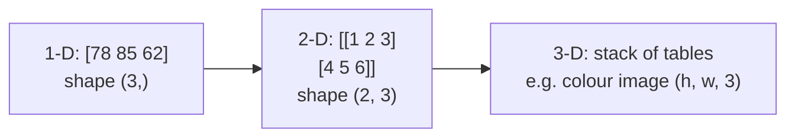

# Session 02: NumPy Library

> Module: Data Science with Python · Term 5 (ADSE) · ⏱ ~2 hours

**NumPy** (Numerical Python) is the foundation of almost every data science library. pandas, Matplotlib and scikit-learn all use NumPy arrays underneath. In this session you learn what an array is, why it is faster and easier than a Python list for numbers, and how to use NumPy's built-in functions on real problems.

## 🎯 Learning Objectives

By the end of this session you will be able to:

- Explain what a NumPy array (`ndarray`) is and create 1-D and 2-D arrays
- Explain why NumPy arrays are preferred over Python lists for numeric work
- Index, slice, filter and reshape arrays
- Use built-in NumPy functions for statistics and maths, including `axis`
- Apply NumPy to a real-world calculation

## 📖 Concepts Explained

### 1. What is a NumPy array?

An **array** is a grid of values that all have the **same data type** (for example all integers). It can have one dimension (a row of numbers), two (a table) or more.



Install with `pip install numpy` and import it as `import numpy as np` (everyone uses the short name `np`).

### 2. Why NumPy instead of a list?

| Feature | Python list | NumPy array |
|---------|-------------|-------------|
| Item types | can mix (`[1, "a", True]`) | one type only |
| Maths on all items | needs a loop | one operation (`arr * 2`) |
| Speed on big data | slow | 10–100× faster (written in C) |
| Memory | more | less |
| `* 2` means | repeat the list | double every number |

> **Analogy:** a list is a shopping bag with mixed items; you check each item by hand. An array is an egg tray: every slot is the same size, so a machine can process the whole tray at once.

Applying an operation to every item without writing a loop is called **vectorisation**.

### 3. Creating arrays

| Function | Example | Result |
|----------|---------|--------|
| `np.array(list)` | `np.array([1, 2])` | `[1 2]` |
| `np.zeros(n)` | `np.zeros(3)` | `[0. 0. 0.]` |
| `np.ones(n)` | `np.ones(2)` | `[1. 1.]` |
| `np.arange(start, stop, step)` | `np.arange(0, 6, 2)` | `[0 2 4]` |
| `np.linspace(a, b, n)` | `np.linspace(0, 1, 3)` | `[0. 0.5 1.]` |
| random | `np.random.default_rng(42).integers(1, 7, 5)` | five dice rolls |

Key properties: `shape` (size of each dimension), `ndim`, `size` (total items) and `dtype` (item type).

### 4. Indexing, slicing and filtering

- `arr[0]` first item, `arr[-1]` last item, `arr[1:4]` items 1 to 3.
- In 2-D: `grid[row, col]`, `grid[0]` whole first row, `grid[:, 1]` whole second column.
- **Boolean filtering:** `arr[arr > 60]` keeps only items where the condition is True. This is one of the most used tricks in data science.
- `reshape(rows, cols)` changes the shape without changing the data (the total size must match).

### 5. Built-in functions and `axis`

| Function | Meaning |
|----------|---------|
| `mean()`, `np.median()` | average, middle value |
| `std()` | standard deviation (how spread out values are) |
| `min()`, `max()`, `argmax()` | smallest, largest, position of largest |
| `sum()`, `np.sort()`, `np.sqrt()`, `np.round()` | total, sorted copy, square roots, rounding |
| `np.where(cond, a, b)` | a where condition is True, else b |

For 2-D arrays, `axis=0` works **down the columns** and `axis=1` works **across the rows**.

## 💻 Code Examples

### Example 1: Creating arrays

File: [`create_arrays.py`](./create_arrays.py)

```python
# create_arrays.py - different ways to create NumPy arrays
import numpy as np

# 1. From a Python list
marks = np.array([78, 85, 62, 91])
print("marks:", marks)

# 2. A 2-D array (rows and columns) from a list of lists
table = np.array([[1, 2, 3],
                  [4, 5, 6]])
print("table:\n", table)

# 3. Ready-made arrays
print("zeros:", np.zeros(4))          # four 0.0 values
print("ones:", np.ones(3))            # three 1.0 values
print("range:", np.arange(0, 10, 2))  # start 0, stop before 10, step 2
print("linspace:", np.linspace(0, 1, 5))  # 5 evenly spaced numbers from 0 to 1

# 4. Random numbers (seed makes the result the same every run)
rng = np.random.default_rng(seed=42)
print("random ints:", rng.integers(1, 7, size=5))   # five dice rolls

# 5. Useful properties of an array
print("shape:", table.shape)   # (rows, columns)
print("ndim:", table.ndim)     # number of dimensions
print("size:", table.size)     # total number of items
print("dtype:", table.dtype)   # data type of the items
```

**How it works:** each line shows a different way to build an array. The seed in `default_rng(seed=42)` makes the "random" numbers repeat every time you run, which helps when you compare results with classmates.

### Example 2: NumPy vs list

File: [`numpy_vs_list.py`](./numpy_vs_list.py)

```python
# numpy_vs_list.py - why NumPy arrays beat Python lists for numbers
import time
import numpy as np

prices_list = [100, 250, 400]
prices_array = np.array([100, 250, 400])

# Adding 10% tax
# List: we need a loop (or comprehension)
taxed_list = [p * 1.10 for p in prices_list]
# Array: one operation applies to every item (vectorisation)
taxed_array = prices_array * 1.10
print("list :", taxed_list)
print("array:", taxed_array)

# Careful: * means something different for lists!
print("list * 2  ->", prices_list * 2)    # repeats the list
print("array * 2 ->", prices_array * 2)   # doubles each number

# Speed test on one million numbers
size = 1_000_000
big_list = list(range(size))
big_array = np.arange(size)

start = time.perf_counter()
squared_list = [x * x for x in big_list]
list_time = time.perf_counter() - start

start = time.perf_counter()
squared_array = big_array * big_array
array_time = time.perf_counter() - start

print(f"list time : {list_time:.4f} s")
print(f"array time: {array_time:.4f} s")
print(f"NumPy was about {list_time / array_time:.0f}x faster")
```

**How it works:** the same tax calculation is done with a list comprehension and with one array operation. The speed test squares one million numbers both ways; your exact times will differ, but NumPy always wins clearly.

### Example 3: Indexing, filtering and reshaping

File: [`array_operations.py`](./array_operations.py)

```python
# array_operations.py - indexing, slicing, reshaping and maths
import numpy as np

scores = np.array([55, 72, 89, 40, 95, 63])

# Indexing and slicing (same as lists)
print("first:", scores[0], "last:", scores[-1])
print("first three:", scores[:3])

# Boolean filtering: keep scores of 60 or more
passed = scores[scores >= 60]
print("passed:", passed)

# Element-wise maths
print("plus 5 bonus:", scores + 5)
print("as percentage of 100:", scores / 100)

# Reshape 6 values into 2 rows x 3 columns
grid = scores.reshape(2, 3)
print("grid:\n", grid)
print("row 0:", grid[0])          # first row
print("column 1:", grid[:, 1])    # second column of every row

# Two arrays of the same shape can be combined item by item
quiz = np.array([8, 9, 7])
lab = np.array([10, 6, 9])
print("quiz + lab:", quiz + lab)
```

**How it works:** `scores >= 60` creates an array of True/False values; putting it inside `[ ]` keeps only the True positions. `reshape(2, 3)` turns six values into a small table.

### Example 4: Statistics and `axis`

File: [`numpy_functions.py`](./numpy_functions.py)

```python
# numpy_functions.py - built-in statistics and maths functions
import numpy as np

# Daily temperatures in Karachi for one week (made-up)
temps = np.array([31, 33, 34, 32, 35, 36, 30])

print("mean:", temps.mean())
print("median:", np.median(temps))
print("std (spread):", round(temps.std(), 2))
print("min/max:", temps.min(), temps.max())
print("day of max (index):", temps.argmax())
print("sorted:", np.sort(temps))
print("rounded square roots:", np.round(np.sqrt(temps), 2))

# Statistics along an axis of a 2-D array
# rows = students, columns = subjects
marks = np.array([[70, 80, 90],
                  [60, 75, 85],
                  [88, 92, 79]])
print("average per student (axis=1):", marks.mean(axis=1).round(1))
print("average per subject (axis=0):", marks.mean(axis=0).round(1))

# np.where: choose a value based on a condition
result = np.where(temps >= 34, "Hot", "Warm")
print("labels:", result)
```

**How it works:** the `marks` table has students as rows. `mean(axis=1)` averages across each row (per student); `mean(axis=0)` averages down each column (per subject). `np.where` labels each day as Hot or Warm.

### Example 5: Real-world use: electricity bills

File: [`electricity_bill.py`](./electricity_bill.py)

```python
# electricity_bill.py - real-world use case: monthly bills for many homes
import numpy as np

# Units used by 6 homes this month
units = np.array([120, 340, 90, 510, 275, 60])

# A simple slab rate: up to 200 units = Rs 25 per unit, above 200 = Rs 40 per unit
rate = np.where(units <= 200, 25, 40)
bill = units * rate

print("units:", units)
print("rate :", rate)
print("bill :", bill)
print("total collected: Rs", bill.sum())
print("average bill   : Rs", round(bill.mean(), 2))
print("homes above Rs 10,000:", np.count_nonzero(bill > 10000))
```

**How it works:** `np.where` picks the right rate for each home in one step, then multiplying two arrays gives every bill at once. No loop needed, even for a million homes.

## 🧪 Lab Practice

1. Create an array of the ages of 10 classmates. Print the mean, median, youngest and oldest.
2. Using `np.arange`, create the numbers 1 to 20 and print only the even ones using boolean filtering.
3. Create a 3 × 4 array of monthly sales (3 shops, 4 months). Print total sales per shop and per month.
4. In `electricity_bill.py`, add a third slab: above 400 units costs Rs 55 per unit (hint: use `np.where` twice, or `np.select`).

## 📝 Assignment

A class of 8 students has marks in 3 subjects. Store them in a 2-D NumPy array. Write a script that prints each student's total and average, the class average per subject, the position (index) of the top student, and a label array saying "Pass" if the average is 50 or more, otherwise "Fail".

## ❓ Quick Quiz

1. What does `np.arange(1, 10, 3)` return?
2. What is the shape of `np.zeros((2, 5))`?
3. What does `[1, 2] * 2` give for a list, and for `np.array([1, 2]) * 2`?
4. In a 2-D array, which axis gives one value per row?
5. Which function returns the index of the largest value?

<details>
<summary>Show answers</summary>

1. `[1 4 7]`
2. `(2, 5)`
3. List: `[1, 2, 1, 2]`; array: `[2 4]`
4. `axis=1`
5. `argmax()`

</details>

## 💼 Interview Questions

1. **Why is NumPy faster than Python lists?** — Arrays store same-type values in one continuous block of memory and operations run in optimised C code, so there is no Python loop overhead for each item.
2. **What is broadcasting?** — NumPy's rule for combining arrays of different shapes, such as adding a single number or a 1-D row to every row of a 2-D array, without copying data by hand.
3. **What is the difference between `reshape` and `flatten`?** — `reshape` gives the same data a new shape (often as a view); `flatten` always returns a new 1-D copy.

## ✅ Summary

- A NumPy array holds values of one type in one or more dimensions.
- Arrays are faster, smaller and easier than lists for maths, thanks to vectorisation.
- Use slicing and boolean filtering to pick data; `reshape` to change shape.
- Built-in functions (`mean`, `std`, `argmax`, `where`) and `axis` make analysis short.
- NumPy is the base layer under pandas, Matplotlib and scikit-learn.

---

[⬅ Previous](../Session-01-Introduction-to-Data-Science-with-Python/README.md) · [🏠 Module Home](../README.md) · [Next ➡](../Session-03-Pandas-Series-and-DataFrames/README.md)

Prepared by Zeeshan Abbas · Aptech Learning North Nazimabad
