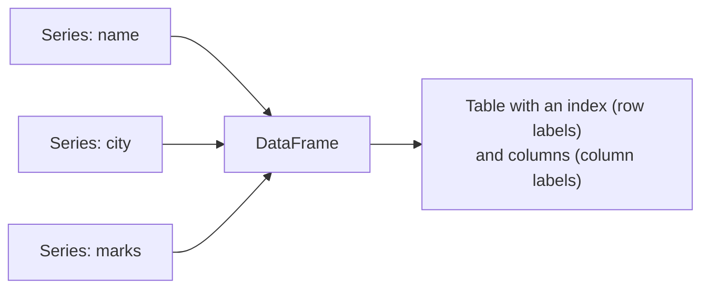

# Session 03: Pandas Series and DataFrame Operations

> Module: Data Science with Python · Term 5 (ADSE) · ⏱ ~2 hours

**pandas** is the most important library for everyday data work. It gives Python two structures that feel like a spreadsheet: the **Series** (one column) and the **DataFrame** (a whole table). In this session you create both, do maths and filtering on them, and learn the difference between the two selectors every interviewer asks about: `loc` and `iloc`.

## 🎯 Learning Objectives

By the end of this session you will be able to:

- Explain one-dimensional and two-dimensional data structures
- Create a pandas Series from a list or dictionary and use its index
- Perform maths, filtering and statistics on a Series
- Create a DataFrame, select columns, add columns and filter rows
- Distinguish `loc` (by label) from `iloc` (by position)

## 📖 Concepts Explained

### 1. One-dimensional vs two-dimensional data

- **1-D data** is a single list of values: the marks of a class, the price of each item. In pandas this is a **Series**.
- **2-D data** has rows **and** columns: a full mark sheet with name, city, age and marks. In pandas this is a **DataFrame**.



> **Analogy:** a Series is one column in an Excel sheet; a DataFrame is the whole sheet. Each column of a DataFrame is itself a Series.

Install with `pip install pandas` and import it as `import pandas as pd`.

### 2. The Series

A Series has **values** and an **index** (labels). If you do not give labels, pandas uses 0, 1, 2 ...

| Create from | Code | Index |
|-------------|------|-------|
| list | `pd.Series([10, 20])` | 0, 1 |
| list + labels | `pd.Series([10, 20], index=["a", "b"])` | a, b |
| dictionary | `pd.Series({"a": 10, "b": 20})` | a, b |

Series behave like NumPy arrays (vectorised maths, boolean filtering) **plus** labels. Useful methods: `sum()`, `mean()`, `max()`, `idxmax()` (label of the max), `sort_values()`, `value_counts()`.

When you add or subtract two Series, pandas matches values **by label**, not by position. This is called **alignment**.

### 3. The DataFrame

The easiest way to build one is a dictionary where every key is a column name and every value is a list of the same length.

| Task | Code |
|------|------|
| size | `df.shape` → `(rows, columns)` |
| column names | `df.columns` |
| one column (Series) | `df["marks"]` |
| several columns | `df[["name", "marks"]]` (double brackets) |
| new column | `df["passed"] = df["marks"] >= 70` |
| filter rows | `df[df["city"] == "Karachi"]` |
| combine conditions | `df[(df["age"] > 20) & (df["marks"] > 80)]` |

Use `&` (and), `|` (or) and put brackets around each condition.

### 4. `loc` vs `iloc`

| | `loc` | `iloc` |
|---|-------|--------|
| Selects by | **labels** (index names, column names) | **positions** (0, 1, 2 ...) |
| Example | `df.loc["P2", "price"]` | `df.iloc[1, 1]` |
| Slice end | **included** (`"P1":"P3"` gives 3 rows) | **excluded** (`0:2` gives 2 rows) |
| Conditions | yes: `df.loc[df["price"] > 100, "product"]` | no (positions only) |

> **Memory trick:** **i**loc = **i**nteger position. loc = label.

## 💻 Code Examples

### Example 1: Creating a Series

File: [`series_basics.py`](./series_basics.py)

```python
# series_basics.py - a Series is ONE column of data with labels
import pandas as pd

# 1. Series from a list (labels are 0, 1, 2 ... by default)
marks = pd.Series([78, 85, 62, 91])
print(marks)

# 2. Series with our own labels (the index)
prices = pd.Series([250, 120, 80], index=["burger", "fries", "drink"])
print("\n", prices)

# 3. Series from a dictionary (keys become labels)
population = pd.Series({"Karachi": 20.4, "Lahore": 13.0, "Faisalabad": 3.6})
print("\nPopulation in millions:\n", population)

# Reading values
print("\nPrice of fries:", prices["fries"])     # by label
print("First mark:", marks[0])                   # by default number label
```

**How it works:** the same idea built three ways. With labels you can read a value by name, like `prices["fries"]`, which is clearer than remembering a position.

### Example 2: Working with a Series

File: [`series_operations.py`](./series_operations.py)

```python
# series_operations.py - maths, filtering and statistics on a Series
import pandas as pd

sales = pd.Series([1200, 950, 1800, 400, 1500],
                  index=["Mon", "Tue", "Wed", "Thu", "Fri"])

# Maths applies to every value (like NumPy)
print("Sales after 5% discount:\n", sales * 0.95)

# Filtering with a condition
print("\nGood days (> 1000):\n", sales[sales > 1000])

# Quick statistics
print("\nTotal:", sales.sum())
print("Average:", sales.mean())
print("Best day:", sales.idxmax())    # label of the largest value
print("\nSorted high to low:\n", sales.sort_values(ascending=False))

# Two Series line up by label automatically
target = pd.Series([1000, 1000, 1500, 1000, 1200],
                   index=["Mon", "Tue", "Wed", "Thu", "Fri"])
print("\nAbove target by:\n", sales - target)
```

**How it works:** `sales * 0.95` changes every value at once; `sales[sales > 1000]` keeps the good days; `idxmax()` returns the **label** of the biggest value ("Wed"). `sales - target` matches Mon with Mon, Tue with Tue, and so on.

### Example 3: Creating and using a DataFrame

File: [`dataframe_basics.py`](./dataframe_basics.py)

```python
# dataframe_basics.py - a DataFrame is a TABLE: many Series side by side
import pandas as pd

# Build a DataFrame from a dictionary: each key is a column
students = pd.DataFrame({
    "name":  ["Ayesha", "Bilal", "Hira", "Usman", "Sana"],
    "city":  ["Karachi", "Lahore", "Karachi", "Multan", "Lahore"],
    "age":   [20, 22, 21, 23, 20],
    "marks": [88, 72, 95, 64, 81],
})

print(students)
print("\nShape (rows, columns):", students.shape)
print("Columns:", list(students.columns))

# One column = a Series
print("\nMarks column:\n", students["marks"])

# Several columns = a smaller DataFrame (note the double brackets)
print("\nName and marks:\n", students[["name", "marks"]])

# Add a new column calculated from another
students["passed"] = students["marks"] >= 70
print("\nWith new column:\n", students)

# Filter rows
print("\nStudents from Karachi:\n", students[students["city"] == "Karachi"])
```

**How it works:** the dictionary becomes a table with five rows. One pair of brackets returns a Series; two pairs return a DataFrame. The new `passed` column holds True/False for every student in one line.

### Example 4: `loc` and `iloc`

File: [`loc_vs_iloc.py`](./loc_vs_iloc.py)

```python
# loc_vs_iloc.py - two ways to select rows and columns
import pandas as pd

df = pd.DataFrame({
    "product": ["Pen", "Notebook", "Bag", "Ruler"],
    "price":   [30, 150, 1200, 50],
    "stock":   [500, 200, 25, 300],
}, index=["P1", "P2", "P3", "P4"])     # our own row labels
print(df, "\n")

# loc  -> select by LABEL (row label, column name)
print("loc['P3']:\n", df.loc["P3"], "\n")
print("loc['P2', 'price']:", df.loc["P2", "price"])
print("loc['P1':'P3', ['product', 'stock']]:\n", df.loc["P1":"P3", ["product", "stock"]], "\n")
# Note: with loc the END label 'P3' IS included

# iloc -> select by POSITION number (0, 1, 2 ...)
print("iloc[0]:\n", df.iloc[0], "\n")
print("iloc[1, 1]:", df.iloc[1, 1])
print("iloc[0:2, 0:2]:\n", df.iloc[0:2, 0:2])
# Note: with iloc the END position 2 is NOT included (like Python slices)

# loc with a condition: products that cost more than 100
print("\nExpensive products:\n", df.loc[df["price"] > 100, ["product", "price"]])
```

**How it works:** the rows are labelled P1–P4. `loc` uses those labels and includes the end of a slice; `iloc` uses positions and stops before the end. The last line shows `loc` with a condition and a column list together.

## 🧪 Lab Practice

1. Create a Series of the runs scored by a batter in 6 matches, labelled `"M1"` to `"M6"`. Print the total, the average and the match with the highest score.
2. Build a DataFrame of 6 mobile phones with columns `brand`, `price` and `ram_gb`. Print only phones under Rs 60,000.
3. Add a column `price_usd` (divide by a rate of your choice) and a column `budget` that is True when the price is under Rs 50,000.
4. Using the same DataFrame, select the 2nd to 4th rows and first two columns with `iloc`, then the same with `loc`.

## 📝 Assignment

Create a DataFrame of 10 employees (`name`, `department`, `salary`, `years`). Write a script that: prints employees with more than 3 years, adds a `bonus` column (10% of salary), uses `loc` to show name and bonus of the IT department only, and uses `iloc` to print the last three rows.

## ❓ Quick Quiz

1. What is the default index of `pd.Series([5, 6, 7])`?
2. What type does `df["marks"]` return? And `df[["marks"]]`?
3. `df.loc["A":"C"]` vs `df.iloc[0:3]` — how many rows does each return if the index is A, B, C, D?
4. Which operator joins two filter conditions with AND?
5. What does `idxmax()` return?

<details>
<summary>Show answers</summary>

1. 0, 1, 2
2. A Series; a DataFrame
3. Both return 3 rows (loc includes C; iloc stops before position 3)
4. `&` (with brackets around each condition)
5. The index label of the largest value

</details>

## 💼 Interview Questions

1. **Difference between a Series and a DataFrame?** — A Series is a 1-D labelled array (one column); a DataFrame is a 2-D labelled table made of several Series that share the same index.
2. **When would you use `loc` instead of `iloc`?** — Use `loc` when selecting by meaningful labels or with boolean conditions; use `iloc` when you need rows by their position, such as "the first 5 rows".
3. **What is index alignment?** — When two Series or DataFrames are combined, pandas matches values by their labels, inserting NaN where a label exists in only one of them.

## ✅ Summary

- A Series is one labelled column; a DataFrame is a labelled table of Series.
- Both support vectorised maths, filtering and quick statistics.
- Select columns with `df["col"]` or `df[["a", "b"]]` and filter rows with conditions.
- `loc` selects by labels (end included); `iloc` selects by positions (end excluded).

---

[⬅ Previous](../Session-02-NumPy-Library/README.md) · [🏠 Module Home](../README.md) · [Next ➡](../Session-04-Advanced-Pandas-CSV-Exploration-and-GroupBy/README.md)

Prepared by Zeeshan Abbas · Aptech Learning North Nazimabad
