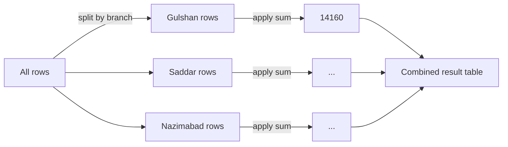

# Session 04: Advanced Pandas — CSV Files, Data Exploration and GroupBy

> Module: Data Science with Python · Term 5 (ADSE) · ⏱ ~2 hours

Real data rarely arrives typed into your code. It comes as files, and the most common file is the **CSV** (comma-separated values). In this session you read and write CSV files with pandas, learn the standard set of commands to explore any new dataset in minutes, and use `groupby()` to answer business questions such as "which branch earns the most?". We finish with a small case study on a bakery chain's sales.

## 🎯 Learning Objectives

By the end of this session you will be able to:

- Read a CSV file into a DataFrame and write a DataFrame back to CSV
- Use exploration commands: `head`, `tail`, `info`, `describe`, `unique`, `value_counts`, `isnull`
- Sort data and create calculated columns
- Use `groupby()` with `sum`, `mean`, `count` and `agg()` to summarise data
- Solve a small real-world case study end to end

## 📖 Concepts Explained

### 1. What is a CSV file?

A CSV file is plain text where each line is a row and commas separate the columns. The first line usually holds the column names. Excel, Google Sheets and every database can export CSV, which is why it is everywhere.

```text
date,branch,category,item,quantity,unit_price
2026-01-03,Gulshan,Bakery,Cake,4,1200
```

| Task | Code | Notes |
|------|------|-------|
| read | `pd.read_csv("file.csv")` | also works with a URL |
| some columns | `usecols=["a", "b"]` | faster on large files |
| dates | `parse_dates=["date"]` | turns text into real dates |
| other separator | `sep=";"` | for files that use `;` |
| write | `df.to_csv("out.csv", index=False)` | `index=False` skips row numbers |

### 2. Exploring a new dataset

Before any analysis, get to know the data. Run this checklist every time:

| Command | Answers the question |
|---------|---------------------|
| `df.shape` | How big is it? |
| `df.head()` / `df.tail()` | What do rows look like? |
| `df.info()` | Which types? Any missing values? |
| `df.describe()` | Min, max, mean, quartiles of number columns |
| `df["col"].unique()` / `nunique()` | Which different values exist? How many? |
| `df["col"].value_counts()` | How often does each value appear? |
| `df.isnull().sum()` | How many blanks per column? |
| `df.sort_values("col", ascending=False)` | What are the top rows? |

### 3. GroupBy: split, apply, combine

`groupby()` is like making piles of receipts, one pile per branch, then adding up each pile.



| Pattern | Code |
|---------|------|
| one column, one summary | `df.groupby("branch")["revenue"].sum()` |
| average | `df.groupby("category")["quantity"].mean()` |
| many summaries | `df.groupby("category").agg(total=("revenue", "sum"), orders=("item", "count"))` |
| two group columns | `df.groupby(["branch", "category"])["revenue"].sum()` |

Common summary functions: `sum`, `mean`, `median`, `count`, `min`, `max`, `std`.

### 4. A simple analysis plan

1. Load the file. 2. Explore it. 3. Add the columns you need (like `revenue`). 4. Group and summarise. 5. Sort and pick the answer. 6. Draw one clear chart.

## 💻 Code Examples

All examples use the dataset [`shop_sales.csv`](./shop_sales.csv): 16 sales rows from three bakery branches in Karachi. Run the scripts from inside this folder.

### Example 1: Read and write CSV

File: [`read_write_csv.py`](./read_write_csv.py)

```python
# read_write_csv.py - load a CSV file into a DataFrame and save results back
import pandas as pd

# Read the CSV file that sits in the same folder
df = pd.read_csv("shop_sales.csv")
print("Loaded", len(df), "rows")
print(df.head())                # first 5 rows

# Add a calculated column: money earned on each row
df["revenue"] = df["quantity"] * df["unit_price"]

# Keep only the Bakery rows
bakery = df[df["category"] == "Bakery"]

# Save to a new CSV file (index=False means do not write the 0,1,2 row numbers)
bakery.to_csv("bakery_sales.csv", index=False)
print("\nSaved", len(bakery), "bakery rows to bakery_sales.csv")

# Read only some columns, and tell pandas which column holds dates
small = pd.read_csv("shop_sales.csv", usecols=["date", "item", "quantity"],
                    parse_dates=["date"])
print("\n", small.dtypes)
```

**How it works:** `read_csv` turns the file into a DataFrame. We add `revenue`, filter the Bakery rows and save them to `bakery_sales.csv`. The last read loads only three columns and converts `date` to a real date type (`datetime64`).

### Example 2: Exploration checklist

File: [`explore_data.py`](./explore_data.py)

```python
# explore_data.py - the first commands to run on ANY new dataset
import pandas as pd

df = pd.read_csv("shop_sales.csv")

print("1) shape:", df.shape)                 # rows, columns
print("\n2) first rows:\n", df.head(3))
print("\n3) last rows:\n", df.tail(2))
print("\n4) info (types, missing values):")
df.info()
print("\n5) describe (number statistics):\n", df.describe())
print("\n6) unique branches:", df["branch"].unique())
print("   how many items:", df["item"].nunique())
print("\n7) value counts per category:\n", df["category"].value_counts())
print("\n8) missing values per column:\n", df.isnull().sum())
print("\n9) sorted by quantity (top 3):\n",
      df.sort_values("quantity", ascending=False).head(3))
```

**How it works:** each numbered print answers one question from the checklist. `info()` prints directly (no `print` needed). `describe()` only covers number columns.

### Example 3: GroupBy

File: [`groupby_analysis.py`](./groupby_analysis.py)

```python
# groupby_analysis.py - split rows into groups, then summarise each group
import pandas as pd

df = pd.read_csv("shop_sales.csv")
df["revenue"] = df["quantity"] * df["unit_price"]

# Total revenue for each branch
by_branch = df.groupby("branch")["revenue"].sum()
print("Revenue per branch:\n", by_branch)

# Average quantity sold per category
print("\nAverage quantity per category:\n",
      df.groupby("category")["quantity"].mean().round(1))

# Several summaries at once with agg()
summary = df.groupby("category").agg(
    total_revenue=("revenue", "sum"),
    orders=("item", "count"),
    biggest_order=("quantity", "max"),
)
print("\nCategory summary:\n", summary)

# Group by TWO columns
print("\nRevenue per branch and category:\n",
      df.groupby(["branch", "category"])["revenue"].sum())
```

**How it works:** `groupby("branch")` makes one group per branch and `["revenue"].sum()` adds each group's revenue. `agg()` gives several named summaries in one table. Grouping by two columns gives a result with a two-level index.

### Example 4: Case study — the bakery owner's questions

File: [`case_study_bakery.py`](./case_study_bakery.py)

```python
# case_study_bakery.py - a short real-time style case study
# Owner asks: "Which branch earns most, what sells best, and which day was busiest?"
import pandas as pd
import matplotlib
matplotlib.use("Agg")                 # save charts to files
import matplotlib.pyplot as plt

# 1. Load and prepare
df = pd.read_csv("shop_sales.csv", parse_dates=["date"])
df["revenue"] = df["quantity"] * df["unit_price"]

# 2. Best branch
branch_revenue = df.groupby("branch")["revenue"].sum().sort_values(ascending=False)
print("Best branch:", branch_revenue.index[0], "Rs", branch_revenue.iloc[0])

# 3. Best-selling item by quantity
item_qty = df.groupby("item")["quantity"].sum().sort_values(ascending=False)
print("Best-selling item:", item_qty.index[0], "-", item_qty.iloc[0], "units")

# 4. Busiest day by revenue
day_revenue = df.groupby("date")["revenue"].sum()
print("Busiest day:", day_revenue.idxmax().date(), "Rs", day_revenue.max())

# 5. Share of revenue per category (in percent)
share = df.groupby("category")["revenue"].sum() / df["revenue"].sum() * 100
print("\nRevenue share %:\n", share.round(1))

# 6. Quick bar chart of branch revenue
branch_revenue.plot(kind="bar", color="orange", title="Revenue by branch (Rs)")
plt.ylabel("Revenue")
plt.tight_layout()
plt.savefig("branch_revenue.png")
print("\nChart saved as branch_revenue.png")
```

**How it works:** each question becomes one groupby followed by sorting or `idxmax()`. Dividing a category's revenue by the overall total gives its share. `Series.plot(kind="bar")` uses Matplotlib behind the scenes and the chart is saved as `branch_revenue.png`.

## 🧪 Lab Practice

1. Open `shop_sales.csv` in Excel or a text editor and add 4 new rows of your own. Re-run `explore_data.py` and check the new shape.
2. Find the total quantity of each item, sorted from highest to lowest.
3. Find the average `unit_price` and the number of rows per branch using one `agg()` call.
4. Save a CSV called `branch_summary.csv` holding total revenue per branch.

## 📝 Assignment

Create your own CSV of at least 20 rows about a topic you like (cricket matches, mobile phone sales, monthly expenses). Write a script that explores it with the checklist, adds one calculated column, answers three questions using `groupby()`, saves one summary CSV, and saves one bar chart as PNG.

## ❓ Quick Quiz

1. Which argument stops `to_csv` from writing row numbers?
2. Which command shows column types and missing values together?
3. What does `value_counts()` return?
4. Write the code for total revenue per category.
5. What are the three steps behind groupby?

<details>
<summary>Show answers</summary>

1. `index=False`
2. `df.info()`
3. A Series with each unique value and how many times it appears (largest first)
4. `df.groupby("category")["revenue"].sum()`
5. Split, apply, combine

</details>

## 💼 Interview Questions

1. **How would you read a 5 GB CSV that does not fit in memory?** — Read only needed columns with `usecols`, set smaller dtypes, or process it in pieces with `chunksize=` and combine the results.
2. **What is the difference between `count()` and `size()` after groupby?** — `count()` counts non-missing values per column, while `size()` counts all rows in each group including missing values.
3. **What does `describe()` show?** — For numeric columns: count, mean, standard deviation, min, 25%, 50% (median), 75% and max.

## ✅ Summary

- `read_csv` and `to_csv` move data between files and DataFrames.
- Always explore first: shape, head, info, describe, value_counts, isnull.
- `groupby()` splits rows into groups, applies a summary and combines results.
- `agg()` gives several named summaries at once; group by two columns for deeper detail.

---

[⬅ Previous](../Session-03-Pandas-Series-and-DataFrames/README.md) · [🏠 Module Home](../README.md) · [Next ➡](../Session-05-Practice-Lab-Python-NumPy-and-Pandas/README.md)

Prepared by Zeeshan Abbas · Aptech Learning North Nazimabad
