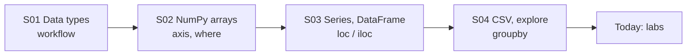

# Session 05: Practice Lab — Python, NumPy and Pandas (Sessions 1–4)

> Module: Data Science with Python · Term 5 (ADSE) · ⏱ ~2 hours

This is a hands-on lab. There are no new topics; you practise everything from Sessions 1 to 4 by solving three guided labs and a set of "try it yourself" challenges. Try each task on your own first, then compare with the solution file. Typing the code yourself is the fastest way to remember it.

## 🎯 Learning Objectives

By the end of this lab you will be able to:

- Use NumPy arrays, `axis`, boolean masks and `np.select` to analyse marks
- Load a CSV with pandas, add calculated columns and filter rows
- Summarise data with `groupby().agg()` and read values with `loc`
- Save results as a CSV report and a PNG chart
- Plan a small analysis from question to answer on your own

## 📖 Concepts Explained

### 1. Quick revision map



### 2. Cheat sheet

| I want to... | NumPy | pandas |
|---|---|---|
| create | `np.array([...])` | `pd.DataFrame({...})`, `pd.read_csv()` |
| average per row | `arr.mean(axis=1)` | `df.mean(axis=1, numeric_only=True)` |
| filter | `arr[arr > 50]` | `df[df["runs"] > 50]` |
| label by rule | `np.where`, `np.select` | same functions on columns |
| group summary | — | `df.groupby("col").agg(...)` |
| save | `np.savetxt()` | `df.to_csv()`, `.plot()` + `plt.savefig()` |

### 3. New helpers you will meet in the labs

- **`np.select(conditions, choices, default)`**: like several `if/elif` rules at once. The first True condition wins.
- **`arr.any(axis=1)`**: True for a row if *any* value in that row is True. `all()` needs every value to be True.
- **Strike rate** (cricket): `runs / balls * 100`, how many runs per 100 balls.
- **`zip()`**: walks through two or more lists together, item by item.

### 4. How to approach a lab task

1. Read the question and write the expected answer type (a number? a table? a chart?).
2. Find the columns you need.
3. Do one step at a time and `print()` after every step.
4. Only then combine steps into one neat script.

## 💻 Code Examples

The dataset [`cricket_scores.csv`](./cricket_scores.csv) has 12 innings from 3 matches (made-up scores for practice): `match, date, player, team, runs, balls, fours, sixes`.

### Lab 1: Class marks with NumPy

File: [`lab1_numpy_marks.py`](./lab1_numpy_marks.py)

```python
# lab1_numpy_marks.py - Lab 1: analyse class marks with NumPy
import numpy as np

# Rows = 6 students, columns = 3 subjects (Python, Stats, English)
names = np.array(["Ali", "Sara", "Omar", "Zoya", "Hamza", "Iqra"])
marks = np.array([
    [78, 65, 80],
    [92, 88, 85],
    [45, 52, 60],
    [67, 74, 70],
    [55, 40, 58],
    [88, 91, 79],
])

# Task 1: total and average per student (across the row -> axis=1)
totals = marks.sum(axis=1)
averages = marks.mean(axis=1).round(1)
for name, total, avg in zip(names, totals, averages):
    print(f"{name:<6} total={total}  average={avg}")

# Task 2: average per subject (down the column -> axis=0)
print("\nSubject averages:", marks.mean(axis=0).round(1))

# Task 3: the topper
print("Topper:", names[totals.argmax()])

# Task 4: grade labels with np.select (several conditions)
conditions = [averages >= 80, averages >= 60, averages >= 50]
grades = ["A", "B", "C"]
labels = np.select(conditions, grades, default="F")
print("Grades:", dict(zip(names.tolist(), labels.tolist())))

# Task 5: how many students failed any subject (mark below 50)?
failed_any = (marks < 50).any(axis=1)
print("Failed at least one subject:", names[failed_any])
```

**How it works:** `axis=1` gives one value per student; `axis=0` one value per subject. `np.select` checks the rules from top to bottom, so an 88 average matches `>= 80` first and becomes "A". `(marks < 50).any(axis=1)` builds a mask of students who failed at least one subject.

### Lab 2: Cricket scores with pandas

File: [`lab2_pandas_cricket.py`](./lab2_pandas_cricket.py)

```python
# lab2_pandas_cricket.py - Lab 2: explore and summarise cricket scores with pandas
import pandas as pd

df = pd.read_csv("cricket_scores.csv", parse_dates=["date"])

# Task 1: explore
print("Shape:", df.shape)
print(df.head(4))

# Task 2: new column - strike rate = runs per 100 balls
df["strike_rate"] = (df["runs"] / df["balls"] * 100).round(1)

# Task 3: filter - innings of 50 or more runs
fifties = df[df["runs"] >= 50]
print("\nFifty-plus innings:\n", fifties[["match", "player", "runs"]])

# Task 4: player summary with groupby + agg
summary = df.groupby("player").agg(
    total_runs=("runs", "sum"),
    average=("runs", "mean"),
    best=("runs", "max"),
    sixes=("sixes", "sum"),
).sort_values("total_runs", ascending=False)
print("\nPlayer summary:\n", summary.round(1))

# Task 5: team total per match
team_match = df.groupby(["match", "team"])["runs"].sum()
print("\nTeam runs per match:\n", team_match)

# Task 6: use loc to read one value
print("\nBabar's best score:", summary.loc["Babar", "best"])
```

**How it works:** we explore, create `strike_rate`, filter fifty-plus innings and build a player summary sorted by total runs. Grouping by `["match", "team"]` gives each team's total per match. Because the summary's index is the player name, `summary.loc["Babar", "best"]` reads one cell directly.

### Lab 3: A saved mini report

File: [`lab3_mini_report.py`](./lab3_mini_report.py)

```python
# lab3_mini_report.py - Lab 3: turn the analysis into a saved report
import pandas as pd
import matplotlib
matplotlib.use("Agg")
import matplotlib.pyplot as plt

df = pd.read_csv("cricket_scores.csv")

# Boundary runs: 4 runs per four, 6 runs per six
df["boundary_runs"] = df["fours"] * 4 + df["sixes"] * 6

# Per-player report
report = df.groupby("player")[["runs", "balls", "boundary_runs"]].sum()
report["strike_rate"] = (report["runs"] / report["balls"] * 100).round(1)
report["boundary_pct"] = (report["boundary_runs"] / report["runs"] * 100).round(1)
print(report)

# Save the report as CSV
report.to_csv("player_report.csv")
print("\nSaved player_report.csv")

# Save a chart of total runs
report["runs"].sort_values().plot(kind="barh", color="green",
                                  title="Total runs in 3 matches")
plt.xlabel("Runs")
plt.tight_layout()
plt.savefig("player_runs.png")
print("Saved player_runs.png")
```

**How it works:** boundary runs are calculated per row, then summed per player. Ratios such as strike rate are calculated **after** grouping (from total runs and total balls), which is more correct than averaging each innings' strike rate. The report is saved as `player_report.csv` and the chart as `player_runs.png`.

## 🧪 Lab Practice

Try these without looking at the solutions:

1. **NumPy:** generate 30 random daily temperatures between 25 and 40 (use a seed). Print the hottest day number, the number of days above 35, and label each day "Hot" / "Normal".
2. **Series:** create a Series of monthly mobile data usage in GB for 12 months (labels Jan–Dec). Print the months above the yearly average.
3. **DataFrame:** using `cricket_scores.csv`, find each player's number of innings where they hit at least one six.
4. **GroupBy:** find which team scored more runs in total, and the average runs per innings for each team.
5. **Report:** add a `ducks` count (innings under 10 runs) to the player report and save it again.

## 📝 Assignment

Create `grocery.csv` with at least 25 rows (`date, customer, item, category, qty, price`). Write `grocery_report.py` that: explores the data, adds a `total` column, finds the top 3 customers by spend, the best category, the average bill per day, saves `grocery_summary.csv` and saves a bar chart `category_sales.png`. Add a comment above every block explaining what it does.

## ❓ Quick Quiz

1. What does `np.select` return when no condition is True?
2. Why calculate strike rate after grouping instead of averaging each innings' strike rate?
3. Which code gives the number of rows per player?
4. What does `arr.any(axis=1)` return for `[[True, False], [False, False]]`?
5. How do you sort a DataFrame by `total_runs` from high to low?

<details>
<summary>Show answers</summary>

1. The `default` value
2. Averaging ratios gives every innings equal weight, even a 5-ball innings; total runs ÷ total balls is the true rate
3. `df.groupby("player").size()` or `df["player"].value_counts()`
4. `[True, False]`
5. `df.sort_values("total_runs", ascending=False)`

</details>

## 💼 Interview Questions

1. **Given a sales table, how would you find the top 3 customers by spend?** — Add a total column, `groupby("customer")["total"].sum()`, then `sort_values(ascending=False).head(3)` (or `nlargest(3)`).
2. **When would you still use NumPy if pandas exists?** — For fast maths on plain numeric grids (images, matrices, simulations) where labels are not needed; pandas itself is built on NumPy.
3. **How do you check your analysis is correct?** — Print intermediate results, test with a tiny dataset you can calculate by hand, check totals add up, and look for missing or duplicate rows.

## ✅ Summary

- You practised the full path: data → arrays/DataFrames → filters → groups → saved report.
- `np.select`, `any()` and `zip()` are handy helpers for rule-based labels.
- Calculate ratios from totals after grouping.
- Print after every step; build the final script only when each step works.

---

[⬅ Previous](../Session-04-Advanced-Pandas-CSV-Exploration-and-GroupBy/README.md) · [🏠 Module Home](../README.md) · [Next ➡](../Session-06-MongoDB-Database-Interaction-with-PyMongo/README.md)

Prepared by Zeeshan Abbas · Aptech Learning North Nazimabad
