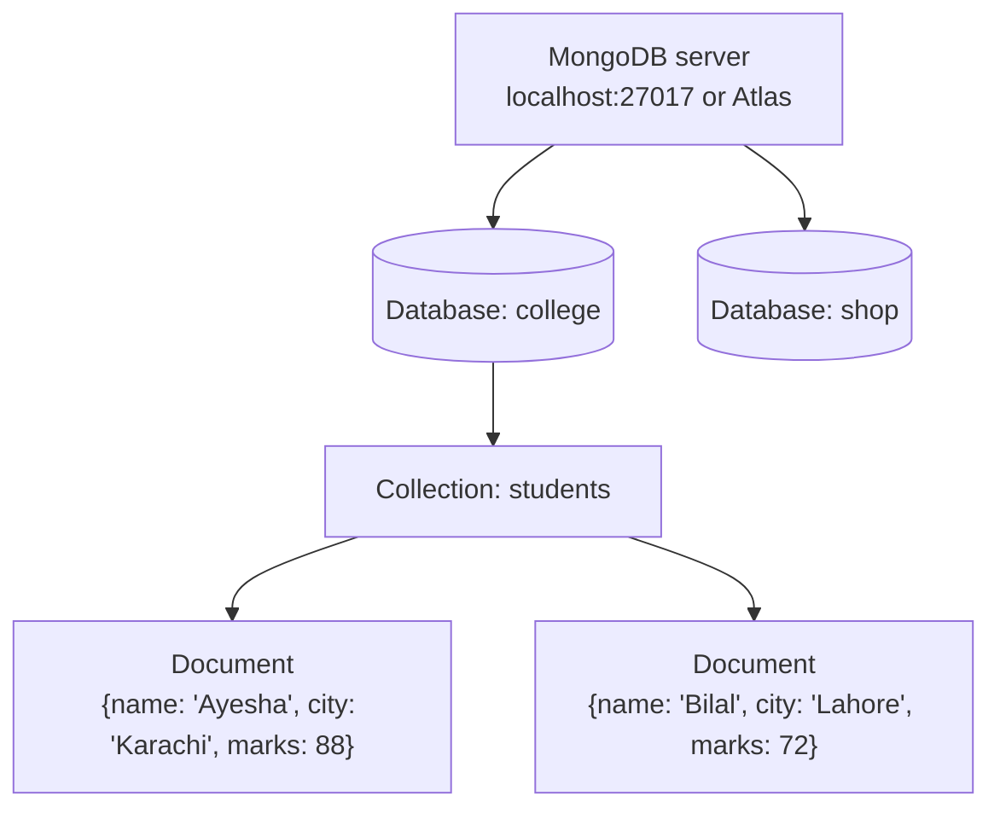

# Session 06: MongoDB Database Interaction with PyMongo

> Module: Data Science with Python · Term 5 (ADSE) · ⏱ ~2 hours

A lot of modern app data (orders, user profiles, sensor readings) lives in **MongoDB**, a NoSQL database that stores JSON-like documents. As a data scientist you need to pull that data into Python, analyse it and show it as charts. In this session you connect to MongoDB with the **PyMongo** driver, insert, query, update and delete documents, and then move the data into pandas for visualisation.

## 🎯 Learning Objectives

By the end of this session you will be able to:

- Explain why data visualisation matters at the end of a data pipeline
- Describe MongoDB's structure: server, database, collection, document
- Connect to a local or Atlas MongoDB server using PyMongo
- Insert, find, update and delete documents from Python
- Use an aggregation pipeline and load results into a pandas DataFrame
- Visualise MongoDB data with a chart saved as PNG

## 📖 Concepts Explained

### 1. Why visualisation?

Numbers in a table are hard to compare; a picture is understood in seconds. Visualisation helps you **spot patterns, outliers and trends**, **check data quality**, and **tell the story** to managers who will not read code. Getting data out of a database is only half the job; turning it into a clear chart completes it.

### 2. MongoDB in one picture



| SQL word | MongoDB word |
|----------|--------------|
| database | database |
| table | collection |
| row | document |
| column | field |
| primary key | `_id` (added automatically) |

Documents in one collection do not need identical fields. That flexibility is why MongoDB is popular for fast-changing apps.

### 3. PyMongo basics

Install: `pip install pymongo`. You also need a running MongoDB: either **MongoDB Community Server** on your PC or a free **MongoDB Atlas** cluster in the cloud.

| Step | Code |
|------|------|
| connect | `client = MongoClient("mongodb://localhost:27017/")` |
| pick database | `db = client["college"]` |
| pick collection | `students = db["students"]` |
| close | `client.close()` |

Databases and collections are created automatically the first time you insert into them.

### 4. CRUD operations

| Operation | Method | Example |
|-----------|--------|---------|
| Create | `insert_one`, `insert_many` | `students.insert_one({"name": "Ali"})` |
| Read | `find_one`, `find`, `count_documents` | `students.find({"city": "Karachi"})` |
| Update | `update_one`, `update_many` | `{"$set": {"price": 35}}`, `{"$inc": {"stock": 10}}` |
| Delete | `delete_one`, `delete_many` | `students.delete_many({"marks": {"$lt": 40}})` |

Query operators: `$gt` (>), `$gte` (>=), `$lt` (<), `$lte` (<=), `$ne` (not equal), `$in` (in a list). A **projection** such as `{"_id": 0}` controls which fields come back. `.sort("marks", -1)` sorts high to low.

### 5. From MongoDB to pandas

Two common ways:

1. **Let MongoDB summarise** with an aggregation pipeline (`$match`, `$group`, `$sort`), then read the small result. Best for huge collections.
2. **Load documents into pandas** with `pd.DataFrame(list(collection.find()))` and use groupby and plotting. Best for small to medium data and quick exploration.

## 💻 Code Examples

> **No MongoDB yet?** `connect_mongodb.py` prints a friendly message instead of crashing. Start your server (or set your Atlas string) and run the other files. Each script inserts its own sample data, so you can run them in any order.

### Example 1: Connect and ping

File: [`connect_mongodb.py`](./connect_mongodb.py)

```python
# connect_mongodb.py - connect Python to a MongoDB server with PyMongo
# Install the driver first:  pip install pymongo
from pymongo import MongoClient
from pymongo.errors import ServerSelectionTimeoutError

# The connection string: a local server on the default port 27017
# For MongoDB Atlas (cloud) paste your own string, e.g.
# "mongodb+srv://<user>:<password>@cluster0.xxxxx.mongodb.net/"
CONNECTION_STRING = "mongodb://localhost:27017/"

# Wait at most 3 seconds for the server to answer
client = MongoClient(CONNECTION_STRING, serverSelectionTimeoutMS=3000)

try:
    client.admin.command("ping")          # a tiny "are you there?" request
    print("Connected to MongoDB!")
    print("Databases:", client.list_database_names())
except ServerSelectionTimeoutError:
    print("Could not reach MongoDB. Is the server running on port 27017?")
    print("Tip: start MongoDB Community Server or use a free Atlas cluster.")
finally:
    client.close()                        # always close the connection
```

**How it works:** `MongoClient` prepares the connection; the `ping` command checks the server really answers. `serverSelectionTimeoutMS=3000` stops the script from waiting forever. `finally` always closes the client.

### Example 2: Insert and find

File: [`insert_and_find.py`](./insert_and_find.py)

```python
# insert_and_find.py - create documents and read them back
from pymongo import MongoClient

client = MongoClient("mongodb://localhost:27017/", serverSelectionTimeoutMS=3000)
db = client["college"]                  # database (created on first insert)
students = db["students"]               # collection (like a table)

students.delete_many({})                # start clean each time we run the demo

# Insert ONE document (a Python dictionary)
result = students.insert_one({"name": "Ayesha", "city": "Karachi", "marks": 88})
print("Inserted id:", result.inserted_id)

# Insert MANY documents at once
students.insert_many([
    {"name": "Bilal", "city": "Lahore", "marks": 72},
    {"name": "Hira", "city": "Karachi", "marks": 95},
    {"name": "Usman", "city": "Multan", "marks": 64},
    {"name": "Sana", "city": "Lahore", "marks": 81},
])
print("Total documents:", students.count_documents({}))

# Find ONE document
print("\nfind_one:", students.find_one({"name": "Hira"}))

# Find MANY with a filter; {"_id": 0} hides the id field
print("\nStudents from Karachi:")
for doc in students.find({"city": "Karachi"}, {"_id": 0}):
    print(" ", doc)

# Comparison operators: $gt (greater than), $lt (less than), $in (in a list)
print("\nMarks above 80, highest first:")
for doc in students.find({"marks": {"$gt": 80}}, {"_id": 0}).sort("marks", -1):
    print(" ", doc["name"], doc["marks"])

client.close()
```

**How it works:** each document is a normal Python dictionary. `find()` returns a cursor you loop over. `{"marks": {"$gt": 80}}` means "marks greater than 80", and `.sort("marks", -1)` orders them from highest to lowest.

### Example 3: Update and delete

File: [`update_delete.py`](./update_delete.py)

```python
# update_delete.py - change and remove documents
from pymongo import MongoClient

client = MongoClient("mongodb://localhost:27017/", serverSelectionTimeoutMS=3000)
products = client["shop"]["products"]

products.delete_many({})                         # clean start for the demo
products.insert_many([
    {"item": "Pen", "price": 30, "stock": 500},
    {"item": "Notebook", "price": 150, "stock": 0},
    {"item": "Bag", "price": 1200, "stock": 25},
])

# $set changes a field in ONE matching document
products.update_one({"item": "Pen"}, {"$set": {"price": 35}})

# $inc adds to a number field in ALL matching documents (here: every product)
products.update_many({}, {"$inc": {"stock": 10}})

# Delete documents that match a filter
deleted = products.delete_many({"price": {"$gt": 1000}})
print("Deleted:", deleted.deleted_count)

# Show what is left
for doc in products.find({}, {"_id": 0}):
    print(doc)

client.close()
```

**How it works:** `$set` replaces a field's value; `$inc` adds to a number. An empty filter `{}` matches every document, so `update_many({}, ...)` adds 10 to all stock. `delete_many` returns how many documents were removed.

### Example 4: MongoDB → pandas → chart

File: [`mongo_to_pandas_chart.py`](./mongo_to_pandas_chart.py)

```python
# mongo_to_pandas_chart.py - load MongoDB data into pandas and visualise it
from pymongo import MongoClient
import pandas as pd
import matplotlib
matplotlib.use("Agg")
import matplotlib.pyplot as plt

client = MongoClient("mongodb://localhost:27017/", serverSelectionTimeoutMS=3000)
orders = client["shop"]["orders"]

# Sample data so the demo works on an empty database
orders.delete_many({})
orders.insert_many([
    {"city": "Karachi", "category": "Mobiles", "amount": 45000},
    {"city": "Lahore", "category": "Mobiles", "amount": 38000},
    {"city": "Karachi", "category": "Laptops", "amount": 120000},
    {"city": "Islamabad", "category": "Laptops", "amount": 95000},
    {"city": "Lahore", "category": "Accessories", "amount": 4500},
    {"city": "Karachi", "category": "Accessories", "amount": 3000},
    {"city": "Islamabad", "category": "Mobiles", "amount": 52000},
])

# Option 1: MongoDB does the grouping (aggregation pipeline)
pipeline = [
    {"$group": {"_id": "$city", "total": {"$sum": "$amount"}}},
    {"$sort": {"total": -1}},
]
for row in orders.aggregate(pipeline):
    print(row)

# Option 2: bring documents into pandas, then analyse there
docs = list(orders.find({}, {"_id": 0}))   # list of dictionaries
df = pd.DataFrame(docs)
print("\n", df)

by_category = df.groupby("category")["amount"].sum()
print("\nSales by category:\n", by_category)

# Visualise the result
by_category.plot(kind="pie", autopct="%1.0f%%", title="Share of sales by category")
plt.ylabel("")
plt.savefig("sales_by_category.png")
print("\nChart saved as sales_by_category.png")

client.close()
```

**How it works:** the pipeline groups orders by `$city` and sums `$amount` inside MongoDB. Then all documents are loaded into a DataFrame, grouped by category in pandas, and drawn as a pie chart saved as `sales_by_category.png`.

## 🧪 Lab Practice

1. Install MongoDB Community Server (or create an Atlas cluster) and run `connect_mongodb.py` until it says Connected.
2. Insert 10 books into a `library.books` collection with `title`, `author`, `year` and `price`.
3. Find books published after 2015, sorted by price; show only title and price.
4. Increase the price of all books by an author of your choice by 10% (hint: `$mul`).
5. Load all books into pandas and save a bar chart of the number of books per author.

## 📝 Assignment

Build `expenses_db.py`: store at least 15 personal expense documents (`date`, `category`, `amount`, `payment_method`) in MongoDB. Use an aggregation pipeline to get total spend per category, load the raw data into pandas to find the average spend per payment method, and save a bar chart `expenses.png`.

## ❓ Quick Quiz

1. What is the MongoDB name for a table? And for a row?
2. Which operator means "greater than or equal"?
3. What does the projection `{"_id": 0}` do?
4. Which update operator adds a number to a field?
5. How do you turn a PyMongo cursor into a DataFrame?

<details>
<summary>Show answers</summary>

1. Collection; document
2. `$gte`
3. Hides the `_id` field in the results
4. `$inc`
5. `pd.DataFrame(list(collection.find()))`

</details>

## 💼 Interview Questions

1. **When would you choose MongoDB over a SQL database?** — When data is document-shaped, its fields change often, or the app needs easy horizontal scaling; SQL is better for strict schemas and complex joins.
2. **Why aggregate in MongoDB instead of pandas for big data?** — The database summarises millions of documents close to where they are stored and sends back only a small result, saving memory and network time.
3. **How do you keep database passwords out of your code?** — Store the connection string in an environment variable or a local config file that is listed in `.gitignore`, and read it with `os.environ`.

## ✅ Summary

- MongoDB stores JSON-like documents in collections inside databases.
- PyMongo connects Python to MongoDB; dictionaries go in and come out.
- CRUD: `insert_*`, `find*`, `update_*` with `$set`/`$inc`, `delete_*`.
- Aggregate in MongoDB for big data, or load into pandas for flexible analysis.
- Finish every pipeline with a clear visual.

---

[⬅ Previous](../Session-05-Practice-Lab-Python-NumPy-and-Pandas/README.md) · [🏠 Module Home](../README.md) · [Next ➡](../Session-07-Handling-Different-File-Formats/README.md)

Prepared by Zeeshan Abbas · Aptech Learning North Nazimabad
