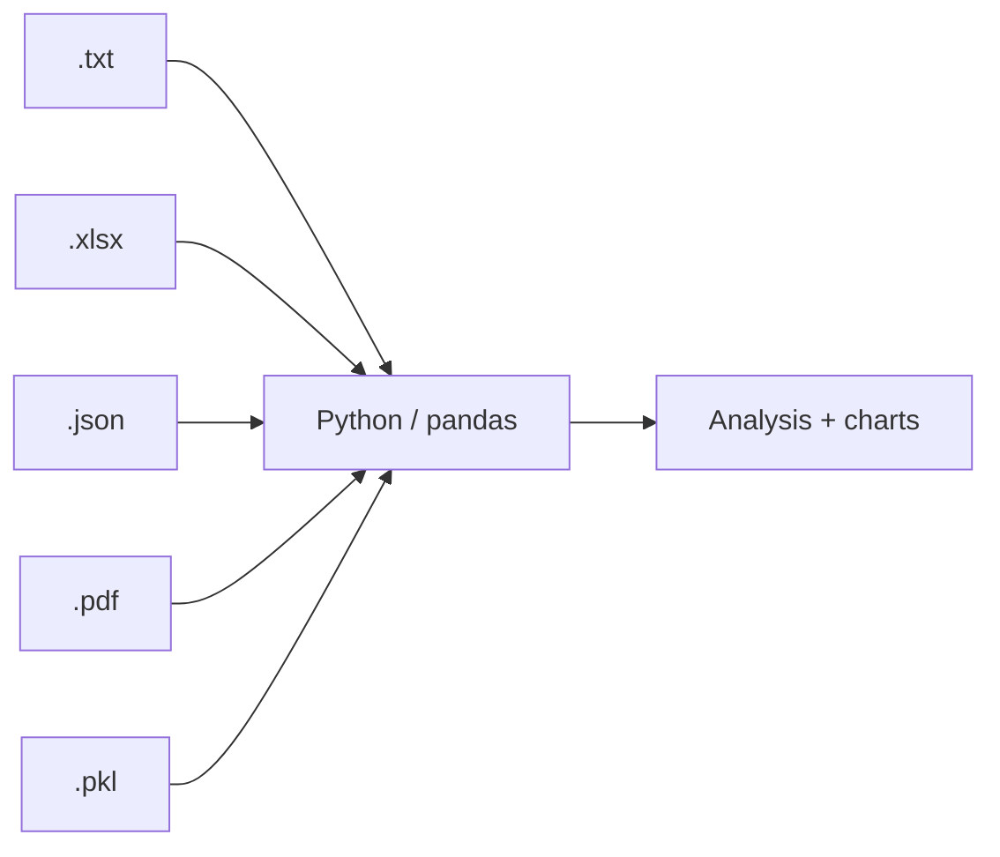

# Session 07: Handling Different File Formats

> Module: Data Science with Python · Term 5 (ADSE) · ⏱ ~2 hours

Data reaches you in many shapes: a text log from a server, a PDF invoice, an Excel sheet from the accounts office, JSON from a web API, or a Python object you saved last week. A data scientist must be comfortable opening all of them. In this session you read and write **text, PDF, Excel, JSON and pickle** files from Python.

## 🎯 Learning Objectives

By the end of this session you will be able to:

- Read, write and append plain text files safely with `with open(...)`
- Create a simple PDF and extract text from a PDF with `pypdf`
- Write several DataFrames into one Excel workbook and read sheets back
- Convert between Python objects, JSON text and JSON files, and flatten JSON into a DataFrame
- Save and load Python objects with `pickle`, and know when it is unsafe

## 📖 Concepts Explained

### 1. Choosing the right format

| Format | Extension | Human readable? | Typical source | Python tool |
|--------|-----------|-----------------|----------------|-------------|
| Plain text | `.txt`, `.log` | yes | logs, notes | built-in `open()` |
| CSV | `.csv` | yes | exports, datasets | `pd.read_csv` (Session 04) |
| PDF | `.pdf` | on screen only | reports, invoices | `pypdf` |
| Excel | `.xlsx` | in Excel | offices, finance | `pd.read_excel` + `openpyxl` |
| JSON | `.json` | yes | web APIs, MongoDB, configs | `json`, `pd.read_json` |
| Pickle | `.pkl` | no (binary) | your own saved objects/models | `pickle`, `pd.read_pickle` |



### 2. Text files

Always use `with open(...) as file:`; it closes the file automatically, even if an error happens.

| Mode | Meaning |
|------|---------|
| `"r"` | read (default) |
| `"w"` | write: creates the file or **erases** old content |
| `"a"` | append: adds to the end |
| `"rb"` / `"wb"` | read / write binary (pickle, images) |

Add `encoding="utf-8"` so Urdu names and special characters are handled correctly.

### 3. PDF files

A PDF is designed for printing, not for data, so extracting text is "best effort": spacing may be odd and tables come out as plain lines. `PdfReader("file.pdf").pages` gives each page, and `page.extract_text()` returns its text. For scanned PDFs (photos of paper) you would need OCR, which is beyond this session. In our example we even *create* a PDF using Matplotlib's `savefig("report.pdf")`.

### 4. Excel files

pandas reads and writes `.xlsx` through the `openpyxl` engine (`pip install openpyxl`).

- `df.to_excel("file.xlsx", sheet_name="Marks", index=False)` writes one sheet.
- `pd.ExcelWriter` lets you write several sheets into one workbook.
- `pd.read_excel(path, sheet_name="Marks")` reads one sheet; `sheet_name=None` reads all sheets into a dictionary.

### 5. JSON

JSON (JavaScript Object Notation) looks almost exactly like Python dictionaries and lists. It is the language of web APIs.

| Function | Direction |
|----------|-----------|
| `json.dump(obj, file)` | Python → JSON **file** |
| `json.load(file)` | JSON file → Python |
| `json.dumps(obj)` | Python → JSON **string** |
| `json.loads(text)` | JSON string → Python |
| `pd.json_normalize(data, record_path=...)` | nested JSON → flat DataFrame |

Note that Python `True` becomes JSON `true`, and `None` becomes `null`.

### 6. Pickle

Pickle saves almost **any** Python object (dictionaries, DataFrames, trained ML models) in a binary file, so you can load it later exactly as it was. Two warnings:

- **Security:** loading a pickle can run hidden code. Only open pickles you made or fully trust.
- **Compatibility:** pickles may not load in very different Python or library versions. Use CSV/JSON for sharing data with others.

## 💻 Code Examples

Run each script inside this folder; the files it creates (notes.txt, report.pdf, class_data.xlsx, course.json, objects.pkl) appear next to it.

### Example 1: Text files

File: [`text_files.py`](./text_files.py)

```python
# text_files.py - write, append and read plain text (.txt) files

# 1. Write (mode "w" creates the file or replaces old content)
with open("notes.txt", "w", encoding="utf-8") as file:
    file.write("Data Science notes\n")
    file.write("NumPy is for arrays\n")

# 2. Append (mode "a" adds to the end)
with open("notes.txt", "a", encoding="utf-8") as file:
    file.write("pandas is for tables\n")

# 3. Read everything at once
with open("notes.txt", "r", encoding="utf-8") as file:
    content = file.read()
print("Whole file:\n" + content)

# 4. Read line by line (good for big files)
with open("notes.txt", encoding="utf-8") as file:
    for number, line in enumerate(file, start=1):
        print(number, line.strip())     # strip() removes the newline

# 5. Count words in the file
words = content.split()
print("\nWord count:", len(words))
```

**How it works:** `"w"` creates the file, `"a"` adds one more line, `read()` returns everything as one string, and looping over the file gives one line at a time. `enumerate(..., start=1)` numbers the lines.

### Example 2: PDF files

File: [`pdf_files.py`](./pdf_files.py)

```python
# pdf_files.py - create a simple PDF, then read its text back
# Install: pip install pypdf matplotlib
import matplotlib
matplotlib.use("Agg")
import matplotlib.pyplot as plt
from pypdf import PdfReader

# --- Part 1: WRITE a one-page PDF report using Matplotlib ---
fig = plt.figure(figsize=(8.27, 11.69))          # A4 size in inches
fig.text(0.1, 0.9, "Monthly Sales Report", fontsize=20)
fig.text(0.1, 0.85, "Total sales: Rs 357,500", fontsize=12)
fig.text(0.1, 0.82, "Best city: Karachi", fontsize=12)
fig.savefig("report.pdf")                        # .pdf extension -> PDF file
plt.close(fig)
print("Created report.pdf")

# --- Part 2: READ text from the PDF using pypdf ---
reader = PdfReader("report.pdf")
print("Pages:", len(reader.pages))

for page in reader.pages:
    text = page.extract_text()
    print("Text found:\n", text)

# Find a value inside the text
if "Karachi" in text:
    print("\nThe report mentions Karachi.")
```

**How it works:** Matplotlib places text on an A4 figure and saves it as a PDF. `PdfReader` opens it and `extract_text()` pulls the words back out, so we can search for "Karachi" in the text.

### Example 3: Excel files

File: [`excel_files.py`](./excel_files.py)

```python
# excel_files.py - write and read Excel (.xlsx) files with pandas
# Install: pip install pandas openpyxl
import pandas as pd

marks = pd.DataFrame({
    "name": ["Ayesha", "Bilal", "Hira"],
    "python": [88, 72, 95],
    "stats": [79, 65, 90],
})
fees = pd.DataFrame({
    "name": ["Ayesha", "Bilal", "Hira"],
    "fee_paid": [True, False, True],
})

# Write two DataFrames into two sheets of ONE workbook
with pd.ExcelWriter("class_data.xlsx") as writer:
    marks.to_excel(writer, sheet_name="Marks", index=False)
    fees.to_excel(writer, sheet_name="Fees", index=False)
print("Saved class_data.xlsx")

# Read one sheet back
marks_back = pd.read_excel("class_data.xlsx", sheet_name="Marks")
print("\nMarks sheet:\n", marks_back)

# Read ALL sheets: you get a dictionary {sheet name: DataFrame}
all_sheets = pd.read_excel("class_data.xlsx", sheet_name=None)
print("\nSheet names:", list(all_sheets.keys()))
print(all_sheets["Fees"])
```

**How it works:** `ExcelWriter` keeps the workbook open while we write two sheets. Reading with `sheet_name=None` returns a dictionary, so `all_sheets["Fees"]` is a DataFrame.

### Example 4: JSON files

File: [`json_files.py`](./json_files.py)

```python
# json_files.py - save and load JSON data (the format of web APIs)
import json
import pandas as pd

# A Python dictionary with a nested list
course = {
    "course": "Data Science with Python",
    "sessions": 18,
    "students": [
        {"name": "Ayesha", "city": "Karachi"},
        {"name": "Bilal", "city": "Lahore"},
    ],
}

# 1. Python -> JSON file
with open("course.json", "w", encoding="utf-8") as file:
    json.dump(course, file, indent=2)    # indent makes it readable
print("Saved course.json")

# 2. JSON file -> Python
with open("course.json", encoding="utf-8") as file:
    data = json.load(file)
print("Course:", data["course"])
print("First student:", data["students"][0]["name"])

# 3. JSON text (string) <-> Python
text = json.dumps({"ok": True, "count": 2})
print("As text:", text)
print("Back to dict:", json.loads(text))

# 4. A list of records -> DataFrame
df = pd.json_normalize(data, record_path="students", meta=["course"])
print("\n", df)
df.to_json("students.json", orient="records", indent=2)
```

**How it works:** `indent=2` makes the file easy to read. `json_normalize` turns the nested `students` list into rows and copies the `course` value onto each row. `to_json(orient="records")` writes a list of row objects.

### Example 5: Pickle files

File: [`pickle_files.py`](./pickle_files.py)

```python
# pickle_files.py - save ANY Python object to a file and load it later
# Only open pickle files you created yourself or fully trust!
import pickle
import pandas as pd

# Some objects we want to keep between runs
settings = {"theme": "dark", "max_rows": 50}
scores = pd.DataFrame({"player": ["Babar", "Rizwan"], "runs": [101, 67]})

# Save (wb = write binary)
with open("objects.pkl", "wb") as file:
    pickle.dump({"settings": settings, "scores": scores}, file)
print("Saved objects.pkl")

# Load (rb = read binary)
with open("objects.pkl", "rb") as file:
    loaded = pickle.load(file)

print("Settings:", loaded["settings"])
print(loaded["scores"])

# pandas has its own shortcut for DataFrames
scores.to_pickle("scores.pkl")
print("\nFrom to_pickle/read_pickle:\n", pd.read_pickle("scores.pkl"))
```

**How it works:** a dictionary holding another dictionary *and* a DataFrame is saved in one step and comes back unchanged. `to_pickle` / `read_pickle` are pandas shortcuts.

## 🧪 Lab Practice

1. Write a script that asks for 3 lines of input with `input()` and appends them to `diary.txt` with today's date (use `datetime.date.today()`).
2. Find any PDF of your own (for example a fee voucher), extract its text and count how many times a chosen word appears.
3. Create an Excel workbook with sheets `Jan` and `Feb` of expenses, read both, join them with `pd.concat` and print the grand total.
4. Download a small JSON from a public API in your browser (for example a weather API), save it, load it and print three values.

## 📝 Assignment

Write `convert_formats.py` that starts with one DataFrame of 10 products and saves it as CSV, Excel, JSON and pickle. Then read each file back, check with `df.equals()` (or by comparing shapes) that the data survived, and print the file size of each with `os.path.getsize()`. Write two lines on which format you would use for sharing and why.

## ❓ Quick Quiz

1. Which open mode erases the old content of a file?
2. Which library and method extract text from a PDF page?
3. What does `pd.read_excel(path, sheet_name=None)` return?
4. What is the difference between `json.dump` and `json.dumps`?
5. Why should you never load a pickle file from an unknown website?

<details>
<summary>Show answers</summary>

1. `"w"`
2. `pypdf`, `page.extract_text()`
3. A dictionary of DataFrames, one per sheet
4. `dump` writes to a file; `dumps` returns a string
5. Loading a pickle can execute malicious code

</details>

## 💼 Interview Questions

1. **Why use `with` to open files?** — It is a context manager that closes the file automatically, even if an exception occurs, avoiding locked or corrupted files.
2. **How would you handle a very large JSON-lines log file?** — Read it line by line (or with `pd.read_json(path, lines=True, chunksize=...)`) instead of loading everything into memory at once.
3. **Pickle vs JSON?** — Pickle stores almost any Python object but is Python-only and unsafe with untrusted data; JSON is text-based, language-independent and safe, but only stores basic types.

## ✅ Summary

- Use `with open()` and the right mode for text; add `encoding="utf-8"`.
- `pypdf` extracts text from PDFs; results are approximate.
- pandas reads and writes Excel sheets via `openpyxl`.
- `json` converts between Python and JSON; `json_normalize` flattens nested data.
- Pickle saves any Python object, but only load pickles you trust.

---

[⬅ Previous](../Session-06-MongoDB-Database-Interaction-with-PyMongo/README.md) · [🏠 Module Home](../README.md) · [Next ➡](../Session-08-Cleaning-Imported-Data/README.md)

Prepared by Zeeshan Abbas · Aptech Learning North Nazimabad
